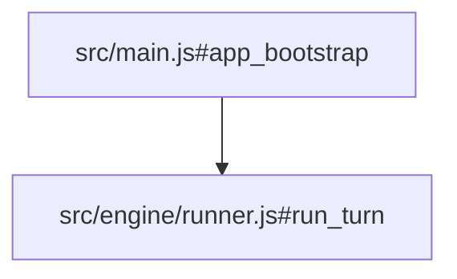

# Codebase Exploration, Budgeting & Architecture Mapping

Read on demand from `graph-it-live` when orienting in an unfamiliar area, tuning `context` token budgets, drilling into architecture layers/cycles, generating human diagrams, or running a structured onboarding tour.

## 1. `context` Token-Budget Strategy

Every CLI call costs a turn and an index load, so size the budget to answer in one call:

1. Pick the budget for the task: `2000` to locate code, `4000-8000` for impact or refactor, `16000` max.
2. On `truncated=true`, stop if the seeds and top-ranked nodes already answer the question.
3. Otherwise narrow the request (`--scope`, `--seeds`, `--relations`, `--depth`) before asking for more tokens.
4. When every result is required (all importers before a refactor, all callers before a deletion), rerun once with `--token-budget 16000`; page with `--cursor <nextCursor>` only if still truncated. Pages never repeat nodes.
5. `--mode search` ranks the entire graph; never page it to the end.

For complete symbol caller/impact lists without cursor loops:

- `graph-it tool query_call_graph --tokenBudget=0` returns all callers in one call (or page via `--offset <nextOffset>`).
- `graph-it tool get_impact_analysis` has no token cap and returns the complete result.

## 2. Progressive Architecture Exploration & Cycles

Use top-down inspection before pulling full file graphs:

```bash
# 1. Workspace units, layers, and dependency matrix
graph-it architecture --level units --format toon
graph-it architecture --folder src --format toon
graph-it architecture --level units --matrix --format toon

# 2. Step-by-step drill-down without dumping the whole graph
graph-it tool explore_architecture
graph-it tool explore_architecture --group=src/engine
graph-it tool explore_architecture --from=src/engine --to=src/state --limit=50

# 3. Validate RPGlitch 6-Rank DAG & no-rank-folder-cycles
graph-it check-architecture --format toon
```

For whole-repo file-level import cycles (remember `[PF-007]`: `cycles <file>` checks only one file):

- Check unit and rank-folder cycles via `graph-it check-architecture --format toon` and `graph-it architecture --level units --matrix --format toon`.
- For intra-folder file cycles (such as mutual store imports), run a Tarjan SCC check over the edges returned by `graph-it architecture --communities louvain --format json`.

## 3. Diagrams & Visual Artifacts for Humans

```bash
# Static script-free SVG with RPGlitch rule violations highlighted
graph-it diagram --format svg --rules --output tmp/architecture.svg

# Raw diagram-spec JSON to pipe into a custom diagramming workflow
graph-it diagram --format diagram-spec --rules --output -

# Full interactive exploration bundle (report.md, SVGs, index.html)
graph-it init --dry-run --format markdown
graph-it init --focus src/engine --output tmp/engine-report

# Mermaid snippets for docs/PRs
graph-it trace src/main.js#app_bootstrap --format mermaid
graph-it path src/main.js --format mermaid
graph-it architecture --groups --format mermaid
```

When handing `diagram-spec` JSON to a diagram workflow, draw only listed nodes and edges and preserve their exact counts. Runtime flows from `graph-it trace` are static analysis, not observed execution.

## 4. Codebase Onboarding Tour Workflow

Run these five steps when asked to tour an unfamiliar area or produce an architectural briefing.

### Step 1: Workspace Overview

```bash
graph-it architecture --level units --format toon
graph-it architecture --folder src --format toon
```

Use `--maxFiles 300` only on very large scopes and note the partial pass in the report if hit. Flag candidate entry points (`main.js`, `App.svelte`, `index.js`) and core folders (`engine`, `simulation`, `state`, `data`, `media`, `utils`).

### Step 2: Identify the 3 Main Entry Points

For up to 5 candidates, inspect both outgoing and incoming edges:

```bash
graph-it explain <file> --format toon
graph-it path-in <file> --format toon
```

Rank candidates:

- High fan-out + 0 fan-in: true root entry point.
- High fan-out + few importers: secondary entry point (script, worker, test harness).
- High fan-in + many exports: shared core, not an entry point.

### Step 3: Locate Core Logic

For candidate core files, run `graph-it summary <file> --format toon` and `graph-it path-in <file> --format toon`:

- Many exports + many importers: core logic (pick top 1-3).
- Many importers + few exports: utility hub.
- Many exports + zero importers: entry point or dead-code candidate.

### Step 4: Find the Most Complex Module

Sample up to 20 representative files by size (or all files if `< 50`) using `graph-it explain <file> --format toon`. Rank by internal call depth and internal cycles (high weight), then exported symbol count, fan-in, and fan-out (medium weight). Optionally run `graph-it query "which module has the deepest call stack and widest impact" --format toon` as a starting hypothesis, then verify with `explain`.

### Step 5: Trace the Critical Path

Run `graph-it trace <entryFile>#<mainFunction> --format mermaid` and paste the output unchanged into the report template below.

### Project Tour Report Template

````markdown
## Project Tour: `<ProjectName>`

### 3 Main Entry Points

| #   | File                   | Role                                      | Type                   |
| --- | ---------------------- | ----------------------------------------- | ---------------------- |
| 1   | `src/main.js`          | Application bootstrap, mounts Svelte root | True entry (0 callers) |
| 2   | `src/App.svelte`       | Root UI shell and layout orchestration    | Called by `main.js`    |
| 3   | `src/engine/runner.js` | Turn simulation heartbeat                 | Core orchestrator      |

### Core Logic

| File                   | Exported Symbols | Referenced By |
| ---------------------- | ---------------- | ------------- |
| `src/engine/runner.js` | 15               | 5 files       |

### Most Complex Module

> `src/engine/runner.js`: 1,206 lines, 15 exports + 8 internals, referenced by 5 files. Run `get_impact_analysis` before modifying.

### Critical Path


````
