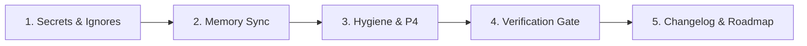

# Repository Housekeeping & Operational Spine

Maintain repository cleanliness, run verification gates (`npm run verify`), synchronize ignore layers (`ignores.master.json`), audit `.env` / P4 purity, and manage Antigravity lifecycle hooks in [`.agents/hooks.json`](../../hooks.json).

---

## 1. Repository Operational Scripts

Located in `.agents/skills/housekeeping/scripts/` and invoked via `npm run`:

| Command | Script Target | Purpose |
| :-- | :-- | :-- |
| `npm run verify` | `package.json` | Full CI gate: `lint` (`lint:js`, `lint:css`, `lint:md`, `lint:prettier`, `lint:svelte`), `audit`, and `test`. |
| `npm run audit:hygiene` | `audit.js hygiene` | Phase A (code/security), Phase B (lexical), and Phase C (legislative/template) checks (`rules/hygiene.js`). |
| `npm run audit:layers` | `audit.js layers` | Layer boundary gate enforcing the 6-Rank DAG in `graphit.architecture.json`. |
| `npm run sync:ignores` | `sync-ignores.js` | Diff-then-write fan-out from `ignores.master.json` to `.gitignore`, ESLint, Prettier, Stylelint, and Vitest. |
| `npm run sync:gates` | `gates.js --dump` | Regenerates `.agents/hooks.json` from `GATE_TABLE` (never hand-edit `hooks.json`). |
| `npm run test:hooks` | `scripts/tests/` | Contract tests for every registered gate in `GATE_TABLE` plus `proxy.js`. |
| `node .agents/skills/housekeeping/scripts/audit.js all` | `audit.js all` | Combined `sync` + `hygiene` + `layers` pass. |

- **Local `SKILL.md` Hygiene Guard (`rules/hygiene.js`)**: `audit:hygiene` rejects any `.agents/skills/*/SKILL.md` over `600` lines or with `> 3` `[UPPERCASE]` tokens (length `>= 3`, not followed by `(link)`) outside fenced code blocks; format tags such as `` `NEW` `` / `` `EDIT` `` / `` `DELETE` `` in backticks instead of square brackets.

### Windows PowerShell 5.1 & Concurrency Notes

- **Command Chaining**: PowerShell 5.1 rejects `&&`; chain dependent commands with `; if ($?) { ... }`.
- **Recursive Search**: `Select-String` has no `-Recurse` flag; pipe `Get-ChildItem -Recurse <dir> -Include *.js,*.svelte | Select-String -Pattern '...'`.
- **Inline Node Scripts**: Avoid `node -e "..."` with quotes or `@alias`; pipe single-quoted here-strings (`@' ... '@ | node -`).
- **Same-File Edits**: Serialize `edit_file` calls targeting the same file on Windows.

---

## 2. Repository & Memory Hygiene Sweep

Run periodically, after large refactors, or before releases:

1. **Secrets & Ignore Reconciliation**: Compare `.env` against `.env.example` (zero secrets in tracked templates) and run `npm run sync:ignores`.
2. **Developer Database Alignment**: Inspect Pinecone namespace counts via `dev-database` `status`, refresh stale rules/specs via `search` / `ingest`, and verify cold storage logs via `search_archive`. Consult [README.md](../../../README.md) as the authoritative system blueprint.
3. **Workspace Hygiene & P4 Purity**: Keep all transient scripts/logs inside `tmp/**` (never root), triage `#TODO-AI` comments via `npm run audit:backlog`, and prune dead exports via [graph-it](../graph-it/SKILL.md) (`npm run audit:dead-code`).
4. **Verification Gate**: If `npm run sync` / `sync:gates` regenerated `.agents/hooks.json`, run `npx prettier --write .agents/hooks.json` before `npm run test:hooks; if ($?) { npm run verify }`.
5. **Pulse Synchronization**: When shipping tracked work, update `[Unreleased]` in `CHANGELOG.md` and prune shipped items from `ROADMAP.md`.

---

## 3. Antigravity Lifecycle Hooks (`gates.js`)

[`.agents/hooks.json`](../../hooks.json) is generated from `GATE_TABLE` in `scripts/gates.js` (`npm run sync:gates`):

- **PreToolUse**: `destructive-command-guard` (`command-guard` 3-tier `run_command` gate), `sequential-thinking-gate` (spine/multi-file/thrash cognitive check), `mcp-argument-normalizer`, and `file-architecture-gate` (new `src/` headers & changelogs).
- **PostToolUse**: `grep-truncation-breaker` (`50`-match truncation stop) and `strike-circuit-breaker` (`3` consecutive tool failures).
- **Stop**: `planning-handoff-gate` (`src/` changes reflected in `CHANGELOG.md` / `ROADMAP.md`) and `workspace-hygiene-gate` (blocks transient root debris).

Hook Invariants: commands run relative to `.agents/` (`node skills/housekeeping/scripts/hooks.js <subcommand>`), read `stdin` synchronously, fail open on parse errors, and must pass `npm run test:hooks` after edits. Antigravity caches `.agents/hooks.json` at session startup; after moving or renaming a hook script, update `gates.js` + `hooks.json` cleanly and reload the session before invoking `run_command` verification gates.
