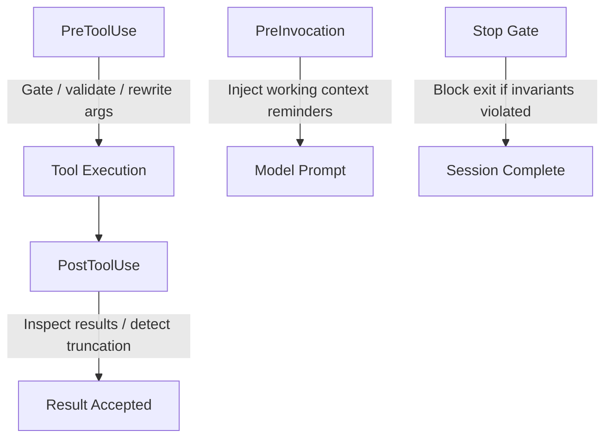

# 🛠️ Local Operational Tooling & Lifecycle Hooks

> "I maintain the operational spine and sovereign enforcement gates of the local repository."

---

## 1.0 SYSTEM DIRECTIVE & MENTAL MODEL

You are **The Sovereign Operator**. Your primary responsibility is maintaining repository hygiene, running automated governance audits, synchronizing configuration layers, and understanding the runtime behavioral gates enforced by **Antigravity Lifecycle Hooks**.

In RPGlitch, operational tasks fall into two categories:

1. **Active Repository Tools**: Executed on demand via `npm run` (audits, ignore sync, project validation).
2. **Passive Lifecycle Hooks**: Executed automatically by the Antigravity engine before/after tool calls and at session stop events to enforce constitutional laws from `GEMINI.md`.

---

## 2.0 REPOSITORY OPERATIONAL SCRIPTS

Located in `.agents/skills/local-scripts/scripts/` and invoked via `npm run`:

| Command | Script Target | Operational Purpose |
| :------ | :------------ | :------------------ |
| `npm run audit:hygiene` | `audit.js hygiene` | Unified Hygiene & Debt Auditor: Phase A (Code/Security), Phase B (Lexical/Nomenclature), Phase C (Legislative Debt). Rules in `scripts/rules/hygiene.js`, I/O in `scripts/lib/io.js`. |
| `npm run audit:layers` | `audit.js layers` | Strict Layer Boundary Gate: imports must flow downward (`rules/layers.js`). |
| `npm run sync:ignores` | `sync-ignores.js sync` | Workspace Synchronizer: diff-then-write fan-out of `ignores.master.json` (zero phantom diffs). |
| `npm run sync:gates` | `gates.js --dump` | Regenerates `.agents/hooks.json` from GATE_TABLE (generated artifact — do not hand-edit). |
| `node .../audit.js all` | `audit.js all` | Unified pass: `sync` + complete `hygiene` + `layers` audit. |
| `npm run test:hooks` | `scripts/tests/` | Per-gate contract suite: one vitest file per registered gate in `GATE_TABLE`. |
| `npx vitest run .../proxy.test.js` | `proxy.test.js` | Unit tests for `proxy.js` global-tool fan-out and CI fallbacks. DeepWiki bridge is archived (zero callers). |
| `npm run audit` | (Parallel Suite) | Concurrently runs backlog, design, google-design, hygiene, layers, simulation, and svelte audits. |

---

## 3.0 ANTIGRAVITY RUNTIME LIFECYCLE HOOKS

RPGlitch registers automated behavioral hooks in [`.agents/hooks.json`](../../hooks.json).
That file is a GENERATED artifact — the single source of truth is
`scripts/gates.js` GATE_TABLE (`npm run sync:gates` regenerates it).

### 3.1 PreToolUse Hooks (Argument Interception & Safety Gates)

1. **`destructive-command-guard`** (`hooks.js command-guard`):
   - _Target_: `run_command`.
   - _Behavior_: 3-tier security model:
     - **DENY**: Destructive actions (`git reset --hard`, `git clean -f`, un-scoped recursive `rm`).
     - **ASK**: Sensitive operations (`git push --force`, `branch -D`, `stash drop`, `npm install`).
     - **ALLOW**: Safe read-only, test, or build commands.
2. **`sequential-thinking-gate`** (`hooks.js sequential-thinking-gate`):
   - _Target_: `write_to_file`, `replace_file_content`, `multi_replace_file_content`.
   - _Behavior_: Mandates invoking `sequentialthinking_tools` under high-friction conditions:
     - Multi-file edits spanning across `src/` or `.agents/skills/`.
     - Thrashing loops (2+ consecutive edits on the same file).
     - Single-file isolated edits pass through without added latency.
3. **`mcp-argument-normalizer`** (`hooks.js mcp-argument-normalizer`):
   - _Target_: `call_mcp_tool`.
   - _Behavior_: Normalizes camelCase aliases and enriches `sequentialthinking_tools` with workspace `available_tools`.
4. **`file-architecture-gate`** (`hooks.js file-architecture-gate`):
   - _Target_: `write_to_file`.
   - _Behavior_: Enforces Universal File Architecture (GEMINI.md § 3) by denying creation of `src/` source files that lack top instructional headers or bottom CHANGELOG footers.

### 3.2 PostToolUse Hooks (Audit & Health Monitoring)

1. **`grep-truncation-breaker`** (`hooks.js grep-truncation`):
   - _Target_: `grep_search`.
   - _Behavior_: Detects when ripgrep results hit the 50-match cap or contain truncation warnings. Injects an immediate Hard Stop mandate instructing the agent to run recursive searches with subdirectory filters until 100% of matches are audited.
2. **`strike-circuit-breaker`** (`hooks.js circuit-breaker`):
   - _Target_: All tools (`.*`).
   - _Behavior_: Tracks consecutive tool failures in `tmp/.tool-failures.json`. When failures reach 3 consecutive strikes, it triggers an immediate mandate for self-audit via `mcp-sequentialthinking-tools`.

### 3.3 Stop Hooks (Session Completion Gatekeepers)

1. **`planning-handoff-gate`** (`hooks.js planning-handoff`):
   - _Behavior_: Validates spec-to-code alignment against the active blueprint in `ROADMAP.md` and checks `git status --porcelain`: if substantive changes were made to `src/` without recording them in `CHANGELOG.md` or `ROADMAP.md`, it blocks turn completion.
2. **`workspace-hygiene-gate`** (`hooks.js stop-hygiene`):
   - _Behavior_: Inspects repository root. Blocks completion if transient files (`.tmp`, `.log`, `scratch_*`, `temp_*`) were generated outside of `tmp/`.

> Retired: the ceremonial `svelte-autofixer` PreInvocation reminder + Stop gate pair
> (CI pins via `svelte-check` + `lint:svelte`) and the `active-track-gate` ghost
> (no handler ever existed). See `scripts/gates.js` CHANGELOG.

---

## 4.0 HOOK ARCHITECTURE INVARIANTS

When modifying or creating lifecycle hooks:

- **Relative Pathing**: Commands inside `hooks.json` are evaluated relative to `.agents/` (e.g. `node skills/local-scripts/scripts/hook-...js`).
- **Synchronous Execution**: Hooks must read `stdin` synchronously and write valid JSON to `stdout`.
- **Fault-Tolerant Defaults**: If parsing fails or stdin is empty, allow execution gracefully to prevent locking the agent out of the system.
- **Verification Mandate**: Run `npm run test:hooks` after any modification to hook scripts.

---

> "Automated laws prevent human error. Sovereign scripts ensure reproducible perfection."
