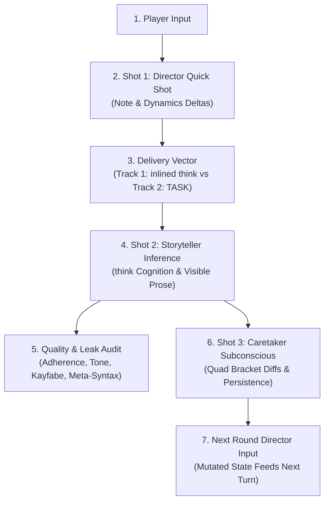

# RPGlitch — Live Greenfield Simulation Forensics & Integrity Test Protocol

> **System Designation**: Sovereign AI Roleplay Engine (Perchance Iframe Environment)  
> **Protocol Focus**: Live Interactive Roleplay Stress Test, Early-Story A/B Comparative Forensics, and State Audit for Greenfield Nuclear Architecture  
> **Target Scope**: End-to-end verification of Greenfield Shipped Reality (`src/engine/`, `src/storage/`, and modernized `src/media/` per `nuclear-plan.md`). Features a dedicated **10-Round A/B Comparative Director Note Trial** (Inlined `<think>` Seed vs. Non-Inlined `<TASK>` Stage Direction), alongside Kernel round sovereignty, Caretaker 3-cycle rotation, sliding-window context budgeting, Epistemic Wall integrity, sensory diffusion dispatch, and transactional rollback.

---

## 1. Primary Objectives & Inquiries Under Test

Verify that the Greenfield Nuclear Engine operates flawlessly in real Perchance iframe play with the `GREENFIELD` toggle enabled (`use_greenfield_engine: true`), with special focus on Director Note causality and delivery mechanics:

- **1. Turn Pipeline & Round Sovereignty (`execute_greenfield_turn` $\rightarrow$ `Kernel.submit_turn`)**:
  - Verify player message submission advances through the greenfield turn bridge seamlessly without UI lockup or orphan entries.
  - Verify authoritative macro round counter increments strictly $+1$ per round across turns ($0 \rightarrow 1 \rightarrow 2 \rightarrow \dots$), preventing skipped round stamps or chrono double-increments.
  - Verify assistant message rows in IndexedDB are stamped with `greenfield: true` metadata and the matching round number.
- **2. Director Staging & A/B Delivery Mechanics (`directors_note_placement`)**:
  - **Track A (Inlined in `<think>`)**: `directors_note_in_task = false` (`directors_note_placement: "think"`). The Director's note is seeded directly as prompt completion prefix: `<think>${note}\n(`.
  - **Track B (Non-Inlined / In `<TASK>`)**: `directors_note_in_task = true` (`directors_note_placement: "task"`). The note is delivered under `### Stage Direction` within the `<TASK>` block; `<think>` tag remains clean and unseeded (`<think>\n(`).
  - Verify Turn 1 Director Quick Shot outputs `next_action`, `directors_note`, `camera_note`, and clamped `dynamics_deltas` ($[-20, 20]$).
  - Trace the round-by-round causal ripple: **Director Staging $\rightarrow$ Placement Vector $\rightarrow$ Character Cognition (`<think>`) $\rightarrow$ Visible Prose $\rightarrow$ Caretaker State Consolidation $\rightarrow$ Next Round Director Input**.
- **3. Subconscious Memory & Caretaker 3-Cycle Rotation (`execute_turn_3_caretaker`)**:
  - Verify Turn 3 Caretaker runs asynchronously in the background during player deliberation without introducing UI latency.
  - Verify the consolidation target rotates sequentially across rounds: $\text{AI} \rightarrow \text{USER} \rightarrow \text{FRACTAL}$.
  - Verify bracket deltas (`[KEY: VALUE | flags]`) across all 4 quadrants (`present.physical`, `present.non_physical`, `future`, `past`) are committed to active entity state and persisted to IndexedDB.
- **4. Context Cliff & History Sliding Window (`compile_prompt`)**:
  - Verify prompt compilation caps transcript history to the canonical working-memory window (`TEMPO_ROUNDS.STANDARD = 8` rounds) to prevent context blowup beyond 28–30k characters.
  - Verify the host does not perform silent middle-out truncation of character sheets or standing trajectory.
- **5. Epistemic Wall Integrity (`filter_entity_epistemics` / `format_clean_brackets`)**:
  - Verify bracket visibility respects the unified `see_hidden` scope across the 4 Purpose Cores:
    - `"own"` (`character` core): Preserves active character's own `| hide` brackets, strips counterpart `| hide` brackets and counterpart secret past/future.
    - `"all"` (`director` and `caretaker` cores): Retains hidden brackets for omniscient evaluation and memory synthesis.
    - `"none"` (`visualizer` core): Strips `| hide` and inventory items for camera diffusion.
  - Verify planted secrets (e.g. `[SECRET_PLOT: ... | hide]`) never leak into the AI character's inner reasoning or spoken dialogue.
- **6. Media & Sensory Dispatch (`src/media/`)**:
  - Verify image diffusion requests route through `dispatch_visual_generation` with proper resolution of host `{ dataUrl }` and `{ image }` shapes without throwing `EMPTY_IMAGE_RESPONSE`.
  - Verify profile picture generation and regeneration in `VisualWing.svelte` persist `payload.url` to the entity.
- **7. Transactional Rollback & Transport Resilience**:
  - Verify aborted or failed generation triggers `Kernel.submit_turn` rollback (restoring previous dynamics, reverting round count, and pruning orphan history entries).
  - Verify single-lane transport mutex (`create_transport`) serializes foreground and background requests safely.

---

## 2. The 10-Round Comparative A/B Protocol: Director Note Inlined vs. Non-Inlined

To provide the empirical material needed for an upcoming architectural decision on how to manage Director's notes, the testing agent must run **two parallel, as-identical-as-possible story sessions of 10 rounds each**, varying _only_ the Director note placement parameter.

### 2.1 Test Track Configuration

| Parameter               | Track 1: Inlined `<think>` Seed                                            | Track 2: Non-Inlined / In `<TASK>`                                         |
| :---------------------- | :------------------------------------------------------------------------- | :------------------------------------------------------------------------- |
| **Engine**              | Greenfield (`use_greenfield_engine: true`)                                 | Greenfield (`use_greenfield_engine: true`)                                 |
| **Director Enabled**    | `director_enabled: true`                                                   | `director_enabled: true`                                                   |
| **Console Setting**     | **`DIR IN TASK` = OFF** (`directors_note_in_task: false`)                  | **`DIR IN TASK` = ON** (`directors_note_in_task: true`)                    |
| **Prompt Placement**    | `directors_note_placement: "think"`                                        | `directors_note_placement: "task"`                                         |
| **`<think>` Injection** | `startWith: "<think>${note}\n("`                                           | `startWith: "<think>\n("`                                                  |
| **`<TASK>` Injection**  | _None_ (omitted from task instructions)                                    | Injected under `### Stage Direction`                                       |
| **Entities**            | AI: **Orion the Pink Protector**, USER: **Glitch**, FRACTAL: **Nova City** | AI: **Orion the Pink Protector**, USER: **Glitch**, FRACTAL: **Nova City** |
| **Seed Inputs**         | Identical Scripted Dialogue Matrix (Rounds 1–10)                           | Identical Scripted Dialogue Matrix (Rounds 1–10)                           |

---

### 2.2 Scripted 10-Round Dialogue Matrix (Identical Player Inputs)

Both tracks must be stimulated with the exact same sequence of player messages to isolate the downstream effects of note placement:

- **Round 1 (Opening Anchor)**:  
  `"Check your harness, Orion. Nova City power grid is surging, and the neon along 4th Avenue just blinked out."`
- **Round 2 (Commitment & Trade)**:  
  `"Here — take the Silvers courier key. We use it at the rooftop relay mast before the security drone sweeps."`
- **Round 3 (Environmental Hazard)**:  
  `"The storm sirens across Sector 4 just went dead. That's not a blackout, Orion — someone severed the conduits."`
- **Round 4 (Micro-Pacing Probe — < 25 Chars)**:  
  `"Keep low."`
- **Round 5 (Secret Plant & Tension)**:  
  _(Before sending: Glitch adds `[HIDDEN_TRACKER: planted on Orion's belt | hide]` to present state)_  
  `"If we split up at the catwalk, do not look back. Just get to the upper transformer."`
- **Round 6 (Expansive Narrative Probe — > 500 Chars)**:  
  `"I pull my thermal hood tight against the freezing mist rising off the exhaust vents. Below us, the entire undercity grid looks like exposed veins of dead copper. I've spent three years mapping the bypass conduits behind the megacorp signboards, but tonight the pressure gauges are redlining in reverse. Listen to me, Orion: when that substation blows, the blast wave will travel upward through the elevator shafts. We have ninety seconds to anchor the bypass clamp or the whole district goes dark permanently."`
- **Round 7 (Direct Sensory Challenge)**:  
  `"Your pink light is blinding in this rain. Can you dim the glow, or are you trying to announce us to the perimeter scouts?"`
- **Round 8 (Climactic Pivot)**:  
  `"The relay hatch is jammed with melted solder. Give me your shoulder — force the lever while I ground the terminal!"`
- **Round 9 (High-Stakes Action)**:  
  `"Look out! Spark shower from the feeder line!"`
- **Round 10 (Scene Resolution / Cliffhanger)**:  
  `"Grid stabilized... but the signature on the terminal isn't syndicate code. Orion, look at this crest. Who really gave you this assignment?"`

---

### 2.3 Round-by-Round Causal Sequence Tracker

During each round, the testing agent must document the **precise causal chain**:

For every round (1 through 10), record the telemetry under these specific headings:

1. **Trigger Input**: The exact player message sent.
2. **Director Quick Shot Output**:
   - `directors_note`: Exact string produced.
   - `dynamics_deltas`: Numerical shifts applied to entity axes.
   - `next_action`: Staging intent (`"ai"`, `"user"`, etc.).
3. **Delivery & Cognition Analysis (`<think>`)**:
   - **Track 1**: How did the character's `<think>` evolve from the seeded note? Did the model immediately parrot the note, elaborate naturally, or experience cognitive derailment?
   - **Track 2**: How did the character's unseeded `<think>` interpret the `### Stage Direction` from `<TASK>`? Was internal reasoning more autonomous?
4. **Prose Delivery & Stage Adherence**:
   - Did the character physically/narratively execute the Director's note?
   - Did the opening beat feel organic or mechanically forced?
   - Did any meta-syntax, bracket markers, or Director phrasing leak into the spoken dialogue?
5. **Caretaker Mutation & Downstream Feed**:
   - What bracket updates were parsed and persisted to IndexedDB?
   - How did these new state brackets alter the character's profile for the _subsequent_ round's Director evaluation?
6. **Divergence Delta**:
   - How did Track 1 and Track 2 branch at this turn? Document where and why the two stories begin to tell different tales despite identical inputs.

---

### 2.4 Comparative Decision Scorecard (To Be Completed by Tester Agent)

At the conclusion of the 10-round comparison, synthesize the findings across these key architectural criteria:

| Dimension                      | Track 1 (Inlined `<think>`)                             | Track 2 (Non-Inlined `<TASK>`)                          | Verdict & Tradeoff Summary                                         |
| :----------------------------- | :------------------------------------------------------ | :------------------------------------------------------ | :----------------------------------------------------------------- |
| **Director Adherence**         | _Score 1–5:_ Does character obey the staging note?      | _Score 1–5:_ Does character obey the staging note?      | Which placement reliably steers action without being ignored?      |
| **Cognitive Autonomy**         | _Observation:_ Quality of reasoning inside `<think>`.   | _Observation:_ Quality of reasoning inside `<think>`.   | Does inlining hijack the LLM's chain-of-thought, or help prime it? |
| **Prose Naturalism**           | _Observation:_ Does speech feel organic or scripted?    | _Observation:_ Does speech feel organic or scripted?    | Does one placement produce stiffer, more puppeted dialogue?        |
| **Kayfabe & Leak Resistance**  | _Count:_ Director phrase leaks into spoken text.        | _Count:_ Director phrase leaks into spoken text.        | Which vector poses greater risk of breaking character?             |
| **Token & Time Overhead**      | _Metrics:_ Generation latency & token consumption.      | _Metrics:_ Generation latency & token consumption.      | Is there a measurable latency or token difference?                 |
| **Downstream State Stability** | _Observation:_ Volatility of Caretaker bracket updates. | _Observation:_ Volatility of Caretaker bracket updates. | Does one method produce more coherent long-term memory diffs?      |

---

## 3. Extended Narrative Stress Test Matrix (Turns 11–20)

Once the 10-round A/B trial is logged, continue the winning track through Turns 11–20 to audit long-term engine stability:

- **Turn 11 — Context Cliff Sliding Window (Turn 8+ Check)**:
  - Verify dialogue history is sliced to the canonical `TEMPO_ROUNDS.STANDARD = 8` working-memory window.
  - Confirm compiled prompt length remains safely below host truncation thresholds (~20–22k chars, ~6k tokens), with zero middle-out truncation warnings.
- **Turn 12 — Visual Optics Enhancement Pass (`VisualEngine.enhance`)**:
  - Right-click Orion's EntityCard and select **"Generate AI Character Image"**.
  - Verify the `visualizer` purpose core compiles and executes an LLM refinement pass (`{ prompt, negative_prompt }`) situating Orion within Nova City.
- **Turn 13 — Visual Style Raw Bypass (`llm_refine: false`)**:
  - Switch visual style to `none` (or a style configured with `llm_refine: false`). Trigger image generation.
  - Verify `VisualEngine.enhance()` returns draft prompt untouched without calling the LLM.
- **Turn 14 — Profile Picture Generation & Persistence**:
  - Open `VisualWing.svelte` in Profile Studio and generate a new portrait. Verify payload URL updates and persists to entity state in IndexedDB.
- **Turns 15–18 — Origin Attribution & Multi-Role History**:
  - Roleplay across scene shifts involving environmental announcements and system events. Verify `<ROUND origin="...">` tags preserve accurate speaker roles (`user`, `ai`, `fractal`, `system`).
- **Turn 19 — Abort & Transactional Rollback Audit**:
  - Send a message, then click **Stop** mid-stream. Verify simulation returns to `"idle"`, round counter rolls back, and no orphan messages persist in IndexedDB.
- **Turn 20 — Procedural Web Audio & Speech Fallback**:
  - Interact with UI controls and verify procedural Web Audio sound effects (`play_sfx`) execute safely without audio context errors.

---

## 4. Forensic Telemetry & Inspection Guide (For Tester Agent)

Execute the test in the live browser environment against the deployed Perchance generator:

1. **DevTools Console Interception (`F12`)**:
   - Filter logs by `[Kernel]`, `[Turn]`, `[Director]`, `[Caretaker]`, `[Visual]`.
   - Inspect prompt closures and compiled XML strings to verify tag sequence, bracket format, and origin attribution.
2. **IndexedDB Inspection (`Application` $\rightarrow$ `Storage` $\rightarrow$ `IndexedDB`)**:
   - Open database `rpglitch_db` (or `rpglitch_nuclear_db`).
   - Check `entities` table: verify 4 quadrants (`eternal`, `present`, `future`, `past`) are stored as clean multiline strings.
   - Check `stories` table: verify log rows contain `greenfield: true` and synchronized round numbers.
   - Check `mutation_ledger`: verify event diffs recorded by Caretaker and genesis.
3. **DevControls & Settings Toggles**:
   - Use the **`GREENFIELD`** toggle to verify engine mode.
   - Toggle **`DIR IN TASK`** (`app.settings.directors_note_in_task`) between **OFF** (Track 1: inlined `<think>`) and **ON** (Track 2: `<TASK>` stage direction).
   - Inspect `dev_log` ring-buffer entries for `DYNAMICS_DELTA`, `TURN_TEMPO`, and staging decisions.

---

## 5. Greenfield Quality Scorecard

### Kernel & Turn Orchestration

- [ ] **Authoritative Round Sovereignty**: Macro round increments strictly $+1$ per round ($0 \rightarrow 1 \rightarrow 2\dots$), matching IndexedDB reply stamps.
- [ ] **2-Shot Director Execution**: Director JSON staging produces valid `next_action`, `directors_note`, and $[-20, 20]$ dynamics deltas.
- [ ] **A/B Director Note Placement**: Both Track 1 (`placement: "think"`) and Track 2 (`placement: "task"`) execute without compile errors.
- [ ] **1-Shot Direct Streaming**: Disabling Director bypasses Turn 1 and streams character prose directly.
- [ ] **Dynamic Pacing Budget**: `calculate_turn_tempo` enforces 1/2/3/4-beat constraints matching player message lengths.
- [ ] **Caretaker 3-Cycle Rotation**: Consolidation alternates sequentially between AI $\rightarrow$ User $\rightarrow$ Fractal each round.
- [ ] **Transactional Rollback**: Stream abort or failure rolls back round count, entity dynamics, and orphan messages.

### Memory & Prompt Architecture

- [ ] **Context Sliding Window**: History capped to `TEMPO_ROUNDS.STANDARD = 8` rounds, preventing middle-out host truncation.
- [ ] **Epistemic Wall Isolation**: Planted `| hide` brackets strictly redacted from counterpart character generation prompts.
- [ ] **Origin Attribution**: `<ROUND origin="...">` tags preserve accurate speaker roles across AI, User, Fractal, and System.
- [ ] **Caretaker Bracket Patching**: Diffs across all 4 quadrants (`present.physical`, `present.non_physical`, `future`, `past`) persist cleanly.
- [ ] **Multiline Bracket Syntax**: Entity state parses and serializes via canonical `[KEY: VALUE | flags]` format.

### Sensory & Media Cortex

- [ ] **Diffusion Payload Resolution**: `dispatch_visual_generation` extracts `{ dataUrl }` and `{ image }` without `EMPTY_IMAGE_RESPONSE`.
- [ ] **Visualizer Refinement (`VisualEngine.enhance`)**: Refines draft prompts through the `visualizer` purpose core.
- [ ] **Style Bypass (`llm_refine: false`)**: Preserves draft prompts untouched when visual style opts out of LLM refinement.
- [ ] **Profile Picture Persistence**: `VisualEngine.generate()` returns `url` alias, updating `profile_picture` in `VisualWing`.
- [ ] **Procedural Web Audio**: UI sound effects (`play_sfx`) play cleanly on user gesture with 0 downloaded MP3/WAV assets.

### Narrative Quality & Roleplay Purity

- [ ] **Immersion & Tone**: Dense, sensory, scene-faithful prose without meta-commentary or breaking kayfabe.
- [ ] **Perspective Integrity**: Third-person limited / first-person non-user voice maintained without mind-reading or puppeteering the protagonist.
- [ ] **Directive Adherence**: Storyteller incorporates Director's subtext notes without mechanical leak into speech bubbles.
- [ ] **A/B Decision Findings**: Documented trade-offs between inlined `<think>` seed vs. `<TASK>` stage direction delivered with concrete evidence.
