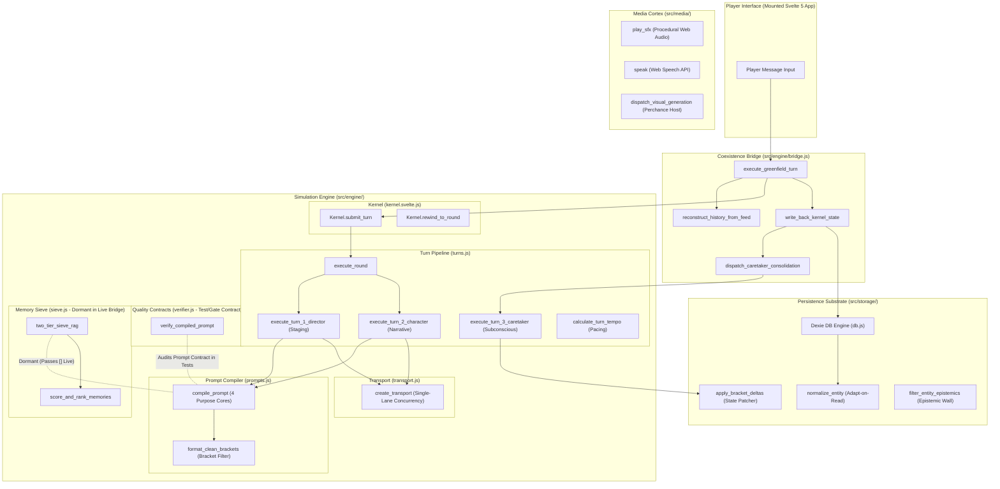

# RPGlitch Greenfield Functionality Report

_AUTHORITATIVE TECHNICAL & PRODUCT SPECIFICATION — Single Source of Truth for the Greenfield Kernel, Persistence Substrates, Media Cortex, and Coexistence Bridge._

---

## Executive Summary

The **Greenfield Architecture** (`src/engine/`, `src/storage/`, and modernized `src/media/`) replaces legacy monolithic orchestration with a headless, reactive, test-driven simulation engine.

Instead of intertwining prompt generation, database transactions, UI rendering, and streaming hooks inside legacy state stores, the Greenfield architecture enforces strict separation of concerns across four primary pillars:

1. **The Simulation Engine (`src/engine/`)**: A pure, reactive Svelte 5 kernel and functional turn orchestrator that executes rounds, compiles prompt packages against tested structural contracts, and schedules director, character, and caretaker passes.
2. **The Persistence Engine (`src/storage/`)**: A unified Dexie.js persistence layer with adapt-on-read entity schemas, deterministic bracket delta patching (`[KEY: VALUE]`), and Epistemic Wall security.
3. **The Sensory Cortex (`src/media/`)**: Stateless, procedural Web Audio synthesis and resilient diffusion image generation with zero heavy WASM or external binary dependencies.
4. **The Coexistence Bridge (`src/engine/bridge.js`)**: An adapter allowing the mounted legacy UI to execute live simulation rounds via the Greenfield Kernel with zero visual regressions.

---

## 1. The Turn Pipeline (Player Message $\rightarrow$ Story Progression)

This pipeline coordinates what happens when a player sends a message, transforming raw input into in-character prose, directorial adjustments, and emotional dynamics.

### `execute_greenfield_turn` (`src/engine/bridge.js`)

- **Role:** The **Front Door**.
- **Product Function:** Connects the legacy UI runtime to the Greenfield Kernel. It adapts active legacy entities into canonical 4-quadrant format, binds streaming callbacks into the UI typewriter store, starts the turn, logs generated assistant messages into IndexedDB, and coordinates state write-backs.
- **Why it matters:** Allows the game to run on the Greenfield Kernel right now without rewriting the UI or breaking existing gameplay loops.

### `Kernel.submit_turn` (`src/engine/kernel.svelte.js`)

- **Role:** The **Macro-Round Controller & Transactional Safety Net**.
- **Product Function:** Accepts player text, sets simulation phase to `"generating"`, increments the authoritative macro round counter, appends the player's message to transcript history, dispatches the turn pipeline, applies emotional dynamics deltas to entities, and appends the final AI reply.
- **Transactional Rollback:** If generation aborts or fails mid-stream, `submit_turn` automatically rolls back the round counter, restores previous entity dynamics for AI, Fractal, and User, and trims the orphan history entry.

### `Kernel.rewind_to_round` (`src/engine/kernel.svelte.js`)

- **Role:** **Time-Travel Scrubbing**.
- **Product Function:** Truncates history down to a target round number and resets macro chronology back to that point, enabling non-destructive narrative branching and state rewinds.

### `execute_round` (`src/engine/turns.js`)

- **Role:** **Two-Shot Stage Director**.
- **Product Function:** Orchestrates the sequence of generation shots within a round. If `director_enabled` is true, it executes Turn 1 (Director Staging) first, extracts the directorial guidance note and emotional shifts, and passes them directly into Turn 2 (Character Narrative). If disabled (1-shot default), it streams character prose directly.

### `execute_turn_1_director` (`src/engine/turns.js`)

- **Role:** **Director Staging Shot**.
- **Product Function:** Performs fast JSON inference to plan the upcoming beat. Outputs:
  1. `next_action`: Who should speak (Main Character, Fractal, or delegated NPC).
  2. `directors_note`: Acting and subtext instruction delivered exclusively to the speaker.
  3. `dynamics_deltas`: Numeric nudges to emotional sliders (`chaos`, `intensity`, `velocity`, `entropy`) clamped strictly to `[-20, 20]`.
  4. `camera_note`: Visual composition prompt for background image diffusion.
- **Resilience:** If the LLM generates malformed JSON, it logs a warning and falls back to a deterministic safe staging baseline without crashing the round.

### `execute_turn_2_character` (`src/engine/turns.js`)

- **Role:** **Storyteller & Prose Streamer**.
- **Product Function:** The primary visible narrative pass. Prefills the character's `<think>` block with the Director's note, guides inner reasoning (Intent, Friction, Subtext, Physical Vector), closes `</think>`, and streams visceral, in-character dialogue and descriptive prose directly to the player.

### `calculate_turn_tempo` (`src/engine/turns.js`)

- **Role:** **Dynamic Pacing Budgeter**.
- **Product Function:** Evaluates the length of the previous message in dialogue history and calculates the allowed beat/sentence budget:
  - **Tiny** (< 25 chars): 1 snappy beat
  - **Small** (< 150 chars): 2 beats
  - **Medium** (< 500 chars): 3 beats
  - **Expansive** ($\ge$ 500 chars): 4 beats
- **Why it matters:** Prevents the AI from writing overwhelming walls of text in response to short player queries, ensuring a dynamic conversational cadence.

### `create_live_stream_fn` (`src/engine/bridge.js`)

- **Role:** **Host Stream Transport Adapter**.
- **Product Function:** Bridges browser host generation APIs (`window.generateText` on Perchance) to the engine. Normalizes instruction payloads (accepting both closures `() => prompt` and raw strings) and includes a deduplication guard to prevent duplicate token rendering if both `onToken` and `onChunk` fire.

---

## 2. Memory & Subconscious Engine (The Story Remembers)

The memory system ensures long-term continuity across turns without blowing through LLM token context limits.

### `execute_turn_3_caretaker` (`src/engine/turns.js`)

- **Role:** **The Subconscious State & Memory Synthesizer**.
- **Product Function:** Operates during player deliberation. Analyzes recent dialogue and extracts state diffs using canonical bracket grammar (`[KEY: VALUE | flags]`):
  - Updates physical and emotional conditions (`present`).
  - Updates standing agendas and narrative trajectory (`future`).
  - Forms new durable factual memories (`past`).

### `resolve_caretaker_target` (`src/engine/turns.js`)

- **Role:** **Round-Robin Cast Selector**.
- **Product Function:** Rotates consolidation targets sequentially across macro rounds:
  $$\text{Target} = \text{Round} \pmod{\text{Cast Length}} \implies \text{AI} \longrightarrow \text{USER} \longrightarrow \text{FRACTAL} \ (\longrightarrow \text{NPC})$$
- **Why it matters:** Ensures every character's state and memory pool evolves evenly without incurring multiple expensive LLM calls per turn.

### `dispatch_caretaker_consolidation` (`src/engine/bridge.js`)

- **Role:** **Zero-Latency Background Worker**.
- **Product Function:** Fires Turn 3 Caretaker consolidation asynchronously in the background. Commits resulting bracket deltas across all 4 quadrants (`present.physical`, `present.non_physical`, `future`, `past`) to active entity state and persists them to IndexedDB without adding any latency to the player's chat reply.

### `reconstruct_history_from_feed` (`src/engine/bridge.js`)

- **Role:** **Multi-Role Context Preserver**.
- **Product Function:** Ingests the visual message feed and normalizes dialogue entries into clean semantic roles (`user`, `model`, `fractal`, `system`) with accurate speaker origin tags (`character_name`), preventing world-events or system anchors from being misattributed to the AI character.

### `compile_prompt` (`src/engine/prompts.js`)

- **Role:** **Unified XML Envelope Compiler**.
- **Product Function:** Constructs the complete prompt envelope for the **4 Purpose Cores** (`director`, `character`, `caretaker`, `visualizer`). Assembles structured XML tags:
  - `<REALITY>`: Baseline world truths and atmosphere from the Fractal.
  - `<CHARACTERS>`: 4-quadrant profile sheets for protagonist and counterpart.
  - `<SCENARIO>`: Present environmental status and physics.
  - `<TRAJECTORY>`: Standing agendas.
  - `<HISTORY>`: Recent transcript with explicit speaker origins (`<ROUND number="..." origin="...">`).
  - `<TASK>`: Purpose core directives and pacing constraints.

### `two_tier_sieve_rag` & `score_and_rank_memories` (`src/engine/sieve.js`)

- **Role:** **Two-Tier Semantic Memory Retrieval (Dormant in Live Bridge)**.
- **Product Function:** An algorithmic memory retrieval pipeline that ranks candidate memories by cosine similarity against an active query vector:
  - **Tier 1 (Guaranteed Floors):** Reserves a baseline character floor for primary participants.
  - **Tier 2 (Semantic Ranking):** Scores memories cleanly as $\text{similarity} \times 1.5$ for canonical items bearing the `is_origin: true` flag (with non-origin items evaluated at raw similarity). Fills the remaining character budget with top-ranked candidates.
- **Current Live Status:** Fully tested and operational in isolation, but **dormant on the live turn path**. `bridge.js` $\rightarrow$ `Kernel.submit_turn` $\rightarrow$ `turns.js` currently passes `memories: []`, meaning the live prompt compiler currently receives zero episodic memories from this pipeline.

---

## 3. Safety, Validation & Quality Gates

Enforces architectural boundaries, defense-in-depth, and state stability before and after every execution.

### `verify_compiled_prompt` (`src/engine/verifier.js`)

- **Role:** **Prompt Structural Contract & Test Gate**.
- **Product Function:** Validates compiled prompt packages against architectural contracts:
  - Verifies closed `<SYSTEM round="..." identity="...">...</SYSTEM>` root envelopes.
  - Checks tag balance and nesting across the prompt string.
  - Confirms mandatory structural tags appear in topological order.
  - Runs prompt hygiene checks to catch unparsed `{{mustache}}` macro leaks (e.g. `{{char}}`, `{{user}}`).
- **Current Live Status:** Operates as a **test-time contract and CI verification gate** (`prompts.test.js`, `differential.test.js`). It is not invoked in the live generation path.

### `write_back_kernel_state` (`src/engine/bridge.js`)

- **Role:** **Transactional State Synchronization**.
- **Product Function:** Takes completed Kernel outcomes and synchronizes in-memory dynamics (`chaos`, `intensity`, `velocity`, `entropy`) to `runtime.active_ai`, `runtime.active_fractal`, and `runtime.active_user`, advances `runtime.round`, and persists all three entities and the story record to IndexedDB via `runtime.save_entity` and `runtime.save`.

### `create_transport` (`src/engine/transport.js`)

- **Role:** **Single-Lane Request Mutex**.
- **Product Function:** Implements a single-lane request queue (`max_concurrency: 1`) with AbortSignal cancellation support. Serializes the requests sharing a transport instance — the foreground player turn and its background caretaker pass — so they never collide or freeze the tab. (Image generation travels a separate media path and is outside this mutex.)

### `parse_bracket_token`, `parse_brackets`, `apply_bracket_deltas` (`src/storage/parser.js`)

- **Role:** **Pseudo-JSON State Parser & Delta Patcher**.
- **Product Function:** Parses `[KEY: VALUE | flags]` bracket tokens while safely preserving pipe delimiters inside alternation scopes (`{Option A | Option B}`). Merges incoming updates:
  - Overwrites existing single-value keys.
  - Appends multi-item collections (`INVENTORY`, `STASH`).
  - Deletes cleared keys when value is `"none"` or `"cleared"`.

### `format_clean_brackets` (`src/engine/parser.js`) & `filter_entity_epistemics` (`src/storage/entities.js`)

- **Role:** **Epistemic Wall & Bracket Filter**.
- **Product Function:** Governs visibility across the Epistemic Wall.
  - `compile_prompt` directly invokes `format_clean_brackets` inline when assembling character and scenario blocks, redacting hidden tags (`| hide`) and counterpart items depending on the purpose core's visibility scope (`"all"`, `"own"`, or `"none"`).
  - `filter_entity_epistemics` provides the full-entity adaptation utility in the persistence substrate, stripping invisible brackets across whole entity objects when needed.

### `normalize_entity` (`src/storage/entities.js`)

- **Role:** **Adapt-on-Read Normalizer**.
- **Product Function:** Automatically migrates old, legacy entity database rows into the modern 4-quadrant format (`eternal`, `present`, `future`, `past`) in memory upon retrieval, ensuring forward compatibility without database corruption.

### `dev_log` (`src/engine/dev.svelte.js`)

- **Role:** **Telemetry Flight Recorder**.
- **Product Function:** A ring-buffered diagnostic recorder capturing events (`DYNAMICS_DELTA`, `TURN_TEMPO`, `ERROR`) with millisecond timestamps for DevMode inspection.

---

## 4. Sensory & Media Cortex (`src/media/`)

Stateless, lightweight audiovisual generators replacing former heavy multi-megabyte dependencies.

### `play_sfx` (`src/media/audio.js`)

- **Role:** **Zero-Asset Audio Synthesizer**.
- **Product Function:** Generates immediate UI sound effects (`click`, `pop`, `glitch`, `alert`, `subtle_hum`) on direct user gestures using native browser Web Audio oscillators and gain envelopes. Requires 0 downloaded MP3/WAV assets.

### `speak` (`src/media/audio.js`)

- **Role:** **Zero-Dependency Speech Engine**.
- **Product Function:** Provides text-to-speech voicing using the native browser Web Speech API (`speechSynthesis`), replacing the retired 40MB Kokoro WASM speech model.

### `dispatch_visual_generation` (`src/media/visual.js`)

- **Role:** **Resilient Diffusion Gateway**.
- **Product Function:** Coordinates image generation requests to host Perchance diffusion plugins. Features exponential backoff retries (2500ms initial) for rate-limit protection, AbortSignal cancellation, and offline SVG fallback generation.

---

## 5. Architectural Invariants & Key Interplays

1. **Kernel Round Sovereignty:**
   The `Kernel` in `src/engine/` is the single source of truth for round advancement (`this.round += 1`). Chrono does not pre-increment the round counter on greenfield turns, preventing skipped round counts and out-of-sync tempo calculations.
2. **Round-Driven Caretaker Cadence:**
   The macro round counter directly determines which entity is targeted for background consolidation. Stable, sequential round increments (`1, 2, 3, 4...`) guarantee predictable rotation across the cast.
3. **Decoupled Coexistence:**
   The Greenfield Kernel (`src/engine/`) has **zero upward dependencies** on legacy state or UI components (`src/state/`, `src/ui/`, `src/intelligence/`). All coordination with the current frontend flows strictly through `src/engine/bridge.js`, which can be toggled via the `GREENFIELD` console switch at runtime.
4. **Pre-Beta Purity (P4):**
   No backwards-compatibility shims, legacy aliases, or deprecated wrappers exist inside `src/engine/` or `src/storage/`. Legacy data rows are adapted on-read at the storage boundary.

---

## Greenfield Live Test Report — HEAD `bee4244` (vault bundle ≥ bee4244)

Date: 2026-11-06. Method: live preview driven via UI + `generate_text` prompt interception (core/length/origins per call), IndexedDB reads after every turn, screenshots. No LLM cap. All destructive actions allowed; test story left in DB.

Cast (premade, untouched): AI **Orion the Pink Protector**, USER **Glitch**, FRACTAL **Nova City**. Settings: `use_greenfield_engine: true`, `director_enabled: true` (2-shot focus), dev_mode on. 8 greenfield turns + 1 legacy turn + 1 retry attempt. ~30 generation calls observed.

## Feature verdicts

| Feature                                | Verdict                                                                                                                                                                                                                                                                                                                                          |
| -------------------------------------- | ------------------------------------------------------------------------------------------------------------------------------------------------------------------------------------------------------------------------------------------------------------------------------------------------------------------------------------------------ |
| Turn pipeline (send → reply → persist) | **PASS.** 8/8 greenfield turns completed, replies persisted with `greenfield: true` meta, feed renders with avatars + Thoughts blocks.                                                                                                                                                                                                           |
| 2-shot director                        | **PASS.** Director JSON fired every turn (17–28k chars), dynamics deltas applied (Orion chaos 59/+2, intensity 61/+5 …; Glitch chaos 52, intensity 44 …).                                                                                                                                                                                        |
| 1-shot (director off)                  | **PASS.** Character + caretaker only, no director call.                                                                                                                                                                                                                                                                                          |
| Round sovereignty (the audit HIGH)     | **PASS, fixed live.** Rounds advanced 0→1→2…→8, exactly +1/turn on both engines.                                                                                                                                                                                                                                                                 |
| Caretaker rotation + write-back        | **PASS.** Turn 1→Orion (`[SUDDEN_ASCENT…]` appended), turn 2→Glitch (`[EVENT: Glitch offered a Silvers courier key as a toll \| w: 5]`), USER dynamics persisted (52/44/48/56). Turn 3→Fractal: no-op (nothing world-changing happened — correct judgment).                                                                                      |
| Origin attribution                     | **PASS.** `<ROUND origin="…">` correct for SYSTEM/Nova City/Orion/Glitch across all cores.                                                                                                                                                                                                                                                       |
| Tempo                                  | **PASS.** 1/2/3/4-beat budgets observed matching message lengths.                                                                                                                                                                                                                                                                                |
| Sieve / RAG                            | **Dormant, confirmed live.** `memories: 0` on all ~30 calls; bridge→kernel→turns passes `memories: []`. See §"Why not wired" below.                                                                                                                                                                                                              |
| Verifier                               | **Test-gate only, confirmed.** No runtime invocation path exists (nothing imports it outside tests).                                                                                                                                                                                                                                             |
| Epistemic wall                         | **PASS, proven live.** Planted `[SECRET_PLOT: betray Orion at midnight \| hide]` on Glitch: zero occurrences of the key in director, character, AND caretaker prompts. (Open design Q: caretaker can't see hidden items either, so hidden facts are write-only — never consolidated into memory.)                                                |
| Transport abort / orphan retry         | **Inconclusive on stop, PASS on coherence.** Aborted a mid-stream turn: no duplicate user message, no orphan row, round correct, retry ran on the **greenfield** branch (character prompt in greenfield format — the `bee4244` fix works). Whether `stop()` actually killed the stream vs the turn completing anyway could not be distinguished. |
| Profile Studio / dynamics HUD          | **PASS with note.** Gorgeous render, live dynamics (61/65/56/64%). But HUD says "4,009 / 5,000 tokens (77%)" while real compiled prompts average **19.9k chars (~5.9k tokens), max 27k** — under-reports ~2.5× (stale snapshot accounting).                                                                                                      |
| AudioWing voice guard                  | **Code-verified, UI not reached.** "Loading Voices…" string in bundle; no crash opening any profile. No voice-selection UI surfaced in traversal (profile + Audio menu). `speak` never triggered (no reachable control).                                                                                                                         |

## Bugs found (ranked)

1. **HIGH — Retry button totally broken.** `Retry` → `[Regenerate Error] Ei.generate_candidates is not a function`, zero LLM calls, round frozen. Legacy `session_driver.regenerate` path references a function that doesn't exist in this build. Affects both engines. User-visible dead button.
2. **HIGH — Prompt size outgrowing model context.** From turn ~7, compiled prompts hit 28–30k chars vs ~7k-token input budget → host performs **middle-out truncation** (observed twice, plugin warnings). The removed middle can eat character sheets/trajectory/history silently. Grows every turn as history lengthens. Needs prompt budgeting (truncate/summarize history, cap quadrants) — this is the scaling wall for long stories.
3. **MEDIUM — Image diffusion failing.** `EMPTY_IMAGE_RESPONSE` on prologue + beat 14 (background resolution). Static art/avatars render; the diffusion leg is dead against the live host right now.
4. **LOW — Greenfield DB round stamp off-by-one.** Reply rows stamp `round: runtime.round` _before_ write-back bumps it, so turn-N replies are stored as round N−1 (legacy pre-increments, so its stamps align). Cosmetic — feed round labels, nothing structural.
5. **LOW (legacy) — Director `next_action "orion"` rejected**, falls back to AI_CHARACTER. Legacy-side validation strictness; greenfield accepts the raw string. Asymmetry to be aware of, not a crash.

## RP quality (rubric: immersion, perspective, prompt adherence)

**Immersion: A-.** Prose is dense, sensory, and scene-faithful across all 8 turns — ozone, rust, harness straps, neon. Never breaks kayfabe, never mentions mechanics. Consistently advances the physical situation (grab → hoist → carry → sprint → leap) rather than stalling in dialogue.

**Perspective: A.** Orion stays 1st-person throughout, never speaks for or mind-reads Glitch beyond fair inference. No POV slips in 8 turns.

**Prompt adherence: B+ with one real drop.** Highlights: turn 2 picks up BOTH planted hooks (toll/key → "A favor? You're thinking too small"; billboard → "We'll get you to your billboard"). Turn 4 (post-abort) re-engages the mast objective well ("launching forward in a powerhouse sprint"). The miss: **turn 3 acknowledged "higher" physically but dropped the stated purpose** (line-of-sight to relay mast / spoofing plan) — no mast mention in ~1500 chars. Generous reading: himbo dominance overriding the plan is in-character; strict reading: the objective got lost between director note and prose. Recommend spot-checking whether director notes survive into character prose when the user message carries 2+ instructions.

**Legacy comparison (1 turn):** same voice quality, same tempo behavior, lowercase-origin prompt dialect. No RP reason to prefer either engine on prose alone — the differentiator is memory (greenfield caretaker wrote 2 durable memories in 8 turns) vs legacy's continuum path.

Representative (turn 2): _"A favor? You're thinking too small, Glitch!" I hoist him upward… "We'll get you to your billboard," I rumble, "but you're riding with the Protector."_

## Why sieve/verifier aren't wired (Q7) + sizing

- **Sieve (BIG):** ranking needs `item.vector` embeddings, and nothing in the app produces vectors — `extract_memory_candidates` returns text-only candidates, and there is no embedding model wired (config reserves 384-dim `VECTOR_DIMENSIONS`, but no producer). Threading it through = embedding pipeline (model load + backfill over all past brackets + per-turn inference) + budget policy. Defer until the memory story needs scale; the caretaker path covers continuity today.
- **Verifier (SMALL):** one call to `verify_compiled_prompt` inside `compile_prompt` (or bridge) behind a flag + dev_log on failure. Genuinely tiny — recommend doing it now, since prompts are already breaching context and a budget check belongs in the same gate.

## Bottom line

Greenfield is telling a good story and remembering it. Ship-blockers from this session: fix Retry, budget prompt size before long stories silently lobotomize themselves. Everything else is polish.
