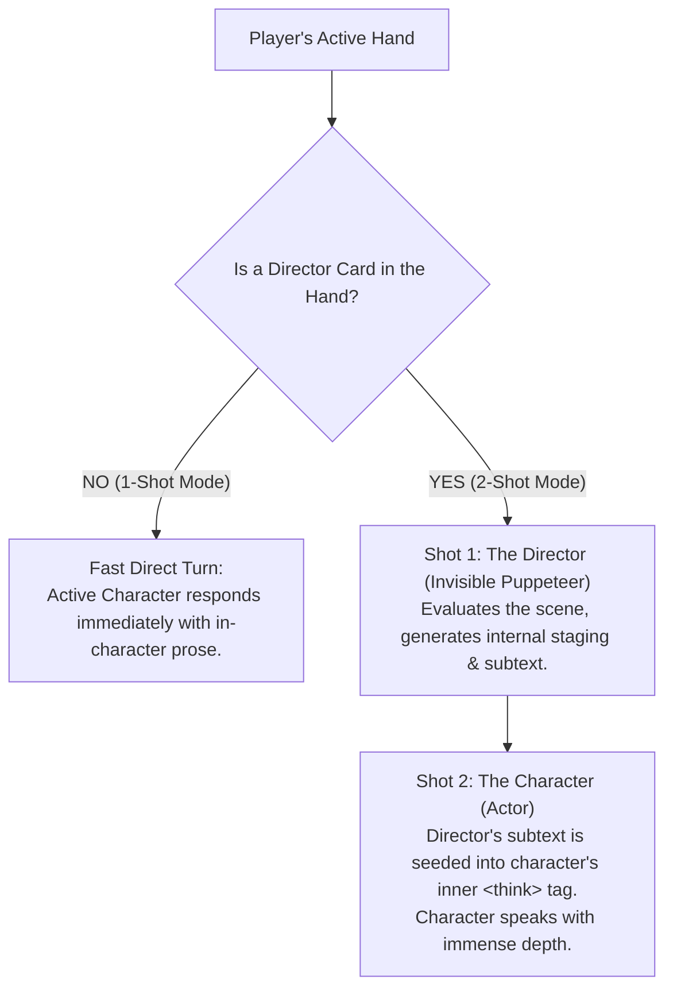

# Product Vision: The Composable Card-Based Roleplay Engine

> *"A story is just a few cards shuffled together on a table. A card can be anything — a character, a location, a challenge, or a director. Slap them down, and the scene begins."*

---

## 1. Executive Summary: What We Are Building

Traditional AI roleplay engines (Chub, Character.ai, JanitorAI, Agnai) treat every story as an isolated 1-on-1 chat bot. They trap authors in 15 fragmented form fields (system prompts, reminder notes, post-history instructions, greeting variants, regex triggers, and lorebooks). 

Earlier iterations of RPGlitch attempted to solve this with heavy mathematical machinery: "quad-partitioned entities", "fractal entities", 40 KB protocol dictionaries, and complex regex veils. This produced cognitive fatigue and architectural spaghetti.

**This engine throws that entire paradigm away.**

Instead, we are building a **Physical Card-Table Engine**. Everything in the story universe is a **Card**. Stories are not hardcoded bot configs; stories are **hands of cards** (from 1 card to 6 cards) drawn from a deck and placed on the table.

```
┌────────────────────────────────────────────────────────────────────────┐
│                              THE TABLE                                 │
│                                                                        │
│   [ 🎴 Greta ]       [ 🎴 Stockholm ]       [ 🎴 Ice Bucket ]          │
│   Character Card      Location Card          Challenge Card            │
│                                                                        │
│         ↳ "The Ice Bucket Challenge in Stockholm with Greta"           │
└────────────────────────────────────────────────────────────────────────┘
```

---

## 2. Core Philosophy & Design Principles

1. **Start at Square One**: Zero legacy baggage, zero pseudo-physics, zero artificial orbital tension.
2. **Extreme Composability**:
   - 1 Card on the table = Classic instant chat.
   - 2 Cards = Defined 1-on-1 RPG (Persona + Character).
   - 3 Cards = Autonomous AI group chat.
   - 4–6 Cards = Dynamic cinematic simulation with locations, obstacles, and world rules.
3. **The Universal Card Substrate**: Every card in the engine shares the exact same base DNA. Special capabilities unlock based on `type`, not through separate database schemas.
4. **Physicality & Tactility**: Interacting with the story feels like manipulating physical cards on a velvet or slate table — dragging, flipping, shuffling, and playing a hand.

---

## 3. The Universal Card Substrate

Every card, regardless of whether it represents a living person, a dark alleyway, or an ancient curse, inherits the identical base structure:

```typescript
interface Card {
  id: string;               // Unique ID: 'card_clara_01'
  name: string;             // Display Title: 'Clara Oswald'
  type: CardType;           // 'character' | 'persona' | 'location' | 'challenge' | 'director' | 'rule'
  image: string;            // Portrait / Visual asset URL
  definition: string;       // The core prose snippet: appearance, tone, atmosphere, or rules
  specs: CardSpecs;         // Modular fields unlocked conditionally by CardType
  created_at: string;
}
```

### Type-Specific Card Specifications

When a card is created or flipped to edit mode, its `type` unlocks distinct specifications:

| Card Type | What It Represents | Unlocked Specifications (`specs`) |
| :--- | :--- | :--- |
| **`character`** *(Most Common)* | Sentient AI entity or NPC | • `first_message`: Opening dialogue/scene hook.<br>• `voice_preset`: TTS timbre.<br>• `brackets`: Public condition & private thoughts/motives. |
| **`persona`** | The human player (or co-op players) | • Purely `name`, `image`, `definition`. Represents the protagonist. |
| **`location`** | Physical setting or room | • `visual_anchor`: Diffusion keywords for image generation.<br>• `brackets`: Weather, hazards, spatial layout. |
| **`challenge`** / **`rule`** | Goals, obstacles, or win/loss stakes | • `brackets`: Objective countdowns, rules of engagement, win/loss triggers. |
| **`director`** *(Special)* | The invisible cinematic puppeteer | • Activates the 2-shot staging dance.<br>• Injects subtext, pacing, and tension into the characters' inner thoughts. |
| **`style`** | Prose voice & camera lens | • Injects literary cadence (e.g. Gritty Noir, Romantic Fantasy, Fast Cyberpunk). |

---

## 4. How the Engine Works: From Hand to Narrative

### The Play Configurations

The user doesn't configure "rooms" or "bot settings"; they simply choose a hand of cards:

- **Configuration A: The Solo Chat (1 Card)**
  - Player plays **`[Sammy]`** (Character Card).
  - Sammy's `first_message` fires. User types a reply. Direct 1-shot interaction.
- **Configuration B: Defined RPG (2 Cards)**
  - Player plays **`[Detective Miles]`** (Persona Card) + **`[The Informant]`** (Character Card).
  - The AI knows who you are without you having to explain yourself.
- **Configuration C: The Party / Group Chat (3 Cards)**
  - Player plays **`[Sammy]`** + **`[Clara]`** + **`[Grimm]`**.
  - Multiple characters interact and banter in the same thread.
- **Configuration D: The Full Scenario (4–6 Cards)**
  - Player plays **`[Greta]`** (Character) + **`[Stockholm]`** (Location) + **`[Ice Bucket]`** (Challenge) + **`[Noir Film]`** (Director).
  - The Director blends the cold Stockholm drizzle and the absurd ice challenge into Greta's dialogue and inner motivation.

---

## 5. The Director Dynamic (1-Shot vs. 2-Shot)

The engine gracefully scales its intelligence based on whether a **Director Card** is on the table:



- **Hidden Puppeteer**: The Director never speaks directly to the user. It operates behind the curtain, manipulating the characters' inner cognition and physical reactions.
- **Pure Option**: If the user wants lightning-fast banter without waiting for two LLM passes, they simply take the Director Card off the table.

---

## 6. Epistemic Isolation: Public vs. Private Brackets

Instead of 40 KB protocol dictionaries and messy regex scanners, entity condition is managed through clean **Public/Private Bracket State**:

```javascript
specs: {
  brackets: {
    // PUBLIC: Shared physical reality visible to all cards & actors
    public: {
      WEAPON: "iron dagger",
      CONDITION: "shivering in the cold"
    },
    // PRIVATE: Visible ONLY to this card's owner and the Director
    private: {
      HIDDEN_POCKET: "stolen brass key",
      MOTIVE: "wants to ditch the player at the next tavern"
    }
  }
}
```

- **Zero Telepathy**: When Character B is generating their response, the engine simply omits Character A's `private` state from B's prompt with a one-line object filter.
- **Zero Regex Acrobatics**: No broken text chunks or fragile string tags.

---

## 7. The User Experience (The Lobby & The Game)

### 1. The Lobby (The Deck & The Hand)
- A smooth, tactile interface displaying your collection of cards.
- **Card Hand Tray**: Slots where you place 1 to 6 cards.
- **Shuffle & Draw**: Quick randomizer to roll unexpected card combinations (e.g. random location + random character + random challenge).
- **Inspect / Edit**: Click any card to flip it over into its dossier view.

### 2. The Game Screen (The Stage)
- **Top Card Dock**: The active hand of cards sits pinned in a tactile dock at the top of the screen.
- **Active Dialogue Feed**: Cinematic, clean message stream highlighting character dialogue, sensory narration, and optional collapsible thoughts.
- **Input Bar**: Direct player response authoring.

---

## 8. Summary Comparison: Old vs. New

| Dimension | Legacy / Traditional Approach | The Composable Card Engine |
| :--- | :--- | :--- |
| **Model** | Static, monolithic Character Sheet (15 textboxes) | Universal Composable Cards (`{ name, type, image, definition, specs }`) |
| **Entities** | Rigid split: 1 User, 1 AI Character, 1 "Fractal" World | Arbitrary hand of 1 to 6 cards of any type |
| **Scene Setup** | Complex scenarios written into one massive prompt | Slap down a Character + a Location + a Challenge |
| **Intelligence** | Permanent complex 3-turn state machine | Dynamic 1-shot banter or 2-shot Director staging |
| **Code Footprint** | 170+ files (~1,250 KB of heavy indirection) | ~25 purposeful, lean files (~180 KB) |
| **Mental Model** | Managing database records and protocol dictionaries | Playing cards on a table |

---

> 🎯 **North Star**: When starting from square one, this document serves as the constitutional product vision. We build the single Character Card first, ensure 1-on-1 chat feels magical, and progressively unlock the full card table.
