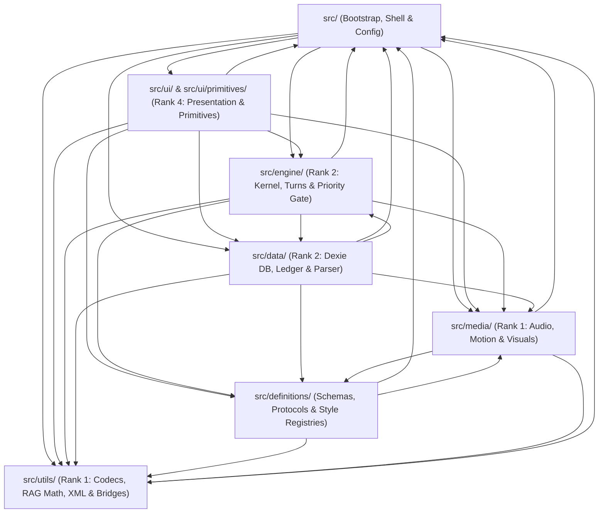

# RPGlitch System Blueprint (Hay)

> **A Simulation-Driven AI Roleplay Engine**  
> _State is Truth. The User is the Protagonist; the Engine is the Physics._

RPGlitch is an offline-capable, local-first web application designed for deep, stateful AI roleplay simulation. Compiled as a single-file portable bundle via Vite 8 (`vite-plugin-singlefile` and `perchanceBase64Vault` in [vite.config.js](./vite.config.js)), it decouples physical/psychological state truth from narrative prose.

- **Visual & Sensory Tokens**: Consult [DESIGN.md](./DESIGN.md).
- **Security & Threat Defense**: Consult [SECURITY.md](./SECURITY.md).
- **Future Engineering & Sprints**: Consult [ROADMAP.md](./ROADMAP.md).
- **Release History**: Consult [CHANGELOG.md](./CHANGELOG.md).

## System Overview

The codebase enforces strict unidirectional dependency flow verified by `npm run audit:layers`. High-level presentation layers depend on core engine and data controllers; lower-level sensory, definition, and utility services never import upward consumers.



### Core Technologies

- **UI & Reactivity**: **Svelte 5 Runes**. State synchronization across `src/App.svelte`, `src/engine/`, `src/data/`, `src/media/`, `src/utils/`, and `src/ui/` is governed exclusively by `$state()`, `$derived()`, and `$effect()`. Legacy store contracts (`writable`, `readable`) and Svelte 4 `$:` reactivity are disallowed.
- **Persistence Engine**: **Dexie.js 4 (IndexedDB)**. Manages structured client-side storage (`"rpglitch"`, schema `version(2)`) for entities, stories, `simulation_log`, `kv_settings`, `sessions`, `audio_prefs`, and the event-sourced `mutation_ledger` in [src/data/db.js](./src/data/db.js). `localStorage` is forbidden.
- **Client-Side Neural Embeddings & Quantization**: Embedded ONNX pipeline in [src/utils/embeddings.svelte.js](./src/utils/embeddings.svelte.js) running `Xenova/all-MiniLM-L6-v2` (384-d vectors) paired with `quantize_vector_q8()` and `dequantize_vector_q8()` in [src/utils/math.js](./src/utils/math.js) under `OnnxMutex` serialization ([src/utils/onnx.js](./src/utils/onnx.js)).
- **Audio & Sensory Output**: Procedural Web Audio SFX and Web Speech API (`window.speechSynthesis`) voice synthesis in [src/media/audio.svelte.js](./src/media/audio.svelte.js), paired with Svelte 5 reduced-motion-aware kinetic physics in [src/media/motion.svelte.js](./src/media/motion.svelte.js).
- **Single-File Bundle Ceiling**: Production builds via [vite.config.js](./vite.config.js) package into a single `dist/index.html` targeting Perchance's 4.00 MB bundle limit.

## Local Interface & Invariants

Root-level manifests configure build tooling, verification gates, and module aliases (`@`, `@ui`, `@primitives`, `@engine`, `@data`, `@media`, `@utils`, `@config`), while direct application entry points live in [src/](./src/README.md):

- **Application Boot & Root Shell**:
  - [src/main.js](./src/main.js): Exposes `app_bootstrap` (`{ async init() }`) and test-only `reset_bootstrap_guard()`. Wires `@utils` `register_state_accessors` and `register_stream_handlers` before seeding premades, reconciling vectors, and mounting `<App />`.
  - [src/App.svelte](./src/App.svelte): Root Svelte 5 shell mounting the atmospheric backdrop, `<ImagePreview />`, persistent 12-column stage (`<Storyboard />` or `<Storymode />` with persistent `<footer>` `<Console />`), `<Profile />`, `<Tooltip />`, and `[data-dev="grid"]`.
  - [src/config.js](./src/config.js): Exports frozen subsystem agreements `TIMING_MS`, `PATIENCE_POLICY`, `DYNAMICS`, `LENGTH_THRESHOLDS`, `IMAGE_RESOLUTIONS`, `EMBEDDING_SPECS`, `TEMPO_ROUNDS`, `CHARS_PER_TOKEN`, `IMAGE_POLICY`, `VOICE_CADENCE`, `CANONICAL_ROLES`, `NARRATOR_ROLES`, `SPEAKING_STYLES`, `TELEMETRY_CAPS`, and `FIELD_FLOORS`.
  - [src/main.pjs](./src/main.pjs) & [src/index.html](./src/index.html): Perchance generator metadata and plugin bindings (`ai-text-plugin`, `text-to-image-plugin`, `super-fetch-plugin`) plus `data-no-vault` `capturePlugins()` polling.
- **Repository Tooling & Gates**:
  - [package.json](./package.json): Defines `dev`, `build`, `verify`, `lint` (`lint:js`, `lint:css`, `lint:md`, `lint:prettier`, `lint:svelte`), `audit` (`audit:backlog`, `audit:design`, `audit:hygiene`, `audit:layers`, `audit:simulation`, `audit:svelte`), `test`, `test:unit`, `test:sync`, `test:hooks`, and `sync` scripts.
  - [vite.config.js](./vite.config.js) & [vitest.config.js](./vitest.config.js): Define `@*` resolve aliases, Vite build plugins (`designTokenSync`, `tailwindcss`, `svelte`, `viteSingleFile`, `perchanceBase64Vault`), and `jsdom` Vitest test discovery.
  - [eslint.config.js](./eslint.config.js), [.markdownlint-cli2.mjs](./.markdownlint-cli2.mjs), & [jsconfig.json](./jsconfig.json): Enforce JS/Svelte/Tailwind/Markdown lint rules and IDE path mappings.

## Subdirectories & System Boundaries

RPGlitch organizes its source code into clean, isolated subsystems:

- [src/](./src/README.md): Application boot entrypoint (`main.js`), root Svelte shell (`App.svelte`), canonical `config.js` constants, and Perchance host integration (`main.pjs`, `index.html`).
- [src/engine/](./src/engine/README.md): Authoritative simulation state kernel (`Kernel`, `RuntimeEngineStore`, `ChronoEngine`, `simulation_state`), 3-turn heartbeat (`turns.js`, `runs.js`), 11-block Spatial State Spine & 4 `PURPOSE_CORES` (`prompts.js`), Two-Tier Sieve RAG (`sieve.js`), structural prompt verifier (`verifier.js`), single-flight LLM priority gate (`gate.js`), and streaming transport (`transport.js`).
- [src/ui/](./src/ui/README.md): Domain presentation layer (`Storymode`, `Storyboard`, `Console`, `Profile`, `VisualWing`, `AudioWing`, `DevWing`, `RelationalGraph`, `ChatBubble`, `EntityCard`, `ImagePreview`, `ContextMenu`, `Typewriter`, `StoryCard`, `MacroText`, `ProfilePicture`, `Dialog`, `UndoToast`) and reactive controllers (`app`, `ProfileState`).
  - [src/ui/primitives/](./src/ui/primitives/README.md): 18 design-system Svelte 5 UI primitives and the global `tooltip` action wrapping `bits-ui`.
- [src/data/](./src/data/README.md): Unified Dexie persistence & `mutation_ledger` replay (`db.js`), 4-quadrant entity normalization & genesis (`entities.js`), bracket parser & epistemic filters (`parser.js`), TavernAI/PNG card conversion (`card-conversion.js`), premades/presets (`presets.js`), `session_driver` (`sessions.svelte.js`), and reactive log stores (`log.svelte.js`).
- [src/definitions/](./src/definitions/README.md): Declarative registries (without an `index.js` barrel) for dynamics rules & protocols (`dynamics-registry.js`), 24 literary narrative styles (`narrative-styles.js`), 4-layer entity taxonomy (`profile-taxonomy.js`), 95 speaking-style & 30 anti-AI detox rules (`speaking-styles.js`), and 26 visual styles (`visual-styles.js`).
- [src/media/](./src/media/README.md): Procedural Web Audio SFX & Web Speech synthesis (`audio.svelte.js`), Svelte 5 kinetic motion & card-flight physics (`motion.svelte.js`), Perchance image dispatch & queue bookkeeping (`visual.svelte.js`), pure optics taxonomy (`optics.js`), and generated design tokens (`palette.js`, `tokens.js`).
- [src/utils/](./src/utils/README.md): Stateless codecs, DOMPurify HTML sanitization & web fetch (`html.js`), deterministic prose detox & slop auditing (`detox.js`, `styles.js`), vector math & CSPRNG (`math.js`), macro expansion (`macros.js`), XML atom rendering (`xml.js`), ONNX MiniLM embeddings (`onnx.js`, `embeddings.svelte.js`), async queues/circuit breakers (`job-queue.js`, `resilience.js`), and decoupled cross-layer registries (`registries.js`).

## Global Invariants

1. **Downward Layer Hierarchy**: Imports flow downward across `src/ui` (Rank 4) → `src/engine` & `src/data` (Rank 2) → `src/media` & `src/utils` (Rank 1), audited by [audit.js](./.agents/skills/local-scripts/scripts/audit.js) (`layers.js`). Cross-layer inversion into `@media` (`set_visualizer_envision_impl`) and `@utils` (`state_bridge`, `stream_bridge`, `stories_bridge`) is registered at boot rather than imported upward.
2. **P1 User Agency**: Never speak, act, or think on behalf of the biological User; non-user entities remain third-person limited.
3. **P4 Zero Backwards Compatibility (Pre-Beta Purity)**: Avoid backwards-compatible fallbacks, legacy aliases, or schema shims; update all downstream consumers directly.
4. **Epistemic Wall & Anti-Telepathy**: Hidden brackets (`| hide`) belonging to non-owner entities are stripped across the Epistemic Wall (`format_clean_brackets`, `filter_epistemic_brackets`, and `see_hidden: "own"` / `"none"` in `PURPOSE_CORES`).
5. **Prompt Catalog & Envelope Gate**: Prompts compiled via `compile_prompt` ([src/engine/prompts.js](./src/engine/prompts.js)) open with `<SYSTEM identity="...">`, close with `</SYSTEM>`, assemble frozen atoms via `render_atom_xml`, and pass `verifier.js` checks (`verify_compiled_prompt`, `verify_tag_balance`, `verify_system_envelope`, `verify_prompt_hygiene`).
6. **Single-Flight LLM Execution**: All LLM jobs flow through [src/engine/gate.js](./src/engine/gate.js) (`max_concurrency: 1`), where `FOREGROUND` (`10`) preempts `BACKGROUND` (`1`) via `AbortController`.
7. **Dexie Schema Freeze & Reload Safety**: IndexedDB `"rpglitch"` remains at schema `version(2)` with single-fire `versionchange` quiesce checkpoints (`save_session_checkpoint`).

## Global Side Effects

- **Client Storage & Globals**: Reads and mutates IndexedDB `"rpglitch"`, `window.sessionStorage`, `window.name`, and `window` bindings (`Dexie`, `DOMPurify`, `app`, `runtime`, `visual`, and Perchance plugin globals).
- **External Network & Host Iframe Integration**: Dispatches LLM generation, image diffusion, and web fetch calls across Perchance host plugin globals; dynamically fetches `@huggingface/transformers@3.5.2` from `esm.sh` (`Xenova/all-MiniLM-L6-v2`) and loads Google Fonts stylesheets in `src/index.html`.
- **Browser Hardware, DOM & Timers**: Instantiates and manages `AudioContext` and `window.speechSynthesis`, attaches `matchMedia`/`pagehide`/`visibilitychange`/`ResizeObserver`/`MutationObserver` listeners, mutates `document.documentElement.style` theme variables and DOM portals, runs Web Animations / `requestAnimationFrame` card flights, and schedules background timers (`TIMING_MS.HEARTBEAT` watchdog, 500ms telemetry flushes, 5000ms undo-delete countdowns).

## System Verification

- **Full Local CI Gate**:

  ```bash
  npm run verify
  ```

  Runs sequentially: `lint` (`lint:js`, `lint:css`, `lint:md`, `lint:prettier`, `lint:svelte`), `audit` (`audit:backlog`, `audit:design`, `audit:hygiene`, `audit:layers`, `audit:simulation`, `audit:svelte`), and `test` (`vitest run`).

- **Test Suite**:

  ```bash
  npm test
  ```

  Runs the full `vitest run` suite across `src/` and `.agents/skills/*/scripts/` (`vitest.config.js` also includes `tests/**/*.test.{js,ts}` if present).

- **Production Single-File Bundle Verification**:

  ```bash
  npm run build
  ```

  Builds `dist/index.html` with `perchanceBase64Vault` asset encapsulation (the 4.00 MB deployment ceiling is verified in `.agents/skills/local-scripts/scripts/deploy.js`).
