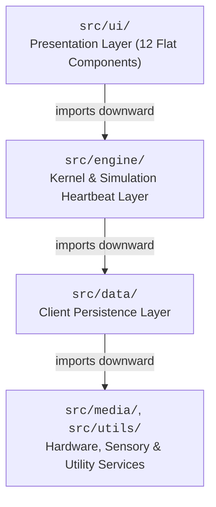

# RPGlitch System Blueprint (Hay)

> **A Simulation-Driven AI Roleplay Engine**  
> _State is Truth. The User is the Protagonist; the Engine is the Physics._

RPGlitch is an offline-capable, local-first web application designed for deep, stateful AI roleplay simulation. Compiled as a single-file portable bundle via Vite 8 (`vite-plugin-singlefile`), it strictly decouples physical/psychological truth from narrative prose.

- **Visual & Sensory Tokens**: Consult [DESIGN.md](DESIGN.md).
- **Security & Threat Defense**: Consult [SECURITY.md](SECURITY.md).
- **Active Demolition & Nuclear Refactor Plan**: Consult [nuclear-plan.md](nuclear-plan.md).
- **Future Engineering & Sprints**: Consult [ROADMAP.md](ROADMAP.md).
- **Release History**: Consult [CHANGELOG.md](CHANGELOG.md).

---

## 1. System Topology & Technology Stack

The codebase enforces strict unidirectional dependency flow. High-level presentation layers depend on core engine controllers; lower-level persistence and utility services never reference upward consumers.



### Core Technologies

- **UI & Reactivity**: **Svelte 5 Runes**. State synchronization is governed exclusively by **$state()**, **$derived()**, and **$effect()**. Legacy store contracts (`writable`) and Svelte 4 reactivity (`$:`) are disallowed.
- **Persistence Engine**: **Dexie.js 4 (IndexedDB)**. Handles structured client-side storage for sessions, entities, environmental models, vector embeddings, and the mutation ledger (`db.mutation_ledger`). `localStorage` is forbidden.
- **Client-Side Neural Inference**:
  - **Transformers.js & 8-Bit Vector Quantization Engine**: Embedded ONNX vector embedding pipeline running a 384-dimensional model (`Xenova/all-MiniLM-L6-v2`) with `quantize_vector_q8()` and `dequantize_vector_q8()` codecs, compressing 32-bit float vector stores to uint8 base64 strings with 75% storage savings and $> 0.99$ cosine similarity preservation.
- **Single-File Bundle Ceiling**: Strict invariant: production bundle must not exceed **4.00 MB** (`MAX_BUNDLE_BYTES`). Realtime TTS is explicitly parked to prevent bundle inflation.

---

## 2. Subdirectories & Architectural Boundaries

RPGlitch organizes its source code into clean, isolated subsystems:

- **[src/engine/](src/engine/README.md)**: Authoritative simulation state kernel, 3-turn heartbeat (`turns.js`), 11-block Spatial Spine & 4 Purpose Cores (`prompts.js`), Two-Tier Sieve RAG (`sieve.js`), and Tag-Inventory Verifier Gate (`verifier.js`).
- **[src/ui/](src/ui/README.md)**: Presentation layer containing 12 flat Svelte 5 domain components (zero nested wrapper subdirectories).
- **[src/data/](src/data/README.md)**: Unified Dexie.js persistence (`db.js`), 4-quadrant entity models (`entities.js`), and starter presets (`presets.js`).
- **[src/media/](src/media/README.md)**: Web Audio SFX (`audio.svelte.js`), Perchance diffusion image synthesis (`visual.svelte.js`), and kinetic spring physics (`motion.js`).
- **[src/utils/](src/utils/README.md)**: Pure stateless codecs, DOMPurify HTML sanitization, 38-rule Tier-1/Tier-2 detox cleaner (`format.js`), vector cosine math (`math.js`), and Mustache interpolation (`macros.js`).

---

## 3. Local Interface & Entry Points (`src/`)

- `src/App.svelte`: Root application container mounting layout shells, modal overlays, storyboards, and feeds.
- `src/main.js`: Client boot entry point, initializing IndexedDB, error hardening, and mounting `App.svelte`.
- `src/config.js`: Honest hardware limits and physical simulation quotas (`PROMPT_CHAR_LIMIT`, `CHARS_PER_TOKEN`, `MAX_ACTIVE_MEMORIES`).
- `src/RPGlitch-left-panel.pjs`: Perchance integration definition file.
- `src/index.html`: Web application HTML host container.

---

## 4. Global Invariants & System Laws

1. **Downward Layer Hierarchy**: Imports flow strictly downward (`src/ui` → `src/engine` → `src/data` → `src/media` & `src/utils`). Upward or circular imports trigger automated CI build failure.
2. **P1 User Agency**: Never speak, act, or think on behalf of the biological User. Maintain strict third-person limited integrity for non-user entities.
3. **P4 Zero Backwards Compatibility (Pre-Beta Purity)**: Never write backwards-compatible fallbacks, legacy aliases, deprecated wrappers, or schema shims. Refactor all downstream consumers immediately.
4. **Epistemic Wall & Anti-Telepathy**: Hidden brackets (`| hide`) belonging to non-owner entities are stripped across the Epistemic Wall in prompt compilation (`see_hidden: "own"`).
5. **Prompt Catalog Grammar Law**: Every prompt atom must be a frozen object `{ tag, body, attrs?, inline? }` compiled exclusively via `render_atom_xml` from `@utils`. Naked strings in prompt catalogs are prohibited.
6. **Tag-Inventory Contract Gate**: All emitted prompts must pass structural verification in `verifier.js` verifying tag balance, ordering, and preventing unclosed `<THINK>` or unescaped control tags.
7. **Single-Concurrency LLM Queue**: All LLM streaming calls pass through `transport.js` enforcing sequential execution (`max_concurrency: 1`).

---

## 5. System Verification

- **Full Local CI Gate**:

  ```bash
  npm test
  ```

  Runs sequentially: `test:unit`, `test:sync`, `test:hooks`.

- **Production Bundle Verification**:

  ```bash
  npm run build
  ```

  Verifies that single-file bundle generation succeeds and remains under the 4.00 MB limit.
