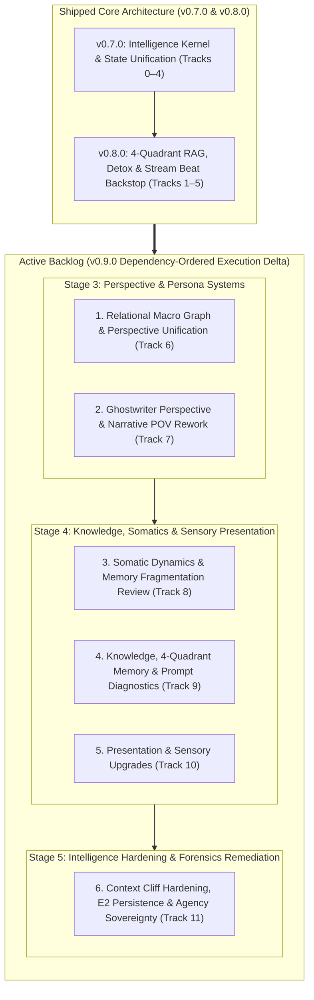

# RPGlitch Technical Roadmap

_WORKING DRAFT (scratch, 2026-10-13) — deconstructed, code-cross-referenced and reassembled from the repo copy. Divergences from upstream are intentional corrections; re-fetch the repo copy before proposing these edits. Code reality pins: workspace src/ @f1d8d645 (226/226 in sync). Evidence anchors: sim/dossier.md finding IDs (F1–F7, E2, M1, L1–L35)._

This roadmap defines the authoritative technical backlog, active engineering sprints, and target architectural blueprints for **RPGlitch**.

- **Temporal Mirror**: `ROADMAP.md` is the **FUTURE mirror** representing exclusively the unbuilt delta between the current state and the desired target state. Completed milestones are recorded in [CHANGELOG.md](CHANGELOG.md) (the **PAST mirror**).
- **Core Specifications**:
  - [README.md](README.md): Strategic product overview, game design, and simulation philosophy.
  - [ARCHITECTURE.md](ARCHITECTURE.md): Authoritative software architecture, layer boundaries, and state reality in `src/`.
  - [DESIGN.md](DESIGN.md): Nordic visual design tokens, typography, and motion contracts.
  - [SECURITY.md](SECURITY.md): Threat defense, input sanitization, and sink controls.
  - [memory-rag-budget-architecture.md](tmp/memory-rag-budget-architecture.md): Sovereign memory RAG, token budget reservoirs, and comprehensive anti-slop specification.
- **Idea Promotion Lifecycle**: Uncommitted mechanical ideas and exploratory proposals incubate in [`.agents/skills/simulation/references/`](.agents/skills/simulation/references/) as `suggestion-*.md`. When an idea is **promoted** from an exploratory possibility into a planned initiative, it is **removed from the incubator and fully migrated into this roadmap**.

---

## 🏛️ Engineering Backlog & Tracks at a Glance

All foundational sprints for Sovereign Engine Core (**Tracks 0 through 4** in v0.7.0, and **Tracks 1 through 5** in v0.8.0) have successfully shipped (recorded in [CHANGELOG.md](CHANGELOG.md)).

Suggested execution order (cross-track dependencies): 6.1–6.2 first (7.3 owner-veil builds on the owner model) → 7.x → 8.2 decision before 8.1 wiring, paired with 11.1 (same memory→prompt pipeline) → 9.x + 10.x anytime → 11.2–11.4 → 11.5 last (it evaluates everything else).

---

## 🚀 Active Engineering Backlog (Target Delta)

Active items are numbered 1–6 for readability; upstream `Track N` IDs stay in parentheses for traceability (CHANGELOG, dossier, code pins). Sub-item numbers (6.1, 7.2, …) are unchanged.

### 1. Relational Macro Graph & Perspective Unification (Track 6)

- **Objective**: Deconstruct and unify entity relational perspectives with role resolution.
- **Code reality**: `_resolve_owner_perspective(owner, entities)` exists and is called in 3 places (`src/utils/macros.js:39,225,278`); `{{me}}`/`{{you}}` display-layer resolution from owner perspective exists WITH tests (`macros.js:214-262`, `macros.test.js:47-50`). NO `RelationalContext` tuple anywhere. Multi-word `@` brackets pervasive in `premade-entities.js` (`@ORION THE PINK PROTECTOR`, `@JULIEN THE BANISHED PRINCE`, `@PROJECT TARTARUS`, `@NOVA CITY`). `<APPEARANCE>` renders via `render_xml_tag` children rows (`sheets.js:348,375,381`) — verbose nested tags, though the `attrs` primitive exists (`sheets.js:357`). `RelationalGraph.svelte` EXISTS and already harvests brackets across eternal/present/past/future (`:96,257-260`) — extension target, not greenfield. No user-configurable entity ID concept (`profile-fields.js` has only dotted field IDs).
- **Problem Diagnosis**: Passing `owner` as a disjointed parameter across dozens of function calls creates fragile coupling; brackets have implicit owners.
- **Key Modules**: `src/utils/macros.js`, `src/intelligence/veil.js`, `src/ui/profile/RelationalGraph.svelte`.
- **Planned Sub-Items**:
  - [ ] **6.1 Unified Relational Context Broker**: Consolidate `owner`, `speaker`, `listener`, and `target` into a single `RelationalContext` tuple `{ me, you, speaker, listener, owner, target }`.
  - [ ] **6.2 Perspective Resolution in Prompt Compilation**: Extend the EXISTING display-layer `{{me}}`/`{{you}}` resolution into prompt assembly via the 6.1 tuple — no new syntax, same semantics, compiler-side.
  - [ ] **6.3 Cross-Quadrant Relational Propagation**: Synchronize relational vectors between `eternal.non_physical` (baseline bonds) and `present.non_physical` (situational dynamics).
  - [ ] **6.4 Entity ID Macro Standard, `@` Scoping & User-Configurable ID**:
    - **`@` Scoping Law**: The `@` prefix is reserved strictly for living/active entities registered within the simulation universe (AI character, user persona, fractal setting, active NPCs, registered factions/items). External cultural, real-world, or general knowledge figures (e.g. "Madonna", "Shakespeare", "Victorian London") do **not** use `@` and rely purely on the LLM's parametric knowledge.
    - **Dual Token Hierarchy**: Concrete `@id` tokens (`@julien`, `@silvers`, `@ashenweald`) represent persistent entities, while contextual role tokens (`@ME`, `@YOU`, `@FRACTAL`, `@USER`, `@CHAR`) dynamically resolve to the active scene participants.
    - **Transition to `@id` Tokens**: Migrate directed relationship brackets and prompt macros from multi-word display names (`@JULIEN THE BANISHED PRINCE`) to strict, canonical entity IDs (`@julien`, `@silvers`, `@ashenweald`). Prevent regex tokenization fragmentation where `@JULIEN` expands into display name while trailing words remain, creating double-name artifacts (`[Julien the Banished Prince THE BANISHED PRINCE]`).
    - **User-Configurable Entity ID**: Enable and guide users in character/persona profile creation and editing to specify their own unique Entity ID alongside their display name (greenfield — no such concept in `profile-fields.js` today).
    - **Strict 1-Word ID Constraint**: Enforce a strict single-word constraint (alphanumeric lowercase slug, 3–12 characters, no spaces or special symbols, e.g., `julien`, `silvers`, `hawk`, `valerius`). Clearly frame this as the entity's functional system ID/handle for macros and relational brackets (avoiding confusing terms like "nickname").
    - **Premade Entity Harmonization**: Clean up directed relational brackets across `src/data/definitions/premade-entities.js` to conform to canonical `@id` syntax and prune cross-genre lore bleeding.
  - [ ] **6.5 Dynamic Character-Length XML Attribute Compaction (`<APPEARANCE>` & Quadrants)**:
    - **Dynamic Length Decision Engine**: Automatically partition bracket values based on character count: values with $\le 40$ characters and no newlines/quotes serialize as container XML attributes (e.g., `gender="male" age="ancient vampire (appears 38)" height="193 cm"`), while values exceeding the threshold automatically promote to nested child tags (e.g., `<SUIT>...</SUIT>`, `<POSTURE>...</POSTURE>`).
    - **Container Architecture**: Apply this to `<APPEARANCE>` and `<STATE>` container elements, terminating with explicit closing tags (`</APPEARANCE>`).
    - **Token & Line Economy**: Eliminates dozens of redundant closing tags while gracefully accommodating long poetic descriptions without manual user formatting.
    - **Pseudo-JSON Purge**: Purge raw `[KEY: value]` bracket dumps inside `<PERSONALITY>`, `<AGENDA>`, `<STATE>`, and `<MEMORIES>` in favor of uniform, well-formed XML elements.
    - **Replay-Safety Constraint**: Compaction MUST preserve the flag-preserving field replay (`ledger.js:193-256`, verified live in dossier T28-29) — compacted rows must round-trip through replay byte-identically.
  - [ ] **6.6 360° Relational Dossier (UI) vs Epistemic Prompt Dispositions (LLM)**:
    - **User-Facing 360° Dossier (extend `RelationalGraph`)**: The harvester already aggregates brackets across all 4 quadrants — build the unified visual relationship card on top (Baseline Bond from `eternal`, Current Dynamic from `present`, Shared Lore from `past`, Trajectory from `future`) plus strict dedup so a bond does NOT appear in both traits and dispositions.
    - **LLM Epistemic Dispositions (Present-Driven Source)**: Sourced primarily from `present.non_physical` (with `eternal.non_physical` fallback for baseline bonds when no present dynamic is specified):
      - `<DISPOSITION target="julien">`: Immediate feelings and relational tension right now in the room.
      - `<MEMORIES>`: Episodic history of past events ("what happened then").
      - `<AGENDA>`: Future trajectory ("what I want from them next").
        Prevents the LLM from conflating past memories with current immediate sentiment.
  - [ ] **6.7 Single-Subject Bracket Key Law**:
    - **Entity-As-Key Rule**: If an agenda item, disposition, or trait is targeted at a specific entity, that entity's `@id` MUST be the bracket key (e.g., `[@tartarus: primary acquisition target for prototype pipelines]`) rather than burying the entity inside a generic noun key (`[EXPANSION: expand ... Project Tartarus ...]`).
    - **Atomic Decomposition**: Enforce 1 bracket = 1 atomic truth. Multi-subject brackets must be decomposed into a general motive bracket and a directed entity bracket. Guide this in UI profile hints and Memory Forge extraction schemas.

---

### 2. Ghostwriter Perspective & Narrative POV Rework (Track 7)

- **Objective**: Rework Ghostwriter prompt compilation and perspective alignment so that user persona drafts match the player's selected POV without constitutional contradictions.
- **Code reality / DECISION CONFLICT**: `task.js:729` records that Track 0.6 deliberately RETIRED `GHOSTWRITE.BASE` — ghost drafts route through merged `CHARACTER.BASE`, a decision that also covers npc turns (`builder.js:896`). Live forensics (dossier T19-20) then proved the merged base contradicts ghostwriting (Beast-POV draft, AGENCY panic). So 7.1 does NOT resurrect the retired directive — it adds a narrowly SCOPED variant that leaves the Track 0.6 merge intact everywhere else. No persona POV setting exists anywhere (`profile-fields.js` has no POV/ID concepts; POV today resolves per-mode via `resolve_pov_protocol(config.system.pov || active_speaker)`). `veil.js` has zero ghostwrite/owner handling — 7.3 is a confirmed gap.
- **Problem Diagnosis**:
  - In `src/intelligence/modules/task.js`, `TASK_LIBRARY.PROSE.CHARACTER.BASE` states: _"Never narrate «USER_PERSONA» in the first person — the player owns their voice, body, and choices."_ In live forensics tests (dossier: T19-20), passing this constraint inside ghostwriting prompts caused the model to panic and author 3rd-person beats for the AI companion rather than drafting for the player.
  - Owner-perspective veil preservation (`veil.js`) was unapplied on the ghostwrite execution path, accidentally dropping the user's own concealed items from their composer draft prompt.
- **Key Modules**: `src/intelligence/prompts.js`, `src/intelligence/modules/task.js`, `src/intelligence/story.js`, `src/ui/console/StorymodeBar.svelte`, `src/intelligence/veil.js`, `src/data/definitions/profile-fields.js`.
- **Planned Sub-Items**:
  - [ ] **7.1 Scoped Ghostwrite Base Directive (additive, ghostwrite-path only)**: Add a dedicated base used SOLELY when `is_ghostwrite` routes — instructing the LLM to draft strictly on behalf of the player without narrating NPC reactions — while `CHARACTER.BASE` keeps governing interaction + npc turns unchanged. Regression gate: npc-turn coverage from the Track 0.6 merge must not shift.
  - [ ] **7.2 Persona POV Setting + Binding (greenfield first)**: ADD a `1st` vs `3rd` person setting to the user-persona profile (no such field exists today), THEN bind it at ghostwrite compile time (`I stepped forward` vs `Benedict stepped forward`).
  - [ ] **7.3 Owner-Perspective Veil Preservation on Ghostwrite Path**: Ensure the player's own `| hide` brackets remain visible to the ghostwrite compiler while staying sealed from third-party AI characters. Builds on the 6.1 owner model.

---

### 3. Somatic Dynamics & Memory Fragmentation Review (Track 8)

- **Objective**: Re-evaluate and wire the dynamics-modulated recall clarity system (`[fragmented recall]` prefix when Chaos/Entropy > 70) in `src/intelligence/temporal.js` into live prompt assembly.
- **Code reality**: `resolve_recall_clarity` (`temporal.js:897`) + `format_hybrid_recall` (`:921`) exist, tested (`temporal.test.js:1273-1286`), exported (`:1439-1440`) — and have ZERO callers outside their own module (no `builder.js` usage). The ONLY in-module call is `:937`, internal plumbing. Dossier L14 confirms zero live firings across 28 rounds at chaos 90–100.
- **Problem Diagnosis**: Exported, unit-tested, never invoked — recall clarity modulation never triggered in live simulation despite extreme stress dynamics.
- **Key Modules**: `src/intelligence/temporal.js`, `src/intelligence/temporal.test.js`, `src/intelligence/builder.js`, `src/data/definitions/profile-fields.js`.
- **Planned Sub-Items**:
  - [ ] **8.2 Recall Modulation Review & Tuning FIRST**: Audit whether prefixing raw `[fragmented recall]` provides desirable narrative impact or causes LLM confusion/hallucinations; evaluate alternatives such as bracket attribute tags (`| hazy`, `| fragmented`), probabilistic recall omission, or noise injection into vector scores. Decision gates 8.1 — do not wire a mechanism under review.
  - [ ] **8.1 Wire Recall Clarity into Builder Pipeline**: Connect the 8.2-winning mechanism to active memory slot compilation in `builder.js`.
  - [ ] **8.3 Grounding in Somatic Physics**: Connect memory clarity directly to live somatic metrics (`GLITCH` / `INSTABILITY` thresholds) rather than synthetic confidence floats.

---

### 4. Knowledge, 4-Quadrant Memory & Prompt Diagnostics (Track 9)

- **Objective**: Deliver comprehensive world knowledge management, semantic 4-Quadrant memory explorer, and prompt token transparency tools.
- **Code reality**: `DevWing.svelte` exists but has ZERO token/budget/bar UI (single match: `variant="bare"`). Both sub-items greenfield UI.
- **Key Modules**: `src/ui/profile/DevWing.svelte`, `src/intelligence/temporal.js`, `src/intelligence/builder.js`.
- **Planned Sub-Items**:
  - [ ] **9.1 "All 4 Quadrants Are Lorebook" Educational Guidance**: Update UI descriptions and docs to teach users how `eternal` + `present` + `past` + `future` form the complete, vectorized world encyclopedia without legacy keyword dumps.
  - [ ] **9.2 Prompt Token Map ("What the Model Sees")**: Visual proportional token bar chart in `DevWing.svelte` showing active allocations (`SYSTEM`, `HISTORY`, `ENTITIES`, `PAST`, `TASK`). Feeds directly into 11.1 budgeting work — build it first and the cap becomes observable.

---

### 5. Presentation & Sensory Upgrades (Track 10)

- **Objective**: Optimize long-session UI performance and sensory capabilities.
- **Code reality**: `Feed.svelte` renders the full `visible_feed` array (`{#each}`, `:262`) — no virtualization inside Feed; the prop name suggests the parent windows, so RECON FIRST where the window happens before building a windower in the wrong layer. `InputBar.svelte` and `GalleryModal.svelte` DO NOT EXIST — 10.2/10.3 are greenfield UI (removed from Key Modules, listed as new files).
- **Key Modules**: `src/ui/message/Feed.svelte`, `src/ui/console/Console.svelte`, `src/ui/console/StorymodeBar.svelte` + NEW `src/ui/message/InputBar.svelte`, NEW `src/ui/gallery/GalleryModal.svelte`.
- **Planned Sub-Items**:
  - [ ] **10.0 Recon**: Trace where `visible_feed` gets windowed upstream of `Feed.svelte`; place the 10.1 windower at the correct layer.
  - [ ] **10.1 Feed Virtualization (Windower for 100+ Turns)**: Implement measured DOM windowing keeping only visible messages mounted, ensuring smooth 60fps scrolling in long roleplays.
  - [ ] **10.2 Slash Command Directing Bar (`/ooc`, `/time`, `/mood`)**: Floating shortcut bar above message input allowing direct Director intervention without polluting in-character dialogue.
  - [ ] **10.3 Persistent Session Image Archive (Gallery Shelf)**: Dedicated gallery modal querying Dexie image attachments across the current story with thumbnail caching.

---

### 6. Intelligence Hardening & Forensics Remediation (Track 11)

- **Objective**: Remediate the architectural vulnerabilities discovered during the 29-round live stress test.
- **Code reality**: `CONTEXT_TOKEN_CLIFF = 6000` lives in `history.js:81` (HISTORY within budget live — dossier T12-14). `calculate_physical_salience` (`temporal.js:1057`) + `whole_vector_slice` (`:1077`) exist, tested, and unwired — except `sheets.js:43` already imports slice (wire-up point ready). `merge_field_content` (`temporal.js:1110`) + consolidation engine (`:1380-1484`) are the REAL E2 sites. `story.js:207` confirms the stagnation diagnosis (`calculate_semantic_drift(input, previous_turn_text)`). `director.js` has NO `USER_PERSONA` death guard (sole match is an unrelated alias comment). CORRECTIONS vs upstream draft: `memory_forge.js` DOES NOT EXIST (forge naming was retired — `render_memory_forge_task` → `render_continuum_task`, `task.js:799`); `src/state/controllers/story.js` DOES NOT EXIST — both removed from targets below.
- **Problem Diagnosis**:
  - `<ENTITIES>` block consumed 21.5k characters (68%–72% of the prompt), blowing past the 6,000-token cliff from Round 4 onward. The engine relied on Perchance's host-level middle-out truncation as a de facto backstop.
  - Memory Forge evicted `| hide` brackets during entity state rewrites (E2 bug), limiting concealed items to a 3-turn lifespan.
  - Stagnation drift compared user input to previous AI reply, preventing natural conversation from ever tripping the Soft Permit (8) or Hard Mandate (16).
  - The Director unilaterally killed the player persona during the Round 28 terminal climax while vetoing an NPC death, violating P1 User Agency.
- **Key Modules**: `src/intelligence/modules/entities.js`, `src/intelligence/modules/sheets.js`, `src/intelligence/temporal.js`, `src/intelligence/story.js`, `src/intelligence/director.js`, `src/intelligence/veil.js`.
- **Planned Sub-Items**:
  - [ ] **11.1 Wire Salience + Slice, Then Cap**: Connect `calculate_physical_salience` and `whole_vector_slice` into sheets scoring (import already at `sheets.js:43`), THEN enforce the ~2,000-token `<ENTITIES>` ceiling with dynamic pruning — so the total prompt stays beneath the cliff by construction, not host truncation.
  - [ ] **11.2 E2 Concealed Bracket Persistence**: Fix `merge_field_content` (`temporal.js:1110`) and the consolidation engine (`:1380-1484`) to preserve `| hide` brackets across passes; cover the veil strip path for other-viewers.
  - [ ] **11.3 Stagnation Drift Recalibration**: Update semantic drift calculation in `story.js` to compare consecutive turns by the same interlocutor (`input[n]` vs `input[n-1]` or `ai_reply[n]` vs `ai_reply[n-1]`), allowing circular dialogue to naturally trip the 8-turn soft permit and 16-turn hard mandate.
  - [ ] **11.4 Climax Sovereignty Calibration**: Constrain the Director's terminal evaluation rules to strictly forbid narrating the death of `«USER_PERSONA»` unless the user's input explicitly declares their own character's destruction.
  - [ ] **11.5 Live Prompt A/B Testing & Evaluation Harness on Perchance**:
    - Build an automated/interactive prompt A/B evaluation harness against Perchance's live endpoint (distinct from `src/tools/harness`, which covers CONTRACT/syntax — the A/B rig measures quality).
    - Track and compare candidate prompt variants across: token budget economy, time-to-first-token (TTFT), `<THINK>` quality, detox compliance (absence of melodramatic slop/puppeting), epistemic adherence, and context truncation resilience across multi-round simulated roleplay conversations.

---

## 🏛️ Master Verification & Auditable Proof Matrix

| Track            | Subsystem / Feature                                   | Target Files                                                                                                                                                                                          | Verification Proof                                                                                                                                                                                                                                                      |
| :--------------- | :---------------------------------------------------- | :---------------------------------------------------------------------------------------------------------------------------------------------------------------------------------------------------- | :---------------------------------------------------------------------------------------------------------------------------------------------------------------------------------------------------------------------------------------------------------------------- |
| **1 (Track 6)**  | **Relational Macro Graph & Perspective Unification**  | `src/utils/macros.js`, `src/intelligence/veil.js`, `src/ui/profile/RelationalGraph.svelte`, `src/data/definitions/premade-entities.js`, `src/intelligence/modules/sheets.js`                          | Unit tests verifying the 6.1 tuple feeds prompt compilation;`{me}`/`{you}` compiler-side tests matching display semantics; tests verifying `@id` token resolution; tests verifying `<APPEARANCE>` attribute compaction WITH replay round-trip; dossier card dedup test. |
| **2 (Track 7)**  | **Ghostwriter Perspective & Narrative POV Rework**    | `src/intelligence/prompts.js`, `src/intelligence/modules/task.js`, `src/intelligence/story.js`, `src/ui/console/StorymodeBar.svelte`, `src/data/definitions/profile-fields.js`                        | Unit test verifying ghostwrite output reflects the persona's 7.2 POV setting via the scoped 7.1 base (no`CHARACTER.BASE` contradiction); npc-turn regression test pinning Track 0.6 merge behavior; owner `&#124; hide` preserved.                                      |
| **3 (Track 8)**  | **Somatic Dynamics & Memory Fragmentation Review**    | `src/intelligence/temporal.js`, `src/intelligence/temporal.test.js`, `src/intelligence/builder.js`                                                                                                    | Unit test verifying the 8.2-winning mechanism is invoked in live prompt compilation and modulates memory tags when Chaos/Entropy > 70.                                                                                                                                  |
| **4 (Track 9)**  | **Knowledge, 4-Quadrant Memory & Prompt Diagnostics** | `src/ui/profile/DevWing.svelte`, `src/intelligence/temporal.js`, `src/intelligence/builder.js`                                                                                                        | UI test validating live token breakdown bar chart in DevWing; educational documentation verified.                                                                                                                                                                       |
| **5 (Track 10)** | **Presentation & Sensory Upgrades**                   | `src/ui/message/Feed.svelte`, `src/ui/console/Console.svelte`, `src/ui/console/StorymodeBar.svelte` (+ NEW `InputBar.svelte`, `GalleryModal.svelte`)                                                  | Performance audit demonstrating smooth 60fps scrolling on 150+ turn chat; gallery modal functional with thumbnail caching.                                                                                                                                              |
| **6 (Track 11)** | **Intelligence Hardening & Forensics Remediation**    | `src/intelligence/modules/entities.js`, `src/intelligence/modules/sheets.js`, `src/intelligence/temporal.js`, `src/intelligence/veil.js`, `src/intelligence/story.js`, `src/intelligence/director.js` | Unit test verifying`<ENTITIES>` block respects 2,000 token cap via wired salience/slice; test verifying `&#124; hide` brackets survive consolidation; live A/B evaluation harness passing on Perchance.                                                                 |

---

## 🏛️ Historical Shipped Milestones

The complete historical specifications, task decompositions, and touchpoint references have been preserved in the archive:

- **[Release Notes (v0.8.0)](CHANGELOG.md#080---2026-10-12)**: Tracks 1 through 5 (4-Quadrant RAG & Dynamic Token Budget Reservoir, Simulation Log Pipeline Harmonization, Anti-Slop Narrative Detox & The Spent Ledger, Scene Momentum & Stagnation Backstop, Runtime Stream Beat Backstop & Continuation `finishTail`, and P4 Purges).
- **[Release Notes (v0.7.0)](CHANGELOG.md#070---2026-10-11)**: Tracks 0 through 4 (Intelligence Kernel Language & Domain Purity, State & Physics Core Unification, Hierarchical Memory & 6k Context Protection, Narrative Pacing & Story Experience, Task Compiler Deconstruction).

---

## 📌 Parking Lot & Tactical Backlog

- **Scattered Tuning Constants (corrected inventory)**: The draft named `config.js` candidates including `DEFAULT_SPENT_WINDOW`/`MAX_SPENT_ITEMS` — but those already live together in `reflex.js:572-573`. The REAL scatter: stagnation trip points inline in `prompts.js:182` (8/16), salience multipliers inline in `temporal.js`, token budgets in `history.js:81+`. Re-evaluate a dedicated tuning surface (`src/intelligence/config.js` or `tuning.js`) against those three sites specifically.
