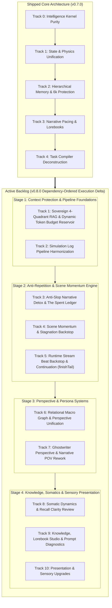

# RPGlitch Technical Roadmap

This roadmap defines the authoritative technical backlog, active engineering sprints, and target architectural blueprints for **RPGlitch**.

- **Temporal Mirror**: `ROADMAP.md` is the **FUTURE mirror** representing exclusively the unbuilt delta between the current state and the desired target state. Completed milestones are recorded in [CHANGELOG.md](CHANGELOG.md) (the **PAST mirror**).
- **Core Specifications**:
  - [README.md](README.md): Strategic product overview, game design, and simulation philosophy.
  - [ARCHITECTURE.md](ARCHITECTURE.md): Authoritative software architecture, layer boundaries, and state reality in `src/`.
  - [DESIGN.md](DESIGN.md): Nordic visual design tokens, typography, and motion contracts.
  - [SECURITY.md](SECURITY.md): Threat defense, input sanitization, and sink controls.
  - [memory-rag-budget-architecture.md](tmp/memory-rag-budget-architecture.md): Sovereign memory RAG, token budget reservoirs, and comprehensive anti-slop specification.
- **Idea Promotion Lifecycle**: Uncommitted mechanical ideas and exploratory proposals incubate in [`.agents/skills/simulation/references/`](.agents/skills/simulation/references/) as `suggestion-*.md`. When an idea is **promoted** from an exploratory possibility into a planned initiative, it is **removed from the incubator and fully migrated into this roadmap**.

---

## 🏛️ Engineering Backlog & Tracks at a Glance

All foundational sprints for the Sovereign Engine Core (**Tracks 0 through 4**) have successfully shipped (recorded in [CHANGELOG.md](CHANGELOG.md)).

---

## 🚀 Active Engineering Backlog (Target Delta)

### Track 1: Sovereign 4-Quadrant RAG & Dynamic Token Budget Reservoir

- **Objective**: Implement the 3-Tier Budget Reservoir and Unified 4-Quadrant RAG from [memory-rag-budget-architecture.md](tmp/memory-rag-budget-architecture.md).
- **Problem Diagnosis**: In live simulations (`forensics-report.md`), the `<ENTITIES>` block alone consumes 72% of the Director prompt and 55% of the interaction prompt, causing Perchance to trigger destructive middle-out prompt truncations that slice entities and history. Vector scoring is isolated to `past`, while `eternal`, `present`, and `future` dump unbudgeted raw text.
- **Key Modules**: `src/intelligence/temporal.js`, `src/intelligence/modules/sheets.js`, `src/intelligence/modules/entities.js`, `src/intelligence/modules/entities.test.js`, `src/intelligence/builder.js`.
- **Planned Sub-Items**:
  - [x] **1.1 Universal 3-Tier Prompt Reservoir**: Allocate ~250 tokens for Tier 1 Core Anchors, ~750 tokens for Tier 2 Scored Reservoir, and ~250 tokens for Tier 3 Contextual Spillover.
  - [x] **1.2 Active Speaker / Target Dynamic Pruning**: Include full detailed sheets strictly for active speaker and target; compress all background cast to terse 1-line summaries.
  - [x] **1.3 The 0.5x Physical Salience Penalty**: Apply a 0.5x scoring penalty to physical descriptor brackets (`CLOTHING`, `HAIR`, `EYES`, `ACCESSORY`) during narrative turns unless cosine similarity $> 0.80$, redirecting $\approx 350$ tokens to memories.
  - [x] **1.4 Whole-Vector Budget Protection**: Enforce bracket-boundary chunking (`temporal.js:421-435`) preventing half-sliced brackets from entering the LLM prompt.
  - [x] **1.5 Unified Field Merger (`merge_field_content`)**: Merge `merge_eternal_field` and `merge_prose_into_field` into a single atomic helper with key-aware replacement and head/tail budget capping.

---

### Track 2: Simulation Log Pipeline Harmonization

- **Objective**: Eliminate redundant conversation log generators and unify simulation history across the engine.
- **Problem Diagnosis**: Conversation history logs are currently generated in at least five divergent places across the codebase:
  1. `src/state/log.svelte.js`: Reactive simulation message log store with filters and round groupings.
  2. `src/intelligence/modules/history.js`: Historical message formatting for LLM prompt compilation (`render_history`, `render_transcript`, token budgeting, role mapping).
  3. `src/utils/story-export.js`: Serializing story history for download/export (JSON, TXT, markdown).
  4. `src/intelligence/builder.js`: Prompt construction querying message arrays and mapping speaker/user turns.
  5. `src/data/db.js`: IndexedDB `messages` table storing raw message rows.
     Each system maintains its own mapping of `{ role, content, thoughts, metadata, timestamp }`, creating drift in role translation, formatting, and token budgeting.
- **Key Modules**: `src/state/log.svelte.js`, `src/state/log.test.js`, `src/utils/text.js`, `src/utils/story-export.js`, `src/utils/story-export.test.js`, `src/intelligence/modules/history.js`, `src/intelligence/modules/history.test.js`, `src/intelligence/builder.js`.
- **Planned Sub-Items**:
  - [x] **2.1 Single Canonical History Formatter**: Build a shared pipeline module that standardizes message normalization, role mapping, and thought stripping across prompt building, UI display, and story export (`normalize_history_beat` in `history.js`).
  - [x] **2.2 High-Performance Dexie Query Windowing**: Streamline log history fetch queries during active round advancement, eliminating duplicate fetches between the UI feed and LLM prompt compilers (`get_recent_window` in `log.svelte.js`).
  - [x] **2.3 Unified Transcript Exporter**: Refactor `story-export.js` to consume the canonical history pipeline directly under P4 Zero Backwards Compatibility.

---

### Track 3: Anti-Slop Narrative Detox & The Spent Ledger

- **Objective**: Harden narrative prose and design system against AI tropes, repetitious physical posture loops, and motion jank using the comprehensive anti-slop suite from `tmp/writing/`.
- **Problem Diagnosis**: Live simulations suffer from severe output-anchored repetition loops (`forensics-report.md: T2-T5`) where characters repeat the exact same physical grip and grunts across consecutive turns because the model anchors to preceding history without a spent ledger.
- **Key Modules**: `src/intelligence/modules/spent-ledger.js`, `src/intelligence/modules/spent-ledger.test.js`, `src/intelligence/modules/protocols.js`, `src/intelligence/modules/protocols.test.js`, `src/intelligence/builder.js`, `src/utils/detox.js`, `src/utils/detox.test.js`, `src/utils/styles.js`, `src/utils/styles.test.js`.
- **Planned Sub-Items**:
  - [x] **3.1 The Spent Ledger Engine (`slop.js` / `protocols.js`)**: Inspect the last 4–6 turns for repeated opening clauses, physical mannerisms, and 3–5 word n-grams, injecting `# SPENT LEDGER` into the prompt tail prohibiting re-use.
  - [x] **3.2 Fatal Syntactic Construction Linter (Tier 1 & P0)**: Deterministic regex detector in `detox.js` flagging negative antithesis (`not X, it's Y`, `it's not X, it's Y`, `not quite X, more like Y`, `she didn't X; she Y`), parenthetical thought leaks, purple weather (`air grew thick`), and explicit subtext naming (`gesture of ownership`).
  - [x] **3.3 Somatic Flooding & Stock Face Gate (Tier 2 & P1)**: Cap facial clichés (`ghost of a smirk`, `barely above a whisper`, `eyes darkened`, `let out a breath she didn't know she was holding`, `a beat passed`) at maximum 1 per reply.
  - [x] **3.4 Macro-Shape & Heuristic Auditing (Tier 3 & P2)**: Enforce rules against `as-if-overuse` (> 2 per turn), `every-para-question`, `familiar-closer` (`Meanwhile`, `Then`, `Suddenly`), and `door-slam-closer`.
  - [x] **3.5 112-Word Replacement Lexicon & Blacklist (`word-tiers.md`)**: Integrate Tier 1A (49 forbidden AI frequency markers: `delve`, `tapestry`, `embark`, `testament to`, `beacon`, `interplay`, `pivotal`, `robust`, `comprehensive`, `realm`), Tier 1B (clarity replacements: `utilize` $\rightarrow$ `use`), and Tier 2 density caps.
  - [x] **3.6 Frontend & Kinetic Anti-Slop**: Enforce zero em-dashes in UI and uphold Emil Kowalski motion constraints (compositor-only transforms, sub-300ms budgets, zero animation on $100+$ times/day actions).

---

### Track 4: Scene Momentum & Stagnation Backstop

- **Objective**: Prevent repetitive circular roleplays and stagnant physical poses by tracking semantic drift across turns.
- **Key Modules**: `src/platform/embeddings.svelte.js`, `src/platform/embeddings.test.js`, `src/platform/index.js`, `src/state/runtime.svelte.js`, `src/state/runtime.test.js`, `src/intelligence/modules/reflex.js`, `src/intelligence/modules/reflex.test.js`, `src/intelligence/modules/task.js`, `src/intelligence/prompts.js`, `src/intelligence/prompts.test.js`, `src/intelligence/builder.js`, `src/intelligence/story.js`.
- **Planned Sub-Items**:
  - [x] **4.1 Semantic Drift Tracker**: Compute turn-to-turn semantic movement ($1 - \text{cosine\_similarity}$) across active turns.
  - [x] **4.2 Directorial Momentum Tiers**: Soft permit at 8 stagnant turns (Director ceases anti-staging directives); hard scene-crossing mandate at 16 stagnant turns (forcing environmental transit or character arrival).

---

### Track 5: Runtime Stream Beat Backstop & Continuation (`finishTail`)

- **Objective**: Prevent narrative ballooning on short inputs and enable clean append-only recovery on clipped generations.
- **Problem Diagnosis**: As seen in `forensics-report.md: T3`, a 4-character input (`"Nod."`) resulted in an unprompted 467-character, 4-sentence reply because prompt-level beat sizing lacked hard stream-level enforcement.
- **Key Modules**: `src/intelligence/story.js`, `src/intelligence/modules/reflex.js`, `src/platform/transport.js`, `src/platform/llm-gate.js`, `src/platform/transport.test.js`.
- **Planned Sub-Items**:
  - [x] **5.1 Input-Proportional Sizing**: Stream beat monitor cutting generation at terminal punctuation of the first beat on `TINY` ($\le 12$ chars) and `SMALL` ($\le 90$ chars) user inputs.
  - [x] **5.2 Append-Only Continuation (`finishTail`)**: Detect unclosed clauses upon stream termination and trigger targeted append prompt rather than full re-rolls.

- **Active Maintenance & Test Consolidation**:
  - [x] **Metasyntax Standing Gate Consolidation**: Merged `src/intelligence/metasyntax.test.js` into `src/intelligence/prompts.test.js` (Section 9) and pruned redundant standalone test file.
  - [x] **P4 Pre-Beta Purity Purges (Lorebook & Physics Shim)**:
    - Purged `src/intelligence/physics.js` and `src/intelligence/physics.test.js`.
    - Purged `src/intelligence/modules/lorebook.js` and `src/intelligence/modules/lorebook.test.js`.
    - Removed lorebooks persistence from `src/data/db.js`, `src/data/repository.js`, `src/data/repository.test.js`, and `src/data/index.js`.
    - Removed lorebook slot from `src/intelligence/prompts.js`, `src/intelligence/story.js`, and `src/intelligence/index.js`.
    - Salvaged `match_keyword_pattern` into `src/utils/text.js`.
  - [x] **Spent Ledger & Style Consolidation**:
    - Consolidated `spent-ledger.js` and its test suite into `src/intelligence/modules/reflex.js` (Section 8) and deleted standalone spent-ledger files.
    - Harmonized clothing markers in `src/intelligence/modules/style.js` using `CLOTHING_KEYS` and `CLEAR_TOKENS`.
  - [x] **Anti-AI Detox & Dictionary Harmonization**:
    - Centralized Tier 1A, Tier 1B, and Tier 2 word tier dictionaries into `src/data/definitions/speaking-styles.js`.
    - Transformed `src/utils/detox.js` into an abstract cleaner broom via `register_anti_ai_rules` without hardcoded vocabulary tables.
    - Integrated Tier 2 cluster linter into `src/utils/styles.js:audit_macro_shape` via `register_cluster_words`.

---

### Track 6: Relational Macro Graph & Perspective Unification

- **Objective**: Deconstruct and unify entity relational perspectives with role resolution.
- **Problem Diagnosis**: In `src/utils/macros.js`, `_resolve_owner_perspective(owner, entities)` takes an ad-hoc `owner` parameter, while `context` takes `{ speaker, listener }`. Brackets like `[CLOTHING: ...]` or directed relationships `[@TARGET: dynamic]` have implicit owners. Passing `owner` as a disjointed parameter across dozens of function calls creates fragile coupling.
- **Key Modules**: `src/utils/macros.js`, `src/intelligence/veil.js`, `src/ui/profile/RelationalGraph.svelte`.
- **Planned Sub-Items**:
  - [ ] **6.1 Unified Relational Context Broker**: Consolidate `owner`, `speaker`, `listener`, and `target` into a single `RelationalContext` tuple `{ me, you, speaker, listener, owner, target }`.
  - [ ] **6.2 Dynamic Perspective Resolution**: Wire `{me}` and `{you}` dynamically across speaker, listener, and target owner contexts without fragile branching.
  - [ ] **6.3 Cross-Quadrant Relational Propagation**: Synchronize relational vectors between `eternal.non_physical` (baseline bonds) and `present.non_physical` (situational dynamics).

---

### Track 7: Ghostwriter Perspective & Narrative POV Rework

- **Objective**: Rework Ghostwriter prompt compilation and perspective alignment so that user persona drafts match the player's selected POV.
- **Problem Diagnosis**:
  - In `src/intelligence/modules/task.js`, `TASK_LIBRARY.PROSE.CHARACTER.BASE` states: _"Never narrate «USER_PERSONA» in the first person — the player owns their voice, body, and choices."_ When ghostwriting runs on behalf of the `USER` persona, this instruction creates an architectural contradiction.
  - Furthermore, entity profiles contain a narrative POV setting (`1st` vs `3rd` person in `profile-fields.js` and `CORE_PROTOCOLS.PERSPECTIVE.POV`). If the user selects 3rd-person perspective for their protagonist, ghostwriting currently assumes 1st person or encounters ambiguous perspective guidance.
- **Key Modules**: `src/intelligence/prompts.js`, `src/intelligence/modules/task.js`, `src/intelligence/story.js`, `src/ui/console/StorymodeBar.svelte`.
- **Planned Sub-Items**:
  - [ ] **7.1 Entity POV Profile Binding**: Inspect the active user persona's configured perspective (`1st` vs `3rd` person) during ghostwriter prompt compilation.
  - [ ] **7.2 Dedicated Ghostwrite Base Directive**: Replace conflicting `CHARACTER.BASE` in ghostwrite mode with a dedicated `PROSE.GHOSTWRITE.BASE` directive instructing the LLM to draft on behalf of the player in their specified POV without narrating NPC reactions.
  - [ ] **7.3 Dynamic Token & Prose Alignment**: Ensure ghostwrite drafts stream into `StorymodeBar.svelte` with matching pronoun registers (`I stepped forward` vs `John stepped forward`).

---

### Track 8: Somatic Dynamics & Memory Fragmentation Review

- **Objective**: Re-evaluate and refine the dynamics-modulated recall clarity system (`[fragmented recall]` prefix when Chaos/Entropy > 70) in `src/intelligence/temporal.js`.
- **Key Modules**: `src/intelligence/temporal.js`, `src/intelligence/temporal.test.js`, `src/data/definitions/profile-fields.js`.
- **Planned Sub-Items**:
  - [ ] **8.1 Recall Modulation Review & Tuning**: Audit whether prefixing raw `[fragmented recall]` provides desirable narrative impact or causes LLM confusion/hallucinations; evaluate alternatives such as bracket attribute tags (`| hazy`, `| fragmented`), probabilistic recall omission, or noise injection into vector scores.
  - [ ] **8.2 Grounding in Somatic Physics**: Connect memory clarity directly to live somatic metrics (`GLITCH` / `INSTABILITY` thresholds) rather than synthetic confidence floats.

---

### Track 9: Knowledge, 4-Quadrant Memory & Prompt Diagnostics

- **Objective**: Deliver comprehensive world knowledge management, semantic 4-Quadrant memory explorer, and prompt token transparency tools.
- **Key Modules**: `src/ui/profile/DevWing.svelte`, `src/intelligence/temporal.js`, `src/intelligence/builder.js`.
- **Planned Sub-Items**:
  - [ ] **9.1 "All 4 Quadrants Are Lorebook" Educational Guidance**: Update UI descriptions and docs to teach users how `eternal` + `present` + `past` + `future` form the complete, vectorized world encyclopedia without legacy keyword dumps.
  - [ ] **9.2 Prompt Token Map ("What the Model Sees")**: Visual proportional token bar chart in `DevWing.svelte` showing active allocations (`SYSTEM`, `HISTORY`, `ENTITIES`, `PAST`, `TASK`).
  - [x] **9.3 P4 Lorebook Purge**: Retired legacy keyword-matching `lorebook.js`, `db.lorebooks`, and prompt slots in favor of pure 4-Quadrant Neural RAG supremacy.

---

### Track 10: Presentation & Sensory Upgrades

- **Objective**: Optimize long-session UI performance and sensory capabilities.
- **Key Modules**: `src/ui/message/Feed.svelte`, `src/ui/message/InputBar.svelte`, `src/ui/gallery/GalleryModal.svelte`, `src/ui/console/Console.svelte`, `src/ui/console/StorymodeBar.svelte`.
- **Planned Sub-Items**:
  - [ ] **10.1 Feed Virtualization (Windower for 100+ Turns)**: Implement measured DOM windowing in `Feed.svelte` keeping only visible messages mounted, ensuring smooth 60fps scrolling in long roleplays.
  - [ ] **10.2 Slash Command Directing Bar (`/ooc`, `/time`, `/mood`)**: Floating shortcut bar above message input allowing direct Director intervention without polluting in-character dialogue.
  - [ ] **10.3 Persistent Session Image Archive (Gallery Shelf)**: Dedicated gallery modal querying Dexie image attachments across the current story with thumbnail caching.
  - [x] **10.4 Console & Composer Typographic Hygiene**: Scrub user-visible raw em-dashes across `Console.svelte` and `StorymodeBar.svelte`, adhering to design token and typography rules.

---

## 🏛️ Master Verification & Auditable Proof Matrix

| Track        | Subsystem / Feature                                    | Target Files                                                                                                                                                                | Verification Proof                                                                                                                                                 |
| :----------- | :----------------------------------------------------- | :-------------------------------------------------------------------------------------------------------------------------------------------------------------------------- | :----------------------------------------------------------------------------------------------------------------------------------------------------------------- |
| **Track 1**  | **Unified 4-Quadrant RAG & Dynamic Reservoir**         | `src/intelligence/temporal.js`, `src/intelligence/modules/sheets.js`, `src/intelligence/builder.js`                                                                         | Unit test verifying physical brackets receive 0.5x penalty; prompt respects budget without slicing mid-bracket;`merge_field_content` passes key replacement tests. |
| **Track 2**  | **Simulation Log Pipeline Harmonization**              | `src/state/log.svelte.js`, `src/intelligence/modules/history.js`, `src/utils/story-export.js`                                                                               | Unit test confirming single history formatter produces identical normalized output across prompts, UI, and exports.                                                |
| **Track 3**  | **Anti-Slop Narrative Detox & The Spent Ledger**       | `src/utils/detox.js`, `src/utils/detox.test.js`, `src/utils/styles.js`, `src/intelligence/modules/protocols.js`                                                             | Vitest suite validating detection of Tier 1 antithesis, Tier 2 stock face capping, Tier 3 heuristics, and `# SPENT LEDGER` injection on repeated physical actions. |
| **Track 4**  | **Scene Momentum & Stagnation Backstop**               | `src/intelligence/modules/history.js`, `src/intelligence/modules/reflex.js`, `src/intelligence/director.js`                                                                 | Test verifying repeated n-grams emit to`# SPENT LEDGER`; test verifying stagnation counter forces scene crossing after 16 turns.                                   |
| **Track 5**  | **Stream Beat Backstop & Continuation (`finishTail`)** | `src/intelligence/story.js`, `src/ui/message/Message.svelte`                                                                                                                | Mock stream test confirming`TINY` input terminates stream at first beat completion; test validating append-only continuation on clipped text.                      |
| **Track 6**  | **Relational Macro Graph & Perspective Unification**   | `src/utils/macros.js`, `src/intelligence/veil.js`, `src/ui/profile/RelationalGraph.svelte`                                                                                  | Unit tests verifying`{me}` and `{you}` resolve correctly across `speaker`, `listener`, and `owner` contexts.                                                       |
| **Track 7**  | **Ghostwriter Perspective & POV Rework**               | `src/intelligence/prompts.js`, `src/intelligence/modules/task.js`, `src/intelligence/story.js`, `src/ui/console/StorymodeBar.svelte`                                        | Unit test verifying ghostwrite output reflects user persona's configured 1st vs 3rd person POV without`CHARACTER.BASE` contradiction.                              |
| **Track 8**  | **Somatic Dynamics & Recall Clarity Tuning**           | `src/intelligence/temporal.js`, `src/intelligence/temporal.test.js`                                                                                                         | Test verifying high Chaos/Entropy modulates memory tags without synthetic confidence floats.                                                                       |
| **Track 9**  | **Knowledge, Lorebook Studio & Token Map**             | `src/ui/lorebook/LorebookModal.svelte`, `src/intelligence/modules/lorebook.js`, `src/ui/profile/DevWing.svelte`                                                             | Import test validating SillyTavern JSON parsing and`@depth` history placement; UI test validating live token breakdown bar chart.                                  |
| **Track 10** | **Presentation & Sensory Upgrades**                    | `src/ui/message/Feed.svelte`, `src/ui/message/InputBar.svelte`, `src/ui/gallery/GalleryModal.svelte`, `src/ui/console/Console.svelte`, `src/ui/console/StorymodeBar.svelte` | Performance audit demonstrating smooth 60fps scrolling on 150+ turn chat; clean typography with zero raw em-dashes in console copy.                                |

---

## 🏛️ Historical Shipped Milestones

All foundational sprints for the Sovereign Engine Core (**Tracks 0 through 4**) have shipped (2026-10-11).
The complete historical specifications, task decompositions, and touchpoint references have been preserved in the archive:

- **[Release Notes (v0.7.0)](CHANGELOG.md#070---2026-10-11)**: Tracks 0 through 3.
- **[Release Notes (Unreleased)](CHANGELOG.md#unreleased)**: Track 4 (Deep Task Compiler Deconstruction).
