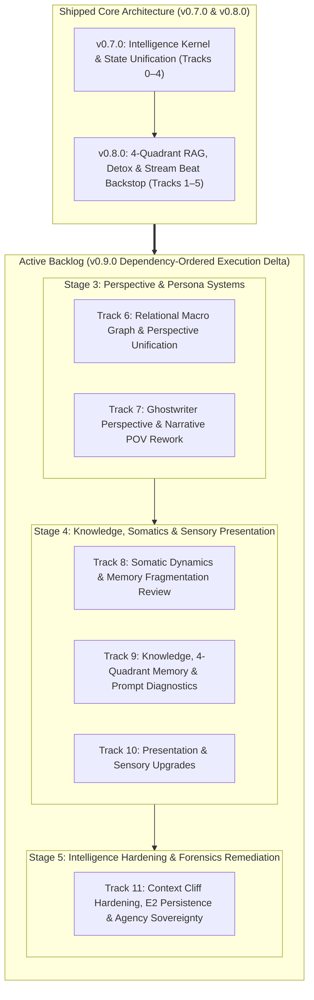

# RPGlitch Technical Roadmap

This roadmap defines the authoritative technical backlog, active engineering sprints, and target architectural blueprints for **RPGlitch**.

- **Temporal Mirror**: `ROADMAP.md` is the **FUTURE mirror** representing exclusively the unbuilt delta between the current state and the desired target state. Completed milestones are recorded in [CHANGELOG.md](CHANGELOG.md) (the **PAST mirror**).
- **Core Specifications**:
  - [README.md](README.md): Strategic product overview, game design, and simulation philosophy.
  - [ARCHITECTURE.md](ARCHITECTURE.md): Authoritative software architecture, layer boundaries, and state reality in `src/`.
  - [DESIGN.md](DESIGN.md): Nordic visual design tokens, typography, and motion contracts.
  - [SECURITY.md](SECURITY.md): Threat defense, input sanitization, and sink controls.
  - [memory-rag-budget-architecture.md](tmp/memory-rag-budget-architecture.md): Sovereign memory RAG, token budget reservoirs, and comprehensive anti-slop specification.
- **Idea Promotion Lifecycle**: Uncommitted mechanical ideas and exploratory proposals incubate in [`.agents/skills/simulation/references/`](.agents/skills/simulation/references/) as `suggestion-*.md`. When an idea is **promoted** from an exploratory possibility into a planned initiative, it is **removed from the incubator and fully migrated into this roadmap**.

---

## 🏛️ Engineering Backlog & Tracks at a Glance

All foundational sprints for Sovereign Engine Core (**Tracks 0 through 4** in v0.7.0, and **Tracks 1 through 5** in v0.8.0) have successfully shipped (recorded in [CHANGELOG.md](CHANGELOG.md)).

---

## 🚀 Active Engineering Backlog (Target Delta)

### Track 6: Relational Macro Graph & Perspective Unification

- **Objective**: Deconstruct and unify entity relational perspectives with role resolution.
- **Problem Diagnosis**: In `src/utils/macros.js`, `_resolve_owner_perspective(owner, entities)` takes an ad-hoc `owner` parameter, while `context` takes `{ speaker, listener }`. Brackets like `[CLOTHING: ...]` or directed relationships `[@TARGET: dynamic]` have implicit owners. Passing `owner` as a disjointed parameter across dozens of function calls creates fragile coupling.
- **Key Modules**: `src/utils/macros.js`, `src/intelligence/veil.js`, `src/ui/profile/RelationalGraph.svelte`.
- **Planned Sub-Items**:
  - [ ] **6.1 Unified Relational Context Broker**: Consolidate `owner`, `speaker`, `listener`, and `target` into a single `RelationalContext` tuple `{ me, you, speaker, listener, owner, target }`.
  - [ ] **6.2 Dynamic Perspective Resolution**: Wire `{me}` and `{you}` dynamically across speaker, listener, and target owner contexts without fragile branching.
  - [ ] **6.3 Cross-Quadrant Relational Propagation**: Synchronize relational vectors between `eternal.non_physical` (baseline bonds) and `present.non_physical` (situational dynamics).
  - [ ] **6.4 Entity ID Macro Standard, `@` Scoping & User-Configurable ID**:
    - **`@` Scoping Law**: The `@` prefix is reserved strictly for living/active entities registered within the simulation universe (AI character, user persona, fractal setting, active NPCs, registered factions/items). External cultural, real-world, or general knowledge figures (e.g. "Madonna", "Shakespeare", "Victorian London") do **not** use `@` and rely purely on the LLM's parametric knowledge.
    - **Dual Token Hierarchy**: Concrete `@id` tokens (`@julien`, `@silvers`, `@ashenweald`) represent persistent entities, while contextual role tokens (`@ME`, `@YOU`, `@FRACTAL`, `@USER`, `@CHAR`) dynamically resolve to the active scene participants.
    - **Transition to `@id` Tokens**: Migrate directed relationship brackets and prompt macros from multi-word display names (`@JULIEN THE BANISHED PRINCE`) to strict, canonical entity IDs (`@julien`, `@silvers`, `@ashenweald`). Prevent regex tokenization fragmentation where `@JULIEN` expands into display name while trailing words remain, creating double-name artifacts (`[Julien the Banished Prince THE BANISHED PRINCE]`).
    - **User-Configurable Entity ID**: Enable and guide users in character/persona profile creation and editing to specify their own unique Entity ID alongside their display name.
    - **Strict 1-Word ID Constraint**: Enforce a strict single-word constraint (alphanumeric lowercase slug, 3–12 characters, no spaces or special symbols, e.g., `julien`, `silvers`, `hawk`, `valerius`). Clearly frame this as the entity's functional system ID/handle for macros and relational brackets (avoiding confusing terms like "nickname").
    - **Premade Entity Harmonization**: Clean up directed relational brackets across `src/data/definitions/premade-entities.js` to conform to canonical `@id` syntax and prune cross-genre lore bleeding.
  - [ ] **6.5 Dynamic Character-Length XML Attribute Compaction (`<APPEARANCE>` & Quadrants)**:
    - **Dynamic Length Decision Engine**: Automatically partition bracket values based on character count: values with $\le 40$ characters and no newlines/quotes serialize as container XML attributes (e.g., `gender="male" age="ancient vampire (appears 38)" height="193 cm"`), while values exceeding the threshold automatically promote to nested child tags (e.g., `<SUIT>...</SUIT>`, `<POSTURE>...</POSTURE>`).
    - **Container Architecture**: Apply this to `<APPEARANCE>` and `<STATE>` container elements, terminating with explicit closing tags (`</APPEARANCE>`).
    - **Token & Line Economy**: Eliminates dozens of redundant closing tags while gracefully accommodating long poetic descriptions without manual user formatting.
    - **Pseudo-JSON Purge**: Purge raw `[KEY: value]` bracket dumps inside `<PERSONALITY>`, `<AGENDA>`, `<STATE>`, and `<MEMORIES>` in favor of uniform, well-formed XML elements.
  - [ ] **6.6 360° Relational Dossier (UI) vs Epistemic Prompt Dispositions (LLM)**:
    - **User-Facing 360° Dossier (`RelationalGraph` / Profile)**: Aggregate all brackets, feelings, and memories sharing the same `@entity_id` across all 4 quadrants into a unified visual relationship card (Baseline Bond from `eternal`, Current Dynamic from `present`, Shared Lore from `past`, and Trajectory from `future`) so the user experiences a cohesive relational view.
    - **LLM Epistemic Dispositions (Present-Driven Source)**: Sourced primarily from `present.non_physical` (with `eternal.non_physical` fallback for baseline bonds when no present dynamic is specified):
      - `<DISPOSITION target="julien">`: Immediate feelings and relational tension right now in the room. Deduplicate strictly so it does NOT appear in both general traits and `<DISPOSITIONS>`.
      - `<MEMORIES>`: Episodic history of past events ("what happened then").
      - `<AGENDA>`: Future trajectory ("what I want from them next").
        Prevents the LLM from conflating past memories with current immediate sentiment.
  - [ ] **6.7 Single-Subject Bracket Key Law**:
    - **Entity-As-Key Rule**: If an agenda item, disposition, or trait is targeted at a specific entity, that entity's `@id` MUST be the bracket key (e.g., `[@tartarus: primary acquisition target for prototype pipelines]`) rather than burying the entity inside a generic noun key (`[EXPANSION: expand ... Project Tartarus ...]`).
    - **Atomic Decomposition**: Enforce 1 bracket = 1 atomic truth. Multi-subject brackets must be decomposed into a general motive bracket and a directed entity bracket. Guide this in UI profile hints and Memory Forge extraction schemas.

---

### Track 7: Ghostwriter Perspective & Narrative POV Rework

- **Objective**: Rework Ghostwriter prompt compilation and perspective alignment so that user persona drafts match the player's selected POV without constitutional contradictions.
- **Problem Diagnosis**:
  - In `src/intelligence/modules/task.js`, `TASK_LIBRARY.PROSE.CHARACTER.BASE` states: _"Never narrate «USER_PERSONA» in the first person — the player owns their voice, body, and choices."_ In live forensics tests (`forensics-report-2.md: T19-20`), passing this constraint inside ghostwriting prompts caused the model to panic and author 3rd-person beats for the AI companion rather than drafting for the player.
  - Entity profiles contain a narrative POV setting (`1st` vs `3rd` person in `profile-fields.js` and `CORE_PROTOCOLS.PERSPECTIVE.POV`). If the user selects 3rd-person perspective for their protagonist, ghostwriting currently assumes 1st person or encounters ambiguous perspective guidance.
  - Owner-perspective veil preservation (`veil.js`) was unapplied on the ghostwrite execution path, accidentally dropping the user's own concealed items from their composer draft prompt.
- **Key Modules**: `src/intelligence/prompts.js`, `src/intelligence/modules/task.js`, `src/intelligence/story.js`, `src/ui/console/StorymodeBar.svelte`, `src/intelligence/veil.js`.
- **Planned Sub-Items**:
  - [ ] **7.1 Dedicated Ghostwrite Base Directive (`PROSE.GHOSTWRITE.BASE`)**: Replace conflicting `CHARACTER.BASE` in ghostwrite mode with a dedicated base directive instructing the LLM to draft strictly on behalf of the player without narrating NPC reactions.
  - [ ] **7.2 Entity POV Profile Binding**: Inspect the active user persona's configured perspective (`1st` vs `3rd` person) during ghostwriter prompt compilation and align pronoun registers (`I stepped forward` vs `Benedict stepped forward`).
  - [ ] **7.3 Owner-Perspective Veil Preservation on Ghostwrite Path**: Ensure the player's own `| hide` brackets remain visible to the ghostwrite compiler while staying sealed from third-party AI characters.

---

### Track 8: Somatic Dynamics & Memory Fragmentation Review

- **Objective**: Re-evaluate and wire the dynamics-modulated recall clarity system (`[fragmented recall]` prefix when Chaos/Entropy > 70) in `src/intelligence/temporal.js` into live prompt assembly.
- **Problem Diagnosis**: Live forensics revealed that `format_hybrid_recall` and `resolve_recall_clarity` were exported and unit-tested, but had **zero live callers** in `builder.js`. Memory recall clarity modulation never triggered in live simulation rounds despite extreme stress dynamics.
- **Key Modules**: `src/intelligence/temporal.js`, `src/intelligence/temporal.test.js`, `src/intelligence/builder.js`, `src/data/definitions/profile-fields.js`.
- **Planned Sub-Items**:
  - [ ] **8.1 Wire Recall Clarity into Builder Pipeline**: Connect `resolve_recall_clarity` and `format_hybrid_recall` to active memory slot compilation in `builder.js`.
  - [ ] **8.2 Recall Modulation Review & Tuning**: Audit whether prefixing raw `[fragmented recall]` provides desirable narrative impact or causes LLM confusion/hallucinations; evaluate alternatives such as bracket attribute tags (`| hazy`, `| fragmented`), probabilistic recall omission, or noise injection into vector scores.
  - [ ] **8.3 Grounding in Somatic Physics**: Connect memory clarity directly to live somatic metrics (`GLITCH` / `INSTABILITY` thresholds) rather than synthetic confidence floats.

---

### Track 9: Knowledge, 4-Quadrant Memory & Prompt Diagnostics

- **Objective**: Deliver comprehensive world knowledge management, semantic 4-Quadrant memory explorer, and prompt token transparency tools.
- **Key Modules**: `src/ui/profile/DevWing.svelte`, `src/intelligence/temporal.js`, `src/intelligence/builder.js`.
- **Planned Sub-Items**:
  - [ ] **9.1 "All 4 Quadrants Are Lorebook" Educational Guidance**: Update UI descriptions and docs to teach users how `eternal` + `present` + `past` + `future` form the complete, vectorized world encyclopedia without legacy keyword dumps.
  - [ ] **9.2 Prompt Token Map ("What the Model Sees")**: Visual proportional token bar chart in `DevWing.svelte` showing active allocations (`SYSTEM`, `HISTORY`, `ENTITIES`, `PAST`, `TASK`).

---

### Track 10: Presentation & Sensory Upgrades

- **Objective**: Optimize long-session UI performance and sensory capabilities.
- **Key Modules**: `src/ui/message/Feed.svelte`, `src/ui/message/InputBar.svelte`, `src/ui/gallery/GalleryModal.svelte`, `src/ui/console/Console.svelte`, `src/ui/console/StorymodeBar.svelte`.
- **Planned Sub-Items**:
  - [ ] **10.1 Feed Virtualization (Windower for 100+ Turns)**: Implement measured DOM windowing in `Feed.svelte` keeping only visible messages mounted, ensuring smooth 60fps scrolling in long roleplays.
  - [ ] **10.2 Slash Command Directing Bar (`/ooc`, `/time`, `/mood`)**: Floating shortcut bar above message input allowing direct Director intervention without polluting in-character dialogue.
  - [ ] **10.3 Persistent Session Image Archive (Gallery Shelf)**: Dedicated gallery modal querying Dexie image attachments across the current story with thumbnail caching.

---

### Track 11: Intelligence Hardening & Forensics Remediation

- **Objective**: Remediate the architectural vulnerabilities discovered during the 29-round live stress test.
- **Problem Diagnosis**:
  - `<ENTITIES>` block consumed 21.5k characters (68%–72% of the prompt), blowing past the 6,000-token cliff from Round 4 onward. The engine relied on Perchance's host-level middle-out truncation as a de facto backstop.
  - Memory Forge evicted `| hide` brackets during entity state rewrites (E2 bug), limiting concealed items to a 3-turn lifespan.
  - Stagnation drift compared user input to previous AI reply, preventing natural conversation from ever tripping the Soft Permit (8) or Hard Mandate (16).
  - The Director unilaterally killed the player persona during the Round 28 terminal climax while vetoing an NPC death, violating P1 User Agency.
- **Key Modules**: `src/intelligence/modules/entities.js`, `src/intelligence/modules/sheets.js`, `src/intelligence/temporal.js`, `src/intelligence/story.js`, `src/intelligence/director.js`, `src/state/controllers/story.js`.
- **Planned Sub-Items**:
  - [ ] **11.1 Hard Entity Budgeting & Cliff Protection**: Cap `<ENTITIES>` block at a strict ~2,000 token ceiling in `entities.js`/`sheets.js`, dynamically pruning non-essential traits and background entities so the total prompt stays firmly beneath `CONTEXT_TOKEN_CLIFF = 6000` without relying on host truncation.
  - [ ] **11.2 E2 Concealed Bracket Persistence**: Update `merge_field_content` and `memory_forge.js` to strictly preserve `| hide` brackets across background entity consolidation passes.
  - [ ] **11.3 Stagnation Drift Recalibration**: Update semantic drift calculation in `story.js` to compare consecutive turns by the same interlocutor (`input[n]` vs `input[n-1]` or `ai_reply[n]` vs `ai_reply[n-1]`), allowing circular dialogue to naturally trip the 8-turn soft permit and 16-turn hard mandate.
  - [ ] **11.4 Climax Sovereignty Calibration**: Constrain the Director's terminal evaluation rules to strictly forbid narrating the death of `«USER_PERSONA»` unless the user's input explicitly declares their own character's destruction.
  - [ ] **11.5 Live Prompt A/B Testing & Evaluation Harness on Perchance**:
    - Build an automated/interactive prompt A/B evaluation harness against Perchance's live endpoint.
    - Track and compare candidate prompt variants across: token budget economy, time-to-first-token (TTFT), `<THINK>` quality, detox compliance (absence of melodramatic slop/puppeting), epistemic adherence, and context truncation resilience across multi-round simulated roleplay conversations.

---

## 🏛️ Master Verification & Auditable Proof Matrix

| Track        | Subsystem / Feature                                   | Target Files                                                                                                                                                                 | Verification Proof                                                                                                                                                                                  |
| :----------- | :---------------------------------------------------- | :--------------------------------------------------------------------------------------------------------------------------------------------------------------------------- | :-------------------------------------------------------------------------------------------------------------------------------------------------------------------------------------------------- |
| **Track 6**  | **Relational Macro Graph & Perspective Unification**  | `src/utils/macros.js`, `src/intelligence/veil.js`, `src/ui/profile/RelationalGraph.svelte`, `src/data/definitions/premade-entities.js`, `src/intelligence/modules/sheets.js` | Unit tests verifying `{me}` and `{you}` resolve correctly across contexts; tests verifying `@id` token resolution; tests verifying `<APPEARANCE>` container attribute compaction and deduplication. |
| **Track 7**  | **Ghostwriter Perspective & Narrative POV Rework**    | `src/intelligence/prompts.js`, `src/intelligence/modules/task.js`, `src/intelligence/story.js`, `src/ui/console/StorymodeBar.svelte`                                         | Unit test verifying ghostwrite output reflects user persona's configured 1st vs 3rd person POV without `CHARACTER.BASE` contradiction; owner `&#124; hide` preserved.                               |
| **Track 8**  | **Somatic Dynamics & Memory Fragmentation Review**    | `src/intelligence/temporal.js`, `src/intelligence/temporal.test.js`, `src/intelligence/builder.js`                                                                           | Unit test verifying `format_hybrid_recall` is invoked in live prompt compilation and modulates memory tags when Chaos/Entropy > 70.                                                                 |
| **Track 9**  | **Knowledge, 4-Quadrant Memory & Prompt Diagnostics** | `src/ui/profile/DevWing.svelte`, `src/intelligence/temporal.js`, `src/intelligence/builder.js`                                                                               | UI test validating live token breakdown bar chart in DevWing; educational documentation verified.                                                                                                   |
| **Track 10** | **Presentation & Sensory Upgrades**                   | `src/ui/message/Feed.svelte`, `src/ui/message/InputBar.svelte`, `src/ui/gallery/GalleryModal.svelte`, `src/ui/console/Console.svelte`, `src/ui/console/StorymodeBar.svelte`  | Performance audit demonstrating smooth 60fps scrolling on 150+ turn chat; gallery modal functional with thumbnail caching.                                                                          |
| **Track 11** | **Intelligence Hardening & Forensics Remediation**    | `src/intelligence/modules/entities.js`, `src/intelligence/temporal.js`, `src/intelligence/story.js`, `src/intelligence/director.js`                                          | Unit test verifying `<ENTITIES>` block respects 2,000 token cap; test verifying `&#124; hide` brackets survive consolidation; live A/B evaluation harness passing on Perchance.                     |

---

## 🏛️ Historical Shipped Milestones

The complete historical specifications, task decompositions, and touchpoint references have been preserved in the archive:

- **[Release Notes (v0.8.0)](CHANGELOG.md#080---2026-10-12)**: Tracks 1 through 5 (4-Quadrant RAG & Dynamic Token Budget Reservoir, Simulation Log Pipeline Harmonization, Anti-Slop Narrative Detox & The Spent Ledger, Scene Momentum & Stagnation Backstop, Runtime Stream Beat Backstop & Continuation `finishTail`, and P4 Purges).
- **[Release Notes (v0.7.0)](CHANGELOG.md#070---2026-10-11)**: Tracks 0 through 4 (Intelligence Kernel Language & Domain Purity, State & Physics Core Unification, Hierarchical Memory & 6k Context Protection, Narrative Pacing & Story Experience, Task Compiler Deconstruction).

---

## 📌 Parking Lot & Tactical Backlog

- **Revisit `config.js` Implementation**:
  - Re-evaluate introducing a dedicated domain tuning surface (e.g. `src/intelligence/config.js` or `tuning.js`) to consolidate scattered simulation thresholds (`DEFAULT_SPENT_WINDOW`, `MAX_SPENT_ITEMS`, `STAGNATION_TURNS_THRESHOLD`, `PHYSICAL_SALIENCE_PENALTY`) into a single discoverable control module, as evaluated against the scattered-constants vs index-barrel patterns.
