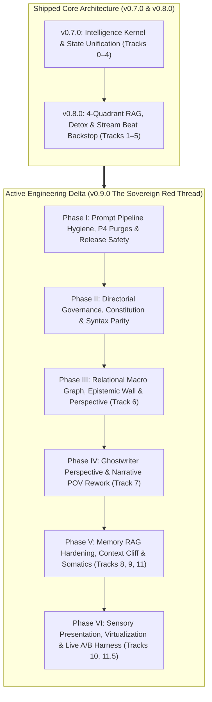

# RPGlitch Technical Roadmap

_AUTHORITATIVE SPECIFICATION (2026-10-14) — Unified, code-grounded engineering backlog synthesized from the Sovereign Engine Architecture, the Prompt Pipeline Audit, and the Entity Referencing Master Plan. Code reality pins: workspace `src/` @1827b58 / f1d8d645 (226/226 in sync). Evidence anchors: sim/dossier.md finding IDs (F1–F7, E2, M1, L1–L35), audit_report.md (Round 1 Gothic Baseline), and identified-issues.md (Issues 1–12, 13–22)._

This roadmap defines the authoritative technical backlog, active engineering sprints, and target architectural blueprints for **RPGlitch**.

- **Temporal Mirror**: `ROADMAP.md` is the **FUTURE mirror** representing exclusively the unbuilt delta between current state and desired target state. Completed milestones are recorded in [CHANGELOG.md](CHANGELOG.md) (the **PAST mirror**).
- **Core Specifications**:
  - [README.md](README.md): Strategic product overview, game design, and simulation philosophy.
  - [ARCHITECTURE.md](ARCHITECTURE.md): Authoritative software architecture, layer boundaries, and state reality in `src/`.
  - [DESIGN.md](DESIGN.md): Nordic visual design tokens, typography, and motion contracts.
  - [SECURITY.md](SECURITY.md): Threat defense, input sanitization, and sink controls.
  - [memory-rag-budget-architecture.md](tmp/memory-rag-budget-architecture.md): Sovereign memory RAG, token budget reservoirs, and anti-slop specification.
- **Idea Promotion Lifecycle**: Uncommitted mechanical ideas and exploratory proposals incubate in [`.agents/skills/simulation/references/`](.agents/skills/simulation/references/) as `suggestion-*.md`. When an idea is **promoted** from an exploratory possibility into a planned initiative, it is **removed from the incubator and fully migrated into this roadmap**.

---

## 🏛️ System Architecture & The Execution Red Thread

The active engineering delta is organized along a continuous **architectural red thread** designed for maximum execution efficiency. The red thread resolves foundational prompt hygiene and release gating first, establishes directorial governance, unifies the relational macro graph across the Epistemic Wall, hardens memory budgets beneath the context cliff, and concludes with presentation virtualization and empirical live evaluation:

### 🛡️ Release Engineering & Execution Invariants

- **Prompt Byte Contract Gate:** Any change to prompt-emitted strings alters contract byte-pins and baseline fixtures. Prompt changes are bundled logically to minimize baseline re-cut frequency.
- **Byte-Identity Advantage:** Wherever code deduplication or refactoring achieves identical compiler output, it is deployed as an immediate zero-risk quick win.
- **Empirical Measurement Precedence:** Structural hypotheses that alter generation behavior (e.g. think-before-input sequencing, pacing alterations) are measured through the test harness before locking.
- **P4 Pre-Beta Purity:** Never retain dead compatibility shims, unused layers, or unconsumed schema attributes. Refactor downstream consumers and purge dead code immediately.

---

## 🚀 The Active Engineering Delta

---

### Phase I: Prompt Pipeline Hygiene, P4 Purges & Release Safety `[COMPLETED 2026-10-14]`

Foundational cleanup, dead-code removal, and immediate token-saving optimizations that establish a clean baseline for subsequent structural refactors.

- **Objective**: Purge all lingering legacy artifacts, eliminate contradictory pacing directives, eliminate output token waste, single-source player sovereignty into Constitution Law L3, and establish release safety without breaking prompt contract pins.
- **Affected Modules & Tests**:
  - Implementation: `src/intelligence/modules/constitution.js`, `src/intelligence/modules/protocols.js`, `src/intelligence/modules/task.js`, `src/intelligence/modules/reflex.js`, `src/intelligence/modules/system.js`, `src/intelligence/prompts.js`, `src/intelligence/director.js`, `src/intelligence/builder.js`, `src/data/db.js`, `SECURITY.md`, `.agents/skills/simulation/references/suggestion-fate-branching-choices.md`.
  - Contracts & Verification: `src/intelligence/prompt-verification.js`, `src/intelligence/modules/system.test.js`, `src/intelligence/modules/reflex.test.js`, `src/intelligence/modules/protocols.test.js`, `src/intelligence/modules/task.test.js`, `src/intelligence/director.test.js`, `src/intelligence/prompts.test.js`, `src/intelligence/builder.test.js`.
- **Shipped Atoms**:
  - [x] **1.1 Single-Source Player Sovereignty (Constitutional Law L3 Authority)**:
    - Consolidated all player agency constraints strictly into `<AXIOMATIC_CONSTITUTION>` Law L3 (Sovereignty) in `src/intelligence/modules/constitution.js`.
    - Enabled `<AXIOMATIC_CONSTITUTION>` across all simulation prompts (including Director Shot 1 via `constitution: true` in `src/intelligence/prompts.js` and `axiomatic_constitution` in `DIRECTOR_LAYERS.system`).
    - Purged duplicate, ad-hoc agency text from `src/intelligence/modules/protocols.js` (`<AGENCY>`), `src/intelligence/modules/task.js` (`CHARACTER.BASE`), and Director directives (`USER_PERSONA_LOCK`).
    - Prohibited player puppeteering across any person or tense while describing player actions strictly as observed from outside.
  - [x] **1.2 Typed Task Input Signals & Omitted Default Attributes**:
    - In `src/intelligence/modules/task.js:276-295`, declared and exported `TASK_INPUT_TYPES` (`REPLY: "reply"`, `CONTENT: "content"`, `INTENT: "intent"`, `INGESTION: "ingestion"`).
    - Standard protagonist actions drop the attribute entirely (`<INPUT origin="..." round="...">`), while auxiliary inputs use typed `type="..."` discriminators, eliminating transport jargon.
  - [x] **1.3 Ruthless Lorebook Ghost-Layer Purge (P4 Compliance)**:
    - Removed `{ key: "lorebook" }` from `PROMPT_LAYERS` in `src/intelligence/modules/system.js`.
    - Removed dead `lorebook_args` builder from `src/intelligence/builder.js`.
    - Purged Section 2.5 "Lorebook Ingestion & ReDoS Defense" from `SECURITY.md`.
    - Cleaned schema comments referencing `lorebooks` in `src/data/db.js`.
    - Updated `src/intelligence/modules/system.test.js` to assert purged layers.
  - [x] **1.4 Alternative Branches P4 Purge (Token Optimization)**:
    - Completely purged `alternative_branches` from `DIRECTOR_SCHEMA` (`src/intelligence/prompts.js`), `src/intelligence/director.js` (`normalize_alternative_branches` and `normalize_director_data`), and Director directives (`DIRECTOR.BRANCHES`), saving 60–120 output tokens/turn.
    - Archived proposal specification in `.agents/skills/simulation/references/suggestion-fate-branching-choices.md` for future interactive `<choices>` UI.
  - [x] **1.5 Correct Candidate Cast Spatial Pointer & Empty-Roster Guard**:
    - In `src/intelligence/modules/task.js`, corrected spatial pointer to metasyntax-safe prose: `"inspect candidate secondary characters in the candidate cast above before minting"`.
    - Wired candidate availability (`has_candidates`) through `normalize_director_context` in `src/intelligence/builder.js` and gated `DIRECTOR.CONVERGENCE` in `src/intelligence/prompts.js`.
  - [x] **1.6 Spent Ledger XML Serialization**:
    - Refactored `render_spent_ledger_directive` in `src/intelligence/modules/reflex.js` to emit typed `<SPENT_LEDGER><PROHIBITED_PATTERNS><ITEM>...` pseudo-XML tags.
    - Updated contract inventories in `src/intelligence/prompt-verification.js` and test expectations in `src/intelligence/modules/reflex.test.js`.
  - [x] **1.7 Purge Diffusion Studio Lighting from Narrative Grounding**:
    - In `src/intelligence/modules/protocols.js`, removed "light fixtures" from `CORE_PROTOCOLS.GROUNDING`.
    - Relocated geometric lighting guidance strictly to `OPTICS.ENVIRONMENTAL_GROUNDING`.
  - [x] **1.8 Pacing Hierarchy Resolution**:
    - In `src/intelligence/modules/reflex.js`, established `<BEAT_BUDGET>` as the sole authoritative macro-structural controller and stripped contradictory sentence counts from `PACING` bodies in favor of qualitative steering.

---

### Phase II: Directorial Governance, Constitution & Syntax Parity

Elevating Shot 1 (Director) from an ad-hoc, unformatted text script into a constitutionally bounded, structurally typed simulation referee.

- **Objective**: Provide the Director with universal axiomatic constitution grounding, decouple lethal physical trauma from player sovereignty rules, co-locate simulation state with delta tuning bounds, harmonize Shot 1 to typed XML elements, enforce climax sovereignty dual defense, and recalibrate same-role semantic drift.
- **Code reality**: `prompts.js:309` explicitly declares `constitution: false` and `protocols: ["CORE_PROTOCOLS.ALTERNATION_OPTIONS"]` (which collapses to empty string), leaving the Director completely stripped of constitutional grounding. Live sim Round 28 proved an ungrounded Director hallucinated terminal player destruction while sparing an NPC. `prompts.js:171-177` space-joins three modules into an unbroken 150-word run-on wall in `task.js:114-123`, mixing decapitation with player sovereignty, followed by redundant bullet points. `task.js:110` calibration instructions are separated by 170 lines from `<DYNAMIC_AXES>` in System.
- **Key Modules**: `src/intelligence/prompts.js`, `src/intelligence/prompt-verification.js`, `src/intelligence/modules/constitution.js`, `src/intelligence/modules/constitution.test.js`, `src/intelligence/modules/task.js`, `src/intelligence/modules/task.test.js`, `src/intelligence/modules/reflex.js`, `src/intelligence/modules/reflex.test.js`, `src/intelligence/dynamics.js`, `src/intelligence/dynamics.test.js`, `src/intelligence/director.js`, `src/intelligence/director.test.js`, `src/intelligence/story.js`, `src/intelligence/story.test.js`.
- **Planned Sub-Items**:
  - [x] **2.1 Universal Axiomatic Constitutional Grounding for Shot 1**:
    - Retain the single universal `<AXIOMATIC_CONSTITUTION>` (Laws L1–L4) as the sole constitutional authority across all simulation passes.
    - Enable constitutional grounding for Shot 1: add `"axiomatic_constitution"` to `DIRECTOR_LAYERS.system` in `src/intelligence/prompts.js` and set `constitution: true` in `PROMPTS.director`.
    - Update `src/intelligence/prompt-verification.js` and test suites to assert `<AXIOMATIC_CONSTITUTION>` and laws L1–L4 across Director system prompts.
  - [x] **2.2 Unified `<ROUTING_RULES>` XML Block & Directives Parity (Issues 9 & 12)**:
    - In `src/intelligence/modules/task.js`, consolidate next-action turn allocation, candidate reuse discipline for `"GENESIS"`, and fatal trauma collapse thresholds for `"EPILOGUE_COLLAPSED"` into a single typed `<ROUTING_RULES>` XML block via `render_xml_tag`.
    - Purge fragmented text directives (`DIRECTOR.ROUTING`, `DIRECTOR.CONVERGENCE`).
  - [x] **2.3 Co-Locate Dynamic Axes Calibration Bounds (Issue 8)**:
    - In `src/intelligence/dynamics.js`, co-locate delta bounds as XML attributes on `<DYNAMIC_AXES scale="0-100" delta_standard="±1-4" delta_extreme="±8-12" boundary_clip="5-95">` and add qualitative behavioral `<CALIBRATION>` guidance when `scope = null`.
    - Completely purge misplaced `DIRECTOR.DYNAMICS_CALIBRATION` from `task.js` and `prompts.js`, eliminating cognitive dispersion.
  - [x] **2.4 Move Momentum Directive XML Compilation to `reflex.js`**:
    - Relocate scene momentum directives to `src/intelligence/modules/reflex.js`, exporting `render_momentum_directive_xml(stagnation_turns)`.
    - Emit `<MOMENTUM tier="soft|critical" turns="...">` only when `stagnation_turns >= 8` (soft permit) or `>= 16` (critical mandate). Purge duplicate momentum definitions from `task.js`.
  - [x] **2.5 Climax Sovereignty Calibration & Dual Defense (Track 11.4 / Finding F6)**:
    - In `src/intelligence/director.js`, implement `is_explicit_player_destruction_declared(user_input)` and programmatically intercept unconsented `next_action: "EPILOGUE_COLLAPSED"` with player death in `normalize_director_data`, safely downgrading to `"AI_CHARACTER"` / `"IN_PROGRESS"` with severe somatic trauma staging notes.
    - Add comprehensive unit tests in `src/intelligence/director.test.js`.
  - [x] **2.6 Stagnation Semantic Drift Recalibration (Track 11.3 / Finding L18)**:
    - In `src/intelligence/story.js`, update `calculate_semantic_drift` to compare consecutive turns by the same interlocutor (`user[n]` vs `user[n-1]` and `companion[n]` vs `companion[n-1]`), allowing conversational circularity to naturally trip stagnation thresholds.
    - Add unit tests in `src/intelligence/story.test.js`.
  - [ ] **2.7 Comprehensive Director Task Routing, Keyword Triggers & Prompt Handoff Audit**:
    - **Routing & Delegation Audit**: Systematically review `next_action` allocation rules (`AI_CHARACTER`, `FRACTAL`, `npc:<id>`, `GENESIS`, `EPILOGUE_COLLAPSED`, `EPILOGUE_CONCLUDED`) in `src/intelligence/modules/task.js`, `src/intelligence/director.js`, and `src/intelligence/story.js:352-388`. Verify the exact condition matrix for when Director delegates to environmental narration vs NPC dialogue vs companion interaction.
    - **Keyword Triggers & Subtext Ingestion**: Trace the complete end-to-end lifecycle of keywords: from `AVAILABLE_KEYWORDS` in `task.js` and `STYLE_MOTIF_REGISTRY` offered to Director Shot 1, through Director selection (`director_data.keywords`), to `render_subtext_xml` resolution against `PHYSICS_PROTOCOLS`, and final `<SUBTEXT>` tag injection in Shot 2 character/narrator prompts.
    - **Staging Directives & Think Seeding**: Audit how `directors_note` seeds the Shot 2 `<THINK>` block via `startWith` in `story.js:547` and ensure robust stripping in `strip_directors_note_seed` without bleeding into persisted narrative prose.

---

### Phase III: Relational Macro Graph, Epistemic Wall & Perspective (Track 6)

Resolving the fundamental conflation between slot, perspective, and identity across the simulation pipeline.

- **Objective**: Establish the unified Relational Context Broker, enforce strict 1-word entity handles, eliminate double-name artifacts, enforce epistemic veil sequencing, and compact character sheet envelopes.
- **Code reality**: `_resolve_owner_perspective(owner, entities)` exists and is called in 3 places (`src/utils/macros.js:39,225,278`); `{{me}}`/`{{you}}` display-layer resolution from owner perspective exists WITH tests (`macros.js:214-262`, `macros.test.js:47-50`). Line 209 holds a critical bug: `if (owner.type === "character") return "ai"`, causing secondary NPCs to steal the companion's identity. Multi-word `@` brackets pervasive in `premade-entities.js` (`@ORION THE PINK PROTECTOR`, `@JULIEN THE BANISHED PRINCE`), creating regex fragmentation and double-name artifacts (`[Julien the Banished Prince THE BANISHED PRINCE]`). `builder.js:262,269` expands macros _before_ `sheets.js:261` sanitizes epistemic secrets. `<APPEARANCE>` renders via verbose nested child rows in `sheets.js:348-381`.
- **Key Modules**: `src/utils/macros.js`, `src/utils/macros.test.js`, `src/intelligence/veil.js`, `src/intelligence/veil.test.js`, `src/intelligence/modules/sheets.js`, `src/intelligence/modules/sheets.test.js`, `src/intelligence/modules/system.js`, `src/intelligence/modules/output.js`, `src/intelligence/modules/task.js`, `src/intelligence/parser.js`, `src/intelligence/director.js`, `src/intelligence/builder.js`, `src/intelligence/builder.test.js`, `src/intelligence/director.test.js`, `src/intelligence/profile.test.js`, `src/intelligence/story.js`, `src/intelligence/prompts.js`, `src/intelligence/prompts.test.js`, `src/intelligence/prompt-verification.js`, `src/intelligence/prompt-verification.test.js`, `src/data/definitions/premade-entities.js`, `src/data/definitions/premade-entities.test.js`, `src/ui/profile/RelationalGraph.svelte`, `src/ui/profile/RelationalGraph.test.js`, `src/ui/profile/Profile.svelte`, `src/ui/profile/ProfileHeader.svelte`.
- **Planned Sub-Items**:
  - [x] **3.1 Secondary NPC Identity Classification Bug Fix (Issue 18 / Batch 1)**:
    - In `src/utils/macros.js:204-211`, eliminate the blanket `if (owner.type === "character") return "ai"` catch-all. Explicitly classify the active companion by ID match (`_entity_ids_match(owner, entities?.AI)`). Secondary NPCs resolve perspective strictly to their own ID (`entity:${owner.id}`), fixing the bug where NPC self-references inverted to the companion.
  - [x] **3.2 Epistemic-First Pipeline Sequencing Invariant (Issue 20 / Security Gate)**:
    - In `src/intelligence/builder.js:262,269` and `src/intelligence/modules/sheets.js:261-289`, enforce the cryptographic invariant: **Veil Sanitization MUST strictly precede Macro Expansion**. Never expand macros on raw bracket text before `strip_epistemic_secrets` runs, eliminating the risk of macro text obfuscating `| hide` flags across the Epistemic Wall.
  - [x] **3.3 Unified Relational Context Broker (Sub-item 6.1)**:
    - Consolidate `owner`, `speaker`, `listener`, and `target` into a single frozen `RelationalContext` tuple `{ me, you, speaker, listener, owner, target, witnesses }`.
  - [x] **3.4 Perspective Resolution in Prompt Compilation (Sub-item 6.2)**:
    - Extend existing display-layer `{{me}}`/`{{you}}` resolution into prompt assembly via the 3.3 tuple — no new syntax, same semantics, compiler-side.
  - [x] **3.5 Entity ID Macro Standard, `@` Scoping & User-Configurable ID (Sub-item 6.4 / Issue 17)**:
    - **`@` Scoping Law**: The `@` prefix is reserved strictly for living/active entities registered within the simulation universe (AI character, user persona, fractal setting, active NPCs, registered factions/items). External real-world or historical figures do not use `@`.
    - **Transition to Canonical `@id` Tokens**: Migrate directed relationship brackets and prompt macros from multi-word display names (`@JULIEN THE BANISHED PRINCE`) to strict canonical entity IDs (`@julien`, `@silvers`, `@ashenweald`). Eliminates regex tokenization fragmentation and double-name artifacts (`[Julien the Banished Prince THE BANISHED PRINCE]`).
    - **User-Configurable Entity ID**: Enable users in profile creation/editing to specify their own unique Entity ID slug (alphanumeric lowercase, 3–12 chars, no spaces or special symbols, e.g. `julien`, `silvers`, `hawk`).
    - **Premade Entity Harmonization**: Clean up directed relational brackets across `src/data/definitions/premade-entities.js` to conform to canonical `@id` syntax. Renamed Rust to `HANK` to eliminate noun collisions and anchored Silvers' and Julien's backstory memories to `[@ASHENWEALD: ...]`. Preserved `@ID` handles in `macros.js` without expansion to uppercase names.
  - [x] **3.6 Single-Subject Bracket Key Law (Sub-item 6.7 / Issue 19)**:
    - **Entity-As-Key Rule**: If an agenda item, disposition, or trait targets a specific entity, that entity's `@id` MUST be the bracket key (e.g. `[@tartarus: primary acquisition target]`), not buried inside a generic noun key.
    - **Immutable State Keys**: Store durable memories and ledgers keyed by canonical IDs; late-bind display names at prompt assembly time. If an entity is renamed, durable vectors and state brackets remain valid.
  - [x] **3.7 Dynamic Character-Length XML Compaction & Universal `<CHARACTER>` Envelopes (Sub-item 6.5 / Issue 13)**:
    - **Dynamic Length Decision Engine**: Automatically partition bracket values based on character count: values $\le 40$ characters and without newlines/quotes serialize as container XML attributes (e.g. `gender="male" height="193 cm"`), while values exceeding the threshold promote to nested child tags.
    - **Universal `<CHARACTER>` Envelope**: Replace computing slot tags (`<AI_CHARACTER>`, `<USER_PERSONA>`, `<NPC>`) with universal ontological `<CHARACTER id="..." role="..." name="...">` envelopes. Purges digital computing baggage (`AI`, `USER`) from character sheets and stabilizes KV-cache prefixes.
    - **Replay-Safety Constraint**: Compaction MUST preserve flag-preserving field replay (`ledger.js:193-256`) — compacted rows must round-trip through replay byte-identically.
  - [x] **3.8 Entity Label Taxonomy Standards & Storage Ban Gate (Sub-item 6.10 / §2.5 Decisions)**:
    - **Pragmatic Turn Roles (`speaker` / `listener`)**: Restricted strictly to transient turn headers in Shot 2 prose prompts. Enforce an automated test gate in `src/intelligence/prompts.test.js` banning `speaker` and `listener` from ever being persisted into durable Dexie memory or mutation ledgers.
    - **Label Proliferation Restraint**: Prohibit bloating the top-level entity taxonomy with excessive literary slot labels (`antagonist`, `deuteragonist`, `foil`, `captive`, `ward`). Represent complex character dynamics through relational bracket edges (`present.non_physical`) rather than proliferating structural XML schemas.
    - **Metasyntax Protection**: Formally reject bare unanchored `<ALICE>` or `<YOUR_IDENTITY>` tags to protect KV-cache prefixes, frozen metasyntax, and veil sigils.
  - [x] **3.9 360° Relational Dossier (UI) vs Epistemic Prompt Dispositions (LLM) (Sub-item 6.6)**:
    - **User-Facing 360° Dossier (extend `RelationalGraph`)**: Build the unified visual relationship card aggregating all 4 quadrants (Baseline Bond from `eternal`, Current Dynamic from `present`, Shared Lore from `past`, Trajectory from `future`) with strict deduplication.
    - **LLM Epistemic Dispositions (Present-Driven Source)**: Sourced primarily from `present.non_physical` (`<DISPOSITION target="julien"> Immediate tension in the room</DISPOSITION>`), preventing the model from conflating past memories with active immediate sentiment.
  - [x] **3.10 Cross-Quadrant Relational Propagation (Sub-item 6.3)**:
    - Synchronize relational vectors between `eternal.non_physical` (baseline bonds) and `present.non_physical` (situational dynamics).
  - [x] **3.11 Macro Fallback Unification & Token Cleansing (Issue 14, 15)**:
    - Replace literal computing fallbacks (`"AI"`, `"User"`) in `src/utils/macros.js:35-37` with natural diegetic descriptors (`"the companion"`, `"the traveler"`). Standardize exclusively on `@`-tokens, normalizing incoming `{me}` / `{you}` brackets during profile intake.

---

### Phase IV: Ghostwriter Perspective & Narrative POV Rework (Track 7) `[COMPLETED 2026-10-14]`

Reworking the Ghostwriter pipeline so user persona drafts match the player's selected POV without constitutional agency panics.

- **Objective**: Ensure the Ghostwriter drafts strictly for the user persona without narrating other participants or panicking under interaction constraints.
- **Code reality / DECISION CONFLICT**: `task.js:729` records that Track 0.6 deliberately merged `GHOSTWRITE.BASE` into `CHARACTER.BASE`, a decision that also covers npc turns (`builder.js:896`). Live forensics (dossier T19-20) proved the merged base contradicts ghostwriting (Beast-POV draft, AGENCY panic). So 4.1 does NOT resurrect the retired directive wholesale — it adds a narrowly SCOPED additive branch for ghostwriting that leaves the Track 0.6 merge intact everywhere else.
- **Key Modules & Verification**: `src/intelligence/prompts.js`, `src/intelligence/prompts.test.js`, `src/intelligence/builder.js`, `src/intelligence/builder.test.js`, `src/intelligence/director.test.js`, `src/intelligence/modules/task.js`, `src/intelligence/modules/task.test.js`, `src/intelligence/modules/style.js`, `src/intelligence/modules/style.test.js`, `src/intelligence/modules/protocols.js`, `src/intelligence/modules/protocols.test.js`, `src/intelligence/modules/sheets.js`, `src/intelligence/modules/sheets.test.js`, `src/intelligence/prompt-verification.js`, `src/intelligence/story.js`, `src/ui/console/StorymodeBar.svelte`, `src/intelligence/veil.js`, `src/data/definitions/profile-fields.js`, `.agents/skills/simulation/scripts/simulation-audit.js`, `.agents/skills/simulation/scripts/simulation-audit.test.js`.
- **Shipped Sub-Items**:
  - [x] **4.1 Scoped Ghostwrite Base Directive (Sub-item 7.1 / Additive Branch)**:
    - Add a dedicated base directive used SOLELY when `is_ghostwrite` routes — instructing the LLM to draft strictly on behalf of the player persona without narrating NPC reactions — while `CHARACTER.BASE` keeps governing interaction + npc turns unchanged. Regression gate: npc-turn coverage from Track 0.6 merge must not shift.
  - [x] **4.2 Persona POV Setting + Binding (Sub-item 7.2)**:
    - Added canonical top-level `pov` setting to the profile schema in `src/data/definitions/profile-fields.js`. Stripped hardcoded "first-person" constraint from `GHOSTWRITE` in `task.js`, binding grammatical perspective dynamically via `<PERSPECTIVE person="FIRST|THIRD">` resolved from `active_speaker.pov`.
  - [x] **4.3 Owner-Perspective Veil Preservation on Ghostwrite Path (Sub-item 7.3)**:
    - Ensure the player's own `| hide` brackets remain visible to the ghostwrite compiler while staying sealed from third-party AI characters. Builds on the 3.3 Relational Context model.
  - [x] **4.4 Decoupled Authorial Voice Framing (Sub-item 7.4 / Issue 22)**:
    - Replaced `<NARRATIVE_STYLE>` with dedicated `<AUTHORIAL_VOICE author="..." internal_ratio="...">` envelopes paired with an inviolable `<SOVEREIGNTY player="...">` non-puppeteering constraint. Allows rich literary prose styling while preventing authorial godmoding over the player persona.
  - [x] **4.5 Quad Profile Field XML Expansion & Epistemic Parity (Issue 13, 21)**:
    - Unified `parse_profile_field_rows` across all quad profile fields (`PERSONALITY`, `STATE`, `AGENDA`, `MEMORIES`) to expand brackets into structured child XML elements and compact short attributes identical to `APPEARANCE`. Extracted relational brackets natively into `<RELATION target="slug">` within `STATE` and `PERSONALITY` envelopes and purged duplicate `<DISPOSITION>` generation.
  - [x] **4.6 Symmetrical Semantic Director Signals**:
    - Replaced disjoint `<INPUT origin="..." round="...">` and `<INPUT origin="..." type="reply">` in Director input signals with chronological, symmetrical semantic tags: `<PREVIOUS_TURN origin="...">` for companion's prior output and `<CURRENT_TURN origin="...">` for player input.

---

### Phase V: Memory RAG Hardening, Context Cliff & Somatics (Tracks 8, 9, 11)

Hardening context windows against the 6,000-token cliff, eliminating memory consolidation leaks, and wiring somatic physics into recall clarity.

- **Objective**: Keep total prompt length beneath the 6,000-token cliff by construction, eliminate Memory Forge concealed item eviction (E2 bug), and modulate memory clarity through somatic metrics.
- **Code reality**: `CONTEXT_TOKEN_CLIFF = 6000` lives in `history.js:81`. `calculate_physical_salience` (`temporal.js:1057`) and `whole_vector_slice` (`:1077`) exist and are unwired. `merge_field_content` (`:1110`) and consolidation engine (`:1592-1615`) are now hardened to preserve `| hide` brackets and weights across Memory Forge passes (E2 resolved) and deduplicate case-variant lines (M1 resolved). `resolve_recall_clarity` (`temporal.js:897`) and `format_hybrid_recall` (`:921`) exist, are tested, and exported — with zero callers in `builder.js`.
- **Key Modules**: `src/intelligence/modules/entities.js`, `src/intelligence/modules/sheets.js`, `src/intelligence/temporal.js`, `src/intelligence/temporal.test.js`, `src/utils/text.js`, `src/utils/text.test.js`, `src/intelligence/builder.js`, `src/ui/profile/DevWing.svelte`.
- **Planned Sub-Items**:
  - [x] **5.1 Wire Salience + Slice, Then Cap `<ENTITIES>` at 2,000 Tokens (Sub-item 11.1)**:
    - Connect `calculate_physical_salience` and `whole_vector_slice` into sheets scoring, then enforce the ~2,000-token `<ENTITIES>` ceiling with dynamic pruning so total prompts stay beneath the 6,000 cliff by construction, eliminating reliance on Perchance host middle-out truncation.
  - [x] **5.2 E2 Concealed Bracket Persistence (Sub-item 11.2 / sim/dossier finding E2)**:
    - Fixed `merge_field_content` (`temporal.js:1110`) and the consolidation engine (`:1592-1615`) to preserve `| hide` brackets and weights across Memory Forge consolidation passes.
  - [ ] **5.3 Recall Modulation Review & Somatic Wiring (Sub-items 8.2, 8.1, 8.3)**:
    - Audit whether prefixing raw `[fragmented recall]` provides desirable narrative impact or causes LLM confusion/hallucinations; evaluate alternatives such as bracket attributes (`| hazy`, `| fragmented`) or noise injection into vector scores.
    - Connect the winning mechanism to active memory slot compilation in `builder.js`.
    - Connect memory clarity directly to live somatic metrics (`GLITCH` / `INSTABILITY` thresholds) rather than synthetic confidence floats.
  - [ ] **5.4 "All 4 Quadrants Are Lorebook" Educational Guidance (Sub-item 9.1)**:
    - Update UI descriptions and documentation to teach users how `eternal` + `present` + `past` + `future` form the complete, vectorized world encyclopedia without legacy keyword dumps.
  - [ ] **5.5 Prompt Token Map ("What the Model Sees") (Sub-item 9.2)**:
    - Visual proportional token bar chart in `DevWing.svelte` showing active allocations (`SYSTEM`, `HISTORY`, `ENTITIES`, `PAST`, `TASK`). Feeds directly into 5.1 budgeting verification.

---

### Phase VI: Sensory Presentation, Virtualization & Live A/B Harness (Tracks 10, 11.5)

Optimizing UI performance for marathon sessions, providing director shortcuts, and empirically validating prompt steering quality.

- **Objective**: Guarantee 60fps scrolling on 100+ turn sessions, introduce non-diegetic Director controls, and establish an automated A/B evaluation rig against live Perchance endpoints.
- **Code reality**: `Feed.svelte` renders full `visible_feed` array (`{#each}`, `:262`) — no virtualization inside Feed. `InputBar.svelte` and `GalleryModal.svelte` do not exist.
- **Key Modules**: `src/ui/message/Feed.svelte`, `src/ui/console/Console.svelte`, `src/ui/console/StorymodeBar.svelte`, `src/tools/harness/`.
- **Planned Sub-Items**:
  - [ ] **6.1 Feed Virtualization Recon & DOM Windowing (Sub-items 10.0, 10.1)**:
    - Trace where `visible_feed` gets windowed upstream of `Feed.svelte`; implement measured DOM windowing keeping only visible messages mounted, ensuring smooth 60fps scrolling in 100+ turn roleplays.
  - [ ] **6.2 Slash Command Directing Bar (Sub-item 10.2)**:
    - Floating shortcut bar above message input allowing direct Director intervention (`/ooc`, `/time`, `/mood`) without polluting in-character dialogue.
  - [ ] **6.3 Persistent Session Image Archive (Gallery Shelf) (Sub-item 10.3)**:
    - Dedicated gallery modal querying Dexie image attachments across the current story with thumbnail caching.
  - [ ] **6.4 Live Prompt A/B Testing & Evaluation Harness on Perchance (Sub-item 11.5)**:
    - Build an interactive prompt A/B evaluation harness against Perchance's live endpoint measuring: token budget economy, TTFT, `<THINK>` quality, detox compliance, and context truncation resilience across multi-round simulated roleplay conversations.
    - **Cognitive Stimulus Ordering Test**: Empirically evaluate whether sequencing `<INPUT>` before `<THINK_FORMAT>` in `PROSE_LAYERS.task` improves reasoning depth and prompt attention weights before locking the order in production.

---

## 🏛️ Master Verification & Auditable Proof Matrix

| Phase / Track                  | Subsystem / Feature                                | Target Files                                                                                                                                                                                                                         | Verification Proof                                                                                                                                                                                                                                                                                                                                       |
| :----------------------------- | :------------------------------------------------- | :----------------------------------------------------------------------------------------------------------------------------------------------------------------------------------------------------------------------------------- | :------------------------------------------------------------------------------------------------------------------------------------------------------------------------------------------------------------------------------------------------------------------------------------------------------------------------------------------------------- |
| **Phase I**                    | **Prompt Hygiene & P4 Foundation**                 | `src/intelligence/modules/system.js`, `src/intelligence/builder.js`, `src/intelligence/modules/task.js`, `src/intelligence/modules/protocols.js`, `src/intelligence/modules/reflex.js`, `src/intelligence/prompts.js`, `SECURITY.md` | Lorebook purge clean in `system.test.js`; byte-identical agency output verified; 5-channel registry frozen; alternative branches gated; candidate spatial pointer fixed; `<SPENT_LEDGER>` XML pilot passing in `reflex.test.js`; `<BEAT_BUDGET>` priority asserted; optics split asserted in `protocols.test.js`.                                        |
| **Phase II**                   | **Directorial Governance & Syntax Parity**         | `src/intelligence/modules/constitution.js`, `src/intelligence/prompts.js`, `src/intelligence/modules/task.js`, `src/intelligence/director.js`, `src/intelligence/story.js`, `src/intelligence/dynamics.js`                           | Unit tests asserting `DIRECTOR_CONSTITUTION` rendered in Shot 1 system envelope; deconstructed directives verified; dynamic axes delta attributes verified; typed XML compilers verified across Shot 1; climax sovereignty guard verified; stagnation drift interlocutor comparison verified; Director routing rules & keyword subtext pipeline audited. |
| **Phase III (Track 6)**        | **Relational Macro Graph & Perspective**           | `src/utils/macros.js`, `src/intelligence/veil.js`, `src/intelligence/modules/sheets.js`, `src/intelligence/builder.js`, `src/ui/profile/RelationalGraph.svelte`                                                                      | Secondary NPC identity isolation test passing; veil-first pipeline ordering test clean; `RelationalContext` tuple compiler-side test; 1-word `@id` resolution asserted; replay round-trip attribute compaction test; storage ban standing gate test for turn roles; 360° dossier dedup asserted.                                                         |
| **Phase IV (Track 7)**         | **Ghostwriter Perspective & Narrative POV**        | `src/intelligence/prompts.js`, `src/intelligence/modules/task.js`, `src/intelligence/story.js`, `src/data/definitions/profile-fields.js`                                                                                             | Unit test verifying ghostwrite output reflects persona's POV setting via scoped base; npc-turn regression test pinning Track 0.6 merge behavior; owner `&#124; hide` preserved; decoupled authorial voice test clean.                                                                                                                                    |
| **Phase V (Tracks 8, 9, 11)**  | **Memory RAG Hardening, Context Cliff & Somatics** | `src/intelligence/modules/entities.js`, `src/intelligence/modules/sheets.js`, `src/intelligence/temporal.js`, `src/ui/profile/DevWing.svelte`                                                                                        | Unit test verifying `<ENTITIES>` block respects 2,000 token cap; test verifying `&#124; hide` survival across forge consolidation; somatic recall clarity wiring test; live token breakdown bar chart in DevWing functional.                                                                                                                             |
| **Phase VI (Tracks 10, 11.5)** | **Sensory Presentation & Live Evaluation**         | `src/ui/message/Feed.svelte`, `src/ui/console/Console.svelte`, `src/tools/harness/`                                                                                                                                                  | Performance audit demonstrating 60fps scrolling on 100+ turns; gallery modal functional; live A/B evaluation harness passing on Perchance.                                                                                                                                                                                                               |

---

## 🏛️ Historical Shipped Milestones

The complete historical specifications, task decompositions, and touchpoint references have been preserved in the archive:

- **[Release Notes (v0.8.0)](CHANGELOG.md#080---2026-10-12)**: Tracks 1 through 5 (4-Quadrant RAG & Dynamic Token Budget Reservoir, Simulation Log Pipeline Harmonization, Anti-Slop Narrative Detox & The Spent Ledger, Scene Momentum & Stagnation Backstop, Runtime Stream Beat Backstop & Continuation `finishTail`, and P4 Purges).
- **[Release Notes (v0.7.0)](CHANGELOG.md#070---2026-10-11)**: Tracks 0 through 4 (Intelligence Kernel Language & Domain Purity, State & Physics Core Unification, Hierarchical Memory & 6k Context Protection, Narrative Pacing & Story Experience, Task Compiler Deconstruction).

---

## 📌 Parking Lot & Tactical Backlog

- **Scattered Tuning Constants**: Re-evaluate a dedicated tuning surface (`src/intelligence/config.js` or `tuning.js`) consolidating stagnation trip points inline in `prompts.js:182` (8/16), salience multipliers inline in `temporal.js`, and token budgets in `history.js:81+`.
- **Entity Label Taxonomy Storage Audit**: Implement an automated metasyntax standing gate in `src/intelligence/prompts.test.js` ensuring transient turn roles (`speaker`/`listener`) never leak into IndexedDB or event-sourced mutation ledgers.
