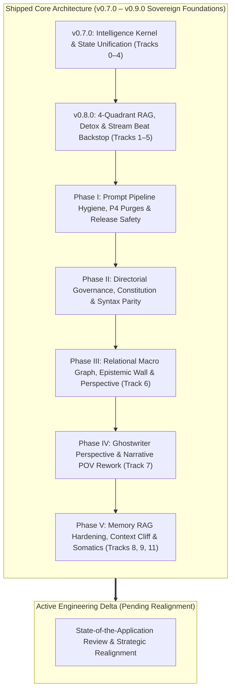

# RPGlitch Technical Roadmap

_AUTHORITATIVE SPECIFICATION (2026-10-14) — Unified, code-grounded engineering backlog synthesized from the Sovereign Engine Architecture, the Prompt Pipeline Audit, and the Entity Referencing Master Plan. Code reality pins: workspace `src/` @1827b58 / f1d8d645 (226/226 in sync). Evidence anchors: sim/dossier.md finding IDs (F1–F7, E2, M1, L1–L35), audit_report.md (Round 1 Gothic Baseline), and identified-issues.md (Issues 1–12, 13–22)._

This roadmap defines the authoritative technical backlog, active engineering sprints, and target architectural blueprints for **RPGlitch**.

- **Temporal Mirror**: `ROADMAP.md` is the **FUTURE mirror** representing exclusively the unbuilt delta between current state and desired target state. Completed milestones are recorded in [CHANGELOG.md](CHANGELOG.md) (the **PAST mirror**).
- **Core Specifications**:
  - [README.md](README.md): Strategic product overview, game design, and simulation philosophy.
  - [ARCHITECTURE.md](ARCHITECTURE.md): Authoritative software architecture, layer boundaries, and state reality in `src/`.
  - [DESIGN.md](DESIGN.md): Nordic visual design tokens, typography, and motion contracts.
  - [SECURITY.md](SECURITY.md): Threat defense, input sanitization, and sink controls.
  - [memory-rag-budget-architecture.md](tmp/memory/memory-rag-budget-architecture.md): Sovereign memory RAG, token budget reservoirs, and anti-slop specification.
- **Idea Promotion Lifecycle**: Uncommitted mechanical ideas and exploratory proposals incubate in [`.agents/skills/simulation/references/`](.agents/skills/simulation/references/) as `suggestion-*.md`. When an idea is **promoted** from an exploratory possibility into a planned initiative, it is **removed from the incubator and fully migrated into this roadmap**.

---

## 🏛️ System Architecture & The Execution Red Thread

The active engineering delta is organized along a continuous **architectural red thread** designed for maximum execution efficiency. The red thread resolves foundational prompt hygiene and release gating first, establishes directorial governance, unifies the relational macro graph across the Epistemic Wall, hardens memory budgets beneath the context cliff, and concludes with presentation virtualization and empirical live evaluation:

### 🛡️ Release Engineering & Execution Invariants

- **Prompt Byte Contract Gate:** Any change to prompt-emitted strings alters contract byte-pins and baseline fixtures. Prompt changes are bundled logically to minimize baseline re-cut frequency.
- **Byte-Identity Advantage:** Wherever code deduplication or refactoring achieves identical compiler output, it is deployed as an immediate zero-risk quick win.
- **Empirical Measurement Precedence:** Structural hypotheses that alter generation behavior (e.g. think-before-input sequencing, pacing alterations) are measured through the test harness before locking.
- **P4 Pre-Beta Purity:** Never retain dead compatibility shims, unused layers, or unconsumed schema attributes. Refactor downstream consumers and purge dead code immediately.

---

## 🚀 The Active Engineering Delta

---

### Sprint: State-of-the-Application Review & Track A Local Investigations

A comprehensive, code-grounded review of the running application and execution of Track A (Unblocked Local Investigations) to resolve known state machine bottlenecks, audit prompts, and enforce architectural invariants.

- **Objective**: Execute Track A local investigations and canonical configuration harmonization: fix composer queued state machine, generate prompt atom matrix in audit harness, rebuild central `src/config.js` with literary scale, and wire canonical contracts across intelligence, data, media, and state layers under P4 purity.
- **Scope & Target Files**:
  - `src/ui/console/StorymodeBar.svelte` (composer serialized queue drainer and unstick resilience)
  - `src/config.js` (master canonical system configuration, literary scale, latency tiers, and subsystem domain agreements)
  - `src/intelligence/temporal.js` (memory past, eternal, present character caps and hybrid retrieval scoring weights)
  - `src/intelligence/temporal.test.js` (memory RAG character budget tests)
  - `src/intelligence/modules/history.js` (dialogue and visual feed window defaults and chapter prompt history slice)
  - `src/intelligence/modules/history.test.js` (history defaults contract verification)
  - `src/intelligence/modules/reflex.js` (momentum stagnation tiers, spent ledger window, and opening clause min chars)
  - `src/intelligence/modules/reflex.test.js` (reflex pacing and spent ledger contract tests)
  - `src/data/normalizer.js` (entity schema name bounds, chapter archive capacity, and paragraph summaries)
  - `src/intelligence/dynamics.js` (dynamics scale and image trigger cooldown threshold)
  - `src/intelligence/dynamics.test.js` (dynamics gate unit tests)
  - `src/media/optics.js` (unified 3-round image cooldown arbitration and dynamics scale thresholds)
  - `src/media/optics.test.js` (optics trigger arbitration test suite)
  - `src/utils/resilience.js` (canonical latency tiers and patience policy circuit breaker defaults)
  - `src/state/status.svelte.js` (freeze watchdog intervals wired to canonical latency tiers)
  - `.agents/skills/simulation/scripts/simulation-audit.js` (automated prompt atom matrix)
  - `.agents/skills/simulation/scripts/simulation-audit.test.js` (wire atom matrix tables into unified report)
  - `.agents/skills/simulation/scripts/consolidation-stress.test.js` (100-round consolidation invariant test)
  - `.agents/skills/local-scripts/scripts/audit-layers.js` (strict layer boundary enforcement gate)
  - `src/ui/message/feed-dom-benchmark.test.js` (feed DOM profiling benchmark)
  - `src/media/audio.test.js` (AudioContext lifecycle and teardown contract verification)
- **Key Modules**: `src/ui/`, `src/state/`, `src/intelligence/`, `src/data/`, `src/media/`, `src/utils/`, `config.md`.

---

## 🏛️ Master Verification & Auditable Proof Matrix

| Phase / Track                 | Subsystem / Feature                                | Target Files                                                                                                                                                                                                                         | Verification Proof                                                                                                                                                                                                                                                                                                                                       |
| :---------------------------- | :------------------------------------------------- | :----------------------------------------------------------------------------------------------------------------------------------------------------------------------------------------------------------------------------------- | :------------------------------------------------------------------------------------------------------------------------------------------------------------------------------------------------------------------------------------------------------------------------------------------------------------------------------------------------------- |
| **Phase I**                   | **Prompt Hygiene & P4 Foundation**                 | `src/intelligence/modules/system.js`, `src/intelligence/builder.js`, `src/intelligence/modules/task.js`, `src/intelligence/modules/protocols.js`, `src/intelligence/modules/reflex.js`, `src/intelligence/prompts.js`, `SECURITY.md` | Lorebook purge clean in `system.test.js`; byte-identical agency output verified; 5-channel registry frozen; alternative branches gated; candidate spatial pointer fixed; `<SPENT_LEDGER>` XML pilot passing in `reflex.test.js`; `<BEAT_BUDGET>` priority asserted; optics split asserted in `protocols.test.js`.                                        |
| **Phase II**                  | **Directorial Governance & Syntax Parity**         | `src/intelligence/modules/constitution.js`, `src/intelligence/prompts.js`, `src/intelligence/modules/task.js`, `src/intelligence/director.js`, `src/intelligence/story.js`, `src/intelligence/dynamics.js`                           | Unit tests asserting `DIRECTOR_CONSTITUTION` rendered in Shot 1 system envelope; deconstructed directives verified; dynamic axes delta attributes verified; typed XML compilers verified across Shot 1; climax sovereignty guard verified; stagnation drift interlocutor comparison verified; Director routing rules & keyword subtext pipeline audited. |
| **Phase III (Track 6)**       | **Relational Macro Graph & Perspective**           | `src/utils/macros.js`, `src/intelligence/veil.js`, `src/intelligence/modules/sheets.js`, `src/intelligence/builder.js`, `src/ui/profile/RelationalGraph.svelte`                                                                      | Secondary NPC identity isolation test passing; veil-first pipeline ordering test clean; `RelationalContext` tuple compiler-side test; 1-word `@id` resolution asserted; replay round-trip attribute compaction test; storage ban standing gate test for turn roles; 360° dossier dedup asserted.                                                         |
| **Phase IV (Track 7)**        | **Ghostwriter Perspective & Narrative POV**        | `src/intelligence/prompts.js`, `src/intelligence/modules/task.js`, `src/intelligence/story.js`, `src/data/definitions/profile-fields.js`                                                                                             | Unit test verifying ghostwrite output reflects persona's POV setting via scoped base; npc-turn regression test pinning Track 0.6 merge behavior; owner `&#124; hide` preserved; decoupled authorial voice test clean.                                                                                                                                    |
| **Phase V (Tracks 8, 9, 11)** | **Memory RAG Hardening, Context Cliff & Somatics** | `src/intelligence/modules/entities.js`, `src/intelligence/modules/sheets.js`, `src/intelligence/temporal.js`, `src/ui/profile/DevWing.svelte`                                                                                        | Unit test verifying `<ENTITIES>` block respects 2,000 token cap; test verifying `&#124; hide` survival across forge consolidation; somatic recall clarity wiring test; live token breakdown bar chart in DevWing functional; background forge concurrency test clean.                                                                                    |

---

## 🏛️ Historical Shipped Milestones

The complete historical specifications, task decompositions, and touchpoint references have been preserved in the archive:

- **[Release Notes (Unreleased)](CHANGELOG.md#unreleased)**: Sovereign Red Thread Phases I through V (Phase I Prompt Pipeline Hygiene & Release Safety, Phase II Directorial Governance & Syntax Parity, Phase III Relational Macro Graph & Perspective, Phase IV Ghostwriter Perspective & Narrative POV Rework, and Phase V Memory RAG Hardening, Context Cliff & Somatics with sub-items 5.1–5.6, token calibration, somatic recall degradation, DevWing token HUD, and design token consolidation).
- **[Release Notes (v0.8.0)](CHANGELOG.md#080---2026-10-12)**: Tracks 1 through 5 (4-Quadrant RAG & Dynamic Token Budget Reservoir, Simulation Log Pipeline Harmonization, Anti-Slop Narrative Detox & The Spent Ledger, Scene Momentum & Stagnation Backstop, Runtime Stream Beat Backstop & Continuation `finishTail`, and P4 Purges).
- **[Release Notes (v0.7.0)](CHANGELOG.md#070---2026-10-11)**: Tracks 0 through 4 (Intelligence Kernel Language & Domain Purity, State & Physics Core Unification, Hierarchical Memory & 6k Context Protection, Narrative Pacing & Story Experience, Task Compiler Deconstruction).

---

## 📌 Parking Lot & Tactical Backlog

- **Sensory Presentation, Virtualization & Live A/B Harness (Former Phase VI)**:
  - _Feed Virtualization Recon & DOM Windowing_: Trace `visible_feed` upstream of `Feed.svelte`; implement measured DOM windowing keeping only visible messages mounted for smooth 60fps scrolling in 100+ turn roleplays. Audit round sequence step increments (`chrono.svelte.js`) under rapid user submissions (`[BUG]` F6).
  - _Slash Command Directing Bar_: Floating shortcut bar above message input allowing direct Director intervention (`/ooc`, `/time`, `/mood`) without polluting in-character dialogue.
  - _Persistent Session Image Archive & Optics Framing Lenses_: Dedicated gallery modal querying Dexie image attachments across the current story with thumbnail caching. Verify scheduled Director Visual Beats faithfully retain camera lenses, framing descriptors, and aesthetic negative maps through `render_optics_prompt`.
  - _Live Prompt A/B Testing & Evaluation Harness on Perchance_: Interactive prompt A/B evaluation harness against Perchance's live endpoint measuring token budget economy, TTFT, `<THINK>` quality, detox compliance, and context truncation resilience. Test cognitive stimulus ordering (`<INPUT>` before `<THINK_FORMAT>`), prose macro shape anti-slop audit integration (`src/utils/styles.js:186`), and think-channel deduplication.
- **Card Conversion & Import Reliability**: Hardened character import parsing and normalization (`src/data/card-conversion.js`, `src/data/card-conversion.test.js`, `src/intelligence/parser.test.js`, `src/intelligence/profile.js`, `src/ui/entity/ImportModal.svelte`, `src/ui/primitives/TextField.svelte`) supporting boxed String coerion, textarea layout formatting, and JSON salvage in parser layers during character card ingestion.
- **Platform Embeddings Retry & Native Config Modernization**: Hardened `src/platform/embeddings.svelte.js` pipeline reset to preserve `_debug_pipeline_fn` under retry during Node/Vitest suites, eliminating ESM cross-origin import errors. Modernized `vitest.config.js` and `vite.config.js` to `import.meta.dirname` and tuned `teardownTimeout: 4000` to prevent fork pool timeouts.
- **Intelligence Suite Type-Narrowing Hardening (`src/intelligence/prompts.test.js`)**: Replaced loose `in` operator assertion (`expect("task" in mode).toBe(false)`) with `Reflect.has(mode, "task")` to resolve TypeScript/IDE `in-operator-narrowing` diagnostics cleanly.
- **Unified Boundary Truncation (`truncate_at_boundary`) & Present State Character Bounds**:
  - _Universal Text-Clipping Contract (`src/utils/text.js`)_: Unify `truncate_at_word` and bracket boundary chunking into a single `truncate_at_boundary(text, max_chars)` helper. If pseudo-JSON brackets (`[...]`) exist in the text, it clips strictly at the last intact bracket boundary (`]`) to prevent mutilated syntax; otherwise falls back cleanly to word-boundary truncation.
  - _Present State Character Harmonization (`src/intelligence/temporal.js`)_: Replace the arbitrary line-based `PRESENT_MAX_SEGMENTS: 3` sliding window with `PRESENT_MAX_CHARS: 500` (mirroring `ETERNAL_MAX_CHARS: 1500`), allowing rich physical condition prose without artificial 3-line chopping.
- **Scattered Tuning Constants**: Re-evaluate a dedicated tuning surface (`src/intelligence/config.js` or `tuning.js`) consolidating stagnation trip points inline in `prompts.js:182` (8/16), salience multipliers inline in `temporal.js`, and token budgets in `history.js:81+`.
