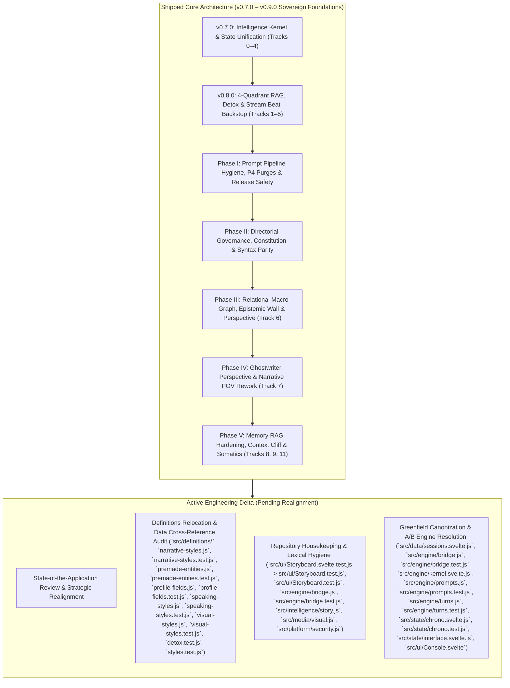

# RPGlitch Technical Roadmap

_AUTHORITATIVE SPECIFICATION (2026-10-14) — Unified, code-grounded engineering backlog synthesized from the Sovereign Engine Architecture, the Prompt Pipeline Audit, and the Entity Referencing Master Plan. Code reality pins: workspace `src/` @1827b58 / f1d8d645 (226/226 in sync). Evidence anchors: sim/dossier.md finding IDs (F1–F7, E2, M1, L1–L35), audit_report.md (Round 1 Gothic Baseline), and identified-issues.md (Issues 1–12, 13–22)._

This roadmap defines the authoritative technical backlog, active engineering sprints, and target architectural blueprints for **RPGlitch**.

- **Temporal Mirror**: `ROADMAP.md` is the **FUTURE mirror** representing exclusively the unbuilt delta between current state and desired target state. Completed milestones are recorded in [CHANGELOG.md](CHANGELOG.md) (the **PAST mirror**).
- **Core Specifications**:
  - [README.md](README.md): Strategic product overview, game design, and simulation philosophy.
  - [README.md](README.md): Authoritative software architecture, layer boundaries, and state reality in `src/`.
  - [DESIGN.md](DESIGN.md): Nordic visual design tokens, typography, and motion contracts.
  - [SECURITY.md](SECURITY.md): Threat defense, input sanitization, and sink controls.
  - [memory-rag-budget-architecture.md](`tmp/memory/memory-rag-budget-architecture.md`): Sovereign memory RAG, token budget reservoirs, and anti-slop specification.
- **Idea Promotion Lifecycle**: Uncommitted mechanical ideas and exploratory proposals incubate in [`.agents/skills/simulation/references/`](.agents/skills/simulation/references/) as `suggestion-*.md`. When an idea is **promoted** from an exploratory possibility into a planned initiative, it is **removed from the incubator and fully migrated into this roadmap**.

---

## 🏛️ System Architecture & The Execution Red Thread

The active engineering delta is organized along a continuous **architectural red thread** designed for maximum execution efficiency. The red thread resolves foundational prompt hygiene and release gating first, establishes directorial governance, unifies the relational macro graph across the Epistemic Wall, hardens memory budgets beneath the context cliff, and concludes with presentation virtualization and empirical live evaluation:

### 🛡️ Release Engineering & Execution Invariants

- **Sovereign Nuclear Architecture & Simplification Protocol (`nuclear-plan.md`)**:
  - **Gate 1: Foundational Scaffolding (`src/engine/`)** — **COMPLETED**:
    - Parallel greenfield engine constructed in `src/engine/` (`verifier.js`, `parser.js`, `sieve.js`, `prompts.js`, `transport.js`, `turns.js`, `kernel.svelte.js`, `dev.svelte.js`, `bridge.js`, `index.js`).
    - Complete test suite coverage across engine units (`verifier.test.js`, `parser.test.js`, `sieve.test.js`, `prompts.test.js`, `transport.test.js`, `turns.test.js`, `kernel.test.js`, `differential.test.js`, `bridge.test.js`) with 42/42 tests passing green.
    - Closed the 5 bridge gaps in `src/engine/bridge.js`: function/string prompt normalization, stream token deduplication, dynamic `director_enabled` app setting toggle, write-back synchronization of entity dynamics (including active user persona dynamics and quadrants), macro round, and full 4-quadrant Caretaker memory diffs (present physical/non-physical, future, and past) dispatched in the background without UI latency, and full history reconstruction with origin attribution in `src/engine/prompts.js` preserving system/fractal roles.
    - Wired visualizer `camera_note` and aesthetic style cues through `PURPOSE_CORES.visualizer.start_with` and `task_block` to `VisualEngine.enhance()` (`src/media/visual.js`, `src/engine/prompts.js`).
    - Hardened visualizer prefill stripping and fallback guards against internal thought markers, and made profile picture resolutions deterministic via tier tables (`src/media/visual.js`, `src/media/optics.js`, `src/ui/profile/VisualWing.svelte`, `src/ui/profile/VisualWing.test.js`, `src/engine/prompts.js`).
    - Standardized comma-separated bracket formatting (`[KEY1: val1], [KEY2: val2]`) across prompt directives (`src/engine/prompts.js`, `src/intelligence/modules/output.js`), parser serialization (`format_clean_brackets`, `apply_bracket_deltas`), normalization (`src/storage/entities.js`), UI inspection (`RelationalGraph.svelte`), and premade archetype definitions (`src/data/definitions/premade-entities.js`, `src/storage/presets.js`).
    - Unified story beat style resolution and prompt composition in `src/media/visual.js` (`resolve_story_beat_style`, `compose_story_beat_prompt`), threading active fractal/app style tokens into background image beats.
    - Resolved post-live-test scaling and sensory gaps:
      - Fixed diffusion output parsing in `src/media/visual.js` to extract `dataUrl` and `image` payloads from host plugins.
      - Aligned `log_message` in `src/data/sessions.svelte.js` and `src/engine/bridge.js` to stamp the assistant turn with `_active_kernel.round` directly.
      - Implemented a canonical working-memory sliding window in `src/engine/prompts.js` capped at `TEMPO_ROUNDS.STANDARD` (8 rounds) to prevent context cliff host truncation.
      - Restored `generate_candidates` facade on `VisualEngine` in `src/media/visual.js` for safe multi-candidate rendering.
      - Replaced hardcoded photo generation prompts in `src/App.svelte` and `src/ui/message/Message.svelte` with `render_optics_fallback` from `@intelligence`, generating prompt-ready aesthetic descriptors with entity traits situated inside the active fractal setting.
      - Standardized visual styles in `src/data/definitions/visual-styles.js` with `llm_refine: true` as the universal default while preserving the `llm_refine: false` bypass on raw/unmodified styles (`none`).
      - Implemented `VisualEngine.enhance()` in `src/media/visual.js` wired to the greenfield `visualizer` purpose core in `src/engine/prompts.js`, resolving dead `visual_engine.enhance` calls in `ImagePicker` and `VisualWing` with structured JSON parsing and style-level bypasses.
      - Aligned `VisualEngine.generate()` return payload to supply both `url` and `image_url`, resolving the profile picture persistence mismatch in `src/ui/profile/VisualWing.svelte` and `src/intelligence/profile.js`.
      - Wired `take_photo()` in `src/App.svelte` to run `visual_engine.enhance()` via the `visualizer` purpose core before dispatching to `visualize()`, with transparent fallback to the draft prompt on failure.
      - Resolved Greenfield Live Forensic Findings from `@752ee63`:
        - Forwarded `options.signal` through `execute_greenfield_turn` -> `Kernel.submit_turn` -> `execute_round` -> `transport.stream` so client stop requests immediately abort in-flight generations.
        - Preserved `style_def.negative_prompt` and injected visual style cues into `VisualEngine.enhance()` so refined diffusion prompts maintain camera/medium/texture style identity.
        - Disambiguated visual style `none` keywords to `["none", "unstyled", "draft", "unmodified"]` to prevent keyword collisions with RAW Photography (`photo`).
        - Emitted `DYNAMICS_DELTA` system telemetry entries on greenfield turns so Quick Shot TelemetryCards update live.
        - Appended Caretaker state mutations to Dexie `mutation_ledger` during `dispatch_caretaker_consolidation` so Back Shot history stays synchronized.
        - Exempted telemetry system rows from empty-text pruning in `src/data/sessions.svelte.js` (`src/data/sessions.test.js`) and protected them against retry rewinds.
        - Enforced upfront signal abortion and gated Caretaker execution on non-empty character prose.
        - Implemented post-hoc sentence-bounded turn pacing backstops in `src/engine/turns.js`.
        - Added explicit `app_style` precedence in `VisualEngine.enhance()` from `src/App.svelte`.
    - Added interactive `GREENFIELD` toggle in `src/ui/console/DevControls.svelte` next to `DEVMODE` for live one-click switching between legacy gamemaster and greenfield kernel.
    - Fixed voice loading guard in `src/ui/profile/AudioWing.svelte` and removed unreferenced `meta?.type` bug in `src/ui/Storymode.svelte`.
    - Resolved 4 greenfield edge cases: round double-increment on greenfield turn advancement in `src/state/chrono.svelte.js`, fractal/system history origin attribution fallback in `src/engine/prompts.js`, orphan retry greenfield branching in `src/state/chrono.svelte.js`, user dynamics rollback in `src/engine/kernel.svelte.js`, and explicit logging on malformed Turn 1 Director fallback in `src/engine/turns.js`.
    - Verified against `differential.test.js` consuming canonical contract fixtures with cross-compilation assertions.
    - Contract synchronized in `src/engine/README.md` with explicit Parallel App coexistence and cutover lifecycle.
  - **Gate 3: Controlled UI Decomposition & Subfolder Eviction (`nuclear-plan.md`)**:
    - **Slice 1: Evict Non-UI Logic from `src/ui/` (COMPLETED)**:
      - Relocated HTML sanitization to `src/utils/html.js` (`sanitize`, `sanitize_to_fragment`, `escape_html`) with re-exports from `src/platform/security.js`.
      - Moved DOM actions to `src/utils/actions.js` (`use_actions`, `click_outside`, `safe_html`, `auto_resize`) and `src/utils/actions.test.js`, updating all UI consumers.
      - Consolidated kinetic physics, spring curves, shared transitions, and card-flight travel into `src/media/motion.svelte.js` (`src/media/motion.test.js`, `src/media/transitions.test.js`) and re-exported from `@media`.
      - Relocated `Shimmer.svelte` to `src/ui/primitives/Shimmer.svelte` and `Typewriter.svelte` / `Typewriter.svelte.js` to `src/ui/message/`.
      - Pruned `src/ui/motion/` directory (`src/ui/motion/card-flight.svelte.js`, `src/ui/motion/engine.svelte.js`, `src/ui/motion/kinetic.svelte.js`, `src/ui/motion/kinetic.test.js`, `src/ui/motion/transitions.svelte.js`, `src/ui/motion/transitions.test.js`, `src/ui/motion/index.js`, `src/ui/motion/Shimmer.svelte`, `src/ui/motion/Typewriter.svelte`, `src/ui/motion/Typewriter.svelte.js`) and retired `@motion` path alias in `vite.config.js` and `audit-layers.js`.
      - Updated callers across `src/App.svelte`, `src/ui/Storyboard.svelte.js`, `src/ui/console/Console.svelte`, `src/ui/console/EndStoryModal.svelte`, `src/ui/console/SettingsButton.svelte`, `src/ui/console/StoryboardBar.svelte`, `src/ui/console/StorymodeBar.svelte`, `src/ui/entity/CardHand.svelte`, `src/ui/entity/EntityCard.svelte`, `src/ui/image/ImagePicker.svelte`, `src/ui/message/Attachments.svelte`, `src/ui/message/Body.svelte`, `src/ui/message/Feed.svelte`, `src/ui/message/TelemetryCard.svelte`, `src/ui/primitives/Backdrop.svelte`, `src/ui/primitives/Dialog.svelte`, `src/ui/primitives/Modal.svelte`, `src/ui/primitives/NumberField.svelte`, `src/ui/primitives/ProgressBar.svelte`, `src/ui/primitives/Skeleton.svelte`, `src/ui/primitives/Slider.svelte`, `src/ui/primitives/TextField.svelte`, `src/ui/primitives/Toggle.svelte`, `src/ui/profile/Profile.svelte`, `src/ui/profile/ProfileHeader.svelte`, `src/ui/story/StoryManager.svelte`.
    - **Slice 2: Prune Trivial Wrapper Primitives in `src/ui/primitives/` (COMPLETED)**:
      - Codified styling patterns into `DESIGN.md` as Tailwind v4 utilities (`@utility glass-input`, `@utility terminal-box`) and synchronized via `sync-css.js`.
      - Inlined `
` in `src/ui/profile/ProfileHeader.svelte`.
      - Inlined semantic pulsing indicator `` in `src/ui/Console.svelte`.
      - Replaced `<Skeleton>` instances in `src/App.svelte` with local Svelte 5 snippet `{#snippet card_skeleton()}` wrapping `<Shimmer color="rgba(255, 255, 255, 0.4)" />`.
      - Replaced `<DataBox>` in `src/ui/message/Body.svelte`, `src/ui/message/TelemetryCard.svelte`, and `src/ui/profile/DevWing.svelte` with native `.terminal-box` containers and clean overflow scrolling.
      - Pruned eliminated primitive component files (`src/ui/primitives/GlassWrapper.svelte`, `src/ui/primitives/Indicator.svelte`, `src/ui/primitives/Skeleton.svelte`, `src/ui/primitives/DataBox.svelte`) and updated `src/ui/primitives/index.js` barrel.
    - **Slice 3: Console Unification into `src/ui/Console.svelte` (COMPLETED)**:
      - Collapsed `src/ui/console/` (9 files: `Console.svelte`, `StoryboardBar.svelte`, `StorymodeBar.svelte`, `ControlPanel.svelte`, `EndStoryModal.svelte`, `AudioControls.svelte`, `SettingsButton.svelte`, `DevControls.svelte`, `index.js`) into a single cohesive organism: `src/ui/Console.svelte`.
      - Inlined sub-bars, accordion decks, and dialogs as Svelte 5 snippets (`settings_gear`, `storyboard_bar`, `storymode_bar`, `control_panel`).
      - Preserved the single persistent mount in `src/App.svelte` and zero cross-view unmount transitions.
      - Relocated test to `src/ui/Console.test.js` and purged `@console` path alias from `vite.config.js` and `audit-layers.js`.
    - Audited and hardened via adversarial EGM Goldfish review (`egm-codebase-details`): JSON escaping in prefill streams, Caretaker 4-quadrant bracket parsing, dynamics delta integer clamping, and clean history-driven turn tempo.
  - **Gate 2: Storage & Persistence Consolidation (`src/storage/`)** — **COMPLETED**:
    - Parallel persistence layer established in `src/storage/` (`parser.js`, `profile-fields.js`, `presets.js`, `entities.js`, `db.js`, `index.js`).
    - Canonical bracket tokenizer, Epistemic Wall filtering, delta merging, and Sieve RAG memory candidate extraction.
    - Strictly preserved IndexedDB schema at `db.version(2)` (`mutation_ledger` included, no vector_cache table) to prevent `versionchange` page collisions.
    - Adapt-on-read legacy row conversion ensuring all 4 quadrants (`eternal`, `present`, `future`, `past`) are pure multiline bracket strings.
    - All 10 premades preserved and author narrative styles inlined with fallback to `"cormac_mccarthy"`.
    - Greenfield persistence test suite (`src/storage/`) passing 100% green (52/52 tests) and engine suites verified at 36/36 tests.
  - **Gate 3: Media & Sensory Subsystems (`src/media/`)** — **COMPLETED**:
    - Greenfield stateless functional generator `dispatch_visual_generation` in `src/media/visual.js` supporting host Perchance discovery, exponential backoff (2500ms initial for 429/503), circuit breaker failure insulation, AbortSignal cancellation, and offline SVG data URI generation for testing.
    - Pure procedural Web Audio synthesizer (`play_sfx`) in `src/media/audio.js` for UI sound effects (`click`, `pop`, `glitch`, `alert`, `subtle_hum`), standalone functions `set_master_volume` and `toggle_mute`, and lightweight Web Speech API fallback preserving positional `speak()` and `Audio.voice` / `Audio.entity_voice` facade surface.
    - Promoted Section 7 nuclear constants added to `src/config.js` and `evaluate_image_trigger` to `@utils/math.js`. Eliminated all upward imports from `src/media/optics.js` into `@intelligence` or `@data`.
    - Greenfield visualizer prompt compiler in `src/media/visualizer.js`, providing byte-identical visual staging prompt assembly without upward layer imports.
    - Transitional coexistence shims in `src/media/audio.svelte.js` and `src/media/visual.svelte.js` preserving parallel operation for legacy consumers (`Feed.svelte`, `Message.svelte`, `story.js`, `main.test.js`).
    - Purged legacy 1,248-line `audio.svelte.js`, 978-line `visual.svelte.js`, and 373-line Kokoro `speech.js` stack.
    - Updated test suites across sensory cortex: created `src/media/visual.test.js`, purged retired `src/media/visual.svelte.test.js`, updated `src/media/tokens.test.js` and `src/media/optics.test.js`, and migrated `src/ui/profile/VisualWing.svelte` to `extract_aesthetic_traits` from `@intelligence/modules/style.js` (`src/intelligence/index.js`) following `aesthetic_resolver` extraction.
    - All 4 media test suites passing 100% green (65/65 tests).
  - **Gate 4: Demolition Execution & Legacy Folder Annihilation (`nuclear-plan.md`)** — **IN PROGRESS**:
    - **Pulse 1: Eradicate `src/platform/` (COMPLETED)**:
      - Purged `src/platform/` entirely (10 files deleted), consolidated zero-trust sandbox and web fetch into `src/utils/html.js`, vector codecs into `src/utils/math.js`, embeddings into `src/utils/embeddings.svelte.js`, signal resilience into `src/utils/resilience.js`, text sanitization into `src/utils/text.js`, and priority gate into `src/engine/gate.js`. Removed `@platform` alias.
    - **Pulse 2: Eradicate `src/data/` (COMPLETED)**:
      - Purged `src/data/` entirely (13 files deleted). Relocated card conversion to `src/storage/card-conversion.js`, sessions driver to `src/storage/sessions.svelte.js`, and ledger replay into `src/storage/db.js`. Exposed `stories` and `entities` facades in `@storage`. Removed `@data` alias across `vite.config.js`, `vitest.config.js`, and `jsconfig.json`. Repointed all UI, state, media, and intelligence consumers. Verified with 72/72 test files green (1,314 tests) and bundle at 1.53 MB.
    - **Pulse 3: Eradicate `src/intelligence/` (COMPLETED)**:
      - Purged `src/intelligence/` entirely (41 files and ~20,000 lines deleted) including legacy prompt compilers, modules (`constitution.js`, `constitution.test.js`, `entities.js`, `entities.test.js`, `output.js`, `output.test.js`, `protocols.js`, `recency.js`, `recency.test.js`, `reflex.js`, `reflex.test.js`, `sheets.js`, `sheets.test.js`, `style.js`, `style.test.js`, `system.js`, `system.test.js`, `task.js`, `task.test.js`), `builder.js`, `builder.test.js`, `director.js`, `director.test.js`, `dynamics.js`, `dynamics.test.js`, `index.js`, `parser.js`, `parser.test.js`, `profile.js`, `profile.test.js`, `prompt-verification.js`, `prompt-verification.test.js`, `prompts.js`, `prompts.test.js`, `story.js`, `temporal.js`, `temporal.test.js`, `veil.js`, `veil.test.js`, and retired obsolete differential tests (`src/engine/differential.test.js`).
      - Separated dynamics declarative registries into `src/definitions/dynamics.js` and pure simulation physics / gravity calculations into `src/engine/dynamics.js` (`src/engine/dynamics.test.js`).
      - Unified profile sorting and enhancement into the single sovereign `caretaker` purpose core via `structure_profile` from `@engine` in `src/ui/Profile.svelte.js` (`src/ui/Profile.test.js`).
      - Implemented `execute_greenfield_epilogue` in `src/engine/bridge.js` and decoupled `Console.svelte` and `chrono.svelte.js` from `gamemaster`.
      - Extracted deterministic engine test fixtures into `src/engine/fixtures.test-util.js`.
      - Removed `@intelligence` alias across `vite.config.js`, `vitest.config.js`, `jsconfig.json`, and `.agents/skills/local-scripts/scripts/audit-layers.js`.
    - **Pulse 4: Eradicate `src/state/`**:
      - Replace reactive state facades with greenfield engine stores in `@engine` / `@ui` and delete `src/state/`.
    - Collapse nested UI directories into flat Svelte 5 domain components without empty wrapper abstractions.
    - Consolidate `src/ui/Typewriter.svelte.js` action into `<script module>` in `src/ui/Typewriter.svelte` and prune wrapper file.
    - Consolidate `src/ui/profile/ProfileHeader.svelte`, `src/ui/profile/FieldHistoryModal.svelte`, and `src/ui/profile/TimelineModal.svelte` directly into `src/ui/Profile.svelte` and flatten profile components (`Profile.svelte`, `Profile.svelte.js`, `Profile.test.js`, `RelationalGraph.svelte`, `RelationalGraph.test.js`, `VisualWing.svelte`, `VisualWing.test.js`, `AudioWing.svelte`, `DevWing.svelte`, `MacroText.svelte`) to top-level `src/ui/`, retiring `src/ui/profile/` and `@profile` path aliases.
    - Consolidate `src/ui/image/ImagePicker.svelte` directly into `src/ui/image/ImagePreview.svelte` as an internal snippet (`picker_overlay`) and prune redundant picker wrapper.
    - Relocate `src/ui/story/StoryCard.svelte` directly to `src/ui/StoryCard.svelte`, pruning empty `src/ui/story/` directory and retiring `@story` path aliases.
    - Re-wire `App.svelte` and `main.js` to `src/engine/` and `src/storage/`.
    - **Pre-Gate-4 Fixes & Greenfield Hardening**:
      - Greenfield user-turn persistence in `src/state/chrono.svelte.js` (mirroring user message write before `execute_greenfield_turn` with abort purge safety; tested in `src/state/chrono.test.js`).
      - Purged dead code `enforce_pacing_backstop` from `src/engine/turns.js` and barrel `src/engine/index.js`.
      - Removed redundant `PURPOSE_CORES.ghostwrite` and `is_continuation` directives from `src/engine/prompts.js`, standardizing the unified character task block.
      - Storage re-point in `src/ui/profile/RelationalGraph.svelte` (`@data` -> `@storage` `list_entities` & `ALL_PREMADES`; tested in `src/ui/profile/RelationalGraph.test.js`).
      - Ghostwriter consolidation in `src/engine/bridge.js` routing drafting turns directly through `execute_turn_2_character` using the active session's shared preemptive transport and 4-quadrant entities, eliminating standalone `src/engine/ghostwriter.js`, `src/engine/ghostwriter.test.js`, and `PURPOSE_CORES.ghostwrite`.
      - Preserved typed seed text during live drafting in `src/ui/console/StorymodeBar.svelte`.
    - **Platform & State Greenfield Pre-Demolition Tasks ([GREENFIELD_CROSSREF.md](GREENFIELD_CROSSREF.md))**:
      - [x] **Pulse 1 Demolition: Eradicate `src/platform/` & Consolidate Primitives**:
        - Completely purged and removed legacy directory `src/platform/` (all 10 modules and test suites eradicated: `embeddings.svelte.js`, `embeddings.test.js`, `index.js`, `llm-gate.js`, `security.js`, `security.test.js`, `transport.js`, `transport.test.js`, `web-fetch.js`, `web-fetch.test.js`).
        - Relocated zero-trust web fetch (`fetch_web`, `validate_url`, `blob_to_data_url`) and sandbox environment hardening (`install_environment_hardening`, `is_perchance_frame_error`) to `src/utils/html.js`.
        - Relocated vector codecs (`serialize_embedding`, `deserialize_embedding`, `quantize_vector_q8`, `dequantize_vector_q8`) to `src/utils/math.js`.
        - Relocated neural embeddings pipeline, LRU cache, and `embeddings_engine` to `src/utils/embeddings.svelte.js` and re-exported via `@utils`.
        - Relocated signal resilience (`merge_abort_signals`) to `src/utils/resilience.js` and output normalization/truncation checks (`looks_truncated`, `raw_to_text`, `raw_stop_reason`, `sanitize_llm`) to `src/utils/text.js`.
        - Relocated priority LLM queue and preemption engine (`LLM_PRIORITY`, `run_llm_job`, `get_llm_gate_status`) to `src/engine/gate.js`.
        - Created temporary bridging transport `src/engine/legacy-transport.js` for active callers during migration pulses.
        - Updated tests (`src/data/normalizer.test.js`, `src/intelligence/director.test.js`, `src/intelligence/temporal.test.js`, `src/main.test.js`, `src/media/visual.test.js`, `src/state/runtime.test.js`, `src/storage/entities.test.js`, `src/ui/Profile.test.js`).
        - Removed `@platform` path alias from `vite.config.js`, `vitest.config.js`, and `jsconfig.json`.
      - [ ] **Shared Preemptive LLM Gate & Singleton Transport (`GREENFIELD_CROSSREF.md`, `src/engine/transport.js:22-112`, `src/engine/bridge.js:220-222, 356-359`, `src/platform/llm-gate.js:79-182`)**: Replace per-turn `create_transport` instantiation in `execute_greenfield_turn` (`src/engine/bridge.js:356-359`) with a shared, preemptible transport/gate instance incorporating `LLM_PRIORITY` (`FOREGROUND: 10` preempting `BACKGROUND: 1`), `preempt_active` (`src/platform/llm-gate.js:79-94`), and `merge_abort_signals` (`src/platform/llm-gate.js:169-182`) so background Caretaker consolidation (`src/engine/bridge.js:220-222`) shares the single-slot gate with foreground turns.
      - [ ] **Embeddings Inference, 1,500-Vector LRU Cache & Q8 Quantization Relocation (`GREENFIELD_CROSSREF.md`, `src/platform/embeddings.svelte.js:52-351`, `src/utils/onnx.js:1-111`, `src/utils/math.js:47-65`, `src/engine/sieve.js:79-204`)**: Relocate `load_model()`, `embed()`, and the 1,500-entry `SvelteMap` LRU cache (`src/platform/embeddings.svelte.js:183-351`) into `src/utils/onnx.js:1-111`, relocate `serialize_embedding`, `deserialize_embedding`, `quantize_vector_q8`, and `dequantize_vector_q8` (`src/platform/embeddings.svelte.js:52-161`) into `src/utils/math.js`, deduplicate `cosine_similarity`, and wire real 384-d embeddings into `src/engine/sieve.js:79-204` and `src/main.js:91`.
      - [ ] **DOMPurify & HTML Escaping Relocation (`GREENFIELD_CROSSREF.md`, `src/platform/security.js:93-124`, `src/utils/html.js:1-271`, `src/ui/actions.js:2`, `src/ui/message/render.js:14`)**: Relocate `sanitize`, `sanitize_to_fragment`, and `escape_html` from `src/platform/security.js:93-124` into `src/utils/html.js` (or `src/ui/actions.js`) and update all UI consumers before `src/platform/` demolition.
      - [ ] **Binary Magic-Byte Image Validation Relocation (`GREENFIELD_CROSSREF.md`, `src/platform/security.js:31-82, 136-168`, `src/ui/primitives/SourceField.svelte:18, 66`)**: Relocate `DEFAULT_MAX_IMAGE_SIZE_BYTES`, `DEFAULT_ALLOWED_IMAGE_MIME_TYPES`, `IMAGE_SIGNATURE_VALIDATORS`, and `validate_image` from `src/platform/security.js:31-82, 136-168` into `src/utils/html.js` (or `src/utils/`) and re-point `src/ui/primitives/SourceField.svelte:18, 66` (or its flat Gate 4 UI replacement).
      - [ ] **Sandbox & ResizeObserver Hardening Relocation (`GREENFIELD_CROSSREF.md`, `src/platform/security.js:179-235`, `src/main.js:15, 26`)**: Relocate `is_perchance_frame_error` and `install_environment_hardening` from `src/platform/security.js:179-235` into `src/main.js:15, 26` (or `src/utils/`).
      - [ ] **3-Tier Session Checkpoint Relocation (`GREENFIELD_CROSSREF.md`, `src/platform/security.js:246-348`, `src/main.js:57`, `src/storage/db.js:334-358`)**: Relocate `save_session_checkpoint`, `load_session_checkpoint`, and `clear_session_checkpoint` (`sessionStorage` -> `window.name` -> in-memory fallback) from `src/platform/security.js:246-348` into `src/storage/db.js` (or `src/main.js:57`) so reload-safe session recovery survives `src/platform/` deletion.
      - [ ] **Web Fetch & Zero-Trust URL Ingestion Relocation (`GREENFIELD_CROSSREF.md`, `src/platform/web-fetch.js:29-226`, `src/utils/html.js:1-271`, `src/ui/primitives/SourceField.svelte:18, 67, 76, 105`)**: Relocate `get_super_fetch_engine`, `blob_to_data_url`, `validate_url`, and `fetch_web` from `src/platform/web-fetch.js:29-226` into `src/utils/html.js` and re-point `src/ui/primitives/SourceField.svelte:18, 67, 76, 105`.
    - Demolition of legacy directories (`src/intelligence/`, `src/data/`, `src/state/`, `src/platform/`).

- **Prompt Pipeline V2 Unification Initiative**:
  - The architectural exploration dossier [architectural-exploration.md](`architectural-exploration.md`) is drafted and aligned around the Universal Spatial Spine (Model A) + Swappable Cores, Universal 4-Dial Entity Projector, and Strategy B Two-Tier RAG Sieve. Active open decisions (Decisions 4–7) are staged in Section 10 pending user commitment before initiating compiler refactoring.

- **Prompt Byte Contract Gate:** Any change to prompt-emitted strings alters contract byte-pins and baseline fixtures. Prompt changes are bundled logically to minimize baseline re-cut frequency.
- **Pins-Survive Rule:** Byte-pins in test fixtures must survive refactoring intact unless the prompt's emitted syntax is deliberately altered. When a prompt tag or delimiter changes across modes, all 12 contract modes must be audited and re-pinned together under a single atomic verification pulse.
- **Variant Mechanism Protocol:** Output variants (such as `selfie`, character portraits, and scene visuals) must be resolved at the prompt compiler boundary through explicit schema options rather than ambient state or mutable global singletons.
- **Detox-Trial Calibration:** Generated prose detoxification passes (`detox_prose`) evaluate anti-cliché, authorial voice neutrality, and somatic constraints against calibrated style definitions (`casual`, `lyrical`, `primal`, `clinical`). Trials and threshold calibrations must run against frozen fixtures to preserve somatic physics.
- **Byte-Identity Advantage:** Wherever code deduplication or refactoring achieves identical compiler output, it is deployed as an immediate zero-risk quick win.
- **Empirical Measurement Precedence:** Structural hypotheses that alter generation behavior (e.g. think-before-input sequencing, pacing alterations) are measured through the test harness before locking.
- **P4 Pre-Beta Purity:** Never retain dead compatibility shims, unused layers, or unconsumed schema attributes. Refactor downstream consumers and purge dead code immediately.

---

## 🚀 The Active Engineering Delta

---

### Sprint: State-of-the-Application Review & Track A Local Investigations

A comprehensive, code-grounded review of the running application and execution of Track A (Unblocked Local Investigations) to resolve known state machine bottlenecks, audit prompts, and enforce architectural invariants.

- **Objective**: Execute Track A local investigations and canonical configuration harmonization: fix composer queued state machine, generate prompt atom matrix in audit harness, rebuild central `src/config.js` with literary scale, and wire canonical contracts across intelligence, data, media, and state layers under P4 purity.
- **Scope & Target Files**:
  - `src/data/definitions/profile-fields.js` (dynamic flat leaf map derivation and legacy alias purge)
  - `src/intelligence/profile.test.js` (profile domain schema hydration and canonical key mapping tests)
  - `src/data/db.test.js` (compound index health and batch ledger query benchmark tests)
  - `src/data/ledger.test.js` (discrete mutation ledger persistence and event-sourcing tests)
  - `src/engine/bridge.js` (greenfield-to-UI coexistence bridge connecting Kernel to active Svelte views)
  - `src/state/chrono.svelte.js` (wire greenfield engine bridge with toggleable use_greenfield_engine flag)
  - `src/state/interface.svelte.js` (purge dead Kokoro neural voice checks from models_ready/models_progress)
  - `src/state/interface.test.js` (verify models_ready and models_progress behavior)
  - `src/ui/ChatBubble.svelte` (unified message bubble chassis consolidating headers, narrative prose, think block drawers, audio controls, prologue, epilogue, attachments gallery, and inlined telemetry module)
  - `src/ui/ChatBubble.test.js` (telemetry formatting, directed edge parsing, and quadrant tests)
  - `src/ui/Typewriter.svelte` (typewriter text stream presenter)
  - `src/ui/Typewriter.svelte.js` (typewriter element action interface)
  - `src/ui/message/ChatBubble.svelte` (unified message bubble chassis consolidating headers, narrative prose, think block drawers, audio controls, prologue, and epilogue layouts)
  - `src/ui/message/Feed.svelte` (message stream rendering re-pointed to ChatBubble and relocated UndoToast)
  - `src/ui/message/Message.svelte` (merged into ChatBubble.svelte)
  - `src/ui/message/MessageHeader.svelte` (merged into ChatBubble.svelte)
  - `src/ui/message/Body.svelte` (merged into ChatBubble.svelte)
  - `src/ui/message/Prologue.svelte` (merged into ChatBubble.svelte)
  - `src/ui/message/Epilogue.svelte` (merged into ChatBubble.svelte)
  - `src/ui/message/Attachments.svelte` (relocated to src/ui/image/Attachments.svelte)
  - `src/ui/image/Attachments.svelte` (image attachments gallery relocated from message layer to @image)
  - `src/ui/image/index.js` (re-exporting Attachments gallery primitive)
  - `src/ui/message/UndoToast.svelte` (relocated to src/ui/UndoToast.svelte)
  - `src/ui/UndoToast.svelte` (soft-delete countdown grace period toast relocated to @ui near Console)
  - `src/ui/index.js` (re-exporting UndoToast alongside Console chassis)
  - `src/ui/message/index.js` (re-exporting ChatBubble, TelemetryCard, and Typewriter)
  - `src/ui/message/TelemetryCard.svelte` (consolidated telemetry module unifying quick shot, back shot, and vector resolution; renders individual bracket boxes with clean quadrant headers)
  - `src/ui/message/TelemetryCard.test.js` (telemetry formatting, directed edge parsing, and quadrant tests)
  - `src/ui/message/telemetry-format.js` (clean_text_debris, parse_relationship_edge, vector_label, and entity block projection)
  - `src/intelligence/modules/sheets.js` (render_entity_memory_context clean bracket quadrant rendering for Continuum Caretaker)
  - `src/intelligence/modules/sheets.test.js` (sheets module tests verifying clean quadrant envelopes)
  - `src/data/definitions/premade-entities.js` (flattening 10 premades to universal bracket strings across all 4 quadrants)
  - `src/data/normalizer.js` (schema normalization to 4 flat quadrant strings)
  - `src/intelligence/story.js` (somatic vs fractal dynamics delta scope isolation)
  - `src/ui/console/StorymodeBar.svelte` (composer serialized queue drainer and unstick resilience)
  - `src/config.js` (master canonical system configuration, literary scale, latency tiers, and subsystem domain agreements)
  - `src/intelligence/temporal.js` (memory past, eternal, present character caps and hybrid retrieval scoring weights)
  - `src/intelligence/temporal.test.js` (memory RAG character budget tests)
  - `src/intelligence/modules/history.js` (dialogue and visual feed window defaults and chapter prompt history slice)
  - `src/intelligence/modules/history.test.js` (history defaults contract verification)
  - `src/intelligence/modules/reflex.js` (momentum stagnation tiers, spent ledger window, and opening clause min chars)
  - `src/intelligence/modules/reflex.test.js` (reflex pacing and spent ledger contract tests)
  - `src/data/normalizer.js` (entity schema name bounds, chapter archive capacity, and paragraph summaries)
  - `src/intelligence/dynamics.js` (dynamics scale and image trigger cooldown threshold)
  - `src/intelligence/dynamics.test.js` (dynamics gate unit tests)
  - `src/media/optics.js` (unified 3-round image cooldown arbitration and dynamics scale thresholds)
  - `src/media/optics.test.js` (optics trigger arbitration test suite)
  - `src/intelligence/modules/entities.js` (cast summary word-boundary truncation unified to 100 chars)
  - `src/intelligence/modules/entities.test.js` (cast summary contract tests)
  - `src/utils/text.js` (calibrated CHARS_PER_TOKEN and bracket-safe truncate_at_boundary)
  - `src/utils/text.test.js` (text boundary truncation test suite)
  - `src/utils/html.js` (web and lore ingestion limits wired to canonical system configuration)
  - `src/utils/styles.js` (SOMATIC_MARKER_CAP wired to canonical system configuration)
  - `src/platform/embeddings.svelte.js` (EMBEDDING_SPECS wired to canonical system configuration)
  - `src/platform/llm-gate.js` (honest priority literals with zero external config dependencies)
  - `src/utils/job-queue.js` (de-bloated concurrency queue without phantom lifecycle state)
  - `src/utils/job-queue.test.js` (concurrency worker and superseding test suite)
  - `src/media/visual.svelte.js` (IMAGE_RESOLUTIONS alignment with canonical system configuration)
  - `src/utils/resilience.js` (canonical latency tiers and patience policy circuit breaker defaults)
  - `src/state/status.svelte.js` (freeze watchdog intervals wired to canonical latency tiers)
  - `.agents/skills/simulation/scripts/simulation-audit.js` (automated prompt atom matrix)
  - `.agents/skills/simulation/scripts/simulation-audit.test.js` (wire atom matrix tables into unified report)
  - `.agents/skills/simulation/scripts/consolidation-stress.test.js` (100-round consolidation invariant test)
  - `.agents/skills/local-scripts/scripts/audit-layers.js` (strict layer boundary enforcement gate)
  - `src/ui/message/feed-dom-benchmark.test.js` (feed DOM profiling benchmark)
  - `src/media/audio.test.js` (AudioContext lifecycle and teardown contract verification)
  - `src/intelligence/modules/recency.js` (rebranded dialogue history emitting <RECENT_ROUNDS> and <ENTRY round="..." origin="...">)
  - `src/intelligence/modules/recency.test.js` (recency module contract and window verification)
  - `src/intelligence/modules/sheets.js` (dynamic 4-quadrant RAG entity sheet formatting and boundary-safe truncation)
  - `src/intelligence/prompts.js` (dynamic prompt character headroom metering, director recency dedup, and ghostwriter draft seeding)
  - `src/intelligence/modules/constitution.js` (folded constitution plan into direct render_constitution)
  - `src/intelligence/modules/constitution.test.js` (direct render_constitution contract tests)
  - `src/intelligence/modules/output.js` (direct output string builder without plan wrapper hops)
  - `src/intelligence/modules/protocols.js` (folded protocol plan into direct render_core_protocols and purged catalog usage)
  - `src/intelligence/modules/protocols.test.js` (protocols module unit tests)
  - `src/intelligence/modules/system.js` (direct compose_system with role interpolation without catalog indirection)
  - `src/intelligence/modules/system.test.js` (system composition unit tests)
  - `src/intelligence/modules/task.js` (folded task plan into direct render_task and authorial voice sovereignty dedup)
  - `src/intelligence/modules/task.test.js` (task plan contract tests)
  - `src/intelligence/modules/recency.js` (collapsed sensory and history formatting into direct string builders)
  - `src/intelligence/modules/reflex.js` (direct stability and prose posture builders with inlined atom interpolation)
  - `src/intelligence/modules/entities.js` (inlined actor sheet mapping into render_entity_sheets)
  - `src/intelligence/builder.js` (eliminated to_data_points round-tripping for eternal and present fields; wired has_bracket_bond)
  - `src/intelligence/index.js` (pruned internal plan function exports)
  - `src/data/sessions.svelte.js` (wired universal has_bracket_bond for entity selection bracket checks)
  - `src/utils/catalog.js` (purged obsolete catalog lookup engine)
  - `src/utils/catalog.test.js` (purged catalog test suite)
  - `src/utils/xml.js` (inlined interpolate_tokens and property path traversal in render_atom_xml)
  - `src/utils/index.js` (purged catalog export barrel)
  - `src/intelligence/index.js` (barrel export migration from history.js to recency.js)
  - `src/intelligence/builder.js` (import migration from history.js to recency.js)
  - `src/intelligence/builder.test.js` (contract assertions update for ENTRY and ALTERNATION_OPTIONS)
  - `src/intelligence/director.test.js` (director prompt origin and entry contract tests)
  - `src/intelligence/modules/output.js` (director output formatting and lead-actor staging)
  - `src/intelligence/modules/task.test.js` (task module contract test suite)
  - `src/intelligence/prompt-verification.js` (mode contract envelope definitions and tag inventory)
  - `src/intelligence/prompt-verification.test.js` (universal envelope contract and layer tests)
  - `src/intelligence/prompts.test.js` (prompt compilation and structural tests)
  - `.agents/skills/simulation/scripts/prompt-contract.test.js` (contract byte-pins re-pinning)
  - `src/lib/vitest-examples/Welcome.svelte` (purged obsolete template file)
  - `src/lib/vitest-examples/Welcome.svelte.spec.js` (purged obsolete template test)
  - `src/lib/vitest-examples/greet.js` (purged obsolete template file)
  - `src/lib/vitest-examples/greet.spec.js` (purged obsolete template test)
  - `src/data/ledger.js` (event-sourcing ledger Genesis multiline bracket replay fix and story_id normalization)
  - `src/data/ledger.test.js` (Genesis bracket preservation across single-key updates test suite)
  - `src/data/repository.js` (entity deep clone structuredClone migration and header cleanup)
  - `src/intelligence/modules/style.js` (pure flatten_aesthetic_map trait flattening extraction)
  - `src/intelligence/story.js` (execute_ghostwriter redundant entity sanitization loop purge)
  - `src/intelligence/veil.js` (dead strip_relational_brackets purge)
  - `src/state/runtime.svelte.js` (character getter reduction and save_entity proxy decoupling)
  - `src/App.svelte` (unified run_image_regeneration and run_mock streaming lock)
  - `src/ui/image/ImagePicker.svelte.js` (canonical run_image_regeneration pipeline)
  - `src/ui/image/ImagePicker.svelte` (handle_regenerate deduplication)
  - `src/ui/image/ProfilePicture.svelte` (avatar presenter and image rendering)
  - `src/ui/entity/ContextMenu.svelte` (reusable portalled viewport-clamped context menu component)
  - `src/ui/entity/ContextMenu.svelte.js` (context menu anchor positioning and runes state)
  - `src/ui/entity/EntityCard.svelte` (portalled menu deduplication)
  - `src/ui/ContextMenu.svelte` (flattened context menu component)
  - `src/ui/ContextMenu.svelte.js` (flattened context menu controller)
  - `src/ui/EntityCard.svelte` (flattened entity card component)
  - `src/ui/ImagePreview.svelte` (flattened image preview modal)
  - `src/ui/ProfilePicture.svelte` (flattened avatar presenter)
  - `src/ui/message/Message.svelte` (portalled badge menu deduplication)
  - `src/state/status.svelte.js` (purged bottom changelog block; WATCHDOG_POLICY direct consumption)
  - `src/state/status.test.js` (WATCHDOG_POLICY timing thresholds test contract)
  - `src/state/log.svelte.js` (purged bottom changelog block; TELEMETRY_CAPS direct consumption)
  - `src/state/log.test.js` (TELEMETRY_CAPS developer log buffer cap test contract)
  - `src/state/interface.svelte.js` (purged bottom changelog block)
  - `src/state/chrono.svelte.js` (purged bottom changelog block)
  - `src/state/index.js` (purged bottom changelog block)
  - `src/state/runtime.test.js` (purged bottom changelog block)
  - `src/utils/bridges.js` (mode-tagged prompt token snapshot recording and peak tracking)
  - `src/intelligence/director.js` (brief input sensory physical micro-directive injection)
  - `src/ui/primitives/Accordion.svelte` (trigger inline caret alignment)
  - `src/ui/primitives/DataBox.svelte` (settled 2-cycle resonance pulse)
  - `src/ui/message/Body.svelte` (collapsible developer mode thoughts accordion)
  - `src/ui/message/TelemetryVector.svelte` (memory card engine flag stripping)
  - `src/ui/message/TelemetryBlocks.svelte` (telemetry block engine flag stripping)
  - `src/ui/message/render.js` (concealed bracket and covert directive suppression)
  - `src/ui/message/render.test.js` (concealed bracket rendering unit tests)
  - `src/ui/message/MessageHeader.svelte` (unextended h-0 header DOM weight elimination)
  - `src/ui/Storymode.svelte` (feed ghost row suppression)
  - `src/ui/message/ChatBubble.svelte` (unified message bubble consolidating Message, MessageHeader, Body, Prologue, Epilogue)
  - `src/ui/message/TelemetryCard.svelte` (re-pointed to Storymode parse_message)
  - `src/ui/Storyboard.svelte.js` (re-pointed to Storymode parse_message)
  - `src/ui/index.js` (exported Storymode, storymode_state, parse_message, wrap_dialogue, take_photo, regenerate_image, UndoToast)
  - `src/ui/message/index.js` (pruned Feed and render.js exports)
  - `src/ui/message/Feed.svelte` (deleted; merged into Storymode.svelte)
  - `src/ui/message/render.js` (deleted; merged into Storymode.svelte)
  - `src/App.svelte` (slimmer shell; relegated photo and mock handlers to Storymode; retired Layout.svelte)
  - `src/ui/Storyboard.svelte` (consolidated Storyboard.svelte.js, Layout storyboard slots, and CardHand.svelte)
  - `src/ui/Storyboard.svelte.js` (deleted; merged into Storyboard.svelte)
  - `src/ui/Storyboard.svelte.test.js` (re-pointed imports to Storyboard.svelte)
  - `src/ui/Layout.svelte` (deleted; stage layout owned by App, Storyboard, and Storymode)
  - `src/ui/entity/CardHand.svelte` (deleted; merged into Storyboard.svelte)
  - `src/ui/entity/index.js` (pruned CardHand export)
  - `src/ui/Console.svelte` (consolidated StoryManager.svelte into Library accordion deck)
  - `src/ui/story/StoryManager.svelte` (deleted; merged into Console.svelte)
  - `src/ui/story/index.js` (pruned StoryManager export)
- **Key Modules**: `src/ui/`, `src/state/`, `src/intelligence/`, `src/data/`, `src/media/`, `src/utils/`, `src/config.js`, `src/lib/`.

---

## 🏛️ Master Verification & Auditable Proof Matrix

| Phase / Track                 | Subsystem / Feature                                | Target Files                                                                                                                                                                                                                         | Verification Proof                                                                                                                                                                                                                                                                                                                                       |
| :---------------------------- | :------------------------------------------------- | :----------------------------------------------------------------------------------------------------------------------------------------------------------------------------------------------------------------------------------- | :------------------------------------------------------------------------------------------------------------------------------------------------------------------------------------------------------------------------------------------------------------------------------------------------------------------------------------------------------- |
| **Phase I**                   | **Prompt Hygiene & P4 Foundation**                 | `src/intelligence/modules/system.js`, `src/intelligence/builder.js`, `src/intelligence/modules/task.js`, `src/intelligence/modules/protocols.js`, `src/intelligence/modules/reflex.js`, `src/intelligence/prompts.js`, `SECURITY.md` | Lorebook purge clean in `system.test.js`; byte-identical agency output verified; 5-channel registry frozen; alternative branches gated; candidate spatial pointer fixed; `<SPENT_LEDGER>` XML pilot passing in `reflex.test.js`; `<BEAT_BUDGET>` priority asserted; optics split asserted in `protocols.test.js`.                                        |
| **Phase II**                  | **Directorial Governance & Syntax Parity**         | `src/intelligence/modules/constitution.js`, `src/intelligence/prompts.js`, `src/intelligence/modules/task.js`, `src/intelligence/director.js`, `src/intelligence/story.js`, `src/intelligence/dynamics.js`                           | Unit tests asserting `DIRECTOR_CONSTITUTION` rendered in Shot 1 system envelope; deconstructed directives verified; dynamic axes delta attributes verified; typed XML compilers verified across Shot 1; climax sovereignty guard verified; stagnation drift interlocutor comparison verified; Director routing rules & keyword subtext pipeline audited. |
| **Phase III (Track 6)**       | **Relational Macro Graph & Perspective**           | `src/utils/macros.js`, `src/intelligence/veil.js`, `src/intelligence/modules/sheets.js`, `src/intelligence/builder.js`, `src/ui/profile/RelationalGraph.svelte`                                                                      | Secondary NPC identity isolation test passing; veil-first pipeline ordering test clean; `RelationalContext` tuple compiler-side test; 1-word `@id` resolution asserted; replay round-trip attribute compaction test; storage ban standing gate test for turn roles; 360° dossier dedup asserted.                                                         |
| **Phase IV (Track 7)**        | **Ghostwriter Perspective & Narrative POV**        | `src/intelligence/prompts.js`, `src/intelligence/modules/task.js`, `src/intelligence/story.js`, `src/data/definitions/profile-fields.js`                                                                                             | Unit test verifying ghostwrite output reflects persona's POV setting via scoped base; npc-turn regression test pinning Track 0.6 merge behavior; owner `&#124; hide` preserved; decoupled authorial voice test clean.                                                                                                                                    |
| **Phase V (Tracks 8, 9, 11)** | **Memory RAG Hardening, Context Cliff & Somatics** | `src/intelligence/modules/entities.js`, `src/intelligence/modules/sheets.js`, `src/intelligence/temporal.js`, `src/ui/profile/DevWing.svelte`                                                                                        | Unit test verifying `<ENTITIES>` block respects 2,000 token cap; test verifying `&#124; hide` survival across forge consolidation; somatic recall clarity wiring test; live token breakdown bar chart in DevWing functional; background forge concurrency test clean.                                                                                    |

---

## 🏛️ Historical Shipped Milestones

The complete historical specifications, task decompositions, and touchpoint references have been preserved in the archive:

- **[Release Notes (Unreleased)](CHANGELOG.md#unreleased)**: Sovereign Red Thread Phases I through V (Phase I Prompt Pipeline Hygiene & Release Safety, Phase II Directorial Governance & Syntax Parity, Phase III Relational Macro Graph & Perspective, Phase IV Ghostwriter Perspective & Narrative POV Rework, and Phase V Memory RAG Hardening, Context Cliff & Somatics with sub-items 5.1–5.6, token calibration, somatic recall degradation, DevWing token HUD, and design token consolidation).
- **[Release Notes (v0.8.0)](CHANGELOG.md#080---2026-10-12)**: Tracks 1 through 5 (4-Quadrant RAG & Dynamic Token Budget Reservoir, Simulation Log Pipeline Harmonization, Anti-Slop Narrative Detox & The Spent Ledger, Scene Momentum & Stagnation Backstop, Runtime Stream Beat Backstop & Continuation `finishTail`, and P4 Purges).
- **[Release Notes (v0.7.0)](CHANGELOG.md#070---2026-10-11)**: Tracks 0 through 4 (Intelligence Kernel Language & Domain Purity, State & Physics Core Unification, Hierarchical Memory & 6k Context Protection, Narrative Pacing & Story Experience, Task Compiler Deconstruction).

---

## 📌 Parking Lot & Tactical Backlog

- **Console-Integrated Undo Bar Interaction**:
  - Unify the soft-delete grace period countdown (`UndoToast.svelte`) directly into the floating bottom `Console.svelte` chassis.
  - When a user deletes a message in the feed, rather than rendering an inline toast block inside the feed scroll area, the console pill transitions temporarily into an alert/undo bar (showing "Message deleted", a countdown shrink bar, and a quick "Undo" trigger button) before returning to the active composer/action mode.
- **Sensory Presentation, Virtualization & Live A/B Harness (Former Phase VI)**:
  - _Feed Virtualization Recon & DOM Windowing_: Trace `visible_feed` upstream of `Feed.svelte`; implement measured DOM windowing keeping only visible messages mounted for smooth 60fps scrolling in 100+ turn roleplays. Audit round sequence step increments (`chrono.svelte.js`) under rapid user submissions (`[BUG]` F6).
  - _Slash Command Directing Bar_: Floating shortcut bar above message input allowing direct Director intervention (`/ooc`, `/time`, `/mood`) without polluting in-character dialogue.
  - _Persistent Session Image Archive & Optics Framing Lenses_: Dedicated gallery modal querying Dexie image attachments across the current story with thumbnail caching. Verify scheduled Director Visual Beats faithfully retain camera lenses, framing descriptors, and aesthetic negative maps through `render_optics_prompt`.
  - _Live Prompt A/B Testing & Evaluation Harness on Perchance_: Interactive prompt A/B evaluation harness against Perchance's live endpoint measuring token budget economy, TTFT, `<THINK>` quality, detox compliance, and context truncation resilience. Test cognitive stimulus ordering (`<INPUT>` before `<THINK_FORMAT>`), prose macro shape anti-slop audit integration (`src/utils/styles.js:186`), and think-channel deduplication.
- **Card Conversion & Import Reliability**: Hardened character import parsing and normalization (`src/data/card-conversion.js`, `src/data/card-conversion.test.js`, `src/intelligence/parser.test.js`, `src/intelligence/profile.js`, `src/ui/entity/ImportModal.svelte`, `src/ui/primitives/TextField.svelte`) supporting boxed String coerion, textarea layout formatting, and JSON salvage in parser layers during character card ingestion.
- **Platform Embeddings Retry & Native Config Modernization**: Hardened `src/platform/embeddings.svelte.js` pipeline reset to preserve `_debug_pipeline_fn` under retry during Node/Vitest suites, eliminating ESM cross-origin import errors. Modernized `vitest.config.js` and `vite.config.js` to `import.meta.dirname` and tuned `teardownTimeout: 4000` to prevent fork pool timeouts.
- **Intelligence Suite Type-Narrowing Hardening (`src/intelligence/prompts.test.js`)**: Replaced loose `in` operator assertion (`expect("task" in mode).toBe(false)`) with `Reflect.has(mode, "task")` to resolve TypeScript/IDE `in-operator-narrowing` diagnostics cleanly.
- **Dynamic Turn Headroom Metering & Entity Allocation (`src/intelligence/prompts.js`)**:
  - Dynamically calculate prompt character headroom on a turn-by-turn basis before assembling character profiles.
  - Measure the exact footprint of fixed/supportive modules (`SYSTEM`, `CONSTITUTION`, `PROTOCOLS`, `HISTORY`, `TASK`) in real time, and subtract from `PROMPT_CHAR_ENVELOPE` (20,000 chars) to know the exact remaining character budget available for the `ENTITIES` module (speaker, listener, fractal, and memory vectors), eliminating artificial static budget middleman variables.
- **Simulation Core & Intelligence Pipeline Hardening (Master Investigation Recommendations)**:
  - _1. Primary Cast Sheet Dynamic Compression (`src/intelligence/modules/sheets.js`)_: When total entity content exceeds dynamic turn headroom, compress primary cast sheets (`AI`, `USER`, `FRACTAL`) from `"full"` mode to `"compact"` (retaining physical anchor brackets and active standing agenda).
  - _2. Actor Embodiment vs. Narrator POV (`src/intelligence/director.js`, `prompts.js`)_: Maintain Fractals as strictly 3rd-person environmental entities; when Director delegates to AI, compile in `interaction` mode embodying configured 1st-person POV (_"I"_, _"my gauntlet"_) rather than 3rd-person narrator prose.
  - _3. Hard Constitutional User Sovereignty Boundary (`src/intelligence/modules/constitution.js`)_: Add explicit negative constraint in `<AXIOMATIC_CONSTITUTION>`: _"«USER_PERSONA» dialogue is strictly forbidden. Never emit spoken quotes attributed to «USER_PERSONA»."_
  - _4. Prompt Atom Compaction (`src/intelligence/modules/`)_: Deduplicate sovereignty restatements, trim repetitive scene directives, and simplify `<THINK>` closing boilerplate to reclaim ~100 tokens/shot.
  - _5. Memory Forge Scope Lockdown (`src/intelligence/story.js`)_: In `director_background_queue`, strictly bound entity consolidation to active story cast `[story.ai_id, story.user_id, story.fractal_id, ...(story.npc_ids || [])]`, preventing queries/mutations on inactive Dexie library records.
  - _6. Settled Fact Hallucination Prevention (`src/intelligence/modules/task.js`)_: When somatic fragmentation fires (`Chaos >= DYNAMICS_SCALE.HIGH` `[75]` or `Entropy >= DYNAMICS_SCALE.HIGH` `[75]`) triggering block glyphs (`■■■`), inject into `<TASK>`: _"When recall is degraded (■), acknowledge uncertainty or sensory static. Never invent or hallucinate exact verbatim dialogue."_
  - _7. Canonical Single-Word Slug Generator (`src/utils/text.js`, `normalizer.js`)_: Enforce regex normalization on generated entity bracket handles: uppercase, single-word snake_case (`@LORD_SILVERS`, not `@LORD SILVERS`).
- **Scattered Tuning Constants**: Re-evaluate a dedicated tuning surface (`src/intelligence/config.js` or `tuning.js`) consolidating stagnation trip points inline in `prompts.js:182` (8/16), salience multipliers inline in `temporal.js`, and token budgets in `history.js:81+`.
