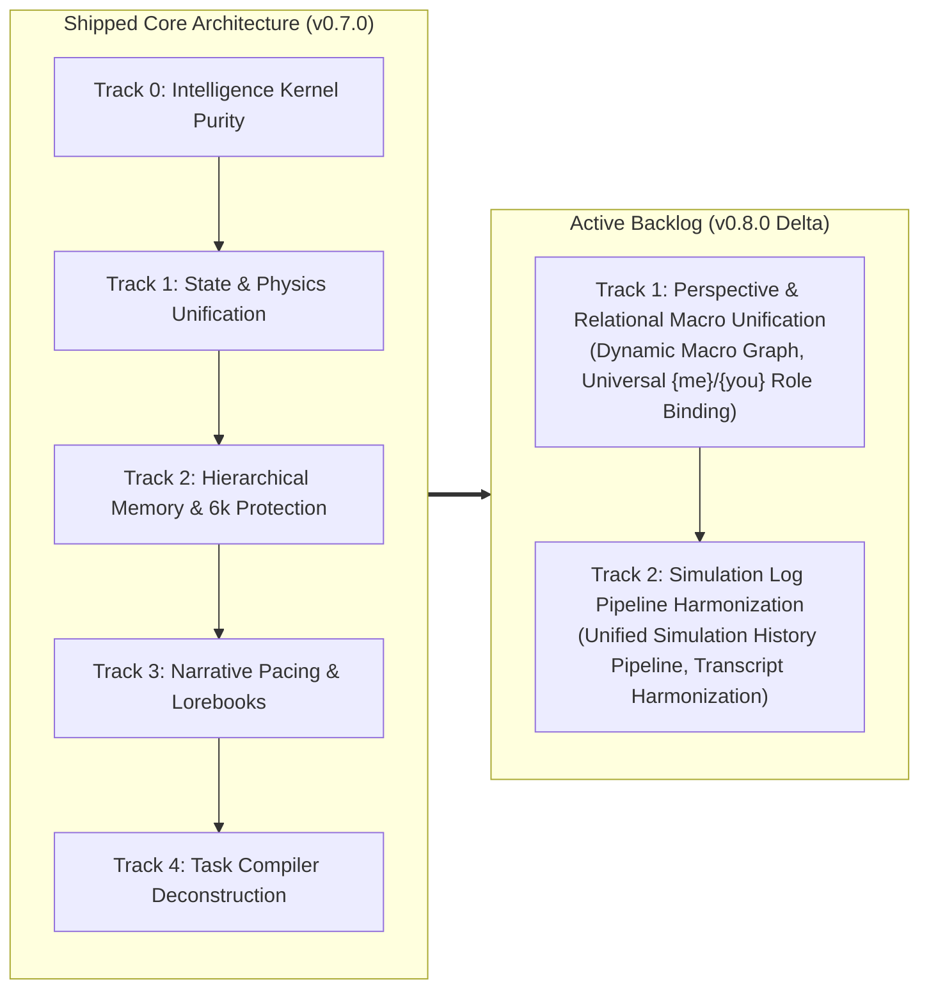

# RPGlitch Technical Roadmap

This roadmap defines the authoritative technical backlog, active engineering sprints, and target architectural blueprints for **RPGlitch**.

- **Temporal Mirror**: `ROADMAP.md` is the **FUTURE mirror** representing exclusively the unbuilt delta between the current state and the desired target state. Completed milestones are recorded in [CHANGELOG.md](CHANGELOG.md) (the **PAST mirror**).
- **Core Specifications**:
  - [README.md](README.md): Strategic product overview, game design, and simulation philosophy.
  - [ARCHITECTURE.md](ARCHITECTURE.md): Authoritative software architecture, layer boundaries, and state reality in `src/`.
  - [DESIGN.md](DESIGN.md): Nordic visual design tokens, typography, and motion contracts.
  - [SECURITY.md](SECURITY.md): Threat defense, input sanitization, and sink controls.
- **Idea Promotion Lifecycle**: Uncommitted mechanical ideas and exploratory proposals incubate in [`.agents/skills/simulation/references/`](.agents/skills/simulation/references/) as `suggestion-*.md`. When an idea is **promoted** from an exploratory possibility into a planned initiative, it is **removed from the incubator and fully migrated into this roadmap**.

---

## 🏛️ Engineering Backlog & Tracks at a Glance

All foundational sprints for the Sovereign Engine Core (**Tracks 0 through 4**) have successfully shipped (recorded in [CHANGELOG.md](CHANGELOG.md)).

---

## 🚀 Active Engineering Backlog (Target Delta)

### Track 1: Perspective & Relational Macro Unification

- **Objective**: Deconstruct and unify entity relational perspectives with role resolution.
- **Key Modules**: `src/utils/macros.js`, `src/intelligence/veil.js`, `src/ui/profile/RelationalGraph.svelte`.
- **Planned Sub-Items**:
  - [ ] **1.1 Dynamic Perspective Resolution**: Wire `{me}` and `{you}` dynamically across speaker, listener, and target owner contexts.
  - [ ] **1.2 Cross-Quadrant Relational Propagation**: Synchronize relational vectors between `eternal.non_physical` and `present.non_physical`.

### Track 2: Simulation Log Pipeline Harmonization

- **Objective**: Eliminate redundant conversation log generators across the engine.
- **Key Modules**: `src/state/log.svelte.js`, `src/utils/story-export.js`, `src/intelligence/modules/history.js`.
- **Planned Sub-Items**:
  - [ ] **2.1 Single Canonical History Formatter**: Unify prompt history compilation and export transcript serialization into a single shared pipeline.
  - [ ] **2.2 High-Performance Dexie Query Windowing**: Streamline log history fetch queries during active round advancement.

### Track 3: Anti-Slop Design & Narrative Detox Hardening

- **Objective**: Harden narrative prose and design system against AI tropes, typographic slop, and motion jank.
- **Key Modules**: `src/utils/detox.js`, `src/utils/detox.test.js`, `src/data/definitions/speaking-styles.js`.
- **Planned Sub-Items**:
  - [x] **3.1 Punctuation Normalization**: Replace raw em-dashes and en-dashes with clean punctuation.
  - [x] **3.2 Cliché Filter Expansion**: Cleanse pseudo-poetic formulas ("quietly [verb]", "testament to", "dance/symphony of").
  - [x] **3.3 Motion & Defensive Layout Gates**: Enforce Ten Commandments of Motion and defensive text bounds.

---

## 🏛️ Historical Shipped Milestones

All foundational sprints for the Sovereign Engine Core (**Tracks 0 through 4**) have shipped (2026-10-11).
The complete historical specifications, task decompositions, and touchpoint references have been preserved in the archive:

- **[Release Notes (v0.7.0)](CHANGELOG.md#070---2026-10-11)**: Tracks 0 through 3.
- **[Release Notes (Unreleased)](CHANGELOG.md#unreleased)**: Track 4 (Deep Task Compiler Deconstruction).
