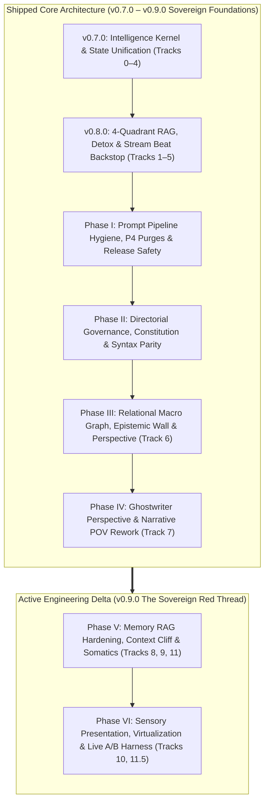

# RPGlitch Technical Roadmap

_AUTHORITATIVE SPECIFICATION (2026-10-14) — Unified, code-grounded engineering backlog synthesized from the Sovereign Engine Architecture, the Prompt Pipeline Audit, and the Entity Referencing Master Plan. Code reality pins: workspace `src/` @1827b58 / f1d8d645 (226/226 in sync). Evidence anchors: sim/dossier.md finding IDs (F1–F7, E2, M1, L1–L35), audit_report.md (Round 1 Gothic Baseline), and identified-issues.md (Issues 1–12, 13–22)._

This roadmap defines the authoritative technical backlog, active engineering sprints, and target architectural blueprints for **RPGlitch**.

- **Temporal Mirror**: `ROADMAP.md` is the **FUTURE mirror** representing exclusively the unbuilt delta between current state and desired target state. Completed milestones are recorded in [CHANGELOG.md](CHANGELOG.md) (the **PAST mirror**).
- **Core Specifications**:
  - [README.md](README.md): Strategic product overview, game design, and simulation philosophy.
  - [ARCHITECTURE.md](ARCHITECTURE.md): Authoritative software architecture, layer boundaries, and state reality in `src/`.
  - [DESIGN.md](DESIGN.md): Nordic visual design tokens, typography, and motion contracts.
  - [SECURITY.md](SECURITY.md): Threat defense, input sanitization, and sink controls.
  - [memory-rag-budget-architecture.md](tmp/memory/memory-rag-budget-architecture.md): Sovereign memory RAG, token budget reservoirs, and anti-slop specification.
- **Idea Promotion Lifecycle**: Uncommitted mechanical ideas and exploratory proposals incubate in [`.agents/skills/simulation/references/`](.agents/skills/simulation/references/) as `suggestion-*.md`. When an idea is **promoted** from an exploratory possibility into a planned initiative, it is **removed from the incubator and fully migrated into this roadmap**.

---

## 🏛️ System Architecture & The Execution Red Thread

The active engineering delta is organized along a continuous **architectural red thread** designed for maximum execution efficiency. The red thread resolves foundational prompt hygiene and release gating first, establishes directorial governance, unifies the relational macro graph across the Epistemic Wall, hardens memory budgets beneath the context cliff, and concludes with presentation virtualization and empirical live evaluation:

### 🛡️ Release Engineering & Execution Invariants

- **Prompt Byte Contract Gate:** Any change to prompt-emitted strings alters contract byte-pins and baseline fixtures. Prompt changes are bundled logically to minimize baseline re-cut frequency.
- **Byte-Identity Advantage:** Wherever code deduplication or refactoring achieves identical compiler output, it is deployed as an immediate zero-risk quick win.
- **Empirical Measurement Precedence:** Structural hypotheses that alter generation behavior (e.g. think-before-input sequencing, pacing alterations) are measured through the test harness before locking.
- **P4 Pre-Beta Purity:** Never retain dead compatibility shims, unused layers, or unconsumed schema attributes. Refactor downstream consumers and purge dead code immediately.

---

## 🚀 The Active Engineering Delta

---

### Phase V: Memory RAG Hardening, Context Cliff & Somatics (Tracks 8, 9, 11)

Hardening context windows against the 6,000-token cliff, eliminating memory consolidation leaks, and wiring somatic physics into recall clarity.

- **Objective**: Keep total prompt length beneath the 6,000-token cliff by construction, eliminate Memory Forge concealed item eviction (E2 bug), and modulate memory clarity through somatic metrics.
- **Code reality**: `CONTEXT_TOKEN_CLIFF = 6000` lives in `history.js:81`. `calculate_physical_salience` (`temporal.js:1057`) and `whole_vector_slice` (`:1077`) exist and are unwired. `merge_field_content` (`:1110`) and consolidation engine (`:1592-1615`) are now hardened to preserve `| hide` brackets and weights across Memory Forge passes (E2 resolved) and deduplicate case-variant lines (M1 resolved). `resolve_recall_clarity` (`temporal.js:897`) and `format_hybrid_recall` (`:921`) exist, are tested, and exported — with zero callers in `builder.js`.
- **Key Modules**: `src/intelligence/modules/entities.js`, `src/intelligence/modules/sheets.js`, `src/intelligence/temporal.js`, `src/intelligence/temporal.test.js`, `src/utils/text.js`, `src/utils/text.test.js`, `src/intelligence/builder.js`, `src/ui/profile/DevWing.svelte`.
- **Shipped in Foundation**:
  - [x] **5.1 Wire Salience + Slice, Then Cap `<ENTITIES>` at 2,000 Tokens (Sub-item 11.1)**: Connected `calculate_physical_salience` and `whole_vector_slice` into sheet scoring, capping `<ENTITIES>` at ~2,000 tokens (8,000 chars) with dynamic pruning under the 6k context cliff. _(Recorded in [CHANGELOG.md](CHANGELOG.md#unreleased))_.
  - [x] **5.2 E2 Concealed Bracket Persistence (Sub-item 11.2 / sim/dossier finding E2)**: Hardened `merge_field_content` (`temporal.js:1110`) and background forge consolidation to carry over `| hide` brackets and custom weights. _(Recorded in [CHANGELOG.md](CHANGELOG.md#unreleased))_.
- **Planned Sub-Items (Active Delta)**:
  - [ ] **5.3 Recall Modulation Review & Somatic Wiring (Sub-items 8.2, 8.1, 8.3)**:
    - Audit whether prefixing raw `[fragmented recall]` provides desirable narrative impact or causes LLM confusion/hallucinations; evaluate alternatives such as bracket attributes (`| hazy`, `| fragmented`) or noise injection into vector scores.
    - Connect the winning mechanism to active memory slot compilation in `builder.js`.
    - Connect memory clarity directly to live somatic metrics (`GLITCH` / `INSTABILITY` thresholds) rather than synthetic confidence floats.
  - [ ] **5.4 "All 4 Quadrants Are Lorebook" Educational Guidance (Sub-item 9.1)**:
    - Update UI descriptions and documentation to teach users how `eternal` + `present` + `past` + `future` form the complete, vectorized world encyclopedia without legacy keyword dumps.
  - [ ] **5.5 Prompt Token Map & Tokenization Calibration (Sub-item 9.2 / [WATCH] Token Calculation Discrepancy)**:
    - Visual proportional token bar chart in `DevWing.svelte` showing active allocations (`SYSTEM`, `HISTORY`, `ENTITIES`, `PAST`, `TASK`). Feeds directly into 5.1 budgeting verification.
    - Calibrate character-to-token heuristics against live Perchance BPE tokenization to eliminate the ~19% undercount and protect the 6k context cliff.
  - [ ] **5.6 Background Task Concurrency Lock & Abort Resilience ([BUG] F4 Starvation)**:
    - Implement mutex / task queue arbitration between Turn 3 background Memory Forge consolidation and Optics diffusion passes to eliminate `Generation aborted by caller` collisions under heavy marathon turns.

---

### Phase VI: Sensory Presentation, Virtualization & Live A/B Harness (Tracks 10, 11.5)

Optimizing UI performance for marathon sessions, providing director shortcuts, and empirically validating prompt steering quality.

- **Objective**: Guarantee 60fps scrolling on 100+ turn sessions, introduce non-diegetic Director controls, and establish an automated A/B evaluation rig against live Perchance endpoints.
- **Code reality**: `Feed.svelte` renders full `visible_feed` array (`{#each}`, `:262`) — no virtualization inside Feed. `InputBar.svelte` and `GalleryModal.svelte` do not exist.
- **Key Modules**: `src/ui/message/Feed.svelte`, `src/ui/console/Console.svelte`, `src/ui/console/StorymodeBar.svelte`, `src/tools/harness/`, `src/utils/styles.js`.
- **Planned Sub-Items**:
  - [ ] **6.1 Feed Virtualization Recon & DOM Windowing (Sub-items 10.0, 10.1)**:
    - Trace where `visible_feed` gets windowed upstream of `Feed.svelte`; implement measured DOM windowing keeping only visible messages mounted, ensuring smooth 60fps scrolling in 100+ turn roleplays.
    - Audit round sequence step increments (`chrono.svelte.js`) under rapid user submissions and state recovery to resolve edge-case round jump anomalies ([BUG] F6).
  - [ ] **6.2 Slash Command Directing Bar (Sub-item 10.2)**:
    - Floating shortcut bar above message input allowing direct Director intervention (`/ooc`, `/time`, `/mood`) without polluting in-character dialogue.
  - [ ] **6.3 Persistent Session Image Archive & Optics Framing Lenses (Sub-item 10.3 / [WATCH] Optics Framing)**:
    - Dedicated gallery modal querying Dexie image attachments across the current story with thumbnail caching.
    - Verify and assert that scheduled Director Visual Beats faithfully retain camera lenses, framing descriptors, and aesthetic negative maps through `render_optics_prompt`.
  - [ ] **6.4 Live Prompt A/B Testing & Evaluation Harness on Perchance (Sub-item 11.5)**:
    - Build an interactive prompt A/B evaluation harness against Perchance's live endpoint measuring: token budget economy, TTFT, `<THINK>` quality, detox compliance, and context truncation resilience across multi-round simulated roleplay conversations.
    - **Cognitive Stimulus Ordering Test**: Empirically evaluate whether sequencing `<INPUT>` before `<THINK_FORMAT>` in `PROSE_LAYERS.task` improves reasoning depth and prompt attention weights before locking the order in production.
    - **Prose Macro Shape & Anti-Slop Audit Integration ([BUG] Macro Shape Audit)**: Wire `audit_macro_shape` (`src/utils/styles.js:186`) into post-generation telemetry and harness reporting to flag as-if overuse, sentence structures, and repetitive closing tics.
    - **Think-Channel Deduplication**: Evaluate extending spent-ledger n-gram suppression to repetitive `<think>` tropes and verbatim input echoes.

---

## 🏛️ Master Verification & Auditable Proof Matrix

| Phase / Track                  | Subsystem / Feature                                | Target Files                                                                                                                                                                                                                         | Verification Proof                                                                                                                                                                                                                                                                                                                                       |
| :----------------------------- | :------------------------------------------------- | :----------------------------------------------------------------------------------------------------------------------------------------------------------------------------------------------------------------------------------- | :------------------------------------------------------------------------------------------------------------------------------------------------------------------------------------------------------------------------------------------------------------------------------------------------------------------------------------------------------- |
| **Phase I**                    | **Prompt Hygiene & P4 Foundation**                 | `src/intelligence/modules/system.js`, `src/intelligence/builder.js`, `src/intelligence/modules/task.js`, `src/intelligence/modules/protocols.js`, `src/intelligence/modules/reflex.js`, `src/intelligence/prompts.js`, `SECURITY.md` | Lorebook purge clean in `system.test.js`; byte-identical agency output verified; 5-channel registry frozen; alternative branches gated; candidate spatial pointer fixed; `<SPENT_LEDGER>` XML pilot passing in `reflex.test.js`; `<BEAT_BUDGET>` priority asserted; optics split asserted in `protocols.test.js`.                                        |
| **Phase II**                   | **Directorial Governance & Syntax Parity**         | `src/intelligence/modules/constitution.js`, `src/intelligence/prompts.js`, `src/intelligence/modules/task.js`, `src/intelligence/director.js`, `src/intelligence/story.js`, `src/intelligence/dynamics.js`                           | Unit tests asserting `DIRECTOR_CONSTITUTION` rendered in Shot 1 system envelope; deconstructed directives verified; dynamic axes delta attributes verified; typed XML compilers verified across Shot 1; climax sovereignty guard verified; stagnation drift interlocutor comparison verified; Director routing rules & keyword subtext pipeline audited. |
| **Phase III (Track 6)**        | **Relational Macro Graph & Perspective**           | `src/utils/macros.js`, `src/intelligence/veil.js`, `src/intelligence/modules/sheets.js`, `src/intelligence/builder.js`, `src/ui/profile/RelationalGraph.svelte`                                                                      | Secondary NPC identity isolation test passing; veil-first pipeline ordering test clean; `RelationalContext` tuple compiler-side test; 1-word `@id` resolution asserted; replay round-trip attribute compaction test; storage ban standing gate test for turn roles; 360° dossier dedup asserted.                                                         |
| **Phase IV (Track 7)**         | **Ghostwriter Perspective & Narrative POV**        | `src/intelligence/prompts.js`, `src/intelligence/modules/task.js`, `src/intelligence/story.js`, `src/data/definitions/profile-fields.js`                                                                                             | Unit test verifying ghostwrite output reflects persona's POV setting via scoped base; npc-turn regression test pinning Track 0.6 merge behavior; owner `&#124; hide` preserved; decoupled authorial voice test clean.                                                                                                                                    |
| **Phase V (Tracks 8, 9, 11)**  | **Memory RAG Hardening, Context Cliff & Somatics** | `src/intelligence/modules/entities.js`, `src/intelligence/modules/sheets.js`, `src/intelligence/temporal.js`, `src/ui/profile/DevWing.svelte`                                                                                        | Unit test verifying `<ENTITIES>` block respects 2,000 token cap; test verifying `&#124; hide` survival across forge consolidation; somatic recall clarity wiring test; live token breakdown bar chart in DevWing functional; background forge concurrency test clean.                                                                                    |
| **Phase VI (Tracks 10, 11.5)** | **Sensory Presentation & Live Evaluation**         | `src/ui/message/Feed.svelte`, `src/ui/console/Console.svelte`, `src/tools/harness/`, `src/utils/styles.js`                                                                                                                           | Performance audit demonstrating 60fps scrolling on 100+ turns; gallery modal functional; live A/B evaluation harness passing on Perchance; `audit_macro_shape` wired into audit telemetry.                                                                                                                                                               |

---

## 🏛️ Historical Shipped Milestones

The complete historical specifications, task decompositions, and touchpoint references have been preserved in the archive:

- **[Release Notes (Unreleased)](CHANGELOG.md#unreleased)**: Sovereign Red Thread Phases I through IV & Phase V foundation (Phase I Prompt Pipeline Hygiene & Release Safety, Phase II Directorial Governance & Syntax Parity, Phase III Relational Macro Graph & Perspective, Phase IV Ghostwriter Perspective & Narrative POV Rework, and Phase V 5.1/5.2 ENTITIES Hard Budgeting & E2 Concealment Persistence).
- **[Release Notes (v0.8.0)](CHANGELOG.md#080---2026-10-12)**: Tracks 1 through 5 (4-Quadrant RAG & Dynamic Token Budget Reservoir, Simulation Log Pipeline Harmonization, Anti-Slop Narrative Detox & The Spent Ledger, Scene Momentum & Stagnation Backstop, Runtime Stream Beat Backstop & Continuation `finishTail`, and P4 Purges).
- **[Release Notes (v0.7.0)](CHANGELOG.md#070---2026-10-11)**: Tracks 0 through 4 (Intelligence Kernel Language & Domain Purity, State & Physics Core Unification, Hierarchical Memory & 6k Context Protection, Narrative Pacing & Story Experience, Task Compiler Deconstruction).

---

## 📌 Parking Lot & Tactical Backlog

- **Card Conversion & Import Reliability**: Hardened character import parsing and normalization (`src/data/card-conversion.js`, `src/data/card-conversion.test.js`, `src/intelligence/parser.test.js`, `src/intelligence/profile.js`, `src/ui/entity/ImportModal.svelte`, `src/ui/primitives/TextField.svelte`) supporting boxed String coerion, textarea layout formatting, and JSON salvage in parser layers during character card ingestion.
- **Platform Embeddings Retry & Native Config Modernization**: Hardened `src/platform/embeddings.svelte.js` pipeline reset to preserve `_debug_pipeline_fn` under retry during Node/Vitest suites, eliminating ESM cross-origin import errors. Modernized `vitest.config.js` and `vite.config.js` to `import.meta.dirname` and tuned `teardownTimeout: 4000` to prevent fork pool timeouts.
- **Intelligence Suite Type-Narrowing Hardening (`src/intelligence/prompts.test.js`)**: Replaced loose `in` operator assertion (`expect("task" in mode).toBe(false)`) with `Reflect.has(mode, "task")` to resolve TypeScript/IDE `in-operator-narrowing` diagnostics cleanly.
- **Scattered Tuning Constants**: Re-evaluate a dedicated tuning surface (`src/intelligence/config.js` or `tuning.js`) consolidating stagnation trip points inline in `prompts.js:182` (8/16), salience multipliers inline in `temporal.js`, and token budgets in `history.js:81+`.
