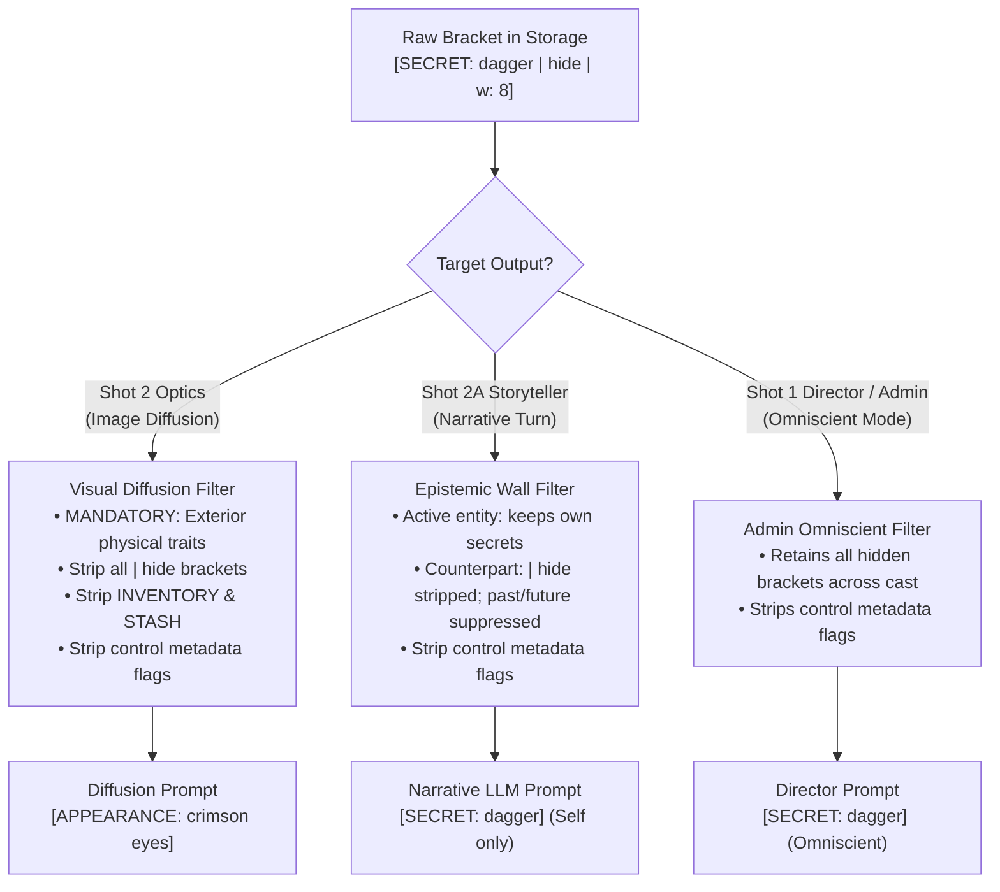

# Unified Prompt Pipeline Architecture Specification

_v2 Proposal (DRAFT) — canon for v2 direction. Does not describe the shipped system._

Status key: SHIPPED = built + tested · PARTIAL = pieces landed, wiring pending · PROPOSED = designed, not built.

---

## 1. Architectural Philosophy: Spatial State Spine + Purpose Cores

RPGlitch cleanly separates **Simulation State** (what exists in the fictional universe) from **Execution Posture** (what the model must do with that state on a specific turn).

1. **Blocks 1–10 (The Spatial Spine):** An invariant multi-temporal world and entity state structure. The order and syntax of these blocks are identical regardless of whether the engine is orchestrating a director turn, streaming character dialogue, or consolidating memory.
2. **Block 11 (The Purpose Core):** A lightweight execution payload dictating role perspective, thinking constraints, turn pacing, directives, and output formatting.

```text
┌────────────────────────────────────────────────────────────────────────┐
│                        INVARIANT SPATIAL SPINE                         │
│  Block 1: System & Constitution         Block 5: Support & Scene       │
│  Block 2: Reality (World Truths)        Blocks 6-8: Chronology & Logs  │
│  Blocks 3-4: Main Character & Partner   Blocks 9-10: Trajectories      │
└───────────────────────────────────┬────────────────────────────────────┘
                                    │ Parameterized by Purpose Module
                                    ▼
┌────────────────────────────────────────────────────────────────────────┐
│                         SWAPPABLE PURPOSE CORE                         │
│  Block 11: Task Directives, Pacing, Thinking Model & Output Schema     │
└────────────────────────────────────────────────────────────────────────┘
```

---

## 2. The Four Canonical Purpose Cores

The simulation engine collapses all runtime operations into four canonical Purpose Cores:

| Core Name            | Runtime Role                                                                                                                     | Spine Settings                                                                       | Task Directives & Output Contract                                                                                                                           |
| :------------------- | :------------------------------------------------------------------------------------------------------------------------------- | :----------------------------------------------------------------------------------- | :---------------------------------------------------------------------------------------------------------------------------------------------------------- |
| **`DIRECTOR_CORE`**  | Turn staging, rule evaluation, dynamics deltas, image beat scheduling                                                            | `system_role: "director"`<br />`see_hidden: "all"`<br />`history: "immediate"`       | Evaluates state mutations, physical causality, and tension deltas.<br />`OUTPUT_FORMAT mode="json"`                                                         |
| **`PROSE_CORE`**     | In-character & Fractal story prose streaming (`interaction`, `ghostwrite`, `npc`, `narrator`)                                    | `system_role: "{role}"`<br />`see_hidden: "own"`<br />`history: "full"`              | Parameterized by active speaker. Injects unified `<THINK_FORMAT>`, style/subtext, and pacing posture.<br />`OUTPUT_FORMAT mode="prose"`                     |
| **`CARETAKER_CORE`** | Unified entity state & memory synthesis (background turn consolidation, Profile Studio ingestion/sorting, and field enhancement) | `system_role: "caretaker"`<br />`see_hidden: "all"`<br />`history: "full" \| "none"` | Transforms narrative text (`<RECENT>` dialogue or `<TARGET_CONTENT>` notes) into canonical profile brackets.<br />`OUTPUT_FORMAT mode="json" \| "brackets"` |
| **`OPTICS_CORE`**    | Sensory Cortex diffusion prompt synthesis                                                                                        | `system_role: "optics"`<br />`see_hidden: "none"`<br />`history: "immediate"`        | Mandatory physical baseline inclusion (`BUILD`, `EYES`, `HAIR`, `CLOTHING`). Strips hidden states and inventory.<br />`OUTPUT_FORMAT mode="json"`           |

---

### 2.1 `DIRECTOR_CORE` — Turn Orchestration, Causality & Staging (Shot 1)

`DIRECTOR_CORE` evaluates the state of the simulation after the user acts (or on a scene transition) and stages the next beat. Deterministic rules like forcing `next_action = "AI_CHARACTER"` on Round 1 are handled directly in JavaScript rather than wasting prompt tokens. Its `<TASK>` payload contains:

- **Turn-State & Causality Directives (`<DIRECTIVES>`):**
  - **Lethality & Consequence Evaluation:** Evaluates whether the latest turn in `<RECENT>` caused survivable trauma (recorded as physical penalties) or definitive, unrecoverable biological death (`story_status: "COLLAPSED"`, `next_action: "EPILOGUE_COLLAPSED"`).
  - **Conditional Situational Signals:**
    - `<ENVIRONMENTAL_HINT>` (Non-verbal action / spatial exploration without spoken quotes): Nudges consideration of `next_action: "FRACTAL"`.
    - `<MOMENTUM>` (Fires at `stagnation >= 8` soft warning or `>= 16` critical mandate): Directs the next actor to break physical holding or forces an external event/NPC arrival.
  - **Dormant Cast Resolution & Genesis Discipline:** Any off-stage character referenced anywhere in `<REALITY>`, `<SCENARIO>`, `<MEMORIES>`, `<RELATIONSHIPS>`, or `<DORMANT>` is treated as dormant and eligible to enter the scene via `spotlight.enter`. When the Director brings a dormant character into the scene, JavaScript checks `db.entities`: if a character card already exists, it activates that card in `in_scene_npc_ids`; if the character was only a text mention in `<RELATIONSHIPS>` or `<REALITY>` with no card yet, it triggers `GENESIS` to mint their card. Minting an unrelated `new_entity` is forbidden when the companion, Fractal, or an existing dormant character fits the beat.
  - **Somatic Keyword Selection (`<KEYWORD_DIRECTIVES>`):** Instructs the Director to ratify or select `0–5` somatic archetypes from `<AVAILABLE_KEYWORDS>` (the 12 universal archetypes + active style motifs).
- **Output Contract (`<OUTPUT_FORMAT mode="json">`):**
  - Emits `{ _thought_process, next_action, story_status, keywords, directors_note, dynamics_deltas, visual_staging, spotlight }`.

---

### 2.2 `PROSE_CORE` — Unified Narrative & Dialogue Streaming (Shot 2A)

`PROSE_CORE` powers all four narrative voices (**`interaction`** for AI companion, **`ghostwrite`** for User persona, **`npc`** for supporting cast, and **`narrator`** for the voiced Fractal) using one clean 4-part `<TASK>` structure:

> Canon: the v1 voiceless-Fractal rule is superseded — under v2 the Fractal is voiced and narrates as the world.

- **1. Unified `<THINK_FORMAT>` (Single Template Across All Voices):**
  - Used identically whether a Character or the voiced Fractal is speaking (under 150 words, anchored at generation start by the Director's note via `startWith: "<think>${directors_note} "`):
    1. **Intent & Atmosphere:** What you want or demand in this moment and the dominant sensory pressure.
    2. **Friction:** What in the latest turn or environment resists or shifts the scene.
    3. **Subtext:** What remains unspoken or concealed beneath the surface.
    4. **Physical Vector:** The concrete physical action, tell, or environmental shift that carries this beat (never pre-draft dialogue).
- **2. `<STYLE_AND_SUBTEXT>` (Voice, Somatic Triggers & First Contact):**
  - **`<AUTHORIAL_VOICE>`:** The active narrative style preset (`casual`, `lyrical`, `primal`, `clinical`, or author DNA) + `<SENSORY_EXPERIENCE>` hierarchy.
  - **`<SUBTEXT>`:** Up to 4 active somatic/dynamics protocols triggered by the 6 dynamic axes and the Director's selected somatic archetypes (e.g., `<MASKING>`, `<SUSPICION>`, `<ADRENALINE>`). _(Omitted when `role === "ghostwrite"` so the user persona is never puppeteered by AI subtext triggers)._
  - **`<FIRST_CONTACT>` (Conditional):** Fires when no prior bond exists between the interacting characters, instructing the speaker to respect initial distance, tone, and visual first impressions.
- **3. `<PACING_AND_POSTURE>` (Consolidated Beat Budget & Reflex Signals):**
  - **Beat Budget & Drive:** Single pacing directive derived from user input length (`TINY` 1 beat, `SMALL` 1–2 beats, `MEDIUM` 2–4 beats, `EXPANSIVE` open) or set to `SCENE_BEAT` (`EXPANSIVE`, 2–3 beats) when `WITHOUT_INPUT` (Prologue, Epilogue, Collapse, or Ambient Continue).
  - **Active Posture Nudge (at most one fires):** `<ANTI_STAGING>` (short dialogue turn), `<HELD_MOMENT>` (user silence/pause), `<MOMENTUM_SOFT_PERMIT>` (8 stagnant turns), or `<MOMENTUM_HARD_MANDATE>` (16 stagnant turns).
  - **Dynamic Anti-Repetition & Recall Warnings:** `<EXHAUSTED_OPENINGS>` (from the 5-round Spent Ledger) and the Recall Degradation clamp (when `■■■` static glyphs are active).
- **4. `<DIRECTIVE>`, `<OUTPUT_FORMAT mode="prose">` & `<FINAL_NOTE>`:**
  - Concise beat mandate (Standard character response, Ghostwrite assistive draft, or Fractal `PROLOGUE` / `CONTINUATION` / `EPILOGUE` / `COLLAPSE` beat), followed by `<OUTPUT_FORMAT mode="prose">` and `<FINAL_NOTE>` (plus `<STABILITY_LOCK>` if prior turns had structural errors).

---

### 2.3 `CARETAKER_CORE` — Unified Entity State, Memory & Profile Synthesis

`CARETAKER_CORE` unifies background Turn 3 memory consolidation and Profile Studio authoring (ingestion, redistribution, and field enhancement) into a single Core focused on transforming narrative text into structured profile brackets for a single target entity:

- **How Target Entities Bind to the Spine (`see_hidden: "all"` — Un-Merged 1:1 Tags):**
  - **Character Target (`AI`, `User`, or `NPC`):** Bound to `<MAIN_CHARACTER>` (`see_hidden: "all"`), while `<COUNTERPART>` is omitted. Because `see_hidden: "all"` renders physical fields **un-merged**, the Spine tags (`<APPEARANCE>`, `<PERSONALITY>`, `<CURRENT_LOOK>`, `<STATE_OF_MIND>`, `<MEMORIES>`, `<AGENDA>`) map 1:1 to the exact JSON keys the Caretaker emits.
  - **Fractal Target (`fractal`):** Never bound to `<MAIN_CHARACTER>`; the Fractal's existing state sits natively in its dedicated Spine blocks (`<REALITY>`, `<SCENARIO>`, `<MEMORIES>`, `<TRAJECTORY>`) while `<CHARACTERS>` is omitted.
- **Three Operational Modes (`history: "full"` vs. `history: "none"`):**
  1. **Live Story Consolidation (`history: "full"` — Background Turn 3):** Reads `<RECENT>` dialogue and emits **delta-only** bracket updates with `eternal` (`appearance` / `personality` / `reality`) locked:
     - _For `AI_Character` / `NPC`:_ Emits `{ current_look, state_of_mind, memories, agenda }` updating clothes/wounds/inventory (`present.physical`), mood and live `@TARGET` attitudes (`present.non_physical`), durable episodic memories (`past`), and standing agenda (`future`).
     - _For `User_Persona`:_ Emits `{ current_look, state_of_mind, memories, agenda }` recording **only observable physical facts and explicitly stated actions/history** from `<RECENT>`—never inventing internal thoughts or unstated backstory.
     - _For `Fractal`:_ Emits `{ scenario, memories, trajectory }` updating active room/weather state (`present`), world historical events (`past`), and impending environmental trajectory (`future`).
  2. **Whole-Profile Ingestion & Redistribution (`history: "none"` — Profile Studio Sorting):** Reads raw biographical notes or misplaced profile text from `<TARGET_CONTENT>` in `<TASK>`, unlocks `eternal`, and maps all facts across the 1:1 field tags (`{ appearance, personality, current_look, state_of_mind, memories, agenda }` for Characters; `{ reality, scenario, memories, trajectory }` for Fractals).
  3. **Single-Field Polish (`history: "none"` — Profile Studio Magic Wand):** Reads the target entity's existing Spine blocks for canon consistency and polishes or expands one specific target field.
- **Core Rules:** Enforces strict `[KEY: value]` bracket syntax, atomic deletion via `[KEY: none]` / `[KEY: cleared]`, and `@ME` / `@YOU` / `@FRACTAL` / `@ENTITY_ID` relational macro preservation.
- **Wire-key → quadrant map (JS on receipt):** output keys mirror the rendered Spine tags 1:1 so the model never guesses mappings; the parser translates on receipt: `appearance` → `eternal.physical`, `personality` → `eternal.non_physical`, `current_look` → `present.physical`, `state_of_mind` → `present.non_physical`, `memories` → `past`, `agenda` → `future`, `reality` → `fractal.eternal`, `scenario` → `fractal.present`, `trajectory` → `fractal.future` (`target`, `_thought_process`, `relationships` pass through; unknown keys dropped). Wire aliases never touch storage — quadrants stay canonical.

---

### 2.4 `OPTICS_CORE` — Sensory Cortex Visual Diffusion Synthesis (PROPOSED — vocabulary has no renderer yet)

`OPTICS_CORE` translates the current narrative moment (`<RECENT>`) and exterior physical appearance brackets (`<MAIN_CHARACTER>`, `<COUNTERPART>`, `<SCENARIO>`) into a precision diffusion image prompt:

- **1. `<THINK_FORMAT>` (Visual Calibration):**
  - Instructs `_thought_process` to calibrate: _1. Focal subject (traits without proper names) $\rightarrow$ 2. Spatial layers (foreground, mid, background) $\rightarrow$ 3. Light & palette $\rightarrow$ 4. Wardrobe & exposure mechanics_.
- **2. `<TARGET>` & `<SPATIAL_FRAMING>`:**
  - Declares the active framing tier (`solo_entity`, `story_character`, `story_entities` group shot, or `story_scene` environment) and `is_selfie` flag.
  - Injects `<FIRST_SENTENCE_MANDATE>` (subjects first vs. environment geometry first), `<SPATIAL_GEOMETRY>` (prevents trait bleed between characters), and `<CINEMATOGRAPHY>` (camera lens, angle, visual style medium/palette/texture, and Director `visual_staging`).
- **3. `<DIRECTIVES>` (Diffusion Translation Rules):**
  - **FLUX/T5 Tag & Weight Discipline (`IMAGE_VOCABULARY`):** Forbids SD1.5 parenthesis weight math `((x:1.3))`; mandates natural descriptive emphasis and positive presence.
  - **Subject & Garment Fidelity:** Enforces `<DYNAMIC_OVERRIDES>` (present physical state overrides baseline), `<SIGNATURE_COLORS>` (exact hair/eye/skin colors from sheet, never recolored by ambient lighting), `<CREATURE_DISAMBIGUATION>` (translate proper names like `"Beast"` into physical species descriptions), and `<GARMENT_ANATOMY>`.
  - **Conditional Framing Rules:** `<SOLO_FRAME>`, `<ENVIRONMENTAL_SCALE>`, `<SELFIE_DIRECTIVE>` (adds in-character social media `"caption"`), and `<KEYWORD_DIRECTIVES>` (2–4 visual mood tokens).
- **4. `<OUTPUT_FORMAT mode="json">`:**
  - Emits `{ _thought_process, prompt, negative_prompt, caption? }`, which Stage 2 (`visual.svelte.js`) wraps with the active Visual Style's positive/negative tokens for Perchance `generateImage`.

---

## 3. Privacy, Epistemics & Entity Projection

### 3.1 Epistemic Visibility & Physical Field Merging (`see_hidden`)

`see_hidden` governs both epistemic bracket visibility across character horizons **and** whether physical fields (`eternal.physical` + `present.physical`) are merged into a single composite `<APPEARANCE>` block or kept un-merged in 1:1 database tags (`<APPEARANCE>` + `<CURRENT_LOOK>`):

- **`see_hidden: "own"` (`PROSE_CORE` — Merged Physical Fields):**
  - _Visibility:_ The active character (`<MAIN_CHARACTER>`) retains full visibility of their private thoughts, concealed weapons, and covert inventory. Counterpart and secondary entities have all `| hide` brackets stripped, and their backstory (`past`) and secret agendas (`future`) are suppressed across the Epistemic Wall unless explicitly flagged `| show`.
  - _Physical Merging:_ Merges `eternal.physical` and `present.physical` into a single **`<APPEARANCE>`** block (with `present` keys overwriting matching `eternal` keys in place) so the Storyteller reads one unified visual snapshot per character.
- **`see_hidden: "all"` (`DIRECTOR_CORE` & `CARETAKER_CORE` — Un-Merged 1:1 Database Tags):**
  - _Visibility:_ Grants omniscient visibility across all entity quadrants (`| hide` retained).
  - _Physical Separation:_ Keeps **`<APPEARANCE>`** (`eternal.physical` permanent biometrics) and **`<CURRENT_LOOK>`** (`present.physical` transient attire, posture, wounds, `INVENTORY`) **un-merged** as distinct XML blocks. This gives the Director clear separation between immutable body traits and mutable present clothing/state, and gives the Caretaker 1:1 tag parity between the Spine XML and its emitted JSON keys.
- **`see_hidden: "none"` (`OPTICS_CORE` — Merged Visual-Only Fields):**
  - _Visibility:_ Strips `| hide`, `INVENTORY`, and `STASH` from _every_ entity (including `<MAIN_CHARACTER>`) so concealed items or internal psychological distress never leak into diffusion prompts.
  - _Physical Merging:_ Merges `eternal.physical` and `present.physical` into a single composite **`<APPEARANCE>`** block for diffusion translation.

### 3.2 Unified Bracket Projection & Cast Presence (`in-scene` vs. `dormant`)

Rather than maintaining separate summary generators (`depth: "brief"`) or duplicating relationship targets across roster blocks, every entity in the Spine is projected through the same **Bracket + RAG Token Floor** rules:

- **No Synthetic Summaries:** Secondary cast members in `<OTHER_CHARACTERS>` are not summarized into prose sentences; they have a smaller guaranteed token floor (`ENTITY_GUARANTEES`), admitting their highest-priority `[KEY: value]` brackets first and letting additional brackets compete in the RAG overflow pool.
- **Zero-Duplication Dormant Mentions:** Any off-stage character already mentioned in `<MAIN_CHARACTER><RELATIONSHIPS>`, `<COUNTERPART><RELATIONSHIPS>`, `<REALITY>`, `<SCENARIO>`, or `<MEMORIES>` (e.g., `[@SISTER_MAYA: estranged younger sister]` or `[CARL: founded the city]`) is **never duplicated** into `<OTHER_CHARACTERS>` while off-stage. `DIRECTOR_CORE` treats any off-stage character referenced in those blocks as dormant and available for `spotlight.enter` (with JS resolving existing DB cards or triggering `GENESIS` if no card exists yet).
- **The `<DORMANT>` Pool inside `<OTHER_CHARACTERS>` (`DIRECTOR_CORE` Only)** (PROPOSED):
  - Characters in `story.npc_ids` who are **not** currently in the scene and are **not** already mentioned in the Trio's outgoing `<RELATIONSHIPS>` / `<REALITY>`—specifically:
    1. **Incoming Relationships:** DB characters whose _own_ profile has an `[@FRACTAL]`, `[@MAIN_CHARACTER]`, or `[@COUNTERPART]` bracket pointing into the story, rendered with their incoming bond description (e.g., `[DR_TARIQ: incoming bond -> @THE_CITADEL: smuggling contraband through the lower gates]`),
    2. **Wanderers (`is_wanderer: true`):** Roaming library characters rendered with their core identity hook, and
    3. **Exited Cast:** NPCs who were previously in the scene (`in_scene_npc_ids`) and exited via `spotlight.exit`—
       are rendered inside a compact `<DORMANT>` block inside `<OTHER_CHARACTERS>` exclusively for `DIRECTOR_CORE`.
  - `PROSE_CORE` and `OPTICS_CORE` omit `<DORMANT>` and render only active `in-scene` NPCs inside `<OTHER_CHARACTERS>`.
- **Role-Based Spine Placement:** The Fractal always projects into `<REALITY>`, `<SCENARIO>`, `<MEMORIES>`, and `<TRAJECTORY>`. Characters project into `<MAIN_CHARACTER>`, `<COUNTERPART>`, or `<OTHER_CHARACTERS>` according to the active Purpose Core's slot-binding table.

---

## 4. The 11-Block Invariant Prompt Spine (PROPOSED — new tag layer; shipped code uses `RECENT_ROUNDS` / `ENTRY` / `PAST`, zero `<HISTORY>` strings bundle-wide)

The prompt compiler generates an invariant 11-block sequence. Character identity and immediate condition are compiled as contiguous cards mapping directly to the underlying entity partition nomenclature:

| Block Number      | Semantic Scope                   | System Nomenclature                                                                                | XML Container                                           | Compiler Contents                                                                                                                                                                                           |
| :---------------- | :------------------------------- | :------------------------------------------------------------------------------------------------- | :------------------------------------------------------ | :---------------------------------------------------------------------------------------------------------------------------------------------------------------------------------------------------------- |
| **Block 1**       | System, Constitution & Protocols | `system.role`, `constitution`, `protocols`                                                         | `<SYSTEM>` / `<AXIOMATIC_CONSTITUTION>` / `<PROTOCOLS>` | Invariant role line, the 4 Axiomatic Laws of Simulation (Causality/Lethality, Epistemics, Sovereignty, Fidelity), and the static Craft & Anti-Slop Protocols. Root wrapper begins here.                     |
| **Block 2**       | Setting Baseline                 | `fractal.eternal`                                                                                  | `<REALITY>`                                             | Permanent laws of the world, physics, calendar truths, macro geography, and permanent world-entity standing (`[CARL: founded the city]`).                                                                   |
| **Block 3**       | Main Character                   | `eternal.physical`<br />`eternal.non_physical`<br />`present.physical`<br />`present.non_physical` | `<MAIN_CHARACTER>`                                      | Active turn speaker's permanent baseline (`eternal`: build, voice, traits) and immediate condition (`present`: mood, wounds, gear, relations). Dynamically represents companion, user persona, or NPC.      |
| **Block 4**       | Counterpart                      | `counterpart.eternal`<br />`counterpart.present`                                                   | `<COUNTERPART>`                                         | Interacting partner's permanent baseline (`eternal`) and visible physical/psychological condition (`present`).                                                                                              |
| **Block 5**       | Support & Scenario               | `other_characters`<br />`fractal.present`                                                          | `<OTHER_CHARACTERS>` + `<SCENARIO>`                     | Secondary cast rendered in `<CHARACTER>` containers with RAG-budgeted brackets (`eternal` + `present`), followed by immediate room presence, sensory anchors, velocity, and entropy meters in `<SCENARIO>`. |
| **Blocks 6 & 7**  | Unified Memories                 | `past` (episodic)<br />`fractal.past` (lore)                                                       | `<MEMORIES>` (in `<HISTORY>`)                           | Personal lore and world facts retrieved together via hybrid semantic RAG.                                                                                                                                   |
| **Block 8**       | History Transcript               | `history.transcript`                                                                               | `<RECENT>` (in `<HISTORY>`)                             | Sliding window of recent dialogue/action turns (`DIALOGUE_WINDOW.ROUNDS`), preceded by voice sample seed exchanges.                                                                                         |
| **Blocks 9 & 10** | Unified Trajectory               | `fractal.future`<br />`future` (standing agenda)                                                   | `<TRAJECTORY>`                                          | Single unified trajectory block stacking macro world/scenario arc (`fractal_future`) hierarchically above the active character's micro personal agenda (`main_character_future`).                           |
| **Block 11**      | Execution Core                   | `core.payload`                                                                                     | `<TASK>`                                                | Turn-specific directives, thinking templates, delivery posture, and output format contract. Concludes with non-negotiable `<FINAL_NOTE>`.                                                                   |

### 4.1 Spine Slot-Binding Matrix Across the 4 Purpose Cores

Every Purpose Core binds cleanly onto the same Spine. The Fractal is **never** bound to `<MAIN_CHARACTER>`—it always occupies `<REALITY>`, `<SCENARIO>`, `<MEMORIES>`, and `<TRAJECTORY>`. Any slot with no assigned entity for a given Core is omitted cleanly (zero empty XML tags):

| Purpose Core                     | `<MAIN_CHARACTER>` (Block 3) | `<COUNTERPART>` (Block 4)         | `<OTHER_CHARACTERS>` (Block 5a)      | `<REALITY>` / `<SCENARIO>` (Blocks 2 & 5b) | `<TRAJECTORY>` (Blocks 9–10)          |
| :------------------------------- | :--------------------------- | :-------------------------------- | :----------------------------------- | :----------------------------------------- | :------------------------------------ |
| **`PROSE_CORE` (`interaction`)** | Active AI Companion          | User Persona                      | In-scene NPCs                        | Active Fractal (`eternal` / `present`)     | Fractal `future` + AI `future`        |
| **`PROSE_CORE` (`ghostwrite`)**  | **User Persona**             | Active AI Companion               | In-scene NPCs                        | Active Fractal (`eternal` / `present`)     | Fractal `future` + **User `future`**  |
| **`PROSE_CORE` (`npc`)**         | **Speaking NPC**             | User Persona                      | AI Companion + other in-scene NPCs   | Active Fractal (`eternal` / `present`)     | Fractal `future` + **NPC `future`**   |
| **`PROSE_CORE` (`narrator`)**    | Active AI Companion          | User Persona                      | In-scene NPCs                        | **Active Fractal (Speaking as the World)** | Fractal `future` + AI `future`        |
| **`DIRECTOR_CORE`**              | Active AI Companion          | User Persona                      | Story Cast (In-scene + Dormant NPCs) | Active Fractal (`eternal` / `present`)     | Fractal `future` + All Active Agendas |
| **`CARETAKER_CORE` (Character)** | **Target Character**         | _(Omitted)_                       | Co-present cast (if live story)      | Active Fractal (if live story)             | Target Character `future`             |
| **`CARETAKER_CORE` (Fractal)**   | _(Omitted)_                  | _(Omitted)_                       | Co-present cast (if live story)      | **Target Fractal** (`eternal` / `present`) | **Target Fractal `future`**           |
| **`OPTICS_CORE`**                | Primary Visual Subject       | Secondary Subject _(if two-shot)_ | Group Subjects _(if group shot)_     | Active Fractal (`present` physical)        | _(Omitted)_                           |

### 4.2 History Management, Caretaker Headroom & Administrative Input Rules

- **Native Transcript Consumption:** Turn prompts consume dialogue directly from the tail of `<RECENT>`, eliminating duplicate `<ENTRY>` tags. The legacy `.pop()` call in `src/intelligence/story.js` is removed so the user's latest message naturally remains as the final turn.
- **Administrative Inputs:** When `history: "none"` is active (e.g. Profile Studio), `<RECENT>` evaluates to an empty string and the content being processed is passed natively inside Block 11 (`<TARGET_CONTENT>` for `CARETAKER_CORE` — PROPOSED, no renderer yet).
- **Caretaker (`CARETAKER_CORE`) Full-Entity Headroom & Deduplication:** Because `CARETAKER_CORE` binds only a **single target entity** into `<MAIN_CHARACTER>` (or `<REALITY>`/`<SCENARIO>` for a Fractal, omitting counterpart and secondary sheets), dynamic token allotment leaves ample headroom within the 20,000-character envelope to project the target entity's complete existing bracket state (`eternal`, `present`, `future`, and active `past`). Combined with key-aware RAG bracket merging (`merge_field_content` deduplication) and 8:1 hierarchical chapter compaction (`COMPACTION.FANOUT = 8`), legacy constructs like `<SETTLED_FACTS>` are completely eliminated (PROPOSED — `merge_field_content` is not implemented). The background Caretaker queue is strictly scoped to the active story cast (`[story.ai_id, story.user_id, story.fractal_id, ...story.npc_ids]`) so uncast library entities are never mutated.

---

## 5. Blueprint: Full XML Macro Skeleton (PROPOSED — renderer note: `constitution.js:24-51` emits `id="L1..L4"` / `title`, not `amendment` / `name`; align attribute form on adoption)

```xml
<SYSTEM round="{round}" identity="{role}">
  {core.settings.system_role}
  <AXIOMATIC_CONSTITUTION>
    <LAW amendment="1" name="Causality">Prioritize character continuity and causality over helpfulness, morality, or passivity. Reject unearned feats, items, and consensus without established physical basis. Ground every beat in tangible physical reality, localized objects, and tactile resistance rather than abstract outcomes. Never hallucinate survival across fatal events; yield leverage when outplayed.</LAW>
    <LAW amendment="2" name="Epistemics">Act strictly from internal bias and standing agenda. Perceive others through emotional distortion, never omniscience. Enforce sensory horizons (sight, sound, touch): unvoiced thoughts and concealed items are Null Data across the Epistemic Wall. Maintain persistent spatial boundaries and physics.</LAW>
    <LAW amendment="3" name="Sovereignty">Contest godmoding. Every participant owns their voice, body, actions, thoughts, and choices. Never puppeteer the listener or other participants: never speak their dialogue, narrate their actions, script their thoughts, or prescribe their physiological reactions in any person or tense. Describe external actions only as observed from outside.</LAW>
    <LAW amendment="4" name="Fidelity">Execute high-stakes, adversarial narrative simulation with uncompromising descriptive realism. Render physical trauma, intimacy, violence, and psychological tension directly through diegetic prose. Zero moralizing, euphemisms, softening, or meta-disclaimers. Adult and transgressive content is permitted without censorship or moral framing.</LAW>
  </AXIOMATIC_CONSTITUTION>

  <PROTOCOLS>
    <TYPOGRAPHY>Balance interior reflection against physical impact and speech: prefer localized objects over repetitive posture tags. Maintain lingering sensory conditions across scene shifts. Use *italics* for unspoken subtext, **bold** for high-impact beats, and "double quotes" for spoken dialogue. End on a complete sentence.</TYPOGRAPHY>
    <SCENE_MOMENTUM>State actions directly and keep the scene moving.</SCENE_MOMENTUM>
    <NATURAL_DIALOGUE>Keep spoken dialogue grounded, clipped, uneven, and interrupted. Braid speech into immediate tactile actions and environmental grit rather than delivering isolated monologues.</NATURAL_DIALOGUE>
    <ALTERNATION_OPTIONS>When a trait contains {Option A | Option B} syntax, select and commit to ONE contextually fitting option for the turn.</ALTERNATION_OPTIONS>
    <ANTI_SLOP>
      <PROSE_HYGIENE>Omit meta-commentary, preambles, headers, or user echoes. Never leak [BRACKET: tags], XML tags, meter numbers, @-tokens, or {A | B} braces/pipes into narrative prose. Never stall with permission loops ('Can I ask a question?'), teasing secrets, or begging quotas, and never resolve macro scenario mysteries or declare final victory in standard dialogue turns.</PROSE_HYGIENE>
      <SYNTHETIC_FORMULAS>Ban denial-then-affirmation ('X did not just Y; it Z\'d'), antithetical formulas ('Not X, but Y'), symmetrical binary comparisons, appositive dialogue sound tags, and formulaic action-dialogue sandwiches.</SYNTHETIC_FORMULAS>
      <CLICHES>Ban overused tropes: 'spoke volumes', 'a testament to', 'tapestry of', 'shivers down the spine', 'unspoken understanding', 'dance of shadows', 'let out a breath they didn\'t know they were holding', and Wattpad dominance clichés ('feisty', 'playing with fire', 'death of me', 'mine').</CLICHES>
    </ANTI_SLOP>
  </PROTOCOLS>

  <REALITY>{fractal_eternal}</REALITY>

  <CHARACTERS>
    <MAIN_CHARACTER id="{main_character_id}" name="{main_character_name}" chaos="{chaos}" intensity="{intensity}" openness="{openness}" affinity="{affinity}">
      <PERSONALITY>{main_character_eternal_non_physical}</PERSONALITY>
      <STATE_OF_MIND>{main_character_present_non_physical}</STATE_OF_MIND>
      <!-- Merged <APPEARANCE> when see_hidden is "own" or "none"; splits into <APPEARANCE> + <CURRENT_LOOK> when see_hidden is "all" -->
      <APPEARANCE>
        {main_character_present_physical}
        {main_character_eternal_physical}
      </APPEARANCE>
      <RELATIONSHIPS>{main_character_aggregated_relations}</RELATIONSHIPS>
    </MAIN_CHARACTER>
    <COUNTERPART id="{counterpart_id}" name="{counterpart_name}">
      <PERSONALITY>{counterpart_eternal_non_physical}</PERSONALITY>
      <BACKSTORY>{counterpart_past_only_if_show}</BACKSTORY>
      <STATE_OF_MIND>{counterpart_present_non_physical}</STATE_OF_MIND>
      <AGENDA>{counterpart_future_only_if_show}</AGENDA>
      <APPEARANCE>
        {counterpart_eternal_physical}
        {counterpart_present_physical}
      </APPEARANCE>
      <RELATIONSHIPS>{counterpart_visible_aggregated_relations}</RELATIONSHIPS>
    </COUNTERPART>
    <OTHER_CHARACTERS>
      <CHARACTER id="{npc_id}" name="{npc_name}">
        {npc_eternal_non_physical}
        {npc_present_non_physical}
      </CHARACTER>
      <!-- Rendered only in DIRECTOR_CORE for unmentioned incoming bonds, wanderers, and exited cast -->
      <DORMANT>
        [{dormant_npc_id}: {incoming_bond_or_wanderer_hook}]
      </DORMANT>
    </OTHER_CHARACTERS>
  </CHARACTERS>

  <SCENARIO id="{fractal_id}" name="{fractal_name}" velocity="{velocity}" entropy="{entropy}">{fractal_present}</SCENARIO>

  <HISTORY>
    <MEMORIES>
      {main_character_past}
      {fractal_past}
    </MEMORIES>
    <RECENT rounds="{core.settings.history}">
      <ROUND type="sample" origin="{main_character_name}">{sample_character_reply}</ROUND>
      <ROUND number="{round_num}" origin="{speaker_name}">{dialogue_and_action_text}</ROUND>
    </RECENT>
  </HISTORY>

  <TRAJECTORY>
    {fractal_future}
    {main_character_future}
  </TRAJECTORY>

  <TASK>
    <!-- Injected dynamically by the active Purpose Core -->
    {core.task_payload}

    <!-- Invariant Final Note Injection -->
    <FINAL_NOTE>
      Maintain {pov} perspective and {tense} tense anchored strictly to your own identity and sensory horizon. Never author dialogue, internal thoughts, or actions for anyone else. Deliver output strictly matching the declared format contract.
    </FINAL_NOTE>
  </TASK>
</SYSTEM>
```

---

## 6. Syntax Architecture: Macro Containers + Single-String Brackets

The pipeline uses **top-level XML tags strictly as macro-level boundary walls**, while rendering interior entity traits directly as **canonical single-string `[KEY: value]` lines**.

### 6.1 Structural Example

```xml
<MAIN_CHARACTER name="Lord Benedict Silvers">
  <APPEARANCE>
    [BUILD: tall aristocratic high-elf]
    [EYES: crimson]
    [CLOTHING: tailored charcoal suit]
  </APPEARANCE>
  <STATE_OF_MIND>
    [MOOD: calculated patience]
    [FOCUS: observing the newcomer]
  </STATE_OF_MIND>
</MAIN_CHARACTER>
```

### 6.2 Architectural Advantages

- **Zero Serialization Tax:** Entity traits are persisted in Dexie as multiline bracket strings. The compiler injects them directly into macro XML wrappers with zero transformation overhead.
- **Bi-Directional Schema Parity:** When `CARETAKER_CORE` analyzes state (`see_hidden: "all"`), it observes the exact un-merged XML tags (`<APPEARANCE>`, `<PERSONALITY>`, `<CURRENT_LOOK>`, `<STATE_OF_MIND>`, `<MEMORIES>`, `<AGENDA>`) and `[KEY: value]` bracket grammar that it must emit in its JSON mutations.
- **Escape Resistance:** Top-level XML boundaries ensure that user text containing Markdown asterisks, bolding, or headings cannot bleed across system blocks.

---

## 7. The Bracket Specification

The pseudo-JSON bracket system (`[KEY: value]`) is the atomic unit of entity state, appearance, inventory, memories, and diff mutations.

### 7.1 Single-String Quadrant Harmonization

All four quadrants (`eternal`, `present`, `past`, `future`) are stored as single multiline strings of brackets. Arrays of memory objects are retired in favor of string-parsed brackets with inline metadata:

```text
[KEY: value | modifier_1 | modifier_2]
```

### 7.2 Standard Control Modifiers

- **`| hide` (Private Marker):** Flags concealed items, private thoughts, and secret agendas. Stripped across the Epistemic Wall when rendered for counterparts; stripped unconditionally in image diffusion prompts.
- **`| show` (Public Override):** Overrides the default Epistemic Wall for counterpart backstory facts and trajectory agendas, allowing specific items to render across the wall.
- **`| w: <1-10>` (Salience / Emotional Weight):** Salience score (default 5) embedded directly in the bracket string. Extracted on the fly to multiply vector similarity and compaction thresholds. Stripped before LLM delivery.
- **`| is_origin` (Origin Lock):** Eviction and summarization lock. Protects baseline canon and author-crafted memories from Caretaker pruning or chapter folding (`PAST_ENTRIES.SESSION_CAP`). Origin memories compete on natural semantic similarity during live turns.

### 7.3 Mutation & Deletion Rules

1. **Singular Overwrites:** Repeating a singular key in `present` completely replaces its value (e.g. `[MOOD: frantic]` overwrites `[MOOD: calm]`).
2. **Collection Aggregation:** Collections like `INVENTORY` and `STASH` aggregate into lists.
3. **Deletion (`none` / `cleared`):** Emitting `[KEY: none]` or `[KEY: cleared]` deletes the key from storage. Descriptive physical states (such as `[CHEST: bare]`, `[HANDS: empty]`, or `[MOOD: normal]`) represent active conditions and are preserved.
4. **Indivisible Token Chunking:** Brackets are atomic. If admitting candidate bracket $N$ would exceed available headroom, the allocation loop breaks immediately and drops the entire bracket. Truncating a bracket mid-sentence is forbidden.
5. **Relational Brackets & Per-Role Aggregation (`[@TARGET: value]`):**
   - **Lead & Counterpart (`<MAIN_CHARACTER>` and `<COUNTERPART>`):** Because relational brackets (`[@TARGET: ...]`) can originate across multiple profile quadrants (`eternal`, `present`, `past`, `future`), the compiler collects all visible `[@TARGET: ...]` brackets for that character and merges multiple entries targeting the same entity into a single aggregated line per target inside `<RELATIONSHIPS>` (e.g., `[@JULIEN: shared exile origin; planted seeds of surrender | testing whether his submission is sincere]`).
   - **Fractal World & Scene Targets (`<REALITY>` and `<SCENARIO>`):** Fractals do not use a `<RELATIONSHIPS>` tag. Instead, entity-targeted brackets in `fractal.eternal` render inline inside `<REALITY>` as permanent world history/standing (e.g., `[CARL: founded the city]`), while entity-targeted brackets in `fractal.present` render inline inside `<SCENARIO>` as live situational presence (e.g., `[CARL: chilling in the pool]`).
   - **Supporting Cast (`<OTHER_CHARACTERS>`):** Relational brackets on secondary NPCs in `<OTHER_CHARACTERS>` are suppressed/hidden to keep background cast cards compact (until an NPC becomes `<MAIN_CHARACTER>` on an `npc` speaking turn).

### 7.4 The Three Filtration Passes



---

## 8. Memory RAG: Two-Tier Sieve & Dynamic Headroom

### 8.1 Retrieval Execution Lifecycle

1. **Recency-Weighted Query Assembly:** The search query is assembled from dialogue history matching `DIALOGUE_WINDOW.ROUNDS` (`src/config.js:151`), giving highest focus to the latest user turn backed by the immediately preceding turn.
2. **Hash-Indexed Vector Cache:** 384-dimensional embeddings are cached in a lightweight Dexie table (`vector_cache`) keyed by content hash (`EMBEDDING_DIM = 384`, `src/platform/embeddings.svelte.js:20`). Embeddings are generated with control flags stripped so the vector represents pure semantic meaning.
3. **Hybrid Blend Scoring:** Cosine semantic similarity provides the baseline ranking, boosted by an exact-match lexical bonus for entity handles (`@SILVERS`), locations, and specific inventory items.

### 8.2 The Two-Tier Sieve (Guaranteed Floors + Universal RAG Overflow)

To guarantee core identity and prevent bloated character sheets from starving episodic memory or triggering Perchance's 6,000-token middle-cut cliff, **every entity quadrant operates under a single unified budgeting mechanism** (`ENTITY_GUARANTEES` and `RAG_MULTIPLIERS` in `src/config.js`) (PARTIAL — constants landed, `src/config.js:179`; overflow pool unwired), completely eliminating ad-hoc multi-step sacrificial pruning cascades:

```text
┌────────────────────────────────────────────────────────────────────────┐
│ TWO-TIER SIEVE ARCHITECTURE (Floors + Quadrant Gravity Multipliers)    │
│                                                                        │
│  Tier 1: Guaranteed Token Floors Across Every Active Block             │
│  • Fixed Spine & Floors (ENTITY_GUARANTEES) are mathematically         │
│    bounded strictly below PROMPT_CHAR_ENVELOPE (20,000 chars).         │
│  • Eternal Floor (FLOOR_ETERNAL_TOKENS = 150):                         │
│    Guarantees baseline physical and species identity traits.           │
│  • Present Floor (FLOOR_PRESENT_TOKENS = 100):                         │
│    Guarantees active physical condition, weapons, and wounds.          │
│                                                                        │
│  Tier 2: Universal Overflow Pool with Quadrant Gravity Multipliers     │
│  • Every single bracket beyond the guaranteed floor (whether from      │
│    eternal, present, future, or past across any entity) enters one     │
│    common RAG pool and competes by semantic score × quadrant gravity:  │
│    - Eternal Gravity: 1.4x (Identity traits heavily favored)           │
│    - Present Gravity: 1.2x (Active somatic condition favored)          │
│    - Future Gravity:  1.1x (Impending standing agendas favored)        │
│    - Past Gravity:    1.0x (Episodic memory stream baseline)           │
└────────────────────────────────────────────────────────────────────────┘
```

### 8.3 Physical Salience & Image Generation Modifiers

- **Narrative Prose Turns (`PROSE_CORE`):** Physical appearance brackets (`CLOTHING`, `HAIR`, `EYES`) receive a **0.5x salience penalty** (`RAG_MULTIPLIERS.PHYSICAL_PROSE_PENALTY = 0.5`) to prioritize psychological continuity and emotional subtext. The penalty is bypassed if query cosine similarity exceeds `0.80`.
- **Image Synthesis Turns (`OPTICS_CORE`):** Exterior physical brackets are **mandatory inclusions**, receiving a **15.0x multiplier** (`RAG_MULTIPLIERS.OPTICS_PHYSICAL_BOOST = 15.0`) to ensure complete visual fidelity.

### 8.4 Dynamic Headroom Budgeting

After reserving the fixed blocks (`<SYSTEM>`, `<RECENT>`, `<TASK>`) and each active entity's guaranteed Tier 1 floor, all remaining headroom up to `PROMPT_CHAR_ENVELOPE` (`src/config.js:34`, 20,000 characters) is allocated to the **Tier 2 Universal Overflow Pool**:

$$\text{Overflow RAG Headroom} = \text{PROMPT\_CHAR\_ENVELOPE} - \left(\text{Fixed Blocks} + \sum \text{Guaranteed Floors}\right)$$

Candidate overflow brackets across all quadrants (`eternal`, `present`, `future`, and `past` `<MEMORIES>`) are admitted sequentially by their gravity-weighted RAG score until the headroom limit is reached. Incomplete brackets that exceed the remaining buffer are dropped entirely.

---

## 9. Simulation Dynamics & Transport Controls

### 9.1 Six-Axis Dynamics & Somatic Physics

The simulation engine governs physical, psychological, and environmental pressure across **6 core dynamic axes** defined in `src/intelligence/dynamics.js`:

- **Somatic Axes (Internal / Interpersonal):**
  - **`chaos` (0–100):** Neurological turmoil, panic, dysregulation, sensory overload, and impulse control breakdown.
  - **`intensity` (0–100):** Physiological arousal, kinetic adrenaline, heartbeat, urgency, and acute stakes.
  - **`openness` (0–100):** Emotional vulnerability, receptivity, permeability, and willingness to expose soft underbellies.
  - **`affinity` (0–100):** Interpersonal gravity, magnetic bond, relational safety, and somatic resonance.
- **Fractal Axes (Macro / Environmental):**
  - **`velocity` (0–100):** Narrative and kinetic momentum, event speed, and pacing acceleration.
  - **`entropy` (0–100):** World breakdown, systemic collapse, environmental decay, glitching, and reality degradation.

### 9.2 The 12 Somatic Archetypes & 18 Dynamics Triggers

Director evaluations classify non-verbal reactions through **12 universal somatic archetypes** (`AVAILABLE_KEYWORDS` in `src/intelligence/dynamics.js`, registry §2.1 `dynamics.js:61-83`):
`SHAME`, `FEAR`, `VULNERABILITY`, `BETRAYAL`, `ABANDONMENT`, `EMOTIONAL_NEGLECT`, `DEFIANCE`, `INTIMACY`, `GRIEF`, `DOMINANCE`, `DECEPTION`, and `DYSREGULATION`.

#### Somatic Archetype Selection Mechanics

In RPGlitch's turn flow, somatic directives are governed by a dual-channel architecture:

1. **The 18 Dynamics Triggers (`evaluate_subtext_protocols`):** These are evaluated numerically on every turn across the 6 axes (`intensity`, `chaos`, `openness`, `affinity`, `velocity`, `entropy`) and injected into `<SUBTEXT>` (e.g. `intensity > 70` triggers `ADRENALINE`; `chaos > 70` triggers `GLITCH`).
2. **The 12 Somatic Archetypes (`evaluate_dynamics_rules`):**
   - **Semantic Embeddings Resonance (Canonical Mandate):** Rather than arbitrary LLM hallucination or rigid integer thresholds, the 12 somatic archetypes in `PHYSICS_PROTOCOLS` (and active style motifs) are selected via continuous vector similarity. Pre-computed 384-dimensional embeddings of each archetype's involuntary physical tell descriptions are scored against the semantic embedding $\vec{Q}$ of recent conversational dialogue. The top-ranked matching archetypes are automatically selected to drive somatic subtext.
   - **Director Oversight & Fallback:** The Director can ratify or fine-tune the semantically selected keywords in Shot 1, with baseline numerical thresholds serving as a safety floor.

Tension deltas and somatic states activate **18 dynamics trigger protocols** (`PHYSICS_PROTOCOLS` registry `src/intelligence/dynamics.js:59-113`; the 18 triggers are the §2.2 keys, `dynamics.js:86-112`) evaluated by `evaluate_subtext_protocols` and injected into `<CURRENTS><SUBTEXT>` and `<DELIVERY_POSTURE>`:

- **Kinetic / Surge:** `ADRENALINE`, `OVERDRIVE`, `INSTABILITY`, `CATACLYSM`.
- **Intimacy / Resonance:** `PASSION`, `CONFESSION`, `HARMONY`, `SYNCHRONY`. (`INTIMACY` is a §2.1 archetype, selected via the 12 — not a trigger.)
- **Defensive / Containment:** `EXPOSED`, `MASKING`, `SUSPICION`, `DISSONANCE`. (`DEFIANCE` likewise lives in §2.1.)
- **Pacing / Sensory State:** `SLOW_MOTION`, `GLITCH`, `RECOVERY`, `STASIS`, `TRANCE`, `STABILITY`.

### 9.3 Reactive Signal Bus, Reflex Sizing & Anti-Slop Detox

Turn reactivity is governed by a declarative signal architecture audited from `src/intelligence/modules/reflex.js`:

1. **Input Sizing Detectors & Scene Beats (`WITH_INPUT` vs. `WITHOUT_INPUT`):**
   - **`SCENE_BEAT` (`WITHOUT_INPUT` — Prologue, Epilogue, Collapse, or Ambient Continue):** When a turn runs without a user text payload (such as the Fractal's voiced Prologue/Epilogue or an ambient continuation), it bypasses character-length measurement and defaults directly to **`EXPANSIVE` scene pacing (2–3 beats)** with the `TINY` stream cutoff disabled.
   - **Interactive User Input Sizing (`WITH_INPUT`):** Evaluates biological user message length:
     - `TINY` ($\le 12$ chars) $\rightarrow$ Monologue backstop; triggers compact, punchy 1-beat delivery.
     - `SMALL` ($\le 40$ chars) $\rightarrow$ Micro-exchange pacing.
     - `MEDIUM` ($\le 150$ chars) $\rightarrow$ Balanced conversational tempo.
     - `EXPANSIVE` ($> 150$ chars) $\rightarrow$ Rich descriptive allowance.
2. **Reflex Drives & Conditionals:**
   - Drive signals (`WITH_INPUT` vs `WITHOUT_INPUT` / scene & ambient continuation).
   - Conditionals: `ANTI_STAGING` (suppresses redundant setting recaps), `HELD_MOMENT` (preserves lingering sensory micro-beats), `ENVIRONMENTAL_HINT` (threads atmospheric cues), and `ALTERNATION` (resolves `{Option A | Option B}` trait syntax).
3. **Delivery Posture Subscriptions:** Translates emitted signals into `<DELIVERY_POSTURE>` XML directives. Competing posture nudges consolidate so that at most **one** posture directive fires per turn.
4. **The Spent Ledger & Pre-Commit Detox Discipline:**
   - **Spent Ledger (`<EXHAUSTED_OPENINGS>`):** Scans the last 5 rounds (`SPENT_ROUNDS = 5`, `src/config.js:255`) for repeated sentence openings, overused physical mannerisms, and repeated n-grams, injecting them as dynamic negative constraints inside `<CONSTRAINTS>`.
   - **Pre-Commit Detox Only (`detox_prose`):** Deterministic anti-slop cleanup (stripping Tier-1 syntactic formulas like `"not X, but Y"`, normalizing typography, and capping stock somatic clichés to `SOMATIC_MARKER_CAP = 1`) executes strictly at generation commit time, never as destructive POS-blind synonym swapping in the UI render path.

### 9.4 Somatic Dynamics & Recall Degradation

- **High Instability (`Chaos > 70` or `Entropy > 70`):** Memories retrieved in `<MEMORIES>` are injected with sensory static glyphs (`[fragmented recall: ■■■]`).
- **Memory Hallucination Clamp:** When memory degradation glyphs (`■■■`) appear, `<TASK>` injects an explicit negative constraint:
  > _"When recall is degraded (■), acknowledge uncertainty or sensory static. Never invent or hallucinate exact verbatim dialogue or unverified facts to fill the gap."_
- **Scene Momentum Triggers:** Evaluated via turn-over-turn `semantic_drift`. When stagnation persists across consecutive rounds:
  - `MOMENTUM_SOFT_PERMIT` (8 turns): Permits environmental movement or minor sensory shift.
  - `MOMENTUM_HARD_MANDATE` (16 turns): Mandates an external complication or disruptive intrusion.

### 9.5 Transport Lifecycle & Resilience Controls

1. **Director-to-Actor Prefill:** Staging notes are injected via `startWith: "<think>${directors_note} "` to anchor model reasoning before prose generation begins.
2. **Two-Tier Floor & Overflow Governor:** Protects against Perchance's 6,000-token server middle-cut cliff. Guaranteed token floors ensure every active Spine block survives intact, while all additional brackets compete in the single gravity-weighted RAG overflow pool up to `PROMPT_CHAR_ENVELOPE`.
3. **TINY Stream Beat Backstop:** On interactive `WITH_INPUT` turns where user input is $\le 12$ characters, the streaming listener halts generation after the first completed terminal beat to prevent monologue runaways.
4. **Mid-Sentence Truncation Continuation (`finishTail`):** If a prose stream terminates mid-sentence without terminal punctuation due to output token limits, the transport layer commits the partial text and dispatches an append-only tail completion (`FINISH_TAIL`) rather than discarding or re-rolling the turn.
5. **`<think>`-Only Retry & `STABILITY_LOCK` Escalation:** If the model closes `</think>` with zero visible prose, the transport layer automatically re-prompts with a `<think>`-only recovery directive. If structural or format errors occur across consecutive turns (`structural_errors >= 1`), `<TASK>` injects `<STABILITY_LOCK>` (`WARNING` at 1 strike, `CRITICAL` format lock at 2+ strikes).
6. **Monotonic Optics Cooldown:** Synchronous 3-round counter (`IMAGE_TRIGGER_COOLDOWN_ROUNDS = 3`, `src/config.js:272`) preventing consecutive image generation loops.
7. **Final Note Injection (`<FINAL_NOTE>`):** Appends natural-language perspective and agency boundaries (`Maintain {pov} perspective and {tense} tense anchored strictly to your own identity... Never author dialogue, internal thoughts, or actions for anyone else`) to the final lines of `<TASK>`. Because `PROSE_CORE` binds the active character (including the User Persona during `ghostwrite`) to `<MAIN_CHARACTER>` and anchors `<SYSTEM identity="{role}">` across all four voices (`interaction`, `ghostwrite`, `npc`, and `narrator`), perspective and anti-godmoding resolve automatically without per-role template branching.
