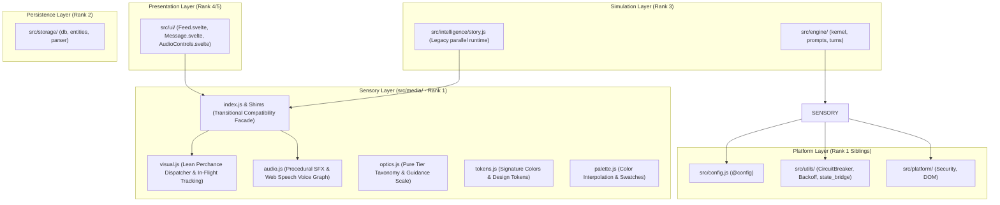

# Gate 3: Media & Sensory Subsystems Consolidation

- **Author:** Antigravity & johng
- **Status:** Finalized & Aligned (Pre-Execution V3)
- **Date:** 2026-11-01

---

## 1. Overview & Domain Lexicon

Gate 1 built the headless simulation kernel in `src/engine/`. Gate 2 consolidated the persistence layer into pure Promise-based modules in `src/storage/`. Gate 3 consolidates the sensory presentation layer (`src/media/`), establishing a clean, unidirectional Rank 1 boundary with zero upward imports into `@intelligence`, `@state`, or `@data`, while providing a robust transitional compatibility facade in `src/media/index.js` and re-export shims to ensure 100% legacy app, speech UI, and test suite survival during parallel coexistence before Gate 4.

### Domain Lexicon

- **Visual Synthesis**: Direct execution of image generation requests via the host Perchance `generate_image` iframe plugin, consuming the prompt, negative prompt, resolution, and guidance scale produced by the engine's Visualizer Purpose Core.
- **Classifier-Free Guidance (CFG)**: A numeric parameter (typically 1.0 to 15.0, defaulting to 7.0 for scenes and 9.0 for portraits/characters) determining how strictly the diffusion model adheres to the prompt text.
- **Procedural SFX**: Lightweight Web Audio synthesizer generating deterministic interface feedback (clicks, hums, alerts, glitch pulses) directly from code without remote WAV dependencies.
- **Web Speech Fallback**: In-browser speech synthesis using standard `window.speechSynthesis` and `SpeechSynthesisUtterance`, preserving functional character voice play/stop buttons across the UI without heavy neural models.
- **AudioContext Gesture Gate**: Web Audio policy guard ensuring hardware `AudioContext` only initializes or resumes upon explicit biological user interaction (click, keypress, touch), and suspends cleanly when idle.
- **Rank 1 Sensory Boundary**: `src/media/` operates strictly as a platform/sensory sibling (Rank 1). It may import downward into `@utils`, `@config`, and `@platform`. Upward imports into `@storage`, `@engine`, `@state`, or `@ui` are strictly prohibited.
- **Parked Kokoro TTS**: Heavy neural TTS (`kokoro-js`, WebGPU/WASM ONNX models) and speech sentence chunkers are parked under P4 Pre-Beta Purity to preserve the 4.00 MB bundle ceiling and 50 MiB iframe memory boundary.

---

## 2. The Problem & Goals

### The Problem

1. **Upward Import Violations**: `src/media/visual.svelte.js` and `src/media/optics.js` currently import upwards from `@intelligence` and `@data`, directly violating layer hierarchy rules:
   - `src/media/optics.js` imports `style.js` and `dynamics.js` from `src/intelligence/`.
   - `src/media/visual.svelte.js` imports `compile_prompt` and formatting helpers from `@intelligence`, and `db`, `entities`, and `VISUAL_STYLES` from `@data`.
   - `src/media/audio.svelte.js` imports `db` from `@data`.
2. **Massive Code Sprawl & Memory Risk**:
   - `src/media/audio.svelte.js` spans over 1,200 lines attempting to manage Kokoro neural speech synthesis, ONNX runtime workers, sentence tokenizers, and audio caching.
   - `src/media/visual.svelte.js` spans nearly 1,000 lines orchestrating internal LLM prompt builder calls, multi-tier scene extraction, and complex state classes.
3. **Redundant Prompt Enhancers**: The engine's Visualizer Purpose Core (`PURPOSE_CORES.visualizer` in `src/engine/prompts.js`) already generates ready-to-render diffusion prompts with focal subject, spatial depth, lighting, and negative prompts. Having `visual.svelte.js` run secondary LLM enhancement passes duplicates inference cost and latency.

### Goals

- **Self-Contained Perchance Image Dispatcher**: Provide a focused Perchance image generation caller in `src/media/visual.js` (< 200 lines) with timeout, retry backoff, circuit breaking, and mock fallback for testing.
- **In-Flight Set Bookkeeping & Queue Survival**: Retain in-RAM Set bookkeeping (`mark_generation_in_flight`, `clear_generation_in_flight`, `is_generation_in_flight`, `_in_flight_image_generations`) and queue lifecycle methods (`spawn_image_beat`, `sweep_stale_ghosts` via `@utils/state_bridge`) to keep `src/intelligence/story.js` completely unbroken.
- **Pure Procedural Web Audio SFX + Web Speech Fallback**:
  - Provide a lean Web Audio sound engine in `src/media/audio.js` (< 250 lines) generating tactile UI audio (clicks, glitches, alerts, hums) strictly upon user gesture.
  - Retain the active Web Speech synthesis fallback (`Audio.voice.speak`, `Audio.voice.stop`, `Audio.toggle_entity_voice`) and pure voice helpers (`get_cadence_rate`, `resolve_voice_uri`) so message-level voice buttons in `Message.svelte`, `Feed.svelte`, and `AudioControls.svelte` continue functioning seamlessly.
- **Clean Single-Sourced Dynamics Gate (`IMAGE_TRIGGER`)**: Relocate `IMAGE_TRIGGER` definition and `evaluate_image_trigger` to `@config` (or `@utils`) so both `dynamics.js` and `optics.js` import downward without duplicating thresholds.
- **Transitional Facade & Re-export Shims**:
  - `src/media/index.js` re-exports greenfield functional APIs and transitional compatibility facades (`visual_engine`, `VisualEngine`, `audio_engine`, `Audio`, `resolve_image_trigger`, `spawn_image_beat`, `sweep_stale_ghosts`, `visualize`).
  - `src/media/audio.svelte.js` and `src/media/visual.svelte.js` remain as lightweight 1-line re-export shims during parallel coexistence so direct-path consumers (`Feed.svelte:7`, `src/main.test.js:22`, and `story.test.js:207-216`) do not break before Gate 4.
- **Zero Upward Layer Violations**: Eliminate all imports into `@intelligence`, `@data`, `@storage`, `@state`, or `@ui` from `src/media/`. Ensure `npm run audit:layers` reports 0 violations across the sensory layer.
- **Token & Design System Fidelity**: Preserve `src/media/tokens.js`, `src/media/palette.js`, and `src/media/design.css` as authoritative styling foundations matching `DESIGN.md`.

### Non-Goals

- **Neural Kokoro TTS**: Realtime ONNX/WebGPU neural vocal synthesis remains parked. Speech output uses standard Web Speech API.
- **Secondary LLM Image Staging**: `src/media/` will not execute LLM inference passes to build prompts; that responsibility belongs exclusively to `src/engine/prompts.js`.

---

## 3. Critical User Journeys (CUJs)

### CUJ 1: Rendering Visual Beat from Engine Output

- **Given**: Turn 2 story generation concludes or Turn 1 director schedules a scene visual, producing a structured visual payload (`{ prompt, negative_prompt, resolution, guidance_scale, seed }`).
- **When**: The presentation layer invokes `dispatch_visual_generation(payload)` (or legacy `visual_engine.generate(payload)` / `visual_engine.visualize(...)` via facade).
- **Then**: `visual.js` resolves the host Perchance `generate_image` function across iframe boundaries (or returns mock SVG data in unit tests), applies exponential backoff on transient network faults, respects `AbortSignal` cancellation, clips resolution to allowed presets (`512x768`, `768x512`, `768x768`), and returns `{ url, seed }` without triggering secondary LLM queries.

### CUJ 2: User First Gesture Audio Unlock & Procedural SFX

- **Given**: The user launches RPGlitch in a browser with strict autoplay restrictions (`AudioContext.state === "suspended"`).
- **When**: The user clicks a narrative option or taps the screen.
- **Then**: The global gesture listener unlocks and resumes the master `AudioContext`. Subsequent UI interactions trigger crisp, procedural synth audio (e.g. `play_sfx("click")`, `play_sfx("glitch")`) rendered entirely via Web Audio oscillator and noise nodes without downloading external WAV assets.

### CUJ 3: Message-Level Web Speech Voice Playback

- **Given**: A message arrives in `Feed.svelte` / `Message.svelte`.
- **When**: The user clicks the speaker icon triggering `Audio.voice.speak(clean_markdown, true, true)` (positional signature: `speak(text, should_clear_queue = true, force = false)`).
- **Then**: `audio.js` synthesizes character dialogue via standard Web Speech API (`speechSynthesis.speak`) modulated by `voice.rate` and `voice.selected_voice` without invoking Kokoro ONNX model downloads or crashing if WebGPU is unsupported.

### CUJ 4: Mute and Volume Control with In-Memory Preference & Facade Mapping

- **Given**: The user adjusts interface audio settings (muting SFX or setting volume to 0.3).
- **When**: `set_master_volume(0.3)` / `toggle_mute()` or legacy `audio_engine.volume = 0.3` is called.
- **Then**: Master gain adjusts in real-time on the shared graph. Persistence across sessions is decoupled from `@media` and delegated upward to state controllers.

### CUJ 5: Architectural Layer Boundary Verification

- **Given**: `src/media/` is fully refactored.
- **When**: The layer boundary audit script runs (`node .agents/skills/local-scripts/scripts/audit-layers.js`).
- **Then**: `src/media/` has zero upward imports into Rank 2 (`@storage`, `@data`), Rank 3 (`@engine`, `@intelligence`), Rank 4 (`@state`), or Rank 5 (`@ui`).

---

## 4. Technical Architecture & Module Specifications

### Layer Topology (End-State Architecture vs Transitional Coexistence)



### Module Specifications

#### 1. `src/media/visual.js` (Lean Functional Perchance Image Dispatcher & Bookkeeping)

- **Role**: Dispatches diffusion image generation to host Perchance `generate_image` iframe plugin and maintains in-flight Set bookkeeping.
- **File Naming & Purity**: Pure JavaScript module `src/media/visual.js`. Zero reactive Svelte stores or Runes at Rank 1.
- **Inputs**: `{ prompt: string, negative_prompt?: string, resolution?: string, guidance_scale?: number, seed?: number }`, `options?: { signal?: AbortSignal }`
- **Output**: `Promise<{ url: string, seed: number }>`
- **Internal Mechanisms**:
  - `find_image_engine()`: Searches `window.pluginGenerateImage`, `window.generate_image`, or parent frame safely guarded against cross-origin exceptions.
  - **In-Flight Bookkeeping (Ported for `story.js`)**:
    - `_in_flight_image_generations = new Set()`
    - `mark_generation_in_flight(id, index)`: Adds `${id}:${index}` to set.
    - `clear_generation_in_flight(id, index)`: Deletes `${id}:${index}` from set.
    - `is_generation_in_flight(id, index)`: Returns boolean check.
    - `reset_generation_in_flight()`: Clears set.
  - **Ghost Sweeper & Queue Lifecycle (Ported for `story.js`)**:
    - `sweep_stale_ghosts()`: Reaps expired placeholders via `state_bridge.session_driver` without importing `@data`.
    - `spawn_image_beat(tier, options)`: Creates image placeholder record via `state_bridge.session_driver` and dispatches generation.
  - **Cancellation & Zombie Promise Prevention**: Accepts an optional `AbortSignal`. If `signal.aborted` is true before or after generation, the dispatch cleanly rejects immediately (`AbortError`), preventing out-of-order turn state corruption.
  - **Circuit Breaker & Backoff Resilience**:
    - Uses domain-scoped `CircuitBreaker(name: "visual_perchance", failure_threshold: 3, reset_timeout_ms: 15000)`.
    - Differentiates errors:
      - `429` (Rate Limited) or `503` (Server Overload): Enforces an extended 2500ms backoff before retrying once. Does not trip circuit breaker unless consecutive failures exceed threshold.
      - `IMAGE_PLUGIN_MISSING`: Immediate rejection without retries.
  - **Environment-Aware Fallback**:
    - In test/headless environments (`NODE_ENV === "test"` or when mock harness is active): Generates a deterministic SVG data URI (`data:image/svg+xml;charset=utf-8,...`) without DOM canvas dependencies to allow fast offline test passes.
    - In browser environments without Perchance: Rejects with a descriptive typed Error (`IMAGE_PLUGIN_MISSING`).
- **Stateless Functional Architecture**: Pure async dispatch function `dispatch_visual_generation(payload, options)`. Keeps UI generation state (`is_generating`, progress) in Rank 4 (`@state`).
- **Imports**: `@utils` (`CircuitBreaker`, `ExponentialBackoffRetryer`, `generate_secure_seed`, `state_bridge`). **Zero upward imports.**

#### 2. `src/media/audio.js` (Pure Web Audio SFX Engine & Web Speech Voice Fallback)

- **Role**: Shared Web Audio hardware graph, procedural sound effects synthesizer, and Web Speech API voice coordinator.
- **File Naming & Purity**: Pure JavaScript module `src/media/audio.js`.
- **Strict Lazy AudioContext Lifecycle & Autoplay Guard**:
  - Never constructs `AudioContext` during module evaluation. Only instantiates upon the first verified user gesture (`pointerdown`, `keydown`) via `init_audio_on_gesture()`.
  - Headless/SSR Safe: Guarded by `typeof window !== "undefined" && ("AudioContext" in window || "webkitAudioContext" in window)`. Returns no-op gracefully in test or headless environments.
  - `suspend_audio()`: Explicitly suspends hardware context when page/tab is backgrounded or narrative is idle.
- **Procedural SFX Synthesizer Graph & Memory Leak Prevention**:
  - Each SFX instance instantiates short-lived nodes, connects them to a dedicated gain envelope, and connects to master `GainNode`.
  - **Strict Teardown Loop**: Upon sound completion (`onended` or scheduled ramp completion), explicitly detaches event handlers and disconnects nodes to ensure garbage collection across V8/JSC:

    ```javascript
    source.onended = () => {
      source.disconnect();
      gain.disconnect();
      source.onended = null;
    };
    ```

  - **Preset Envelopes**:
    - `"click"`: High-frequency sine wave (800Hz decaying exponentially to 200Hz over 30ms).
    - `"pop"`: Sine chirp (300Hz sweeping to 600Hz over 45ms).
    - `"glitch"`: Short white noise burst passed through a BandPass filter (1200Hz, Q=4) with rapid amplitude stutter over 80ms.
    - `"alert"`: Two-tone chime (520Hz for 60ms, then 780Hz for 120ms with smooth exponential release).
    - `"subtle_hum"`: Low-frequency triangle wave (65Hz with slow attack and 250ms decay).
- **Web Speech API Voice Implementation**:
  - Replaces heavy Kokoro ONNX model loader with standard browser `window.speechSynthesis`.
  - Exposes `Audio.voice.speak(text, should_clear_queue = true, force = false)` keeping the positional signature expected by `Message.svelte:211`.
  - Exposes playback controls: `Audio.voice.stop()`, `Audio.voice.pause()`, `Audio.voice.toggle_pause()`.
  - Exposes voice reactive properties & state fields consumed by `Message.svelte` and `AudioControls.svelte`:
    - `voice.rate` (number, default 1.0)
    - `voice.selected_voice` (string)
    - `voice.active_message_id` (string | number | null)
    - `voice.entity_voice` / top-level `Audio.entity_voice` (Record<string, boolean> tracking per-role voice mute toggles)
    - `Audio.voice_enabled` (boolean flag)
  - Exports pure voice metadata helpers ported from `speech.js`:
    - `get_cadence_rate(role, dynamics)`: Calculates speech playback rate offset based on character intensity/velocity.
    - `resolve_voice_uri(role, character)`: Resolves voice name/uri string for character profiles.
    - `toggle_entity_voice(role)`: Toggles voice playback flag in memory.
- **Public API**:
  - `init_audio_on_gesture(): void`
  - `play_sfx(type: "click" | "pop" | "glitch" | "alert" | "subtle_hum"): void`
  - `set_master_volume(level: number): void` (also exposed as getter/setter `audio_engine.volume`)
  - `toggle_mute(): boolean` (also exposed as `audio_engine.is_muted`)
  - `suspend_audio(): Promise<void>`
  - `get_cadence_rate(role, dynamics): number`
  - `resolve_voice_uri(role, character): string`
  - `toggle_entity_voice(role): boolean`
- **Zero Heavy Assets**: All SFX are procedurally synthesized using oscillators and noise buffers. Zero remote WAV downloads.
- **Zero Heavy Neural Models**: Kokoro neural TTS and ONNX runtime are completely excised from the active pipeline.
- **Imports**: `@utils`. **Zero upward imports.**

#### 3. `src/media/optics.js` (Pure Tier Taxonomy, Resolution & Guidance Scale)

- **Role**: Pure mathematical taxonomy and guidance scale mappings without intelligence or dynamic state coupling.
- **Exports**:
  - `IMAGE_TIERS`: Re-exported from `@config` (frozen `["story_entities", "story_character", "solo_entity", "story_scene"]`).
  - `normalize_image_tier(tier)`: Preserved pure tier string normalizer.
  - `get_resolution(mode)`: Returns `{ width, height }` from `IMAGE_RESOLUTIONS`.
  - `get_tier_guidance_scale(mode)`: Preserves calibrated guidance scale (7 for `story_scene`, 9 for character/solo).
  - `get_guidance_scale(style?: string): number`: Returns calibrated CFG scale (defaults to 7.0).
  - `validate_resolution(resolution: string): string`: Clamps unverified resolution strings to allowed set.
  - `resolve_image_trigger(...)`: Refactored to pure deterministic logic importing cooldowns, `IMAGE_TRIGGER`, and `evaluate_image_trigger` downward from `@config` and `@utils`, pruning direct imports of `src/intelligence/modules/style.js`.
- **Imports**: `@config`, `@utils`. **Zero upward imports.**

#### 4. Transitional Compatibility Facade & Shims (`src/media/index.js`, `audio.svelte.js`, `visual.svelte.js`)

- **`src/media/index.js`**:
  1. Greenfield functional APIs: `dispatch_visual_generation`, `play_sfx`, `init_audio_on_gesture`, `set_master_volume`, `toggle_mute`, `suspend_audio`, `IMAGE_RESOLUTIONS`, `get_guidance_scale`, `validate_resolution`, `SIGNATURE_COLORS`, `get_cadence_rate`, `resolve_voice_uri`, `toggle_entity_voice`.
  2. Legacy Story Support: Exports `mark_generation_in_flight`, `clear_generation_in_flight`, `is_generation_in_flight`, `reset_generation_in_flight`, `resolve_image_trigger`, `spawn_image_beat`, `sweep_stale_ghosts`.
  3. Interim Facade:
     - `visual_engine` / `VisualEngine`: Exposes `generate(payload)`, `visualize(story_id, text, tier, options)` (routing raw text directly to `dispatch_visual_generation`), and in-flight tracking.
     - `audio_engine` / `Audio`: Exposes `play_sfx`, `volume`, `is_muted`, `voice` object (`speak`, `stop`, `pause`, `toggle_pause`), and `toggle_entity_voice`.
- **`src/media/audio.svelte.js`**:
  - Retained as a 1-line re-export shim: `export { Audio, audio_engine, AudioEngine } from "./index.js";` ensuring direct path consumers (`src/ui/message/Feed.svelte:7`, `src/main.test.js:22`) stay green.
- **`src/media/visual.svelte.js`**:
  - Retained as a 1-line re-export shim: `export { visual_engine, VisualEngine, mark_generation_in_flight, clear_generation_in_flight, is_generation_in_flight, sweep_stale_ghosts, spawn_image_beat } from "./index.js";` ensuring direct path consumers (`src/intelligence/story.test.js:207-216`) stay green.

#### 5. `src/media/tokens.js` & `src/media/palette.js`

- **Role**: Single source of truth for `SIGNATURE_COLORS`, visual tokens, and color utility functions.
- **Fidelity**: Maintained verbatim in sync with `DESIGN.md`. Prerequisite check ensures `npm run sync` has generated tokens.

---

## 5. Explicit Behavioral Deltas & Trade-Offs

1. **Volume & Entity Voice Persistence Decoupled from Dexie (`audio.js`)**:
   - _Previous behavior_: `audio.svelte.js:965-970` read/wrote `db.audio_prefs` directly on Dexie to restore master volume, voice toggle, and per-entity voice maps.
   - _New behavior_: `audio.js` manages volume, `voice.entity_voice`, and `Audio.entity_voice` strictly in-memory at Rank 1. Persistence across browser sessions is delegated to `@state` controllers. The `audio_prefs` table remains in Dexie schema v2 for parallel coexistence without breaking existing databases.
2. **Procedural Notifications (Remote WAV Retired)**:
   - _Previous behavior_: Notification audio loaded a remote WAV (`DEFAULT_NOTIFICATION_SOUND`, `user.uploads.dev`).
   - _New behavior_: Notification SFX is procedurally synthesized via the `"alert"` two-tone chime envelope. Zero remote audio asset latency or network failures.
3. **Calibrated Tier Guidance Scales Preserved**:
   - To prevent flattening portrait quality, `get_tier_guidance_scale()` continues returning `7` for `story_scene` and `9` for character portraits (`story_character`, `solo_entity`, `story_entities`).
4. **No Secondary LLM Passes on `visual_engine.visualize()`**:
   - _Previous behavior_: Legacy `visualize()` ran an internal LLM prompt builder call before dispatching.
   - _New behavior_: Legacy `visualize()` routes prompt text directly to `dispatch_visual_generation()`. All diffusion prompt enhancement is handled exclusively by the engine's `visualizer` Purpose Core in `src/engine/prompts.js`.

---

## 6. Detailed Implementation Plan & Work Breakdown

### File Inventory & Actions

| File Path                         |   Action   | Description                                                                                                                                                                                                                           |
| :-------------------------------- | :--------: | :------------------------------------------------------------------------------------------------------------------------------------------------------------------------------------------------------------------------------------ |
| `src/config.js`                   | `[MODIFY]` | Add `IMAGE_TRIGGER` thresholds to single-source dynamics constants.                                                                                                                                                                   |
| `src/utils/math.js`               | `[MODIFY]` | Add `evaluate_image_trigger` pure evaluator (~80 lines).                                                                                                                                                                              |
| `src/intelligence/dynamics.js`    | `[MODIFY]` | Re-export `IMAGE_TRIGGER` from `@config` and `evaluate_image_trigger` from `@utils` (import-only touch, 0 behavior change).                                                                                                           |
| `src/media/optics.js`             | `[MODIFY]` | Prune upward imports from `@intelligence`. Preserve pure tier taxonomy (`IMAGE_TIERS`, `normalize_image_tier`, `get_resolution`, `get_tier_guidance_scale`, `resolve_image_trigger` via `@config`). Drop unused `aesthetic_resolver`. |
| `src/media/optics.test.js`        | `[MODIFY]` | Update test suite to verify standalone resolution validation, guidance math, and trigger arbitration without `aesthetic_resolver`.                                                                                                    |
| `src/media/tokens.test.js`        | `[MODIFY]` | Remove deleted `aesthetic_resolver` tests (tested in style module).                                                                                                                                                                   |
| `src/media/visual.js`             |  `[NEW]`   | Stateless functional Perchance image dispatcher with retry, circuit breaker, AbortSignal, in-flight Set bookkeeping, queue management, and deterministic SVG mock fallback.                                                           |
| `src/media/visual.svelte.js`      | `[MODIFY]` | Reduce to lightweight 1-line re-export shim forwarding to `./index.js` for legacy direct-path consumers.                                                                                                                              |
| `src/media/visual.test.js`        |  `[NEW]`   | Test generation, mock fallback, resolution clamping, circuit breaking, and in-flight tracking (replaces legacy 531-line `visual.svelte.test.js`).                                                                                     |
| `src/media/visual.svelte.test.js` | `[DELETE]` | Delete obsolete legacy visual test suite.                                                                                                                                                                                             |
| `src/media/audio.js`              |  `[NEW]`   | Procedural Web Audio SFX engine + Web Speech API voice fallback with envelope presets, lazy gesture unlock, and disconnect cleanup.                                                                                                   |
| `src/media/audio.svelte.js`       | `[MODIFY]` | Reduce to lightweight 1-line re-export shim forwarding to `./index.js` for `Feed.svelte` and `main.test.js`.                                                                                                                          |
| `src/media/audio.test.js`         | `[MODIFY]` | Test AudioContext state lifecycle, gesture unlock listener, procedural SFX envelope synthesis, and drop `./speech.js` import.                                                                                                         |
| `src/media/speech.js`             | `[DELETE]` | Prune parked Kokoro neural vocal synthesis and ONNX worker code.                                                                                                                                                                      |
| `src/media/index.js`              | `[MODIFY]` | Clean barrel exports for greenfield visual/audio APIs plus transitional compatibility facades.                                                                                                                                        |

### Execution Tracks

0. **Track 0: Prerequisite & Config Single-Sourcing (`src/config.js`, `src/intelligence/dynamics.js`)**
   - Verify `npm run sync` artifacts (`src/media/tokens.js`, `design.css`) exist.
   - Move `IMAGE_TRIGGER` definition and `evaluate_image_trigger` to `@config`. Re-export in `dynamics.js` (zero behavior change).
   - Verify: `npx vitest run src/engine/` and `npm run test:storage`.

1. **Track 1: Pure Optics Constants & Taxonomy (`src/media/optics.js`)**
   - Strip `@intelligence/modules/style.js` and `@intelligence/dynamics.js` imports from `src/media/optics.js`.
   - Retain `IMAGE_TIERS`, `normalize_image_tier`, `get_resolution`, `get_tier_guidance_scale`, `validate_resolution`, and refactor `resolve_image_trigger` to import downward strictly from `@config` and `@utils`.
   - Drop `aesthetic_resolver` from `optics.js` and update `src/media/optics.test.js` and `src/media/tokens.test.js`.
   - Verify: `npx vitest run src/media/optics.test.js src/media/tokens.test.js`.

2. **Track 2: Stateless Functional Perchance Visual Dispatcher (`src/media/visual.js`)**
   - Implement `dispatch_visual_generation(payload, options)` with `AbortSignal` cancellation.
   - Port in-flight Set bookkeeping (`mark_generation_in_flight`, `clear_generation_in_flight`, `is_generation_in_flight`, `reset_generation_in_flight`).
   - Port queue lifecycle methods (`spawn_image_beat`, `sweep_stale_ghosts`) via `state_bridge.session_driver`.
   - Implement `find_image_engine()`, `CircuitBreaker`, and `ExponentialBackoffRetryer` with 2500ms 429/503 retry backoff.
   - Implement environment-aware fallback (deterministic SVG data URI in tests, typed error rejection in browser without plugin).
   - Convert `src/media/visual.svelte.js` into re-export shim. Delete `visual.svelte.test.js` and add `visual.test.js`.
   - Verify: `npx vitest run src/media/visual.test.js`.

3. **Track 3: Procedural Web Audio SFX & Web Speech Engine (`src/media/audio.js`)**
   - Implement master `AudioContext` and `GainNode` with strict lazy instantiation on user gesture and `suspend_audio()`.
   - Implement procedural sound presets (`click`, `pop`, `glitch`, `alert`, `subtle_hum`) with explicit `node.onended = null` and `node.disconnect()` cleanup.
   - Port Web Speech API fallback (`speak`, `stop`, `pause`, `toggle_pause`) and pure voice helpers (`get_cadence_rate`, `resolve_voice_uri`, `toggle_entity_voice`).
   - Convert `src/media/audio.svelte.js` into re-export shim.
   - Delete dead `src/media/speech.js`.
   - Update `src/media/audio.test.js` (removing `./speech.js` import).
   - Verify: `npx vitest run src/media/audio.test.js`.

4. **Track 4: Barrel Exports & Layer Audit Verification**
   - Wire transitional facade (`visual_engine`, `visualize`, `audio_engine`, `Audio`) and greenfield exports into `src/media/index.js`.
   - Execute layer audit: `npm run audit:layers` (must achieve 0 violations in `src/media`).
   - Run complete test suite: `npm run test:storage && npm run test:engine && npx vitest run src/media/`.
   - Verify legacy direct consumers: `npx vitest run src/main.test.js src/intelligence/story.test.js`.
   - Run JS lint: `npm run lint:js`.
