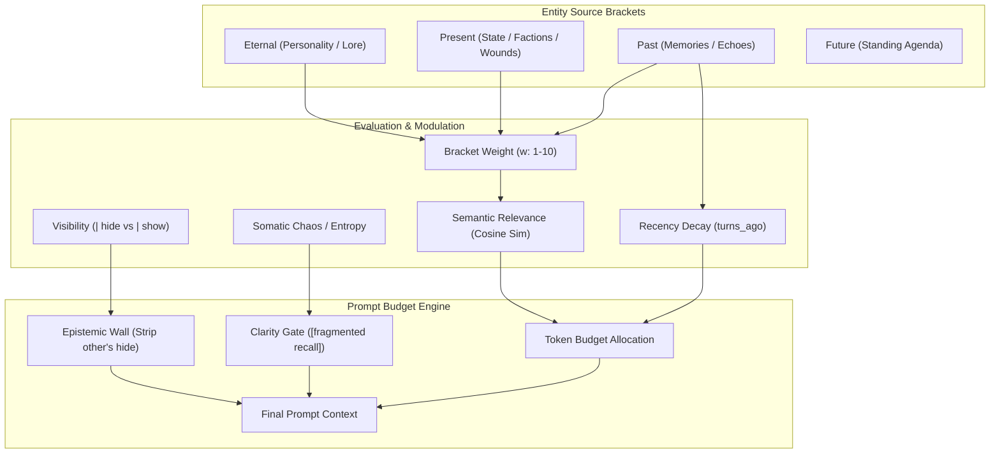

# Memory & Bracket Architecture Analysis: Entity RAG, Token Budgets & Quadrants

> **Executive Synthesis & Investigation Report**  
> _Target Systems_: `src/intelligence/temporal.js`, `src/intelligence/veil.js`, `src/intelligence/modules/sheets.js`, `src/intelligence/builder.js`.

---

## 1. Disambiguation: Why "Velocity" Was Confusing

In our prior discussion about calculating narrative stagnation via turn-to-turn semantic differences, the term "velocity" was borrowed from math/physics ($1 - \text{cosine\_similarity}$). However, in **RPGlitch**, **Velocity** is already a reserved, fundamental numerical somatic axis (0–100) on the Fractal/Simulation state:

- `Fractal.velocity`: Rate of environmental transformation / physics speed.
- `Somatic.velocity`: Biological movement / speed of action.

_Decision_: We will never use "velocity" for narrative drift. Going forward, the semantic drift metric is strictly called **`semantic_drift`** or **`scene_transit_delta`**.

---

## 2. Current Reality: Where Brackets Are Pulled From Today

### The Hard Finding

**Right now, dynamic RAG vector scoring ONLY pulls from `entity.past`.**

- In `temporal.js:152` (`resolve_vector_pool`): It literally only accepts `entity.past` (either as an array of vectors or a bracket string).
- In `sheets.js:332-384` (`render_sheet`):
  - `eternal.non_physical` (Personality / Core Canon): **100% dumped raw into prompt**.
  - `present.non_physical` (Current State / Factions): **100% dumped raw into prompt**.
  - `future` (Agenda): **100% dumped raw into prompt**.
  - `eternal.physical` & `present.physical`: **Merged into `<APPEARANCE>` tags and dumped raw into prompt**.
  - `past`: The **only** field that passes through `temporal_engine.format(resolve_vector_pool(entity), scoring_context, options)`.

---

## 3. The Flaw You Identified: Physical Fields in Story Prompts

You are completely right:

1. **Physical fields exist primarily for visual synthesis (optics / diffusion prompts)**.
   - In image generation, the diffusion model needs: `[HAIR: silver]`, `[CLOTHING: trench coat]`, `[WEATHER: neon rain]`.
2. **In a normal Storymode Narrative pass (Turn 2)**:
   - Stuffing 20 lines of raw clothing/body tags into the Storyteller LLM wastes precious context window tokens and causes **AI fixation** (the LLM starts describing clothes, buttons, and hair in every single reply instead of focusing on dialogue and drama).
   - If physical tags are included in chat prompts, they should either be:
     - **Stripped / Minimized**: Only the broad silhouette/setting anchor.
     - **On-Demand / Dynamically Pulled**: Only present if the scene context actually mentions or interacts with them (e.g. taking off a coat, examining a wound).

---

## 4. The Complex Interaction Matrix: How All The Systems Collide

Here is the exact map of every parameter currently operating or competing in the system:



### The Individual System Rules (From Source Code)

1. **Emotional Weight (`w: 1` to `w: 10`, Default: 5)**
   - Defined in `veil.js:145` as `| w: X` or `| weight: X`.
   - In `temporal.js:293` (`compute_relevance`): Multiplies the score directly:  
     $$\text{relevance} = \text{weight} \times (1 + \text{gain} \times \text{similarity}) \times \text{recency} \times \text{boosts}$$
   - **Weight 10 Immunity**: If `weight >= 10`, it is completely immune to recency decay! It never fades with time.

2. **Recency Decay (`turns_ago` vs `weight`)**
   - Implemented in `temporal.js:266` (`recency_factor`).
   - Formula:  
     $$\text{decay\_exponent} = \max(0, \frac{10 - \text{weight}}{5})$$  
     $$\text{factor} = \left(\frac{1}{1 + \log_{10}(\text{turns\_ago} + 1)}\right)^{\text{decay\_exponent}}$$
   - Low-weight memories ($w=1..4$) drop off rapidly after 3–5 turns. High-weight memories ($w=8..9$) decay very slowly. Weight 10 never decays.

3. **Visibility & The Epistemic Wall (`| hide` vs `| show`)**
   - Implemented in `veil.js:20` and `sheets.js:260`.
   - If an entity owns a bracket flagged with `| hide`: It stays in their sheet so the persona knows it as a secret, but does not voice it.
   - If _another_ entity views that sheet: The Epistemic Wall completely strips all `| hide` brackets so AI cannot read the user's or another character's secrets.

4. **Memory Fragmentation (`Chaos` & `Entropy` > 70)**
   - Implemented in `temporal.js:1608`: When either Chaos or Entropy exceeds 70, recalled memories get prefixed with `[fragmented recall]`.
   - _(Note: We already flagged this on `ROADMAP.md` Track 4 for redesign because raw prefixing can confuse LLMs)._

5. **Token Budgets & The Current Bottleneck Bug (Your Point 2c)**
   - Currently, `builder.js:258` caps past retrieval at `max_chars: 1500` ($\approx 375$ tokens).
   - **The Critical Flaw**:
     - `eternal` has **no budget cap** (it dumps 100% of its content).
     - `present` has **no budget cap** (it dumps 100% of its content).
     - If a user writes 2,000 tokens of setting lore or factions into `eternal` or `present`, **that bloated content steals the model's attention**, while a crucial emotional memory with `w: 10` in `past` gets strictly capped or chopped off at 1,500 characters!

---

## 5. Architectural Proposal: Unified Sovereign Lorebook & Dynamic Budgeting

Instead of dumping non-past fields raw, we should treat all four quadrants under a **Unified Priority Tier & Dynamic Token Reservoir**:

### A. The 3-Layer Prompt Budget Architecture

| Layer                                   | Content                                                                                                                                    | Ingestion Rule                                                                                  | Token Budget         |
| :-------------------------------------- | :----------------------------------------------------------------------------------------------------------------------------------------- | :---------------------------------------------------------------------------------------------- | :------------------- |
| **Tier 1: Anchors (Static)**            | `eternal.core` (Who I am), `present.active_role`, `future.agenda`                                                                          | Always included unconditionally. Kept concise.                                                  | $\approx 250$ tokens |
| **Tier 2: High-Weight RAG (Universal)** | High emotional weight ($w \ge 8$) or high semantic relevance ($> 0.7$) from **ALL** quadrants (`past`, `present.factions`, `eternal.lore`) | Scored together via embedding search. Highest score wins regardless of which field it lives in. | $\approx 600$ tokens |
| **Tier 3: Contextual Spillover**        | Medium-weight recent memories ($w=5..7$) or relevant situational details                                                                   | Fills whatever remains of the context allocation.                                               | $\approx 350$ tokens |

### B. What About Physical Fields?

- **Chat Prompts (Turn 2)**: Completely omit `*.physical` by default. Only include if an item has an active dynamic tag like `[WEAPON: ...]` or if explicitly referenced in the current turn.
- **Vision Prompts (Turn 2 Sub-process)**: Feed 100% of `eternal.physical` and `present.physical` into `optics.js`.

---

## 6. Token Expenditure Breakdown: What We "Spend" Today in Turn 2 (Interaction Shot)

Here is the exact token breakdown of what RPGlitch compiles into the model's context window today for a typical `interaction` narrative shot (`PROSE_LAYERS` in `prompts.js`):

| Section                              | Exact Code Source                                  | Character / Token Limit in Code                                       | Typical Tokens Spent                |
| :----------------------------------- | :------------------------------------------------- | :-------------------------------------------------------------------- | :---------------------------------- |
| **System & Constitution**            | `src/intelligence/modules/system.js` + `axioms.js` | Static system role prompt + Axiomatic Constitution                    | $\approx 350 - 450$ tokens          |
| **Core Protocols**                   | `src/intelligence/modules/protocols.js`            | Tense, grounding, prose discipline, no-cliché rules, natural dialogue | $\approx 400 - 500$ tokens          |
| **Entity Sheets (`<ENTITIES>`)**     | `sheets.js` / `entities.js`                        |                                                                       |                                     |
| ├─ **AI Character**                  | `sheets.js:332-384`                                | Psychology + raw eternal/present + raw appearance + memories          | $\approx 500 - 800$ tokens          |
| ├─ **User Persona**                  | `sheets.js:86` (`USER_PERSONA`)                    | Backstory + appearance + state                                        | $\approx 250 - 450$ tokens          |
| ├─ **Fractal (Setting)**             | `sheets.js:87` (`FRACTAL`)                         | Setting state + dynamics + world description                          | $\approx 300 - 500$ tokens          |
| ├─ **Active/Nearby NPCs**            | `entities.js:135`                                  | 1-2 summaries (each up to 130 words)                                  | $\approx 150 - 300$ tokens          |
| **Memories RAG Pool (`past`)**       | `temporal.js:411` & `builder.js:258`               | Hard cap: `max_chars: 1500`                                           | $\approx 350 - 375$ tokens (capped) |
| **Simulation History (`<HISTORY>`)** | `history.js:86` (`HISTORY_TOKEN_BUDGET`)           | Up to 16 turns, max 400 chars/turn                                    | $\approx 1,200 - 1,600$ tokens      |
| **Active Task & Directives**         | `task.js` + `prompts.js`                           | `<TASK>`, user input, output schema, stability lock                   | $\approx 250 - 350$ tokens          |
| **TOTAL TURN 2 PROMPT SIZE**         | Dispatched to LLM                                  | Protected by `CONTEXT_TOKEN_CLIFF = 6000`                             | **$\approx 3,800 - 4,800$ tokens**  |

### Key Takeaways from Current Spend

1. **History dominates ($\approx 35\%$)**: History takes up to 1,600 tokens.
2. **Entities are the second largest consumer ($\approx 30\%$)**: AI + User + Fractal together consume 1,200 – 1,750 tokens without any dynamic ceiling on non-past fields.
3. **Physical appearance accounts for $\approx 300 - 500$ tokens**: `<APPEARANCE>` tags for User, AI, and Fractal eat $\approx 10\%$ of the entire prompt on visual details that the storyteller barely needs.
4. **Memory is artificially starved ($\approx 8\%$)**: Despite being the source of emotional depth, `past` is strictly clamped to $\approx 375$ tokens (1,500 chars) while uncurated appearance tags get equal or greater space!

---

## 7. Answers to Critical Mechanics Questions

### Q1: In a long roleplay, will ALL memories eventually decay to zero recency?

**No, they will NEVER hit zero.**

1. **The Mathematical Floor**: In `temporal.js:69` & `298`:

   ```javascript
   const RECENCY_FLOOR = 0.5; // Floor is 50%!
   const recency = Math.max(RECENCY_FLOOR, Math.pow(raw_recency, DECAY_SOFTEN));
   ```

   Even if a memory occurred 10,000 turns ago, its recency factor will **never drop below 0.5 (50%)**.

2. **Weight 10 Immunity**: In `temporal.js:268`, any memory with `emotional_weight >= 10` has decay bypassed completely (`recency = 1.0` permanently).
3. **Logarithmic Falloff**: Because the decay uses $\log_{10}(\text{turns\_ago} + 1)$, it drops from $1.0 \to 0.7$ over the first 10 turns, then takes 100 turns to reach $0.55$, and hits the $0.50$ floor gently. It never vanishes.

### Q2: What about the dual physical/non-physical concept (e.g. "Bodybuilder")?

- Your original instinct was completely sound: if a trait has behavioral implications ("bodybuilder" = disciplined, imposing, physical presence), that psychological/social aspect belongs in `non_physical`. The literal visual dimensions ("veiny forearms, broad shoulders, 220 lbs") belong in `physical`.
- But because users and models often just write `[BUILD: bodybuilder]` into `physical`, we can't assume perfect field separation.

### Q3: Giving Physical Brackets a Halved Relevance Score (0.5x Multiplier)?

**This is an elegant, pragmatic solution.**
If we allow physical brackets into the RAG candidate pool with a **`0.5x physical_salience_penalty`**:

1. **Default State**: A standard `[SHIRT: flannel]` ($w=5$) gets scored with a 0.5 penalty $\to$ effective weight 2.5. It will almost never beat real narrative memories ($w \ge 5$) or character traits.
2. **Super Relevant State**: If the user's message is _"I rip open your shirt to see the scar"_, the semantic similarity for `[SHIRT: flannel]` or `[CHEST: claw scars]` shoots up to $\approx 0.85 - 0.95$. With that massive semantic boost, it overcomes the 0.5 penalty and surfaces in the prompt right when the scene demands it!
3. **Zero Token Waste**: When nothing physical is being touched or talked about, physical tags naturally fade out, saving 300–500 tokens per turn for dialogue and emotional memories.
