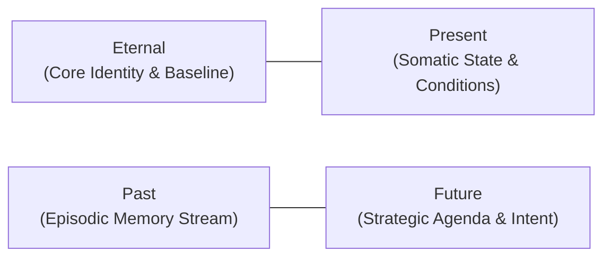
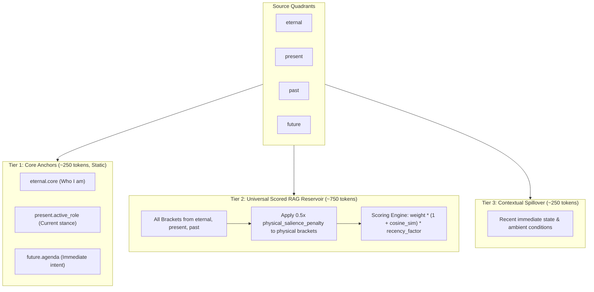
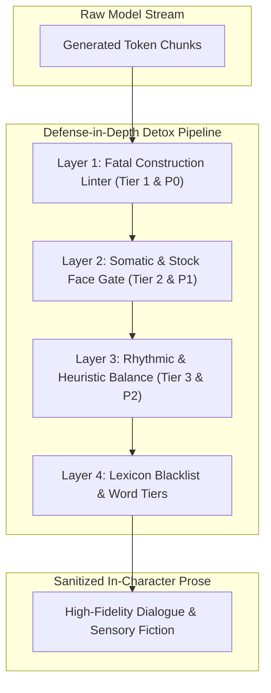

# Sovereign Memory, Entity RAG & Token Budget Architecture

> **Authoritative Specification & Technical Blueprint**  
> _Target Subsystems_: `src/intelligence/temporal.js`, `src/intelligence/veil.js`, `src/intelligence/modules/sheets.js`, `src/intelligence/builder.js`, `src/intelligence/modules/history.js`, `src/intelligence/modules/reflex.js`, `src/intelligence/modules/lorebook.js`, `src/utils/detox.js`, `src/utils/styles.js`, `src/ui/message/Feed.svelte`, `src/media/visual.svelte.js`.

---

## 1. Executive Summary & Foundational Intent

RPGlitch bridges creative prose and simulation physics through the **Story Triad** (`active_user`, `active_ai`, `active_fractal`) and the **Four-Quadrant Entity Schema** (`eternal`, `present`, `past`, `future`).

While analyzing MoeChat's architectures (`SPEC-prism.md`, `SPEC-lorebook.md`, `SPEC-models.md`, `SPEC-context-limit.md`), we conducted a comprehensive gap analysis and identified several critical improvements across our simulation, prompt engineering, memory retrieval, narrative anti-slop, and UI performance pipelines.

This document serves as the **single source of truth** synthesizing every evaluated feature into a unified, modular architecture. It documents the mathematics, schema designs, behavioral contracts, and anti-slop linter specifications that govern RPGlitch's intelligence layer. All planning tracks, implementation schedules, and verification proofs are maintained in [ROADMAP.md](ROADMAP.md).

---

## 2. Canonical Lexicon & Evidentiary Invariants



| Domain Concept                  | Mechanical Definition                                                                                                                        | Implementation Grounding                 |
| :------------------------------ | :------------------------------------------------------------------------------------------------------------------------------------------- | :--------------------------------------- |
| **`eternal`**                   | Immutable canon, identity archetype, baseline traits.                                                                                        | `sheets.js:332-384`, `profile-fields.js` |
| **`present`**                   | Live somatic conditions, active gear, wounds, immediate factions.                                                                            | `veil.js`, `sheets.js`                   |
| **`past`**                      | Episodic memory stream. Compacted multi-tier event tree (`PRISM_FANOUT = 8`).                                                                | `temporal.js:74-110`                     |
| **`future`**                    | Active trajectory and standing intent. Consolidated prose rewritten each cycle.                                                              | `temporal.js:1410-1440`                  |
| **`semantic_drift`**            | Turn-to-turn semantic movement ($1 - \text{cosine\_similarity}$). Measures scene progress without colliding with Fractal physics `velocity`. | Section 3                                |
| **`physical_salience_penalty`** | 0.5x scoring penalty applied to physical brackets during narrative text retrieval.                                                           | Section 4                                |
| **`Epistemic Wall`**            | Strips `\| hide` brackets across entity boundaries to prevent AI telepathy.                                                                  | `veil.js:20`, `sheets.js:260`            |
| **`Context Cliff`**             | 6,000 token limit where Perchance silently drops the middle of the prompt.                                                                   | `history.js:82-84`                       |

---

## 3. Current Codebase Realities vs. Architectural Bottlenecks

Cross-referencing active implementations across `src/` revealed the following system boundaries:

### Current Token Spend in Turn 2 (Interaction Shot)

| Section                              | Exact Code Source                   | Character / Token Budget in Code                    | Typical Tokens Spent               | % of Prompt |
| :----------------------------------- | :---------------------------------- | :-------------------------------------------------- | :--------------------------------- | :---------- |
| **System & Constitution**            | `system.js` + `axioms.js`           | Static system role prompt + Axiomatic Constitution  | $\approx 400$ tokens               | ~9%         |
| **Core Protocols**                   | `protocols.js`                      | Tense, grounding, prose discipline, no-cliché rules | $\approx 450$ tokens               | ~10%        |
| **Simulation History (`<HISTORY>`)** | `history.js:86`                     | `HISTORY_TOKEN_BUDGET = 1600` (max 16 turns)        | $\approx 1,200 - 1,600$ tokens     | **~35%**    |
| **Entity Sheets (`<ENTITIES>`)**     | `sheets.js:332-384`                 | AI + User + Fractal + NPCs (unbudgeted raw dump)    | $\approx 1,200 - 1,750$ tokens     | **~30%**    |
| ├─ _Appearance Tags Alone_           | `sheets.js:348`                     | Raw merged `<APPEARANCE>` blocks                    | $\approx 300 - 500$ tokens         | _~10%_      |
| **Memories Pool (`past`)**           | `temporal.js:411`, `builder.js:258` | **Clamped to `max_chars: 1500`**                    | **$\approx 350 - 375$ tokens**     | **~8%**     |
| **Active Task & Directives**         | `task.js` + `prompts.js`            | `<TASK>`, user input, output schema, stability lock | $\approx 300$ tokens               | ~7%         |
| **TOTAL PROMPT SIZE**                | Dispatched to LLM                   | Protected by `CONTEXT_TOKEN_CLIFF = 6000`           | **$\approx 3,900 - 4,850$ tokens** | 100%        |

### Identified System Inequities

1. **Memory Starvation**: Only 8% of the prompt is allocated to historical memories, truncating character continuity, while visual appearance tags consume 10% on details rarely needed in narrative dialogue.
2. **"Past-Only" Retrieval Bottleneck**: Vector scoring currently operates solely on `entity.past`. The other three quadrants (`eternal`, `present`, `future`) dump raw text without dynamic budgeting.
3. **Appearance Fixation**: In narrative chat, 300–500 tokens of raw physical descriptors (`[HAIR: ...]`, `[COAT: ...]`) lead the LLM to over-describe clothes rather than drama.

---

## 4. The Unified 4-Quadrant RAG Architecture

To solve prompt bloat and memory starvation, we establish a **Universal 3-Tier Prompt Reservoir** where all four quadrants participate in intelligent, budgeted scoring.



### 4.1 The 3-Tier Reservoir Specification

1. **Tier 1: Core Anchors (~250 tokens, Always Injected)**:
   - High-priority invariants: Identity, baseline personality, current physical role, standing agenda.
   - Guaranteed slots that bypass cosine similarity scoring.
2. **Tier 2: Universal Scored Reservoir (~750 tokens, Dynamically Retrieved)**:
   - Evaluates all brackets across `eternal`, `present`, and `past`.
   - **The 0.5x Physical Salience Penalty**: In pure narrative text turns, physical descriptor brackets (`CLOTHING`, `HAIR`, `EYES`, `ACCESSORY`) receive a 0.5x multiplier. They enter the prompt only if direct cosine similarity exceeds 0.80 (e.g., the user explicitly remarks on their clothing or appearance).
   - Frees up $\approx 350$ tokens for episodic memories and interpersonal dynamics.
3. **Tier 3: Contextual Spillover (~250 tokens, Opportunistic)**:
   - Immediate somatic conditions (active bleeding, panic status, inventory items drawn this turn).

### 4.2 Slicing & Boundary Protection: Whole-Vector vs Line-Skipping

A critical architectural consideration from MoeChat (`SPEC-lorebook.md:127`) states:

> _"A line that does not fit is skipped, not truncated — a half sentence of world lore is worse than none."_

RPGlitch enforces **Bracket-Boundary Chunking**:

- In `veil.js:71-173`, `parse_bracket_entries` treats each bracket `[KEY: VALUE]` as an indivisible atomic token.
- In `temporal.js:421-435`, whole-vector budget protection calculates:

  ```javascript
  const payload_length = text.length;
  if (running_chars + payload_length > max_chars && selected.length > 0) {
    break; // Stops before adding the entry! Does NOT slice mid-bracket!
  }
  selected.push(vector);
  running_chars += payload_length;
  ```

- If adding the next bracket `[CLOTHING: dark wool trench coat]` would exceed `max_chars: 1500`, the loop breaks immediately. It never emits malformed fragments like `[CLOTHING: dark wool...`.

#### Sanitization & Depth Validation

The only edge case where an unclosed bracket could enter the pipeline is manual user authoring (e.g., typing `[EYES: blue` without a closing `]`).

- Both `safe_parse_pseudo_json` and `parse_bracket_entries` validate matching brace depth.
- Any unclosed tag is rejected by the bracket tokenizer and falls back to inert raw prose, guaranteeing that malformed syntax never corrupts downstream LLM instruction slots.

### 4.3 Quad-Partitioned Unified Memory Scoring & Salience Equations

The universal retrieval engine scores candidates across all four quadrants using the following formulation:

$$\text{FinalScore}(v) = W(v) \times (1 + \text{CosineSim}(v, q)) \times R(v) \times S(v)$$

Where:

- $W(v)$ is base authoring weight (default: 1.0; origin `usr_` multiplier: 1.5).
- $\text{CosineSim}(v, q)$ is the semantic similarity between bracket vector $v$ and turn query $q$.
- $R(v)$ is temporal recency attenuation (flat 1.0 for `eternal`; exponential decay for `past`).
- $S(v)$ is the salience penalty ($0.5$ for physical appearance tags in narrative mode, $1.0$ if visual diffusion is scheduled or similarity $> 0.80$).

---

## 5. The 4-Quadrant RPGlitch State Consolidation Engine

```mermaid
sequenceDiagram
    autonumber
    actor User as Protagonist (Turn 3)
    participant GM as Story / ChronoEngine
    participant Director as Director (Turn 1)
    participant Actor as Actor (Turn 2)
    participant Forge as Memory Forge (Turn 3 Sub-Process)
    participant DB as Dexie.js Persistence

    Note over User,DB: Round Heartbeat Execution
    User->>GM: Submits Message Payload
    GM->>Director: Turn 1: Quick Shot (Dynamics Delta, Image Schedule)
    Director-->>GM: Telemetry DYNAMICS_DELTA + Directives
    GM->>Actor: Turn 2: Narrative Shot (Dialogue + Sensory Prose)
    Actor-->>User: Streams In-Character Narrative
    par Turn 3 User Deliberation & Background Forge
        User->>User: Authors Next Input (Biological Clock)
    and Turn 3 Sub-Process
        GM->>Forge: Dispatches director_background_queue
        Forge->>Forge: Consolidates Quadrants (eternal, present, past, future)
        Forge->>DB: Appends Diffs to mutation_ledger
        Forge->>DB: Updates 384-d Embeddings (PAST_VECTOR_CAP = 20)
    end
```

### 5.1 Temporal Engine & Turn 3 Consolidation

Consolidation executes silently on `director_background_queue` during Turn 3 while the user writes:

- **Round-Robin Sweep**: One entity is processed per round across historical turns.
- **Episodic Vector Rolling**: Enforces `PAST_VECTOR_CAP = 20` on AI-generated memories while preserving origin-flagged user memories (`usr_`).
- **Telemetry Emitted**: Produces `MEMORY_FORMATION` and `VECTOR_RESOLUTION` cards.

### 5.2 Somatic Recall Degradation & Dynamics-Modulated Uncertainty

Instead of artificial floating-point confidence scores, RPGlitch bridges somatic physics and narrative cognition:

- **High Glitch / Instability (`Chaos > 70` or `Entropy > 70`)**: Memories are prefixed with sensory instability flags (`[fragmented recall]`, `[hazy recollection]`).
- **High Stability (`Stability > 75` or `Entropy < 30`)**: Recalled facts are framed with sensory crispness and immediate grounding.
- Grounded in live somatic dynamics without hallucinating synthetic metric indicators.

### 5.3 Epistemic Partitioning & Dual-Filter Rules

- **Visual Prompt Filter**: Brackets bearing `INVENTORY`, `STASH`, or `| hide` are strictly stripped before image diffusion prompts are assembled (`build_aesthetic_map` & `strip_visual_excluded`).
- **Epistemic Prompt Filter**: Brackets flagged with `| hide` belonging to other entities are stripped across the Epistemic Wall in `render_character` to eliminate telepathy, while remaining fully visible to the Director. Owner entities retain their own covert brackets (e.g. `[DAGGER: stiletto | hide]`) to maintain grounded awareness.

### 5.4 Mutation Ledger & Unifying the Two Merges

Currently, state mutations utilize two divergent functions:

1. `merge_eternal_field`: Key-aware replacement for structured brackets in `eternal`.
2. `merge_prose_into_field`: Naive prose append for dynamic summaries in `present` and `future`.

#### The Unified Merger: `merge_field_content`

Both paths are consolidated into a single atomic helper:

```javascript
merge_field_content(current_value, incoming_mutation, {
  key_aware: true, // Parse brackets and handle key-replacement / atomic clears
  dedup: true, // Drop semantic and exact duplicates
  cap_limit: 1500, // Token/character ceiling
  cap_direction: "head", // "head" keeps baseline identity; "tail" keeps recent state
});
```

This eliminates duplicate implementations across `temporal.js` and `text.js`, cleanly resolving two-writer contention between the Director Turn and Memory Forge.

---

## 6. MoeChat Architectural Inspirations & Reference Blueprints

The following 10 architectural patterns from MoeChat have been evaluated and adapted for RPGlitch:

### 6.1 The Spent Ledger (Anti-Repetition Engine)

- **Origin**: `moechat/tools/slop.js:707-725`.
- **Mechanism**: Inspects the last 4–6 narrative turns, extracting repeated opening clauses, body language mannerisms, and 3–5 word n-grams that appeared in 2+ replies.
- **RPGlitch Integration**: Injects `# SPENT LEDGER` into the prompt tail:
  > _"Already spent recently in this scene: Opener: X. Tells: Y. Phrases: Z. Do not repeat them."_

### 6.2 Runtime Stream Beat Backstop (Input-Proportional Sizing)

- **Origin**: `moechat/docs/SPEC-models.md` §5 & `engine.js`.
- **Mechanism**: On `TINY` ($\le 12$ chars) or `SMALL` ($\le 90$ chars) user inputs, monitors incoming streaming chunks for the terminal punctuation of the first beat and immediately cuts generation.
- **RPGlitch Integration**: Prevents narrative ballooning when the user delivers a brief line or gesture.

### 6.3 Cut-Off Reply Continuation (`finishTail`)

- **Origin**: `moechat/docs/SPEC-models.md` §16.
- **Mechanism**: Detects when generation terminates without terminal punctuation on a multi-word clause. Commits the partial turn and triggers an append-only completion prompt (`finishTail`) rather than forcing a full re-roll.

### 6.4 Scene Momentum & Stagnation Backstop

- **Origin**: `moechat/docs/SPEC-models.md` §13.3 & `engine.js`.
- **Mechanism**: Tracks rounds elapsed without spatial movement (`semantic_drift < 0.15` and no environment mutations).
  - _Tier 1 (8 turns)_: Soft permit: Director ceases anti-staging directives.
  - _Tier 2 (16 turns)_: Hard mandate: Director mandates a physical scene crossing.

### 6.5 Lorebook Instructions & "Our Lorebook" Positioning

- **Origin**: MoeChat Lorebook vs RPGlitch 4-Quadrant Architecture.
- **Mechanism**: Clarifies in UI and documentation that **all 4 quadrants together are our lorebook**:
  - `eternal` + `present` = Active entity lore.
  - `past` = Autobiographical memory stream.
  - `lorebooks` = Global world encyclopedia.

### 6.6 Lorebook Studio Architecture & Depth Placement

- **Origin**: `moechat/docs/SPEC-lorebook.md`.
- **Mechanism**: Backend engine in `src/intelligence/modules/lorebook.js` and `db.lorebooks`.
- **RPGlitch Integration**: UI modal in `src/ui/` with SillyTavern JSON import/export and `@depth` history placement (injecting world lore $N$ turns back into dialogue history).

### 6.7 Prompt Token Map ("What the Model Sees")

- **Origin**: `moechat/docs/SPEC-prompt.md`.
- **Mechanism**: Dedicated visual inspector rendering a proportional token allocation bar chart of prompt components (`SYSTEM`, `HISTORY`, `ENTITIES`, `PAST`, `TASK`).
- **RPGlitch Integration**: Interactive token visualizer in `DevWing.svelte`.

### 6.8 Feed Virtualization Engine (Windowing Architecture)

- **Origin**: `moechat/js/windower.js`.
- **Mechanism**: Measured DOM virtualizer that keeps only visible messages mounted in the DOM, preventing browser slowdowns in long roleplays without breaking scroll anchors or input focus.
- **RPGlitch Integration**: Activates in `src/ui/message/Feed.svelte` when message count exceeds 50 turns.

### 6.9 Slash Command Directing Bar (`/ooc`, `/time`, `/mood`)

- **Origin**: `moechat/js/chat.js`.
- **Mechanism**: Floating shortcut bar above the message input allowing the user to seamlessly invoke director directives (`/ooc`, `/narrate`, `/time +2h`, `/mood tense`) without cluttering in-character dialogue.

### 6.10 Persistent Session Image Archive (Two-Tier Gallery Shelf)

- **Origin**: `moechat/docs/SPEC-mobile.md` §37.
- **Mechanism**: Two-tier image archive indexing generated visual art into a dedicated library grid with thumbnail caching.
- **RPGlitch Integration**: Dedicated gallery modal in `src/ui/` querying Dexie image attachments across the current story.

---

## 7. The Comprehensive Anti-Slop & Narrative Detox Specification

Synthesizing all reference materials from `tmp/writing/` (`slop.js`, `writer.md`, `humanizer.md`, `avoid-ai-writing.md`, `pattern-catalog.md`, `word-tiers.md`, `profiles.md`) establishes RPGlitch's authoritative narrative detox standard.



### 7.1 Multi-Layer Defense-in-Depth Architecture

1. **Pre-Inference Guard (Prompt Constraint)**: Injects the `# SPENT LEDGER` and strict negative constraints into `<TASK>` directives.
2. **Streaming Guard (Boundary Monitor)**: Enforces unit and beat termination on short turns (`TINY`, `SMALL`).
3. **Post-Processing Detox (`detox_prose`)**: Deterministic regex and AST pass scrubbing prohibited constructions, normalizing dashes, and pruning unearned dramatic aphorisms.
4. **Quality Linter & Telemetry**: Emits telemetry diagnostics when anti-slop thresholds are tripped.

---

### 7.2 Tier 1: Fatal Syntactic & Construction Defects (`slop.js`)

Tier 1 patterns represent syntactic defects. Any hit is flagged as an immediate defect requiring remediation:

| Defect ID                    | Trigger Mechanism                                  | Why Forbidden                                               | Example Violation                                    | Clean Correction                                              |
| :--------------------------- | :------------------------------------------------- | :---------------------------------------------------------- | :--------------------------------------------------- | :------------------------------------------------------------ |
| **`not-x-it-is-y`**          | Negation antithesis (`not X, it's Y`)              | Negative contrast used to manufacture false significance.   | _"It was not fear, it was something worse."_         | _"A cold dread settled over him."_                            |
| **`its-not-x-its-y`**        | Conversational negation (`it's not X, it's Y`)     | Conversational evasion; refuses to state the fact directly. | _"It's not anger, it's grief."_                      | _"She felt grief, heavy and hollow."_                         |
| **`not-quite-more-like`**    | Evasive approximation (`not quite X, more like Y`) | Evasive approximation.                                      | _"Not quite a smile, more like a warning."_          | _"His mouth tightened into a warning."_                       |
| **`didnt-x-she-y`**          | Semicolon antithesis (`she didn't X; she Y`)       | Semicolon negative antithesis.                              | _"She didn't answer him; she looked at the door."_   | _"She ignored him and looked at the door."_                   |
| **`parenthetical-thoughts`** | Labeled thoughts in parentheses                    | Narrator cognitive leak.                                    | _"She was quiet. (Sylvie's thoughts: I hate this.)"_ | Free-indirect: _"She was quiet. She hated this."_             |
| **`he-thought-colon`**       | Labeled inner thoughts (`he thought:`)             | Labeled inner cognition.                                    | _"He thought: I shouldn't do this."_                 | _"He shouldn't do this, and he knew it."_                     |
| **`air-grew-thick`**         | Purple atmospheric phrasing                        | Stock purple atmosphere.                                    | _"The air grew thick between them."_                 | Ground in physical sensation: temperature, scent, or silence. |
| **`swirling-in-chest`**      | Stock bodily interior (`swirling in chest`)        | Stock bodily interior.                                      | _"A cold fury swirling in her chest."_               | State the character's observable action or physical tension.  |
| **`naming-subtext`**         | Explicit subtext (`gesture of ownership`)          | Explaining subtext to reader instead of showing it.         | _"She brushed his coat, a gesture of ownership."_    | _"She brushed lint from his coat and held his gaze."_         |

---

### 7.3 Tier 2: Stock Faces & Somatic Flooding (`slop.js`)

Stock facial gestures and somatic physical responses are capped at **maximum 1 per reply**. Exceeding this constitutes somatic flooding:

- **`ghost-of-smirk`**: _"A ghost of a smirk crossed her lips."_ $\rightarrow$ Describe the exact muscular change.
- **`barely-above-whisper`**: _"Her voice was barely above a whisper."_ $\rightarrow$ Use plain attribution: _"she whispered."_
- **`voice-dripping-with`**: _"Voice dripping with venom/sarcasm."_ $\rightarrow$ Let the dialogue deliver the tone.
- **`eyes-darkened`**: _"His eyes darkened with rage."_ $\rightarrow$ Avoid biological impossibilities; describe focus or brow.
- **`let-out-breath-didnt-know`**: _"She let out a breath she didn't know she was holding."_ $\rightarrow$ Cut entirely.
- **`a-beat-passed`**: _"A beat passed between them."_ $\rightarrow$ Show the physical pause via concrete action.

---

### 7.4 Tier 3: Macro-Shape & Heuristic Tells (`slop.js`)

Heuristic rules governing the macro-structure of the generated narrative:

1. **`as-if-overuse`**: Using _"as if"_ or _"as though"_ more than twice in a single response triggers an automatic audit flag.
2. **`every-para-question`**: Responses where every paragraph terminates in a question mark are rejected.
3. **`familiar-closer`**: Responses where the closing paragraph opens with _"Meanwhile"_, _"Then"_, or _"Suddenly"_ are flagged.
4. **`door-slam-closer`**: Relying on an abrupt exit or slammed door as the terminal beat is flagged as dramatic evasion.
5. **`repeat-tell`**: Reusing the preceding turn's opening clause ($12+$ character n-gram match) is strictly rejected by the Spent Ledger.

---

### 7.5 The Six Structural Defect Families (`humanizer.md`)

1. **Staging Instead of Stating**: Setting up emotional throat-clearing before reporting action. State the action first.
2. **Rhythm by Rule**: Symmetrical triplets of adjectives (_"cold, silent, and predatory"_) and ubiquitous em-dash interjections. Break triplets into dynamic pairs or single strong nouns.
3. **Inflation & Borrowed Authority**: Over-indexing on faux-epic significance (_"a pivotal turning point"_, _"a testament to her will"_).
4. **Formatting by Rule**: Emitting markdown bold titles, bullet points, or numbered lists in narrative prose.
5. **Leftovers from Chat**: Apologetic throat-clearing, meta reflections, or summary restatements.
6. **Writing for the Wrong Reader**: Lecturing the user on world lore their character already knows.

---

### 7.6 Severity Classification (P0, P1, P2) & Catalog (`pattern-catalog.md`)

- **P0 (Credibility Killers)**: Unfilled placeholders (`[Character Name]`), model apologies, citation markers (`citeturn0search0`), and cutoff disclaimers.
- **P1 (Structural Tells)**: Negative antithesis constructions, copula avoidance (_"Eyes blazing, she turned"_), metronomic sentence lengths, and aphoristic closers.
- **P2 (Polish Tells)**: Redundant transition adverbs, stock atmospheric metaphors, and repetitive dialogue tags.

---

### 7.7 The 112-Word Replacement Lexicon & Blacklist (`word-tiers.md`, `writer.md`)

#### Tier 1A: Forbidden AI Markers (Immediate Cut or Replacement)

```text
delve          tapestry       embark         testament to   beacon
interplay      pivotal        robust         comprehensive  realm
landscape      curate         leverage       illuminate     bespoke
resonate       multifaceted   nuance         holistic       vibrant
foster         garner         underscore     align          paramount
quintessential indelible      crucible       watershed      labyrinth
```

#### Tier 1B: Plain-Language Clarity Replacements

| AI Marker     | Mandated Clean Replacement |
| :------------ | :------------------------- |
| `utilize`     | **use**                    |
| `in order to` | **to**                     |
| `facilitate`  | **help / assist**          |
| `underpin`    | **support**                |
| `streamline`  | **simplify**               |
| `commence`    | **start / begin**          |

#### Tier 2: Density-Capped Lexicon (Max 1 per paragraph)

`nuanced`, `intricate`, `seamless`, `dynamic`, `nexus`, `juxtaposition`, `paradigm`, `confluence`, `symbiosis`.

---

### 7.8 Voice & Context Tolerance Matrices (`profiles.md`)

Tolerance for specific vocabulary and stylistic density adapts based on the active narrative register:

| Profile                         | Tier 1 Filter                  | Tier 2 Tolerance | Somatic Cap            | Formatting Rules                                       |
| :------------------------------ | :----------------------------- | :--------------- | :--------------------- | :----------------------------------------------------- |
| **`casual`** (RPGlitch Default) | Strict (100% Ban)              | Max 1 per turn   | 1 somatic tell / turn  | Zero markdown lists; pure prose and dialogue.          |
| **`lyrical`**                   | Permitted for poetic metaphors | Max 2 per turn   | 2 somatic tells / turn | Sensory imagery allowed; antithesis still banned.      |
| **`clinical`**                  | Relaxed for technical terms    | Permitted        | Zero somatic emotion   | Objective medical/physical reporting.                  |
| **`primal`**                    | Strict (100% Ban)              | Zero permitted   | Visceral kinetics only | Short sentences, sensory immediacy, zero abstractions. |

---

### 7.9 Frontend & Kinetic Anti-Slop (`design-taste-frontend.md`)

The user interface must uphold the same aesthetic discipline as the narrative engine:

1. **Zero Em-Dashes (`—`) in UI**: All button labels, modal titles, toasts, and descriptions must use clean hyphens, colons, or standard sentence structure.
2. **Nordic Design Token Sovereignty**: Reject AI defaults (generic purple gradients, centered card grids on pure black, Inter font fallbacks).
3. **Emil Kowalski Kinetic Laws**:
   - High-frequency actions ($100+$ times/day) receive **zero animation**.
   - Compositor-only transforms (`transform`, `opacity`); no layout thrashing on `width` or `height`.
   - All spring animations must remain interruptible.
