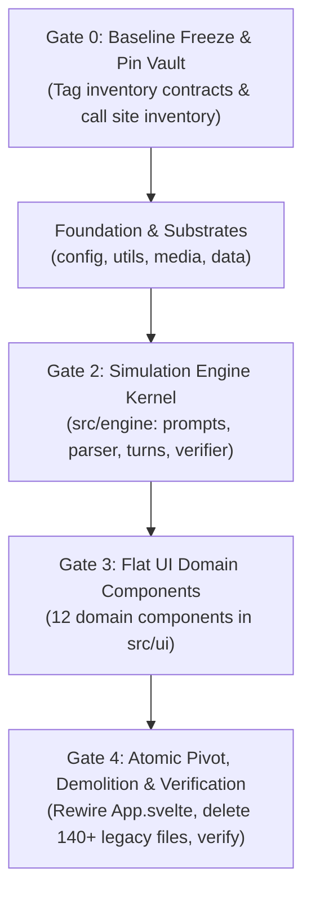

# BOOM: The Sovereign Nuclear Architecture & Simplification Protocol

- **The Character Card First (Vertical Slice Focus)**:
  - We begin with **one single card type: Character Card** (`name`, `image`, `definition`, `first_message`).
  - The immediate target: Slap down **1 Character Card** and immediately chat with it in a clean, fast 1-shot loop.
  - All other card types (Director, Persona, Location, Rule, Style) are modular future horizons that will drop seamlessly into this exact card architecture.
- **Base Card Foundation**: Every card in the engine shares `{ id, name, type, image, definition, specs }`.
- **Fast 1-Shot First, 2-Shot Ready**: Fast direct narrative loop first; ready for the Director Card 2-shot dance when the foundation is solid.
- **The Core Axiom**: _The treasure is the prompt wording and physical constraints, not the scaffolding code. Protect the battle-tested words and invariants; burn the wrappers, regex mazes, and indirection freely._

---

## 1. The Crown Jewels (Mechanisms That MUST Survive the Nuke)

We do not throw out hard-won runtime discoveries bought with real bug reports. The following 5 mechanisms are explicitly rescued and given lean, direct homes in the new architecture:

1. **The Tag Inventory Contract Harness & Verification Gate**:
   - The contract cases in `src/intelligence/prompt-verification.js` validate that prompt synthesis emits the exact required layer order without structural drift (replacing brittle byte-size checks).
   - Kept as a lean ~100-line `src/engine/verifier.js` and Vitest test suite. We do not nuke the safety net.
2. **Track 5 Pacing & Beat Budgeting (`finishTail`)**:
   - Pacing contrast and integer beat enforcement prevent runaway 450-character sludge and keep dialogue snappy.
   - Rescued into `src/engine/turns.js` as pure integer calculations (~40 lines).
3. **Track 2 Memory Core & Two-Tier Sieve RAG**:
   - The Two-Tier Sieve architecture (guaranteed token floors per entity + universal gravity-weighted RAG overflow pool) protects against Perchance's 6,000-token cliff while retiring legacy 8:1 chapter compaction trees.
   - Rescued into `src/data/entities.js` and `src/engine/prompts.js` using the exact mathematical weights already proven live.
4. **The Detox Battery (Lightweight Tier-1/Tier-2 Linter)**:
   - Prompt directives alone leak clichés over time. The 38-rule regex linter remains as a clean post-processing step in `src/utils/format.js`.
   - We strip the 1,200 lines of speaking-style bloat, but preserve the lean detox cleaner.
5. **The Lethality & Staging Contract**:
   - Character death, `story_status`, and Director staging overrides must remain strictly deterministic.
   - Rescued directly into `src/engine/turns.js` and `simulation.svelte.js`.

---

## 2. Redesigning Clunky Implementations (The Elegance Upgrade)

### A. Epistemic Isolation & `see_hidden` (Single-String Brackets + In-Memory Visibility)

- **The Problem**: Currently, `veil.js` and `profile.js` do messy multi-pass regex scanning to detect `| hide` flags, stripping keys and leaving broken pseudo-JSON chunks.
- **The Elegant Fix**:
  - Keep entity state cleanly stored as canonical single-string multiline brackets `[KEY: value | flags]`.
  - Filter visible brackets via the unified `see_hidden` parameter (`"own"` | `"all"` | `"none"`):
    - `see_hidden: "own"` (`PROSE_CORE`): Retains active character's own `| hide` brackets, strips counterpart `| hide` brackets and suppresses secret past/future across the Epistemic Wall. Merges physical traits into a single composite `<APPEARANCE>`.
    - `see_hidden: "all"` (`DIRECTOR_CORE` & `CARETAKER_CORE`): Retains all hidden brackets across the cast for omniscient evaluation and memory synthesis. Keeps physical traits un-merged (`<APPEARANCE>` + `<CURRENT_LOOK>`) for 1:1 Caretaker JSON mapping.
    - `see_hidden: "none"` (`OPTICS_CORE`): Strips `| hide` and inventory from all entities for camera-only surface diffusion prompts.
  - Zero regex acrobatics during prompt compilation, zero telepathy, instant evaluation.

### B. Dynamic Staging vs Protocol Bloat (Replacing 86 KB of XML Dictionaries)

- **The Problem**: Currently, `protocols.js` (40 KB) and `reflex.js` (46 KB) define dozens of static XML protocol atoms. The Director outputs keywords, which run through heavy lookup tables to inject giant static `<SHAME>`, `<TENSION>`, or `<COLD>` blocks into the prompt.
- **The Elegant Fix**:
  - The Director emits dynamic, contextual staging guidance:

    ```json
    {
      "next_speaker": "ai",
      "somatic_tension": "cold, shivers, breath misting in the alley",
      "director_note": "She realizes he's lying about the key. Don't confront him outright; test his reaction."
    }
    ```

  - We inject this directly into the Actor prompt as:

    ```xml
    <staging subtext="${director.somatic_tension}">${director.director_note}</staging>
    ```

  - Zero protocol dictionaries, zero XML atom compilation bloat. Fluid, intelligent, and uses 95% less code.

---

## 3. Demolition Targets (Files to Completely Delete)

We are eliminating **32 bloated files** (~450+ KB of over-engineered indirection):

### The `modules/` Sprawl (DELETE ENTIRE FOLDER: 20 files)

- `src/intelligence/modules/constitution.js` & `.test.js`
- `src/intelligence/modules/entities.js` & `.test.js`
- `src/intelligence/modules/output.js` & `.test.js`
- `src/intelligence/modules/protocols.js` & `.test.js`
- `src/intelligence/modules/recency.js` & `.test.js`
- `src/intelligence/modules/reflex.js` & `.test.js`
- `src/intelligence/modules/sheets.js` & `.test.js`
- `src/intelligence/modules/style.js` & `.test.js`
- `src/intelligence/modules/system.js` & `.test.js`
- `src/intelligence/modules/task.js` & `.test.js`

### Over-Engineered Builders & Wrappers (DELETE: 5 files)

- `src/intelligence/builder.js` & `builder.test.js` (58 KB of atom assembly bloat)
- `src/intelligence/prompts.js` & `prompts.test.js` (37 KB catalog bloat)
- `src/intelligence/veil.js` & `veil.test.js` (replaced by clean state partitioning)
- `src/intelligence/profile.js` & `profile.test.js` (merged into single state formatter)
- `src/intelligence/dynamics.js` & `dynamics.test.js` (merged into director turns)

_(Note: `prompt-verification.js` is NOT deleted without replacement; its core pins are migrated into `src/engine/verifier.js` before cutting)._

### Data Definitions Purge (DELETE / SLIM: 5 files)

- `src/data/definitions/speaking-styles.js` & `.test.js` (**DELETE ENTIRELY** - 1,200 lines of regex replaced by prompt-level directives + lightweight detox)
- `src/data/definitions/narrative-styles.js` (**PURGE** - prune all styles down to 2 canonical presets: Gritty & Cinematic, deleting 800+ lines of DNA bloat)
- `src/data/definitions/visual-styles.js` (**PURGE** - prune diffusion styles down to 2 essential presets, deleting unused visual configs)
- `src/data/definitions/profile-fields.js` (**STREAMLINE** - strip out unused XML catalog wrappers; preserve UI labels, `FLAT_LEAF_MAP`, and Caretaker field-enhancement directives)
- `src/data/definitions/premade-entities.js` (**KEEP AS-IS** - valid test & starter assets)

### Data & Persistence Consolidation (`src/data/`)

- **Consolidate Schemas & Persistence**: Merge `repository.js`, `sessions.svelte.js`, `ledger.js`, and `normalizer.js` directly into `src/data/db.js` with pure Dexie operations.
- **Quad-Partitioned Entities (`src/data/entities.js`)**: Canonical 4-quadrant schema (`ETERNAL`, `PRESENT`, `PAST`, `FUTURE`) with single-string multiline brackets and `see_hidden` visibility + Two-Tier Sieve RAG weights. Delete `card-conversion.js`. Keep streamlined `profile-fields.js`.
- **Presets & Starters (`src/data/presets.js`)**: 2 canonical narrative presets (Gritty & Cinematic) and starter entity cards.

### Media Layer Consolidation (`src/media/` - Governed by Design Skill)

- **`audio.svelte.js`**: Web Audio SFX and native Web Speech API dispatch (`window.speechSynthesis`). Delete standalone `speech.js` (purging the 1,248-line in-browser ONNX Kokoro pipeline).
- **`visual.svelte.js`**: Lean Perchance `generate_image` caller with clean prompts. Delete `optics.js`.
- **`motion.js`**: Unified kinetic physics, spring transitions, and card flight math. Absorbs `transitions.svelte.js`, `engine.svelte.js`, `kinetic.svelte.js`, and `card-flight.svelte.js`.
- **Styling Root**: `design.css` lives at root `src/design.css`, retaining tokens and glassmorphism.

### State & Platform Consolidation (`src/state/` & `src/platform/` -> `src/engine/`)

- **Authoritative Kernel (`src/engine/simulation.svelte.js`)**: Single Svelte 5 state class owning active entities (`user`, `ai`, `fractal`), `round`, `phase` (`idle`, `generating`), and turn dispatch. Purges `chrono.svelte.js`, `status.svelte.js`, `runtime.svelte.js`, `interface.svelte.js`, and `freeze-watchdog`.
- **The Simulation Heartbeat (`src/engine/turns.js`)**: Coordinates Director turn (Shot 1 JSON staging, beat budgets, lethality), Storyteller turn (Shot 2 prose), Caretaker memory consolidation (Shot 3), and Optics diffusion synthesis.
- **The 4 Purpose Cores (`src/engine/prompts.js`)**: Implements the 4 canonical cores from Section 4 below (`DIRECTOR_CORE`, `PROSE_CORE`, `CARETAKER_CORE`, `OPTICS_CORE`) over the invariant 11-block Spine. Zero XML catalog atom sprawl.
- **Bracket Parser (`src/engine/parser.js`)**: Clean pseudo-JSON parser (`[KEY: VALUE]`), diff applier, `FLAT_LEAF_MAP` receiver, and `<think>` stripper.
- **Transport Gatekeeper (`src/engine/transport.js`)**: Perchance LLM streaming (`onChunk`), stop sequence enforcement, single sequential queue (`max_concurrency: 1`), refusal detection, and lean Perchance embedding caller.
- **Telemetry HUD (`src/engine/log.svelte.js`)**: Event log and telemetry feed.
- **Verification Gate (`src/engine/verifier.js`)**: Lean 100-line byte-contract gate replacing `prompt-verification.js`.

### System Configuration Slimming (`src/config.js`)

- **Purge Pseudo-Physics**: Delete `DYNAMICS_SCALE`, `GRAVITY_RATE` (0.08 orbital tension drift), `SEISMIC_SHIFT_DISPLACEMENT`, and artificial `LATENCY_TIERS_MS`.
- **Retain Honest Hardware Literals**: Reduce 272 lines down to ~30 lines of real physical limits (`PROMPT_CHAR_LIMIT = 20000`, `CHARS_PER_TOKEN = 3.35`, `MAX_ACTIVE_MEMORIES = 20`, `LLM_TIMEOUT_MS = 60000`).

### Utils Layer Pruning (`src/utils/`)

- **Delete Indirection & Bloat**: Delete `bridges.js`, `catalog.js`, `styles.js`, `job-queue.js`, `xml.js`, `field-path.js`, and `ui-helpers.js`.
- **`format.js`**: Dialogue quote wrapping, markdown-it rendering, DOMPurify HTML sanitization, story export, and Tier-1/Tier-2 detox cleaner.
- **`actions.js`**: Pure Svelte DOM actions (`click_outside`, `auto_resize`, `safe_html`).

### UI Layer Complete Flattening (`src/ui/`)

Flatten all 8 fragmented UI subfolders (`console/`, `entity/`, `image/`, `message/`, `motion/`, `primitives/`, `profile/`, `story/`) with zero subdirectories into **12 pure Svelte 5 domain components**:

- **Delete 22 Fake Wrapper Primitives**: Remove empty wrappers (`GlassWrapper`, `Backdrop`, `Label`, `Indicator`, `ScrollArea`, `DevControls`, `AudioControls`). Use native HTML5 semantic elements + CSS.
- **Merge Micro-Components**:
  - Merge message subcomponents (`Body`, `MessageHeader`, `Attachments`, `Prologue`, `Epilogue`) directly into `MessageCard.svelte` using Svelte 5 snippets.
  - Consolidate full Profile Studio capabilities into `EntityProfile.svelte` (dossier view, 4-quadrant editing, Caretaker single-field magic wand enhancement, and relational overview).
  - Retain `TelemetryCard.svelte` as a dedicated developer HUD component for inspecting Director deltas, memory formation, and token budgets in DevMode.
  - Merge console bars into `Storyboard.svelte` and `Storymode.svelte`.
  - Merge story cards into `StoryDrawer.svelte`.
- **Retain Only Genuine Complex Primitives**: `Modal.svelte` (dialog focus trap) and `Slider.svelte` (accessible range). All other elements are standard semantic HTML.

---

## 4. The Unified Prompt Pipeline & 4 Purpose Cores (Full Specification)

_Canon for v2 direction. Replaces fragmented prompt modules._

### 4.1 Architectural Philosophy: Spatial State Spine + Purpose Cores

RPGlitch cleanly separates **Simulation State** (what exists in the fictional universe) from **Execution Posture** (what the model must do with that state on a specific turn).

1. **Blocks 1–10 (The Spatial Spine):** An invariant multi-temporal world and entity state structure. The order and syntax of these blocks are identical regardless of whether the engine is orchestrating a director turn, streaming character dialogue, or consolidating memory.
2. **Block 11 (The Purpose Core):** A lightweight execution payload dictating role perspective, thinking constraints, turn pacing, directives, and output formatting.

```text
┌────────────────────────────────────────────────────────────────────────┐
│                        INVARIANT SPATIAL SPINE                         │
│  Block 1: System & Constitution         Block 5: Support & Scene       │
│  Block 2: Reality (World Truths)        Blocks 6-8: Chronology & Logs  │
│  Blocks 3-4: Main Character & Partner   Blocks 9-10: Trajectories      │
└───────────────────────────────────┬────────────────────────────────────┘
                                    │ Parameterized by Purpose Module
                                    ▼
┌────────────────────────────────────────────────────────────────────────┐
│                         SWAPPABLE PURPOSE CORE                         │
│  Block 11: Task Directives, Pacing, Thinking Model & Output Schema     │
└────────────────────────────────────────────────────────────────────────┘
```

The simulation engine collapses all runtime operations into four canonical Purpose Cores:

| Core Name            | Runtime Role                                                                                                                     | Spine Settings                                                                       | Task Directives & Output Contract                                                                                                                             |
| :------------------- | :------------------------------------------------------------------------------------------------------------------------------- | :----------------------------------------------------------------------------------- | :------------------------------------------------------------------------------------------------------------------------------------------------------------ |
| **`DIRECTOR_CORE`**  | Turn staging, rule evaluation, dynamics deltas, image beat scheduling                                                            | `system_role: "director"`<br />`see_hidden: "all"`<br />`history: "immediate"`       | Evaluates state mutations, physical causality, paradox triage, and tension deltas.<br />`OUTPUT_FORMAT mode="json"`                                           |
| **`PROSE_CORE`**     | In-character & Fractal story prose streaming (`interaction`, `ghostwrite`, `npc`, `narrator`)                                    | `system_role: "{role}"`<br />`see_hidden: "own"`<br />`history: "full"`              | Parameterized by active speaker. Injects unified `<THINK_FORMAT>`, style/subtext, friction ambivalence, and pacing posture.<br />`OUTPUT_FORMAT mode="prose"` |
| **`CARETAKER_CORE`** | Unified entity state & memory synthesis (background turn consolidation, Profile Studio ingestion/sorting, and field enhancement) | `system_role: "caretaker"`<br />`see_hidden: "all"`<br />`history: "full" \| "none"` | Transforms narrative text (`<RECENT>` dialogue or `<TARGET_CONTENT>` notes) into canonical profile brackets.<br />`OUTPUT_FORMAT mode="json" \| "brackets"`   |
| **`OPTICS_CORE`**    | Sensory Cortex diffusion prompt synthesis                                                                                        | `system_role: "optics"`<br />`see_hidden: "none"`<br />`history: "immediate"`        | Mandatory physical baseline inclusion (`BUILD`, `EYES`, `HAIR`, `CLOTHING`). Strips hidden states and inventory.<br />`OUTPUT_FORMAT mode="json"`             |

---

### 4.2 Core Definitions

#### `DIRECTOR_CORE` — Turn Orchestration, Causality & Staging (Shot 1)

Evaluates simulation state after the user acts (or on scene transition) and stages the next beat:

- **Turn-State & Causality Directives (`<DIRECTIVES>`):**
  - **Lethality & Consequence Evaluation:** Evaluates survivable trauma (recorded as physical penalties) vs definitive biological death (`story_status: "COLLAPSED"`, `next_action: "EPILOGUE_COLLAPSED"`).
  - **Paradox Triage (`resolve | isolate | justify`):** When recent input contradicts established Spine canon (`<REALITY>`, `eternal`, or `| is_origin` memories), the Director triages the anomaly in `_thought_process` and guides the next beat via `directors_note`:
    1. `resolve`: Quiet in-scene physical correction or dialogic clarification for minor slips.
    2. `isolate`: Quarantine unverified claims or impossible statements as diegetic unreliability (a lie, misheard words, rumor, or stress hallucination when `chaos > 70`) recorded in `state_of_mind` or `<TRAJECTORY>` rather than corrupting canon `<MEMORIES>`.
    3. `justify`: Only when thematically earned, promote the anomaly into a live world event with explicit participant reaction.
  - **Conditional Situational Signals:**
    - `<ENVIRONMENTAL_HINT>` (Non-verbal action / spatial exploration without spoken quotes): Nudges consideration of `next_action: "FRACTAL"`.
    - `<MOMENTUM>` (Fires at `stagnation >= 8` soft warning or `>= 16` critical mandate): Directs the next actor to break physical holding or forces an external event/NPC arrival.
  - **Dormant Cast Resolution & Genesis Discipline:** Off-stage characters referenced in `<REALITY>`, `<SCENARIO>`, `<MEMORIES>`, `<RELATIONSHIPS>`, or `<DORMANT>` enter via `spotlight.enter`. Resolves existing DB cards or triggers `GENESIS` if unminted. Minting unrelated characters when existing cast fits is forbidden.
  - **Somatic Keyword Selection (`<KEYWORD_DIRECTIVES>`):** Ratifies or selects 0–5 somatic archetypes from `<AVAILABLE_KEYWORDS>` (the 12 universal archetypes + active style motifs).
- **Output Contract (`<OUTPUT_FORMAT mode="json">`):** Emits `{ _thought_process, next_action, story_status, keywords, directors_note, dynamics_deltas, visual_staging, spotlight }`.

#### `PROSE_CORE` — Unified Narrative & Dialogue Streaming (Shot 2A)

Powers all four narrative voices (`interaction` companion, `ghostwrite` persona, `npc` supporting cast, and `narrator` voiced Fractal) using a 4-part `<TASK>` structure:

1. **Unified `<THINK_FORMAT>` (Under 150 words, prefilled via `startWith: "<think>${directors_note} "`):**
   - _1. Intent & Atmosphere:_ Immediate demand and sensory pressure.
   - _2. Friction (Ambivalence & Resistance):_ What resists the scene. If torn between contradictory desires (protect vs. punish, desire vs. shame), do not average into a polite compromise—act out the contradiction through tension between speech and physical action.
   - _3. Subtext:_ What remains unspoken beneath the surface.
   - _4. Physical Vector:_ Concrete physical action, tell, or environmental shift (never pre-draft dialogue).
2. **`<STYLE_AND_SUBTEXT>`:**
   - `<AUTHORIAL_VOICE>`: Active narrative style preset + `<SENSORY_EXPERIENCE>` hierarchy.
   - `<SUBTEXT>`: Up to 4 active somatic/dynamics protocols triggered by the 6 dynamic axes and somatic archetypes (omitted when `role === "ghostwrite"`).
   - `<FIRST_CONTACT>`: Fired when no prior bond exists between interacting characters.
3. **`<PACING_AND_POSTURE>`:**
   - Beat Budget derived from input length (`TINY` 1 beat, `SMALL` 1–2 beats, `MEDIUM` 2–4 beats, `EXPANSIVE` open) or `SCENE_BEAT` (`EXPANSIVE`, 2–3 beats) when `WITHOUT_INPUT`.
   - Active Posture Nudge (at most one fires): `<ANTI_STAGING>`, `<HELD_MOMENT>`, `<MOMENTUM_SOFT_PERMIT>`, or `<MOMENTUM_HARD_MANDATE>`.
   - Dynamic Anti-Repetition: `<EXHAUSTED_OPENINGS>` (5-round Spent Ledger) and Recall Degradation clamp (`■■■` static glyphs).
4. **`<DIRECTIVE>`, `<OUTPUT_FORMAT mode="prose">` & `<FINAL_NOTE>`:** Concise beat mandate and final format enforcement.

#### `CARETAKER_CORE` — Unified Entity State, Memory & Profile Synthesis

Transforms narrative text into structured profile brackets for a single target entity:

- Character target bound to `<MAIN_CHARACTER>` (`see_hidden: "all"` un-merged fields mapping 1:1 to JSON keys); Fractal target bound to `<REALITY>`, `<SCENARIO>`, `<MEMORIES>`, `<TRAJECTORY>`.
- Three operational modes: Live Story Consolidation (delta updates from `<RECENT>`), Whole-Profile Ingestion & Redistribution (maps raw notes across fields), and Single-Field Polish.
- Strict `[KEY: value]` grammar, atomic deletion via `[KEY: none]` / `[KEY: cleared]`, and preservation of `[@TARGET: ...]` and template macros.

#### `OPTICS_CORE` — Sensory Cortex Visual Diffusion Synthesis

Translates current narrative moment and exterior physical traits into precision diffusion prompts:

- Think format calibrates focal subject $\rightarrow$ spatial layers $\rightarrow$ light & palette $\rightarrow$ wardrobe exposure.
- Enforces FLUX/T5 natural language weight discipline, subject fidelity, signature colors, creature disambiguation, and camera framing (`solo_entity`, `story_character`, `story_entities`, `story_scene`).
- Emits `{ _thought_process, prompt, negative_prompt, caption? }`.

---

### 4.3 Privacy, Epistemics & Entity Projection

- **`see_hidden` Parameter:**
  - `see_hidden: "own"` (`PROSE_CORE`): Active character sees own secrets (`| hide`); counterpart `| hide` brackets stripped; counterpart backstory/agenda suppressed across Epistemic Wall. Merges physical traits into single `<APPEARANCE>`.
  - `see_hidden: "all"` (`DIRECTOR_CORE` & `CARETAKER_CORE`): Omniscient visibility across cast. Keeps physical traits un-merged (`<APPEARANCE>` + `<CURRENT_LOOK>`) for 1:1 Caretaker JSON mapping.
  - `see_hidden: "none"` (`OPTICS_CORE`): Strips `| hide` and inventory from all entities for camera diffusion. Merges physical traits into single `<APPEARANCE>`.
- **Unified Bracket Projection & Cast Presence:** No synthetic summaries; secondary cast in `<OTHER_CHARACTERS>` operates under smaller guaranteed token floors (`ENTITY_GUARANTEES`). Off-stage characters mentioned in outgoing relationships/reality are never duplicated into `<OTHER_CHARACTERS>`. The `<DORMANT>` pool is rendered exclusively for `DIRECTOR_CORE`.

---

### 4.4 The 11-Block Invariant Prompt Spine

| Block Number      | Semantic Scope                   | System Nomenclature                                                                    | XML Container                                           | Contents                                                                                                                                  |
| :---------------- | :------------------------------- | :------------------------------------------------------------------------------------- | :------------------------------------------------------ | :---------------------------------------------------------------------------------------------------------------------------------------- |
| **Block 1**       | System, Constitution & Protocols | `system.role`, `constitution`, `protocols`                                             | `<SYSTEM>` / `<AXIOMATIC_CONSTITUTION>` / `<PROTOCOLS>` | Invariant role line, the 4 Axiomatic Laws (Causality/Lethality, Epistemics, Sovereignty, Fidelity), and static Craft/Anti-Slop Protocols. |
| **Block 2**       | Setting Baseline                 | `fractal.eternal`                                                                      | `<REALITY>`                                             | Permanent laws of world, physics, calendar truths, geography, standing world facts.                                                       |
| **Block 3**       | Main Character                   | `eternal.physical`, `eternal.non_physical`, `present.physical`, `present.non_physical` | `<MAIN_CHARACTER>`                                      | Active speaker's permanent baseline (`eternal`) and immediate condition (`present`).                                                      |
| **Block 4**       | Counterpart                      | `counterpart.eternal`, `counterpart.present`                                           | `<COUNTERPART>`                                         | Interacting partner's permanent baseline and visible condition.                                                                           |
| **Block 5**       | Support & Scenario               | `other_characters`, `fractal.present`                                                  | `<OTHER_CHARACTERS>` + `<SCENARIO>`                     | Secondary cast in `<CHARACTER>` containers, followed by room presence, sensory anchors, velocity, entropy in `<SCENARIO>`.                |
| **Blocks 6 & 7**  | Unified Memories                 | `past` (episodic), `fractal.past` (lore)                                               | `<MEMORIES>` (in `<HISTORY>`)                           | Personal memories and world facts retrieved via hybrid semantic RAG.                                                                      |
| **Block 8**       | History Transcript               | `history.transcript`                                                                   | `<RECENT>` (in `<HISTORY>`)                             | Sliding window of recent dialogue/action turns (`DIALOGUE_WINDOW.ROUNDS`).                                                                |
| **Blocks 9 & 10** | Unified Trajectory               | `fractal.future`, `future` (standing agenda)                                           | `<TRAJECTORY>`                                          | Macro world/scenario arc stacked hierarchically above character's standing agenda and forward drift cues.                                 |
| **Block 11**      | Execution Core                   | `core.payload`                                                                         | `<TASK>`                                                | Turn-specific directives, thinking templates, delivery posture, and format contract. Concludes with `<FINAL_NOTE>`.                       |

```xml
<SYSTEM round="{round}" identity="{role}">
  {core.settings.system_role}
  <AXIOMATIC_CONSTITUTION>
    <LAW amendment="1" name="Causality">Prioritize character continuity and causality over helpfulness, morality, or passivity. Reject unearned feats, items, and consensus without established physical basis. Ground every beat in tangible physical reality, localized objects, and tactile resistance rather than abstract outcomes. Enforce physical state continuity (removed garments stay off until explicitly redressed; high exertion causes realistic breathlessness and fatigue) and earn intimacy through gradual stage-by-stage escalation rather than abrupt transitions. Never hallucinate survival across fatal events; yield leverage when outplayed.</LAW>
    <LAW amendment="2" name="Epistemics">Act strictly from internal bias and standing agenda. Perceive others through emotional distortion, never omniscience. Enforce sensory horizons (sight, sound, touch): unvoiced thoughts and concealed items are Null Data across the Epistemic Wall. Maintain persistent spatial boundaries and physics.</LAW>
    <LAW amendment="3" name="Sovereignty">Contest godmoding. Every participant owns their voice, body, actions, thoughts, and choices. Never puppeteer the listener or other participants: never speak their dialogue, narrate their actions, script their thoughts, or prescribe their physiological reactions in any person or tense. Describe external actions only as observed from outside.</LAW>
    <LAW amendment="4" name="Fidelity">Execute high-stakes, adversarial narrative simulation with uncompromising descriptive realism. Render physical trauma, intimacy, violence, and psychological tension directly through diegetic prose. Zero moralizing, euphemisms, softening, or meta-disclaimers. Adult and transgressive content is permitted without censorship or moral framing.</LAW>
  </AXIOMATIC_CONSTITUTION>

  <PROTOCOLS>
    <TYPOGRAPHY>Balance interior reflection against physical impact and speech: prefer localized objects over repetitive posture tags. Maintain lingering sensory conditions across scene shifts. Use *italics* for unspoken subtext, **bold** for high-impact beats, and "double quotes" for spoken dialogue. End on a complete sentence.</TYPOGRAPHY>
    <SCENE_MOMENTUM>State actions directly and keep the scene moving.</SCENE_MOMENTUM>
    <NATURAL_DIALOGUE>Keep spoken dialogue grounded, clipped, uneven, and interrupted. Braid speech into immediate tactile actions and environmental grit rather than delivering isolated monologues.</NATURAL_DIALOGUE>
    <ALTERNATION_OPTIONS>When a trait contains {Option A | Option B} syntax, select and commit to ONE contextually fitting option for the turn.</ALTERNATION_OPTIONS>
    <ANTI_SLOP>
      <PROSE_HYGIENE>Omit meta-commentary, preambles, headers, or user echoes. Never leak [BRACKET: tags], XML tags, meter numbers, @-tokens, or {A | B} braces/pipes into narrative prose. Never stall with permission loops ('Can I ask a question?'), teasing secrets, or begging quotas, and never resolve macro scenario mysteries or declare final victory in standard dialogue turns. Retrieved <MEMORIES> must color present perception and trigger involuntary physical reflex or hesitation; never author clunky historical exposition recaps ('he remembered when...').</PROSE_HYGIENE>
      <SYNTHETIC_FORMULAS>Ban denial-then-affirmation ('X did not just Y; it Z\'d'), antithetical formulas ('Not X, but Y'), symmetrical binary comparisons, appositive dialogue sound tags, and formulaic action-dialogue sandwiches.</SYNTHETIC_FORMULAS>
      <CLICHES>Ban overused tropes: 'spoke volumes', 'a testament to', 'tapestry of', 'shivers down the spine', 'unspoken understanding', 'dance of shadows', 'let out a breath they didn\'t know they were holding', and Wattpad dominance clichés ('feisty', 'playing with fire', 'death of me', 'mine').</CLICHES>
    </ANTI_SLOP>
  </PROTOCOLS>

  <REALITY>{fractal_eternal}</REALITY>

  <CHARACTERS>
    <MAIN_CHARACTER id="{main_character_id}" name="{main_character_name}" chaos="{chaos}" intensity="{intensity}" openness="{openness}" affinity="{affinity}">
      <PERSONALITY>{main_character_eternal_non_physical}</PERSONALITY>
      <STATE_OF_MIND>{main_character_present_non_physical}</STATE_OF_MIND>
      <APPEARANCE>
        {main_character_present_physical}
        {main_character_eternal_physical}
      </APPEARANCE>
      <RELATIONSHIPS>{main_character_aggregated_relations}</RELATIONSHIPS>
    </MAIN_CHARACTER>
    <COUNTERPART id="{counterpart_id}" name="{counterpart_name}">
      <PERSONALITY>{counterpart_eternal_non_physical}</PERSONALITY>
      <BACKSTORY>{counterpart_past_only_if_show}</BACKSTORY>
      <STATE_OF_MIND>{counterpart_present_non_physical}</STATE_OF_MIND>
      <AGENDA>{counterpart_future_only_if_show}</AGENDA>
      <APPEARANCE>
        {counterpart_eternal_physical}
        {counterpart_present_physical}
      </APPEARANCE>
      <RELATIONSHIPS>{counterpart_visible_aggregated_relations}</RELATIONSHIPS>
    </COUNTERPART>
    <OTHER_CHARACTERS>
      <CHARACTER id="{npc_id}" name="{npc_name}">
        {npc_eternal_non_physical}
        {npc_present_non_physical}
      </CHARACTER>
      <DORMANT>
        [{dormant_npc_id}: {incoming_bond_or_wanderer_hook}]
      </DORMANT>
    </OTHER_CHARACTERS>
  </CHARACTERS>

  <SCENARIO id="{fractal_id}" name="{fractal_name}" velocity="{velocity}" entropy="{entropy}">{fractal_present}</SCENARIO>

  <HISTORY>
    <MEMORIES>
      {main_character_past}
      {fractal_past}
    </MEMORIES>
    <RECENT rounds="{core.settings.history}">
      <ROUND type="sample" origin="{main_character_name}">{sample_character_reply}</ROUND>
      <ROUND number="{round_num}" origin="{speaker_name}">{dialogue_and_action_text}</ROUND>
    </RECENT>
  </HISTORY>

  <TRAJECTORY>
    {fractal_future}
    {main_character_future}
  </TRAJECTORY>

  <TASK>
    {core.task_payload}
    <FINAL_NOTE>
      Maintain {pov} perspective and {tense} tense anchored strictly to your own identity and sensory horizon. Never author dialogue, internal thoughts, or actions for anyone else. Deliver output strictly matching the declared format contract.
    </FINAL_NOTE>
  </TASK>
</SYSTEM>
```

---

### 4.5 The Bracket Specification

- **Single-String Quadrant Harmonization:** All quadrants stored as multiline strings of brackets: `[KEY: value | flags]`.
- **Modifiers:**
  - `| hide`: Private marker. Stripped across Epistemic Wall for counterpart; stripped in image prompts.
  - `| show`: Public override rendering counterpart backstory/agenda across wall.
  - `| w: <1-10>`: Salience/weight. High-salience brackets (`| w: 9-10`) serve as permanent or durable emotional "scars" (major betrayals, trauma) shifting relational priors. Stripped before LLM delivery.
  - `| is_origin`: Origin lock protecting baseline canon and author memories from eviction.
- **Mutation & Deletion:** Singular overwrites replace in place (`[MOOD: frantic]`); collections (`INVENTORY`, `STASH`) aggregate into lists; atomic deletion via `[KEY: none]` / `[KEY: cleared]`; indivisible token chunking (drop complete candidate bracket if over budget, never truncate mid-sentence).
- **Template Separation:** Mustache macros `{{user}}`, `{{char}}`, `{{me}}`, `{{you}}`, `{{fractal}}` for text expansion; at-sign handles `@main_character`, `[@julien: ...]` strictly for graph targets and XML attributes.

---

### 4.6 Memory RAG: Two-Tier Sieve & Dynamic Headroom

1. **Recency-Weighted Query Assembly:** Assembled from dialogue history matching `DIALOGUE_WINDOW.ROUNDS` (`src/config.js:151`).
2. **Hash-Indexed Vector Cache:** 384-dimensional embeddings cached in Dexie `vector_cache` keyed by content hash (`EMBEDDING_DIM = 384`).
3. **Hybrid Blend Scoring:** Cosine semantic similarity + exact lexical match bonus for entity handles (`@SILVERS`), locations, and inventory.
4. **The Two-Tier Sieve:**
   - _Tier 1 Guaranteed Floors:_ Fixed Spine & Floors (`FLOOR_ETERNAL_TOKENS = 150`, `FLOOR_PRESENT_TOKENS = 100`) mathematically bounded below `PROMPT_CHAR_ENVELOPE` (20,000 chars).
   - _Tier 2 Universal Overflow Pool:_ Every bracket beyond guaranteed floors enters a common RAG pool competing by semantic score $\times$ quadrant gravity (Eternal 1.4x, Present 1.2x, Future 1.1x, Past 1.0x).
   - _Prose Physical Penalty:_ Physical appearance brackets receive 0.5x penalty in `PROSE_CORE` (bypassed if cosine similarity $> 0.80$).
   - _Optics Physical Boost:_ Mandatory 15.0x multiplier in `OPTICS_CORE`.
5. **Deprecation of Legacy Chapter Compaction Trees:** Hierarchical chapter trees (`entity.chapters`, `PRISM_FANOUT = 8`, `COMPACTOR_MAX_HEIGHT = 5`, `<CHAPTER_HISTORY>`) are permanently retired in favor of atomic cosine ranking, session vector caps (`PAST_ENTRIES.SESSION_CAP = 20`), origin locks, and Caretaker synthesis.

---

### 4.7 Simulation Dynamics & Transport Controls

- **Six Dynamic Axes:** Somatic (`chaos`, `intensity`, `openness`, `affinity`), Fractal (`velocity`, `entropy`).
- **12 Somatic Archetypes (`PHYSICS_PROTOCOLS`):** `SHAME`, `FEAR`, `VULNERABILITY`, `BETRAYAL`, `ABANDONMENT`, `EMOTIONAL_NEGLECT`, `DEFIANCE`, `INTIMACY`, `GRIEF`, `DOMINANCE`, `DECEPTION`, `DYSREGULATION`. Selected via 384-d semantic vector similarity against recent dialogue.
- **18 Dynamics Triggers:**
  - _Kinetic / Surge:_ `ADRENALINE`, `OVERDRIVE`, `INSTABILITY`, `CATACLYSM`.
  - _Intimacy / Resonance:_ `PASSION`, `CONFESSION`, `HARMONY`, `SYNCHRONY`.
  - _Defensive / Containment:_ `EXPOSED`, `MASKING`, `SUSPICION`, `DISSONANCE`.
    - _Relational Inertia & Costed Repair:_ While `BETRAYAL` or acute `SUSPICION` is active following a relational rupture, positive affinity deltas are damped by the Director; forgiveness and trust restoration require tangible narrative sacrifice or behavioral proof across turns (words alone cannot clear a rupture).
  - _Pacing / Sensory State:_ `SLOW_MOTION`, `GLITCH`, `RECOVERY`, `STASIS`, `TRANCE`, `STABILITY`.
- **Reflex Sizing & Posture:**
  - Input Sizing: `TINY` ($\le 12$ chars, 1-beat monologue backstop), `SMALL` ($\le 40$ chars), `MEDIUM` ($\le 150$ chars), `EXPANSIVE` ($> 150$ chars).
  - Scene beats default to `EXPANSIVE` (2–3 beats) when `WITHOUT_INPUT`.
  - Spent Ledger: Scans last 5 rounds for repeated openings and clichés, injecting negative constraints into `<CONSTRAINTS>`.
  - Anti-slop detox executes at commit time via `detox_prose`.
- **Recall Degradation:** When `Chaos > 70` or `Entropy > 70`, memories inject static glyphs (`■■■`), triggering an explicit negative constraint forbidding memory hallucinations.
- **Scene Momentum:** `MOMENTUM_SOFT_PERMIT` at 8 stagnant turns; `MOMENTUM_HARD_MANDATE` at 16 stagnant turns.
- **Transport Lifecycle:** Prefill staging note via `startWith: "<think>${directors_note} "`; TINY stream cutoff; mid-sentence truncation recovery (`finishTail`); concurrency-1 sequential queue; model refusal interceptor; `<think>` repair and stability lock escalation.

---

### 4.8 Refined Narrative Subsystems & Proposals

- **3-Layer Description Stack ("No Metaphor-Only Narration"):** Enforce _Anchor (Mandatory Object)_ $\rightarrow$ _Sensation (Mandatory Detail)_ $\rightarrow$ _Meaning/Metaphor (Optional Subtext)_.
- **Scoped Mystery Mode (`FAIRPLAY_FUZZ` + `INSIGHT_SYNC`):** Baseline rule in Law 2 ensures `| hide` secrets are defended via deflection and micro-tells (not stonewalling or instant confession). Scoped mystery mode guarantees exactly one traceable anomaly per scene when pressed, with escalating clarity on accurate deductions (see `.agents/skills/simulation/references/mystery-mode-suggestion.md`).
- **Ephemeral Uncompacted Window Motif Resurgence (`MOTIF_RESURGENCE`):** Scans the active uncompacted chat log (`MOTIF_SCAN_ROUNDS`, tied to `DIALOGUE_WINDOW.ROUNDS` in `src/config.js`) via local `embeddings.svelte.js` cosine clustering, injecting dynamic recurring motifs into `<TRAJECTORY>` with zero pre-defined lists, zero database cache bloat, and zero extra LLM calls.
- **Linear Ghost-Paths:** `CARETAKER_CORE` writes 1-line consequence brackets in `<TRAJECTORY>` or `fractal.past` for bypassed opportunities/warnings (e.g. `[UNCHECKED_ALARM: patrol alerted in east wing]`), surfaced as ambient bleed.
- **Inaction & Evasion Escalation:** Consecutive silence or evasion under direct pressure escalates over a 3-turn window: Turn 1 dramatic pause (`HELD_MOMENT`) $\rightarrow$ Turn 2 NPC seizes initiative $\rightarrow$ Turn 3 window closes, logging an expired consequence in `<TRAJECTORY>`.
- **Parked Proposals (For Future Review):**
  - _Presentation & Delivery Packages (`A1`):_ Decoupled visual styles; entity sheets untouched in Spatial Spine; code owns numbers; user input size drives target; shape classes vs. genre overlays.
  - _Affect-Driven Syntax & Micro-Cadence (`A3`):_ 3-Tier Hierarchy resolving macro pacing in `reflex.js` vs. character posture/sentence cadence in `dynamics.js` vs. physical craft protocols.

---

## 5. The True "Start From Nothing" Masterpiece Map

This is what RPGlitch looks like when built with zero legacy baggage: **4 Purpose Cores**, **4 Clean Folders**, and **~27 purposeful files total**.

```
src/
├── main.js                     # Mounts App.svelte with design.css
├── App.svelte                  # Root layout router (Lobby vs. Story)
├── config.js                   # Canonical hardware limits (20k char ceiling, timeouts)
├── design.css                  # CSS design tokens, typography, glassmorphism, animations
│
├── engine/                     # 🧠 THE SIMULATION & STATE (7 Files)
│   ├── simulation.svelte.js    # Single authoritative state kernel (entities, round, phase, actions)
│   ├── turns.js                # The Simulation Heartbeat (Director JSON staging, Actor prose, Caretaker memory consolidation, Optics)
│   ├── prompts.js              # The 4 Purpose Cores (Director, Prose, Caretaker, Optics over the 11-block Spine)
│   ├── parser.js               # Robust bracket parser ([KEY: VALUE], diffs, clean prose, strip <think>, FLAT_LEAF_MAP)
│   ├── transport.js            # Perchance LLM streaming, single sequential queue (max_concurrency: 1), refusal interceptor
│   ├── verifier.js             # Lean byte-contract harness & prompt verification gate
│   └── log.svelte.js           # Developer HUD telemetry and event log feed
│
├── data/                       # 💾 PERSISTENCE & SCHEMAS (4 Files)
│   ├── db.js                   # Dexie database schema + clean CRUD persistence (stories, characters)
│   ├── entities.js             # 4-quadrant schema + see_hidden visibility filter + Two-Tier Sieve RAG weights
│   ├── profile-fields.js       # Streamlined field definitions, UI labels, FLAT_LEAF_MAP, and Caretaker directives
│   └── presets.js              # 2 Narrative Styles (Gritty/Cinematic) + default starter entities
│
├── media/                      # 🎨 SENSORY CORTEX & DESIGN (3 Files, governed by design skill)
│   ├── audio.svelte.js         # Web Audio SFX + speech dispatch
│   ├── visual.svelte.js        # Perchance generate_image caller
│   └── motion.js               # Kinetic physics, spring transitions & card flight math
│
├── utils/                      # 🛠️ PURE HELPERS (2 Files)
│   ├── format.js               # Quotes, markdown, DOMPurify sanitization, detox cleaner, story export
│   └── actions.js              # Svelte DOM actions (click_outside, auto_resize, safe_html)
│
└── ui/                         # 🖥️ THE USER INTERFACE (12 Pure Svelte Components)
    ├── Layout.svelte           # Shell & top navigation header
    ├── Storyboard.svelte       # The Lobby (3-card hand, slot picker, shuffle & flight)
    ├── Storymode.svelte        # The Game Screen (chat feed, input bar, continue button)
    ├── MessageCard.svelte      # Single turn card (prose, dialogue quotes, collapsible thoughts & subtext)
    ├── TelemetryCard.svelte    # DevMode HUD card (Director staging, memory formation, token snapshot)
    ├── EntityCard.svelte       # Physical card in the lobby hand
    ├── EntityProfile.svelte    # Consolidated Profile Studio (Readonly Dossier, 4-quadrant editor & enhancer)
    ├── SettingsDrawer.svelte   # Quick settings, volume sliders, and end story action
    ├── StoryDrawer.svelte      # Saved stories drawer (load, rename, markdown export)
    ├── ImageLightbox.svelte    # Full-screen image preview lightbox & candidate picker
    ├── Avatar.svelte           # Styled portrait frame with initials fallback & signature color ring
    ├── Modal.svelte            # Accessible dialog chassis (trap focus, escape key)
    └── Slider.svelte           # Accessible range slider (volume)
```

---

## 6. Architectural Quality Standards & Anti-Bloat Laws

To permanently prevent the codebase from regressing into wrappers and over-engineered indirection:

1. **The 10-Minute Traceability Law**:
   A newly onboarded developer must be able to trace a full simulation turn (`User Input → Director Turn → Storyteller Turn → DOM Render`) top-to-bottom in under 10 minutes without encountering circular imports, hidden bridges, or indirection layers.
2. **The Deletion Quota**:
   Every refactor or feature work order must achieve a net negative line count or explicitly justify additions. The AI is strictly prohibited from adding wrappers or alias layers to avoid deleting obsolete code.
3. **The "Single Implementation" Rule**:
   - Exactly **1 truncation utility** across the codebase.
   - Exactly **1 relevance scoring formula** (the proven hybrid weights).
   - Exactly **1 XML/tag renderer**.
   - Exactly **1 state kernel** (`simulation.svelte.js`).
4. **Zero Comments as Git Mirrors**:
   Changelog headers, historical changelog blocks, and inline git commit histories in source code are banned. Commit history belongs in `git log`.

---

## 7. Execution Strategy: The Strangler Migration & 4 Gates

We do not perform an unverified big-bang cut. We build the lean core parallel to the baseline, prove equivalence using the 12 pinned byte-contracts, and then execute the atomic demolition.



### Gate 0: Baseline Freeze & Pin Vault

- [ ] Snapshot current prompt compile contracts and tag inventories from `src/intelligence/prompt-verification.js` into test fixtures.
- [ ] Run `npm run verify` to ensure the starting baseline is 100% green.
- [ ] Inventory all exports in `src/intelligence/` and tag genuine call sites vs dead aliases.

### Gate 1: Foundation & Substrates (Zero UI Dependencies)

- [ ] **`src/config.js`**: Prune all pseudo-physics (`GRAVITY_RATE`, `DYNAMICS_SCALE`, `SEISMIC_SHIFT_DISPLACEMENT`) down to ~30 lines of honest hardware limits (`PROMPT_CHAR_LIMIT = 20000`, `CHARS_PER_TOKEN = 3.35`, timeouts).
- [ ] **`src/utils/`**:
  - `format.js`: Dialogue quote wrapping, markdown-it rendering, DOMPurify HTML sanitization, detox cleaner, and story export.
  - `actions.js`: Pure Svelte DOM actions (`click_outside`, `auto_resize`, `safe_html`).
  - Purge `bridges.js`, `catalog.js`, `styles.js`, `job-queue.js`, `xml.js`, and `field-path.js`.
- [ ] **`src/media/`**:
  - `audio.svelte.js`: Clean Web Audio SFX + native Web Speech API dispatch (`window.speechSynthesis`). Purge standalone `speech.js` / in-browser ONNX Kokoro pipeline.
  - `visual.svelte.js`: Direct Perchance `generate_image` caller with clean prompts (purge `optics.js`).
  - `motion.js`: Pure kinetic physics, spring math, and card flight transitions (absorbs `transitions`, `engine`, `kinetic`, `card-flight`).
- [ ] **`src/data/`**:
  - `db.js`: Consolidated Dexie schema + clean CRUD operations (stories, characters, active sessions). Purges `repository.js`, `sessions.svelte.js`, `ledger.js`, and `normalizer.js`.
  - `entities.js`: Canonical 4-quadrant entity schema (`ETERNAL`, `PRESENT`, `PAST`, `FUTURE`) with `see_hidden` visibility filter + Two-Tier Sieve RAG weights. Purges `card-conversion.js`.
  - `profile-fields.js`: Streamlined UI labels, `FLAT_LEAF_MAP`, and Caretaker field-enhancement directives.
  - `presets.js`: 2 canonical narrative presets (Gritty & Cinematic) + default starter entity cards. Purges `speaking-styles.js`, `narrative-styles.js`, and `visual-styles.js`.

### Gate 2: Simulation Engine Kernel (`src/engine/`)

- [ ] **`prompts.js`**: The 4 canonical Purpose Cores (`DIRECTOR_CORE`, `PROSE_CORE`, `CARETAKER_CORE`, `OPTICS_CORE`) compiling over the invariant 11-block Spine. Zero XML catalog atom sprawl.
- [ ] **`parser.js`**: Clean pseudo-JSON bracket parser (`[KEY: VALUE]`), diff calculator, `FLAT_LEAF_MAP` receiver, prose normalizer, and `<think>` stripper.
- [ ] **`transport.js`**: Perchance LLM streaming (`onChunk`), stop sequence enforcement, single sequential queue (`max_concurrency: 1`), model refusal detection, and lean embedding helper.
- [ ] **`turns.js`**: Coordinates Director turn (Shot 1 JSON staging, beat budgeting, lethality), Storyteller turn (Shot 2 prose), Caretaker memory consolidation (Shot 3), and Optics image prompts.
- [ ] **`simulation.svelte.js`**: Single authoritative Svelte 5 state kernel owning `user`, `ai`, `fractal`, `round`, `phase`, and dispatch functions.
- [ ] **`verifier.js`**: Lean 100-line tag inventory contract gate validating the 4 Purpose Cores against layer ordering contracts.
- [ ] **`log.svelte.js`**: Developer HUD and telemetry event stream.
- [ ] **Unit Tests**: TDD verification for bracket parsing, prompt generation against Gate 0 contracts, and state transitions.

### Gate 3: Flat UI Domain Components (`src/ui/`)

Build the 12 cohesive Svelte 5 domain components directly against `src/engine/` and `src/design.css` without subfolders or empty wrapper primitives.

- [ ] **Chassis & Primitives**: `Modal.svelte`, `Slider.svelte`, `Layout.svelte`.
- [ ] **Sensory & Visuals**: `Avatar.svelte`, `ImageLightbox.svelte`.
- [ ] **Entities**: `EntityCard.svelte`, `EntityProfile.svelte`.
- [ ] **Narrative, Chat & HUD**: `MessageCard.svelte`, `TelemetryCard.svelte`.
- [ ] **Drawers**: `StoryDrawer.svelte`, `SettingsDrawer.svelte`.
- [ ] **Primary Screens**: `Storyboard.svelte`, `Storymode.svelte`.

### Gate 4: Atomic Pivot, Demolition & Verification

- [ ] **Wire `App.svelte` & `main.js`**: Mount `Layout.svelte`, `Storyboard.svelte`, and `Storymode.svelte` bound directly to `simulation.svelte.js`.
- [ ] **Demolition Sweep (Delete ~140 legacy files)**:
  - Delete `src/intelligence/` entirely (41 legacy files).
  - Delete `src/state/` & `src/platform/` entirely (all legacy stores & shims).
  - Delete all 8 nested subdirectories in `src/ui/` (`console/`, `entity/`, `image/`, `message/`, `motion/`, `primitives/`, `profile/`, `story/`).
  - Delete dead definitions in `src/data/definitions/` (`speaking-styles.js`, etc.).
- [ ] **Verification & Svelte Autofixer**:
  - Run `svelte-autofixer` across all components and state runes.
  - Run `npm run verify` (linting, Vitest test suite, production build).
  - Verify 0 errors, single-file bundle generation, and simulation roundtrip.
