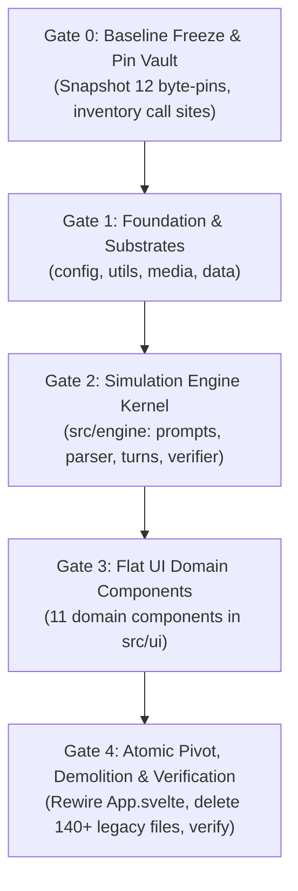

# BOOM: The Sovereign Nuclear Architecture & Simplification Protocol

- **The Character Card First (Vertical Slice Focus)**:
  - We begin with **one single card type: Character Card** (`name`, `image`, `definition`, `first_message`).
  - The immediate target: Slap down **1 Character Card** and immediately chat with it in a clean, fast 1-shot loop.
  - All other card types (Director, Persona, Location, Rule, Style) are modular future horizons that will drop seamlessly into this exact card architecture.
- **Base Card Foundation**: Every card in the engine shares `{ id, name, type, image, definition, specs }`.
- **Fast 1-Shot First, 2-Shot Ready**: Fast direct narrative loop first; ready for the Director Card 2-shot dance when the foundation is solid.
- **The Core Axiom**: *The treasure is the prompt wording and physical constraints, not the scaffolding code. Protect the battle-tested words and invariants; burn the wrappers, regex mazes, and indirection freely.*

---

## 1. The Crown Jewels (Mechanisms That MUST Survive the Nuke)

We do not throw out hard-won runtime discoveries bought with real bug reports. The following 5 mechanisms are explicitly rescued and given lean, direct homes in the new architecture:

1. **The Byte-Contract Harness & Verification Gate**:
   - The 12 byte-pinned prompt compiles prove that prompt synthesis does not regress or silently drift.
   - Kept as a lean ~100-line `src/engine/verifier.js` and Vitest test suite. We do not nuke the safety net.
2. **Track 5 Pacing & Beat Budgeting (`finishTail`)**:
   - Pacing contrast and integer beat enforcement prevent runaway 450-character sludge and keep dialogue snappy.
   - Rescued into `src/engine/turns.js` as pure integer calculations (~40 lines).
3. **Track 2 Memory Core & Hybrid Retrieval**:
   - The 8:1 chapter/arc compactor and rot-folding formula prevent long-run amnesia and context overflow.
   - Rescued into `src/data/entities.js` using the exact mathematical weights already proven live.
4. **The Detox Battery (Lightweight Tier-1/Tier-2 Linter)**:
   - Prompt directives alone leak clichés over time. The 38-rule regex linter remains as a clean post-processing step in `src/utils/format.js`.
   - We strip the 1,200 lines of speaking-style bloat, but preserve the lean detox cleaner.
5. **The Lethality & Staging Contract**:
   - Character death, `story_status`, and Director staging overrides must remain strictly deterministic.
   - Rescued directly into `src/engine/turns.js` and `simulation.svelte.js`.

---

## 2. Redesigning Clunky Implementations (The Elegance Upgrade)

### A. Epistemic Isolation & `| hide` (Replacing Clunky Veil Filters)

- **The Problem**: Right now, `veil.js` and `profile.js` do messy multi-pass regex scanning to detect `| hide` flags, stripping keys and leaving broken pseudo-JSON chunks.
- **The Elegant Fix**:
  - Store entity state cleanly partitioned:
    - `public`: visible to all characters (shared physical reality).
    - `private`: visible ONLY to the owner and the Director (inner thoughts, concealed weapons, secret motives).
  - Classification happens once at the ingestion/parse boundary.
  - When rendering an entity for a speaker, it is an instantaneous, zero-cost object filter:

    ```js
    const visible_state = (viewer === owner || viewer === 'director') 
      ? { ...entity.public, ...entity.private } 
      : entity.public;
    ```

  - Zero regex acrobatics during prompt compilation, zero telepathy, instant evaluation.

### B. Dynamic Staging vs Protocol Bloat (Replacing 86 KB of XML Dictionaries)

- **The Problem**: Currently, `protocols.js` (40 KB) and `reflex.js` (46 KB) define dozens of static XML protocol atoms. The Director outputs keywords, which run through heavy lookup tables to inject giant static `<SHAME>`, `<TENSION>`, or `<COLD>` blocks into the prompt.
- **The Elegant Fix**:
  - The Director emits dynamic, contextual staging guidance:

    ```json
    {
      "next_speaker": "ai",
      "somatic_tension": "cold, shivers, breath misting in the alley",
      "director_note": "She realizes he's lying about the key. Don't confront him outright; test his reaction."
    }
    ```

  - We inject this directly into the Actor prompt as:

    ```xml
    <staging subtext="${director.somatic_tension}">${director.director_note}</staging>
    ```

  - Zero protocol dictionaries, zero XML atom compilation bloat. Fluid, intelligent, and uses 95% less code.

---

## 3. Demolition Targets (Files to Completely Delete)

We are eliminating **32 bloated files** (~450+ KB of over-engineered indirection):

### The `modules/` Sprawl (DELETE ENTIRE FOLDER: 20 files)
- `src/intelligence/modules/constitution.js` & `.test.js`
- `src/intelligence/modules/entities.js` & `.test.js`
- `src/intelligence/modules/output.js` & `.test.js`
- `src/intelligence/modules/protocols.js` & `.test.js`
- `src/intelligence/modules/recency.js` & `.test.js`
- `src/intelligence/modules/reflex.js` & `.test.js`
- `src/intelligence/modules/sheets.js` & `.test.js`
- `src/intelligence/modules/style.js` & `.test.js`
- `src/intelligence/modules/system.js` & `.test.js`
- `src/intelligence/modules/task.js` & `.test.js`

### Over-Engineered Builders & Wrappers (DELETE: 5 files)
- `src/intelligence/builder.js` & `builder.test.js` (58 KB of atom assembly bloat)
- `src/intelligence/prompts.js` & `prompts.test.js` (37 KB catalog bloat)
- `src/intelligence/veil.js` & `veil.test.js` (replaced by clean state partitioning)
- `src/intelligence/profile.js` & `profile.test.js` (merged into single state formatter)
- `src/intelligence/dynamics.js` & `dynamics.test.js` (merged into director turns)

*(Note: `prompt-verification.js` is NOT deleted without replacement; its core pins are migrated into `src/engine/verifier.js` before cutting).*

### Data Definitions Purge (DELETE / SLIM: 5 files)
- `src/data/definitions/speaking-styles.js` & `.test.js` (**DELETE ENTIRELY** - 1,200 lines of regex replaced by prompt-level directives + lightweight detox)
- `src/data/definitions/narrative-styles.js` (**PURGE** - prune all styles down to 2 canonical presets: Gritty & Cinematic, deleting 800+ lines of DNA bloat)
- `src/data/definitions/visual-styles.js` (**PURGE** - prune diffusion styles down to 2 essential presets, deleting unused visual configs)
- `src/data/definitions/profile-fields.js` (**STREAMLINE** - strip out unused AI prompt directives; keep clean UI labels and canonical 4-quadrant field paths)
- `src/data/definitions/premade-entities.js` (**KEEP AS-IS** - valid test & starter assets)

### Data & Persistence Consolidation (`src/data/`)
- **Consolidate Schemas & Persistence**: Merge `repository.js`, `sessions.svelte.js`, `ledger.js`, and `normalizer.js` directly into `src/data/db.js` with pure Dexie operations.
- **Quad-Partitioned Entities (`src/data/entities.js`)**: Canonical 4-quadrant schema (`ETERNAL`, `PRESENT`, `PAST`, `FUTURE`) with one-line public/private epistemic isolation. Delete `profile-fields.js` and `card-conversion.js`.
- **Presets & Starters (`src/data/presets.js`)**: 2 canonical narrative presets (Gritty & Cinematic) and starter entity cards.

### Media Layer Consolidation (`src/media/` - Governed by Design Skill)
- **`audio.svelte.js`**: Web Audio SFX and speech synthesis. Delete standalone `speech.js` (pruning the 1,248-line ONNX/Kokoro monster).
- **`visual.svelte.js`**: Lean Perchance `generate_image` caller with clean prompts. Delete `optics.js`.
- **`motion.js`**: Unified kinetic physics, spring transitions, and card flight math. Absorbs `transitions.svelte.js`, `engine.svelte.js`, `kinetic.svelte.js`, and `card-flight.svelte.js`.
- **Styling Root**: `design.css` lives at root `src/design.css`, retaining tokens and glassmorphism.

### State & Platform Consolidation (`src/state/` & `src/platform/` -> `src/engine/`)
- **Authoritative Kernel (`src/engine/simulation.svelte.js`)**: Single Svelte 5 state class owning active entities (`user`, `ai`, `fractal`), `round`, `phase` (`idle`, `generating`), and turn dispatch. Purges `chrono.svelte.js`, `status.svelte.js`, `runtime.svelte.js`, `interface.svelte.js`, and `freeze-watchdog`.
- **The Two-Step Heartbeat (`src/engine/turns.js`)**: Coordinates Director turn (staging JSON, beat budgets, lethality) and Storyteller turn (sensory prose).
- **The 2 Canonical Prompts (`src/engine/prompts.js`)**: Replaces all 9 legacy prompt modes with 2 clean template functions: Director Staging and Storyteller Prose (parameterized for interaction, ghostwrite, or NPC).
- **Bracket Parser (`src/engine/parser.js`)**: Clean pseudo-JSON parser (`[KEY: VALUE]`), diff applier, and `<think>` stripper.
- **Transport Gatekeeper (`src/engine/transport.js`)**: Perchance LLM streaming (`onChunk`), stop sequence enforcement, and priority queuing. Merges `llm-gate.js` and lean Perchance embedding caller.
- **Telemetry HUD (`src/engine/log.svelte.js`)**: Event log and telemetry feed.
- **Verification Gate (`src/engine/verifier.js`)**: Lean 100-line byte-contract gate replacing `prompt-verification.js`.

### System Configuration Slimming (`src/config.js`)
- **Purge Pseudo-Physics**: Delete `DYNAMICS_SCALE`, `GRAVITY_RATE` (0.08 orbital tension drift), `SEISMIC_SHIFT_DISPLACEMENT`, and artificial `LATENCY_TIERS_MS`.
- **Retain Honest Hardware Literals**: Reduce 272 lines down to ~30 lines of real physical limits (`PROMPT_CHAR_LIMIT = 20000`, `CHARS_PER_TOKEN = 3.35`, `MAX_ACTIVE_MEMORIES = 20`, `LLM_TIMEOUT_MS = 60000`).

### Utils Layer Pruning (`src/utils/`)
- **Delete Indirection & Bloat**: Delete `bridges.js`, `catalog.js`, `styles.js`, `job-queue.js`, `xml.js`, `field-path.js`, and `ui-helpers.js`.
- **`format.js`**: Dialogue quote wrapping, markdown-it rendering, DOMPurify HTML sanitization, story export, and Tier-1/Tier-2 detox cleaner.
- **`actions.js`**: Pure Svelte DOM actions (`click_outside`, `auto_resize`, `safe_html`).

### UI Layer Complete Flattening (`src/ui/`)
Flatten all 8 fragmented UI subfolders (`console/`, `entity/`, `image/`, `message/`, `motion/`, `primitives/`, `profile/`, `story/`) with zero subdirectories into **11 pure Svelte 5 domain components**:
- **Delete 22 Fake Wrapper Primitives**: Remove empty wrappers (`GlassWrapper`, `Backdrop`, `Label`, `Indicator`, `ScrollArea`, `DevControls`, `AudioControls`). Use native HTML5 semantic elements + CSS.
- **Merge Micro-Components**:
  - Merge message subcomponents (`Body`, `MessageHeader`, `Attachments`, `Prologue`, `Epilogue`, `TelemetryBlocks`) directly into `MessageCard.svelte` using Svelte 5 snippets.
  - Merge profile subcomponents (14 files, 170 KB including SVG graph math) into a single dual-mode `EntityProfile.svelte` (Readonly Dossier + Edit 4-quadrant mode).
  - Merge console bars into `Storyboard.svelte` and `Storymode.svelte`.
  - Merge story cards into `StoryDrawer.svelte`.
- **Retain Only Genuine Complex Primitives**: `Modal.svelte` (dialog focus trap) and `Slider.svelte` (accessible range). All other elements are standard semantic HTML.

---

## 4. The True "Start From Nothing" Masterpiece Map

This is what RPGlitch looks like when built with zero legacy baggage: **2 Core Prompts**, **4 Clean Folders**, and **~26 purposeful files total**.

```
src/
├── main.js                     # Mounts App.svelte with design.css
├── App.svelte                  # Root layout router (Lobby vs. Story)
├── config.js                   # Canonical hardware limits (20k char ceiling, timeouts)
├── design.css                  # CSS design tokens, typography, glassmorphism, animations
│
├── engine/                     # 🧠 THE SIMULATION & STATE (7 Files)
│   ├── simulation.svelte.js    # Single authoritative state kernel (entities, round, phase, actions)
│   ├── turns.js                # The Two-Step Heartbeat (Director JSON staging, Actor prose, beat budgeting, lethality)
│   ├── prompts.js              # The 2 Canonical Prompts (Director staging & parameterized Storyteller prose)
│   ├── parser.js               # Robust bracket parser ([KEY: VALUE], diffs, clean prose, strip <think>)
│   ├── transport.js            # Perchance LLM streaming & priority queue gatekeeper
│   ├── verifier.js             # Lean byte-contract harness & prompt verification gate
│   └── log.svelte.js           # Developer HUD telemetry and event log feed
│
├── data/                       # 💾 PERSISTENCE & SCHEMAS (3 Files)
│   ├── db.js                   # Dexie database schema + clean CRUD persistence (stories, characters)
│   ├── entities.js             # 4-quadrant schema + public/private epistemic filter + memory core weights
│   └── presets.js              # 2 Narrative Styles (Gritty/Cinematic) + default starter entities
│
├── media/                      # 🎨 SENSORY CORTEX & DESIGN (3 Files, governed by design skill)
│   ├── audio.svelte.js         # Web Audio SFX + speech dispatch
│   ├── visual.svelte.js        # Perchance generate_image caller
│   └── motion.js               # Kinetic physics, spring transitions & card flight math
│
├── utils/                      # 🛠️ PURE HELPERS (2 Files)
│   ├── format.js               # Quotes, markdown, DOMPurify sanitization, detox cleaner, story export
│   └── actions.js              # Svelte DOM actions (click_outside, auto_resize, safe_html)
│
└── ui/                         # 🖥️ THE USER INTERFACE (11 Pure Svelte Components)
    ├── Layout.svelte           # Shell & top navigation header
    ├── Storyboard.svelte       # The Lobby (3-card hand, slot picker, shuffle & flight)
    ├── Storymode.svelte        # The Game Screen (chat feed, input bar, continue button)
    ├── MessageCard.svelte      # Single turn card (prose, dialogue quotes, collapsible thoughts & subtext)
    ├── EntityCard.svelte       # Physical card in the lobby hand
    ├── EntityProfile.svelte    # Character dossier & 4-quadrant editor modal (Readonly & Edit mode)
    ├── SettingsDrawer.svelte   # Quick settings, volume sliders, and end story action
    ├── StoryDrawer.svelte      # Saved stories drawer (load, rename, markdown export)
    ├── ImageLightbox.svelte    # Full-screen image preview lightbox & candidate picker
    ├── Avatar.svelte           # Styled portrait frame with initials fallback & signature color ring
    ├── Modal.svelte            # Accessible dialog chassis (trap focus, escape key)
    └── Slider.svelte           # Accessible range slider (volume)
```

---

## 5. Architectural Quality Standards & Anti-Bloat Laws

To permanently prevent the codebase from regressing into wrappers and over-engineered indirection:

1. **The 10-Minute Traceability Law**:
   A newly onboarded developer must be able to trace a full simulation turn (`User Input → Director Turn → Storyteller Turn → DOM Render`) top-to-bottom in under 10 minutes without encountering circular imports, hidden bridges, or indirection layers.
2. **The Deletion Quota**:
   Every refactor or feature work order must achieve a net negative line count or explicitly justify additions. The AI is strictly prohibited from adding wrappers or alias layers to avoid deleting obsolete code.
3. **The "Single Implementation" Rule**:
   - Exactly **1 truncation utility** across the codebase.
   - Exactly **1 relevance scoring formula** (the proven hybrid weights).
   - Exactly **1 XML/tag renderer**.
   - Exactly **1 state kernel** (`simulation.svelte.js`).
4. **Zero Comments as Git Mirrors**:
   Changelog headers, historical changelog blocks, and inline git commit histories in source code are banned. Commit history belongs in `git log`.

---

## 6. Execution Strategy: The Strangler Migration & 4 Gates

We do not perform an unverified big-bang cut. We build the lean core parallel to the baseline, prove equivalence using the 12 pinned byte-contracts, and then execute the atomic demolition.



---

### Gate 0: Baseline Freeze & Pin Vault
- [ ] Snapshot current 12 byte-pinned prompt compiles from `src/intelligence/prompt-verification.js` into test fixtures.
- [ ] Run `npm run verify` to ensure the starting baseline is 100% green.
- [ ] Inventory all exports in `src/intelligence/` and tag genuine call sites vs dead aliases.

### Gate 1: Foundation & Substrates (Zero UI Dependencies)
- [ ] **`src/config.js`**: Prune all pseudo-physics (`GRAVITY_RATE`, `DYNAMICS_SCALE`, `SEISMIC_SHIFT_DISPLACEMENT`) down to ~30 lines of honest hardware limits (`PROMPT_CHAR_LIMIT = 20000`, `CHARS_PER_TOKEN = 3.35`, timeouts).
- [ ] **`src/utils/`**:
  - `format.js`: Dialogue quote wrapping, markdown-it rendering, DOMPurify HTML sanitization, detox cleaner, and story export.
  - `actions.js`: Pure Svelte DOM actions (`click_outside`, `auto_resize`, `safe_html`).
  - Purge `bridges.js`, `catalog.js`, `styles.js`, `job-queue.js`, `xml.js`, and `field-path.js`.
- [ ] **`src/media/`**:
  - `audio.svelte.js`: Clean Web Audio SFX + speech dispatch (purge standalone `speech.js` / ONNX Kokoro bloat).
  - `visual.svelte.js`: Direct Perchance `generate_image` caller with clean prompts (purge `optics.js`).
  - `motion.js`: Pure kinetic physics, spring math, and card flight transitions (absorbs `transitions`, `engine`, `kinetic`, `card-flight`).
- [ ] **`src/data/`**:
  - `db.js`: Consolidated Dexie schema + clean CRUD operations (stories, characters, active sessions). Purges `repository.js`, `sessions.svelte.js`, `ledger.js`, and `normalizer.js`.
  - `entities.js`: Canonical 4-quadrant entity schema (`ETERNAL`, `PRESENT`, `PAST`, `FUTURE`) with one-line public/private epistemic isolation filter (`public` vs `private`) + memory core hybrid weights. Purges `profile-fields.js` and `card-conversion.js`.
  - `presets.js`: 2 canonical narrative presets (Gritty & Cinematic) + default starter entity cards. Purges `speaking-styles.js`, `narrative-styles.js`, and `visual-styles.js`.

---

### Gate 2: Simulation Engine Kernel (`src/engine/`)
- [ ] **`prompts.js`**: The 2 canonical prompts (Director JSON staging & parameterized Storyteller prose). Zero XML catalog atom sprawl.
- [ ] **`parser.js`**: Clean pseudo-JSON bracket parser (`[KEY: VALUE]`), diff calculator, prose normalizer, and `<think>` stripper.
- [ ] **`transport.js`**: Perchance LLM streaming (`onChunk`), stop sequence enforcement, priority queue gatekeeper, and lean embedding helper.
- [ ] **`turns.js`**: Coordinates Director turn (staging JSON, beat budgeting, lethality) and Storyteller turn (sensory prose).
- [ ] **`simulation.svelte.js`**: Single authoritative Svelte 5 state kernel owning `user`, `ai`, `fractal`, `round`, `phase`, and dispatch functions.
- [ ] **`verifier.js`**: Lean 100-line byte-contract gate reproducing the 12 pinned prompt checks.
- [ ] **`log.svelte.js`**: Developer HUD and telemetry event stream.
- [ ] **Unit Tests**: TDD verification for bracket parsing, prompt generation against Gate 0 pins, and state transitions.

---

### Gate 3: Flat UI Domain Components (`src/ui/`)
Build the 11 cohesive Svelte 5 domain components directly against `src/engine/` and `src/design.css` without subfolders or empty wrapper primitives.

- [ ] **Chassis & Primitives**:
  - `Modal.svelte`: Accessible dialog chassis (trap focus, escape key).
  - `Slider.svelte`: Accessible range slider for audio volume.
  - `Layout.svelte`: App shell, top navigation bar, title, and quick drawer toggles.
- [ ] **Sensory & Visuals**:
  - `Avatar.svelte`: Styled portrait frame with initials fallback and signature ring.
  - `ImageLightbox.svelte`: Full-screen image preview lightbox and candidate selector.
- [ ] **Entities**:
  - `EntityCard.svelte`: Physical card in the lobby hand (flip, drag, signature glow).
  - `EntityProfile.svelte`: Consolidated character dossier & 4-quadrant editor modal (Readonly & Edit mode, replacing 14 files / 170 KB of SVG graph bloat).
- [ ] **Narrative & Chat**:
  - `MessageCard.svelte`: Single turn card with dialogue quotes, sensory prose, and collapsible thoughts/subtext (absorbs 6 message micro-components via snippets).
- [ ] **Drawers**:
  - `StoryDrawer.svelte`: Saved stories drawer (load, rename, markdown export).
  - `SettingsDrawer.svelte`: Quick settings, audio volume sliders, and end story action.
- [ ] **Primary Screens**:
  - `Storyboard.svelte`: The Lobby screen (3-card hand, slot picker, shuffle, flight).
  - `Storymode.svelte`: The Game screen (chat feed, input bar, continue button).

---

### Gate 4: Atomic Pivot, Demolition & Verification
- [ ] **Wire `App.svelte` & `main.js`**:
  - Mount `Layout.svelte`, `Storyboard.svelte`, and `Storymode.svelte` bound directly to `simulation.svelte.js`.
  - Ensure `design.css` tokens are cleanly applied.
- [ ] **Demolition Sweep (Delete ~140 legacy files)**:
  - Delete `src/intelligence/` entirely (41 legacy files).
  - Delete `src/state/` & `src/platform/` entirely (all legacy stores & shims).
  - Delete all 8 nested subdirectories in `src/ui/` (`console/`, `entity/`, `image/`, `message/`, `motion/`, `primitives/`, `profile/`, `story/`).
  - Delete dead definitions in `src/data/definitions/` (`speaking-styles.js`, etc.).
- [ ] **Verification & Svelte Autofixer**:
  - Run `svelte-autofixer` across all components and state runes.
  - Run `npm run verify` (linting, Vitest test suite, production build).
  - Verify 0 errors, single-file bundle generation, and simulation roundtrip.
