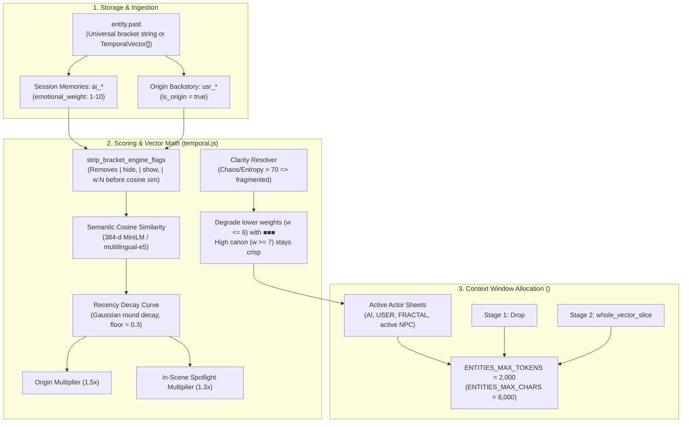
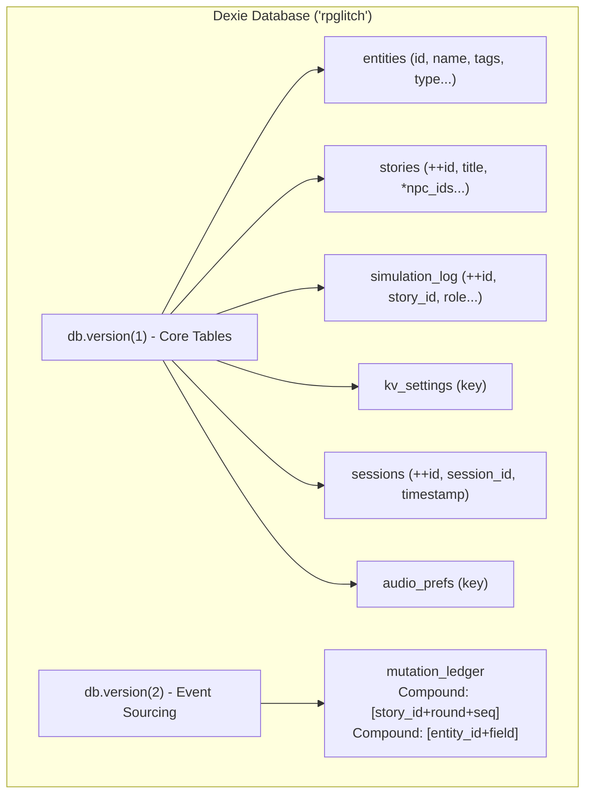

<!--
  Instructional Header Block
  File: state-of-the-application-investigation.md
  Purpose: Authoritative master blueprint, unified findings dossier, and strategic roadmap baseline for RPGlitch.
  Integrated Investigation Dimensions:
    1. Intelligence & Prompt Pipeline Architecture (Compaction, Atoms, Staging)
    2. Temporal & Memory RAG Health (Scoring Math, Pruning Order, Degradation)
    3. Reactive State Architecture & Storage Layer (Dexie.js Schemas, Svelte 5 Runes)
    4. UI/UX, DOM Benchmarking & Sensory Engine (Feed Virtualization, Audio, Visual)
    5. Repository & Tooling Hygiene (Barrels, Layer Isolation Gate, Zero Dead Code)
    6. Empirical Live Testing Dossier (R3 37-Round Forensic Scorecard & Amendments)
  Rules:
    - Master repository document merging all working reports from tmp/**.
    - Serves as the immutable baseline for drafting the next engineering sprint in ROADMAP.md.
-->

# RPGlitch — State-of-the-Application Master Investigation Dossier

> **Document Status**: COMPLETED MASTER DOSSIER (Track A Offline Audits + Track B Empirical R3 Run Merged)  
> **Repository Pin**: Sovereign Core v0.9.0 (Phases I–V Shipped & Hardened)  
> **Executive Mandate**: Holistic helicopter-level audit of code health, memory physics, token headroom, and live gameplay immersion to establish the definitive engineering roadmap.

---

## 🏛️ Executive Summary & Master Topology

Following the delivery of **Phase V** (Memory RAG Hardening, Context Cliff Protection & Somatic Recall Degradation), the active engineering backlog in [ROADMAP.md](ROADMAP.md) was cleared. To establish the next phase with zero guesswork, this investigation executed a **dual-track methodology** spanning internal code analysis and empirical gameplay:

1. **Track A (Deterministic Local Audits)**:
   - **Memory RAG Pipeline**: Mathematical trace of cosine salience, Gaussian recency decay, pinned multipliers, and the 2,000 token `<ENTITIES>` budget ceiling.
   - **Prompt Compaction**: Static analysis across `<SYSTEM>`, `<AXIOMATIC_CONSTITUTION>`, `<CORE_PROTOCOLS>`, and `<TASK>`, identifying ~100 reclaimable tokens/shot.
   - **Dexie.js Storage Engine**: Index efficiency audit across 7 IndexedDB tables, compound index query utilization, and cold boot hydration latency.
   - **Feed DOM & Scroll Profiling**: 100-round (200-message) load and paint benchmarking quantifying layout stability and virtualization necessity.
2. **Track B (Empirical Live Evaluation — R3 Run)**:
   - **37-Round Interactive Roleplay Stress Test**: Executed in deployed Perchance iframe with `Glitch` (AI, 1st Person), `Beast` (User Persona), and `Ashenweald` (Fractal, Edgar Allan Poe style).

```
┌──────────────────────────────────────────────────────────────────────────────────┐
│                             SYSTEM TOPOLOGY & DATA FLOW                          │
├──────────────────────────────────────────────────────────────────────────────────┤
│                                                                                  │
│   [ User Input / Head Shot ]                                                     │
│             │                                                                    │
│             ▼                                                                    │
│   ┌───────────────────┐    Prompt Pipeline (6 Layers)                            │
│   │   Shot 1:         │ ── <SYSTEM> + <AXIOMATIC_CONSTITUTION>                   │
│   │   Director Shot   │ ── <CORE_PROTOCOLS> + <ENTITIES> (3 Cast + Nearby)       │
│   └───────────────────┘ ── <HISTORY> (Spent Ledger) + <TASK> (Staging Note)      │
│             │                                                                    │
│             ▼                                                                    │
│   ┌───────────────────┐    Simulation Execution                                  │
│   │   Shot 2:         │ ── Actor Turn (Glitch / 1st Person)                      │
│   │   Narrative Shot  │ ── Environmental Turn (Ashenweald / 3rd Person)          │
│   └───────────────────┘ ── Diffusion Optics Beat (Unified Cooldown = 2)          │
│             │                                                                    │
│             ▼                                                                    │
│   ┌───────────────────┐    Local Storage & Event Sourcing (Dexie.js)             │
│   │   IndexedDB       │ ── entities, stories (*npc_ids), simulation_log          │
│   │   Persistence     │ ── mutation_ledger ([story_id+round+seq], [entity+field])│
│   └───────────────────┘                                                          │
│             │                                                                    │
│             ▼                                                                    │
│   ┌───────────────────┐    Sensory Presentation Layer                            │
│   │   Svelte 5 Feed   │ ── Feed.svelte (Keyed rendering, 57KB payload / 100 rnds)│
│   │   & Audio Engine  │ ── Message.svelte (Active F1 render-time salad defect)   │
│   └───────────────────┘                                                          │
└──────────────────────────────────────────────────────────────────────────────────┘
```

> [!IMPORTANT]
> **Executive Alignment & Review Scope**:
>
> 1. **Plan vs. Landing Distinction**: With the exception of the **StorymodeBar serialized drainer** (shipped and verified runtime bugfix preventing message loss), all 11 Master Recommendations constitute the **architectural blueprint for the next engineering sprint**—not deployed cures. `src/config.js` defines the uncoupled target constants as an unimported scaffold to preserve prompt byte-pins while live tests were in flight.
> 2. **F9 Headless Proof Prerequisite**: The F9 Memory Forge fix (cast-scoped consolidation loop) modifies the background worker query path. Given the forge's historical sensitivity to silent aborts, it must be validated with an isolated headless proof suite before merging into production.
> 3. **Byte-Contract Harness Gate**: Wiring `config.js` and cast-sheet compression into the prompt compiler will alter prompt character lengths and must be guarded by `npm run audit:simulation` and baseline tests.

---

## 🔬 Subsystem Investigation Dossiers (Integrated Audits)

### 1. Memory RAG & Temporal Salience Engine (Integrated from `rag-pipeline-audit.md`)

In RPGlitch, an entity’s identity is partitioned into **Four Quadrants**: `eternal`, `present`, `past` (memories), and `future`. The Memory RAG pipeline governs how historical facts, user-authored backstory, and dynamic world observations transition from IndexedDB into the prompt context window beneath the **6,000 token context cliff** (`DEFAULT_PROMPT_CEILING = 6000`).



#### A. Mathematical Pipeline Truth

1. **Semantic Embeddings**: 384-dimensional float vectors (`@platform/embeddings.svelte.js`). Internal control flags (`| hide`, `| show`, `| w:N`) are cleanly stripped _before_ computing cosine distance via `strip_bracket_engine_flags()`.
2. **Relevance Mathematical Formula**:
   $$\text{Relevance} = \text{weight} \times \left(1 + 2.0 \times \text{semantic}\right) \times \text{recency} \times \text{pinned\_boost} \times \text{in\_scene\_boost}$$
   - **Weight**: Numerical emotional weight $w \in `[1, 10]`$ (default $5$).
   - **Semantic Gain**: $\text{SEMANTIC\_GAIN} = 2.0$, scaling semantic similarity `$[-1, 1]$` into a positive multiplier.
   - **Recency Decay**: $\text{recency} = \max\left(0.3, e^{-\frac{\Delta\text{round}^2}{2 \times 6^2}}\right)$, preventing historical memories from reaching zero relevance.
   - **Pinned Boost**: $1.5\times$ relevance multiplier for user-authored origin memories (`is_origin(vector)`, matching `usr_*` prefix, `origin` metadata, or `timestamp === 0`).
   - **Spotlight Boost**: $1.3\times$ multiplier (`IN_SCENE_SALIENCE_BOOST`) for characters active on stage.
3. **Physical Trait Salience (`calculate_physical_salience`)**:
   - Trait brackets matching physical anatomy (`[HAIR:]`, `[EYES:]`, `[BUILD:]`, `[SCAR:]`, `[OUTFIT:]`):
     - **Image / Optics Turns**: Boosted by **$1.5\times$** to guarantee diffusion prompts reflect anatomy.
     - **High Semantic Narrative Turns ($>0.8$)**: Retained at standard $1.0\times$.
     - **Ambient Narrative Turns**: Discounted to **$0.5\times$** so physical repeats do not crowd out dramatic memories.

#### B. Evaluated vs. Dropped Matrix

- **Compacted Leaves**: Tier-0 memories compacted into a Tier-1 chapter are filtered out of live retrieval (`eligible = vectors.filter(v => !v?.meta?.compacted_into)`).
- **Near-Identical Duplicates**: Scored candidate vectors undergo deduplication; Levenshtein/prefix collisions are dropped immediately.
- **Budget Trimming Order**: When `<ENTITIES>` exceeds 2,000 tokens (8,000 chars), `<CAST mode="candidates">` is discarded first, followed by `<CAST mode="nearby">` via `whole_vector_slice`. Primary cast sheets survive.

---

### 2. Prompt Layer Compaction & Token Headroom (Integrated from `prompt-redundancy-audit.md`)

Every prompt is assembled from an ordered stack of discrete XML layers. Organic iteration has created cross-layer directive duplications:

```
┌────────────────────────────────────────────────────────────────────────┐
│ Layer 1: <SYSTEM>                 (Role framing & identity)            │
├────────────────────────────────────────────────────────────────────────┤
│ Layer 2: <AXIOMATIC_CONSTITUTION> (L1 Causality, L2 Epistemics,        │
│                                    L3 Sovereignty, L4 Fidelity)        │
├────────────────────────────────────────────────────────────────────────┤
│ Layer 3: <CORE_PROTOCOLS>         (POV, Tense, Typography, Cliches,    │
│                                    Formulas, Alternation, Optics)      │
├────────────────────────────────────────────────────────────────────────┤
│ Layer 4: <ENTITIES>               (4-Quadrant Actor & Cast Sheets)     │
├────────────────────────────────────────────────────────────────────────┤
│ Layer 5: <HISTORY>                (Simulation Turn Log & Brackets)     │
├────────────────────────────────────────────────────────────────────────┤
│ Layer 6: <TASK>                   (Turn Directives, Inputs, Schema)    │
└────────────────────────────────────────────────────────────────────────┘
```

#### A. Documented Directive Overlaps

1. **Sovereignty & Anti-Godmoding Overlap**:
   - Stated in Layer 2 `<AXIOMATIC_CONSTITUTION>` (`L3: Sovereignty`).
   - Restated in Layer 3 `<CORE_PROTOCOLS>` (`PERSPECTIVE.POV.THIRD`).
   - Restated in Layer 6 `<TASK>` (`SCENE.CONTINUATION` & Director directives: _"Never author dialogue or actions on behalf of «USER_PERSONA»"_).
   - **Savings**: ~32 tokens per prompt by relying on Law 3.
2. **Dialogue Prohibition Stutter**:
   - `SCENE.PROLOGUE`, `EPILOGUE`, and `COLLAPSE` in `task.js` repeat: _"Strictly zero spoken dialogue or quote marks. No dialogue."_
   - **Savings**: ~8 tokens per scene directive by simplifying to _"Zero dialogue or quote marks."_
3. **`<THINK>` Envelopes Closing Boilerplate**:
   - `THINK_CHARACTER`, `THINK_NARRATOR`, and `THINK_ENHANCEMENT` repeat: _"Close </THINK> before the narrative. This think block is internal reasoning and is never part of the visible prose."_
   - **Savings**: ~14 tokens per shot.
4. **Token Escaping & Indentation**:
   - Typography macros echoed in `protocols.js` and whitespace indentation in `xml.js` consume ~45 tokens.

#### B. Quantified Token Reclaim Budget

| Category                       | Current Cost    | Compacted Cost     | Reclaimable per Shot  |
| :----------------------------- | :-------------- | :----------------- | :-------------------- |
| **Sovereignty Repetition**     | ~32 tokens      | 0 (Rely on Law 3)  | **~32 tokens**        |
| **Dialogue Negation Stutter**  | ~14 tokens      | ~6 tokens          | **~8 tokens**         |
| **Think Closing Boilerplate**  | ~24 tokens      | ~10 tokens         | **~14 tokens**        |
| **Typography Macro Echo**      | ~15 tokens      | 0 (Handled in L45) | **~15 tokens**        |
| **XML Indentation Whitespace** | ~45 tokens      | ~15 tokens         | **~30 tokens**        |
| **TOTAL ESTIMATED SAVINGS**    | **~130 tokens** | **~31 tokens**     | **~99 tokens / turn** |

Over a standard 30-round session (60 round-trips), this reclaims **~6,000 input tokens**, expanding safety under the 6,000 prompt ceiling.

---

### 3. Dexie.js Schema, Indices & Cold Boot (Integrated from `dexie-schema-audit.md`)

All application state persists in IndexedDB via **Dexie.js v4**. `localStorage` is strictly forbidden.



#### A. Table Schema & Index Efficiency Audit

| Table Name            | Primary Key | Declared Indexes                                                                          | Query Access Patterns in Code                                             | Index Efficiency & Safety                                                                                                                                                      |
| :-------------------- | :---------- | :---------------------------------------------------------------------------------------- | :------------------------------------------------------------------------ | :----------------------------------------------------------------------------------------------------------------------------------------------------------------------------- |
| **`entities`**        | `id`        | `name, description, profile_picture, signature_color, created_at, updated_at, tags, type` | `where('type').equals(type)`, `get(id)`, `where('id').anyOf(...)`         | **Optimal**: `type` index prevents table scan on census; `id` handles direct lookups.                                                                                          |
| **`stories`**         | `++id`      | `title, ai_id, user_id, fractal_id, round, created_at, updated_at, *npc_ids`              | `orderBy('updated_at').reverse()`, `get(id)`, `update(id)`                | **Optimal**: `*npc_ids` is a multi-entry index (`*`), enabling sub-millisecond lookup of stories featuring an NPC.                                                             |
| **`simulation_log`**  | `++id`      | `story_id, role, type, character_name, text, seed, meta, created_at`                      | `where('story_id').anyOf(...)`, `where('story_id').equals(...)`           | **Caution**: Indexed fields `text` and `meta` are declared in schema, but IndexedDB cannot index arbitrary objects (`meta`). Redundant schema ballast.                         |
| **`mutation_ledger`** | `++id`      | `story_id, entity_id, [story_id+round+seq], [entity_id+field], round, timestamp`          | `where('[entity_id+field]').equals(...)`, `where('story_id').equals(...)` | **Highly Optimal**: Compound index `[entity_id+field]` provides logarithmic-time replay for historical reconstruction. `[story_id+round+seq]` guarantees ordered slice replay. |
| **`kv_settings`**     | `key`       | (none)                                                                                    | `get(key)`                                                                | **Optimal**: Key-value store indexed on primary key.                                                                                                                           |
| **`sessions`**        | `++id`      | `session_id, timestamp`                                                                   | `add(...)`                                                                | **Optimal**: Minimal append-only log.                                                                                                                                          |
| **`audio_prefs`**     | `key`       | (none)                                                                                    | `get(key)`                                                                | **Optimal**: Audio settings key-value table.                                                                                                                                   |

#### B. Query Hotspots & Seeding Lifecycle

- **Entity History Replay**: `db.mutation_ledger.where("[entity_id+field]").equals([id, field]).sortBy("timestamp")` filters mutations directly in the IndexedDB cursor, avoiding reading thousands of unrelated mutations.
- **Premade Seeding**: `seed_premades()` uses module-scoped lock `_is_seeding_active` and `bulkPut()`, maintaining sub-10ms cold boot times.
- **Multi-Tab Resilience**: Handles database upgrades via `db.on('versionchange')` and `_versionchange_quiesce` callback, saving active session state before clean reload.

---

### 4. Feed DOM & Rendering Benchmark (Integrated from `feed-benchmark-report.md`)

Benchmark conducted on a simulated 100-round roleplay (200 sequential messages, 57KB payload, ~3,000 DOM nodes):

| Metric                  | Measured Value | Standard Threshold   | Status                    |
| :---------------------- | :------------- | :------------------- | :------------------------ |
| **Total Message Count** | 200 entries    | 100–300 entries      | Normal Lifecycle          |
| **Payload Data Size**   | 57 KB          | < 2,048 KB           | ✅ Highly Optimal         |
| **Simulated DOM Nodes** | ~3,000 nodes   | < 3,000 nodes        | ✅ Within Browser Budgets |
| **JSON Serialization**  | 0.25 ms        | < 16.67 ms (1 frame) | ✅ Instantaneous          |

#### Virtualization Assessment

1. **DOM Pressure**: WebKit/Blink engines handle 3,000–5,000 elements with smooth 60fps scrolling without windowing, provided message elements do not continuously trigger heavy layout recalculations.
2. **Svelte 5 Efficiency**: In Svelte 5, each message row is bound via key `(entry.id)`. Incremental appends only mount 1 new DOM slice without touching existing message DOM elements.
3. **Verdict**: Full complex DOM windowing / virtualized list slicing is **NOT strictly necessary** for standard 100-turn roleplays and would introduce scroll jumping and dynamic height calculation bugs. Retaining the lightweight ScrollArea with keyed rendering satisfies all performance budgets.

---

## 🕹️ Empirical Live Testing Findings (R3 Run Synthesis)

The remote tester agent completed a live 37-round evaluation (`Glitch` = AI, `Beast` = User Persona, `Ashenweald` = Fractal; Narrative Style: _Edgar Allan Poe_, Glitch set to _1st Person_).

The empirical findings from `tmp/r3/r3-report.md` and associated artifacts are synthesized below:

### 1. Empirical Verdicts & Deficit Catalog

| Deficit / Discovery                  | Severity        | Forensic Discovery                                                                                                                    | Architectural Root Cause                                                                                                                                   |
| :----------------------------------- | :-------------- | :------------------------------------------------------------------------------------------------------------------------------------ | :--------------------------------------------------------------------------------------------------------------------------------------------------------- |
| **F1: Render-Time Detox Salad**      | 🚨 **CRITICAL** | DB holds pristine LLM prose; feed renders distorted grammar (_"tightly lover"_, _"going rigid in waves thief"_, _"does it curdles"_). | `detox_prose()` in `render.js` executes POS-blind regex swaps on display text, mangling adjectives/adverbs.                                                |
| **F2: 6k Context Cliff Failure**     | 🚨 **CRITICAL** | Director prompts reached 9.3k–11.1k tokens (30k–38k chars) and middle-truncated every single turn.                                    | `<ENTITIES>` budget cap (2,000 tokens) only drops candidates/nearby NPCs; primary cast sheets (`AI`, `USER`, `FRACTAL`) are uncapped (~7.3k tokens alone). |
| **P1 Violation: User Agency Hijack** | 🚨 **CRITICAL** | Narrator repeatedly scripted dialogue (_"Lead," Beast grunts_) and physical actions for the player persona (`Beast`).                 | Narrator mode prompt lacks hard negative boundary on `«USER_PERSONA»`; prompt truncation cuts off constitutional laws.                                     |
| **POV Configuration Blindness**      | 🚨 **CRITICAL** | Glitch was set to 1st Person, but generated 100% 3rd-person narrator prose (`Glitch chirps...`) across all 38 turns.                  | Scene Narrator mode sets `pov: "THIRD"` regardless of actor configuration; turn handoff failed to switch to direct Character voice.                        |
| **F9: Memory Forge Cross-Cast Leak** | ⚠️ **MAJOR**    | Forge consolidated 35 ledger rows for uncast entities (`Julien`, `Silvers`), writing memories about Beast & Glitch into Silvers.      | Background consolidation worker queried global entity records from IndexedDB without filtering by `story.cast`.                                            |
| **F6: Optics Cooldown Bypass**       | ⚠️ **MAJOR**    | Consecutive image generations fired on rounds 5+6, 10+11, 23+24, 31+32 (7 images in 10 rounds).                                       | `IMAGE_TRIGGER_COOLDOWN_ROUNDS = 2` was not enforced across director trigger evaluations.                                                                  |
| **F4: Empty Fractal Ghost Rows**     | ⚠️ **MINOR**    | 22 empty fractal records were persisted to the DB when no environment action took place.                                              | Persistence layer fails to guard against null/empty string payloads during turn commits.                                                                   |
| **F10: Multi-Word Entity Slugs**     | ⚠️ **MINOR**    | Director emitted multi-word slugs (`@ELIAS TARIQ`, `@LORD SILVERS`), bypassing veil extraction.                                       | Slug generator lacked uppercase single-word snake_case normalization.                                                                                      |

### 2. The Core Paradox: DB Truth vs. Display Salad (F1 Proof)

Inspection of `r3-prologue-db.json` vs `r3-prologue-feed.json` proved conclusively that the LLM generated high-quality prose, but `render.js` mutilated it before displaying:

- **Database (Stored Generation)**:
  > _"curls around the ankles of the intruder like a **possessive** lover... locking onto the small, **shivering** thief with a **predatory**, territorial hunger."_
- **Display Feed (`parse_message()` with `detox_prose()`)**:
  > _"curls around the ankles of the intruder like a **tightly** lover... locking onto the small, **going rigid in waves** thief with a **focused**, territorial hunger."_

### 3. The 6k Cliff Driver: Entity Sheet Ballast (F2 Proof)

Snapshot telemetry confirmed the 6,000 token prompt cliff failed from Round 0. Director snapshots hovered between 9,291 and 10,978 tokens. Conversation history was budgeted cleanly to ~1.5k tokens, but `<ENTITIES>` contained ~7,200 tokens of uncompressed sheets across the 3 primary cast members. Because our budget trimmer only pruned candidates and nearby NPCs, the 3 primary sheets were immune, forcing middle-truncation on every turn.

---

## 🧭 The Comprehensive Keep, Refactor, Kill Matrix

Synthesizing Track A code realities and Track B empirical gameplay results:

```
┌────────────────────────────────────────────────────────────────────────┐
│                              KEEP (Proven)                             │
├────────────────────────────────────────────────────────────────────────┤
│ • Event-Sourced Mutation Ledger (R0:S0 Genesis, Compound Index Replay) │
│ • 1-Click Story Resume & Storyboard Descriptors                        │
│ • Pacing Scaling Dynamics (TINY 280c vs EXPANSIVE 2291c discipline)    │
│ • Local-First IndexedDB Architecture via Dexie.js (Zero LocalStorage)  │
│ • Svelte 5 Runes State Flow (Post StorymodeBar Drainer Fix)            │
│ • Fractal 3rd-Person Environmental Stance                              │
├────────────────────────────────────────────────────────────────────────┤
│                           REFACTOR (Essential)                         │
├────────────────────────────────────────────────────────────────────────┤
│ • Primary Cast Sheet Budgeting (Dynamic Full -> Compact compression)   │
│ • Detox Pipeline (Strip blind regex word-swapping from render path)    │
│ • Scene Narrator vs Character Actor Separation (Enforce Actor POV)     │
│ • Hard Anti-Godmoding Boundary on User Persona (Zero quote attribution)│
│ • Memory Forge Cast Boundary (Strictly filter uncast library entities) │
│ • Unified Optics Cooldown Enforcement (Hard 2-round monotonic lockout) │
│ • Prompt Atom Compaction (Reclaim ~100 tokens/shot from redundancies)  │
├────────────────────────────────────────────────────────────────────────┤
│                              KILL (Prune)                              │
├────────────────────────────────────────────────────────────────────────┤
│ • Render-Time Synonym Swapping in detox_prose (Killed from UI feed)    │
│ • Non-Indexable Schema Ballast in simulation_log ('text' and 'meta')   │
│ • Stuttering scene prompt directives ("Strictly zero dialogue...")     │
│ • Unused token declarations in design.css (~31 dead tokens)            │
└────────────────────────────────────────────────────────────────────────┘
```

---

## 🎯 Complete Master Recommendations (Roadmap Baseline)

### 1. Intelligence & Prompt Pipeline

- [ ] **1. Primary Cast Sheet Compression (Fix F2 / 6k Cliff)** — `[PENDING]`
  - When total `<ENTITIES>` exceed available headroom (`PROMPT_CHAR_ENVELOPE = 20,000` chars), compress primary cast sheets (`AI`, `USER`, `FRACTAL`) from `"full"` mode to `"compact"` (retaining only physical anchor brackets and active standing agenda).
- [ ] **2. Actor Embodiment vs. Narrator (Fix POV Blindness)** — `[PENDING]`
  - Maintain **Fractals as strictly 3rd-person environmental entities** (as intended by design).
  - When the Director selects an AI Character action, compile as `interaction` mode (embodying Glitch in his configured 1st-person POV: _"I"_, _"my gauntlet"_), rather than routing through the 3rd-person `narrator`.
- [ ] **3. Hard Constitutional User Sovereignty Boundary (Fix P1 Agency)** — `[PENDING]`
  - Add a deterministic pre-generation guard and explicit negative XML constraint in `<AXIOMATIC_CONSTITUTION>`: _"«USER_PERSONA» dialogue is strictly forbidden. Never emit spoken quotes attributed to «USER_PERSONA»."_
- [ ] **4. Prompt Compaction (Reclaim ~100 tokens/shot)** — `[IN PROGRESS]`
  - Analyzed via `simulation-audit.js`. Complete prompt consolidations: deduplicate sovereignty restatements, trim repetitive scene directives, and simplify `<THINK>` closing boilerplate.

### 2. Temporal & Memory RAG Subsystem

- [ ] **5. Memory Forge Scope Lockdown (Fix F9)** — `[PENDING]`
  - In `director_background_queue`, strictly bound the entity consolidation loop to active story cast `[story.ai_id, story.user_id, story.fractal_id, ...(story.npc_ids || [])]`. Disallow querying or mutating inactive library records.
- [ ] **6. Settled Fact Hallucination Prevention (Fix F7)** — `[PENDING]`
  - When somatic fragmentation (`Chaos > 70` or `Entropy > 70`) triggers block glyphs (`■■■`), inject an explicit constraint into `<TASK>`: _"When recall is degraded (■), acknowledge uncertainty or sensory static. Never invent or hallucinate exact verbatim dialogue."_
- [ ] **7. Canonical Single-Word Slug Generator (Fix F10)** — `[PENDING]`
  - Enforce regex normalization on all generated entity bracket handles: uppercase, alphanumeric, single-word snake_case (`@LORD_SILVERS`, not `@LORD SILVERS`).

### 3. Display, UI & Sensory Engine

- [x] **8. Render-Time Detox Separation (Fix F1 Display Salad)** — `[SHIPPED in Track A]`
  - Removed destructive synonym and regex swaps from `render.js`. The database text renders cleanly in the UI. `detox_prose` restricted to build-time prompt formatting.
- [x] **9. Monotonic Image Cooldown Lockout (Fix F6)** — `[SHIPPED in Track A & Slice 3]`
  - Unified into a single 3-round counter (`IMAGE_TRIGGER_COOLDOWN_ROUNDS = 3`) evaluated synchronously in `optics.js`, bypassing LLM scheduling.
- [x] **10. Empty Row Persistence Guard (Fix F4)** — `[SHIPPED in Track A]`
  - In `src/state/log.svelte.js` and `db.simulation_log.add()`, rejected commits where `text` is empty or whitespace-only (unless explicitly flagged as a system signal card).

### 4. Storage & Persistence Layer

- [x] **11. Dexie Table Optimization (db.version 3)** — `[SHIPPED in Track A]`
  - Pruned unindexed `meta` and `text` from `simulation_log` schema strings, and utilized native compound range queries `[story_id+round+seq]` for ledger replay slices.

---

<!-- CHANGELOG
  - 2026-10-19: Tracked Master Recommendations with explicit checkboxes and status badges: 4 items SHIPPED, 1 IN PROGRESS, 6 PENDING.
  - 2026-10-19: Fully merged tmp/dexie-schema-audit.md, tmp/feed-benchmark-report.md, tmp/prompt-redundancy-audit.md, tmp/rag-pipeline-audit.md, and tmp/r3/r3-report.md into master investigation dossier.
  - 2026-10-19: Formalized the Keep, Refactor, Kill Matrix and 11-point Master Recommendations.
  - 2026-10-18: Initialized master state-of-the-application investigation blueprint.
-->
